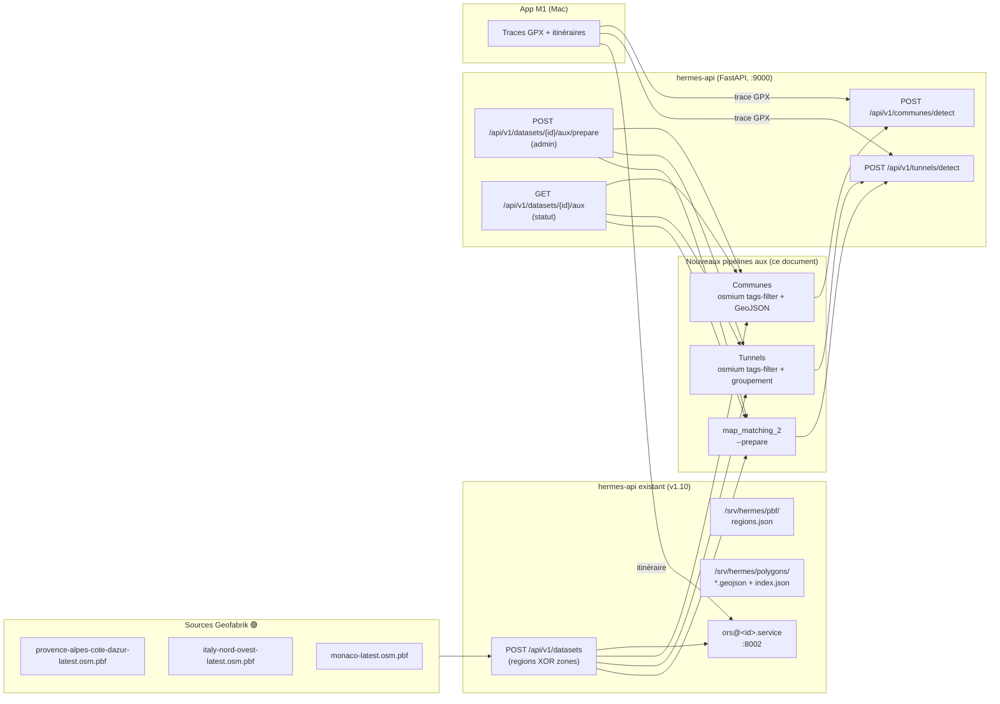
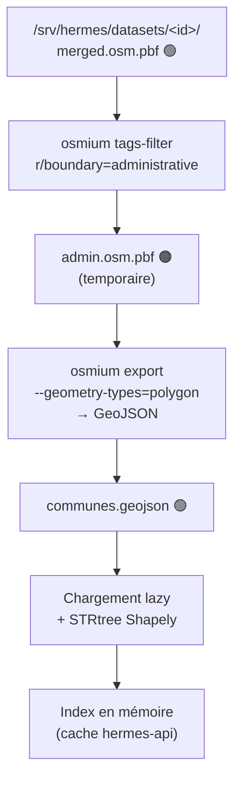
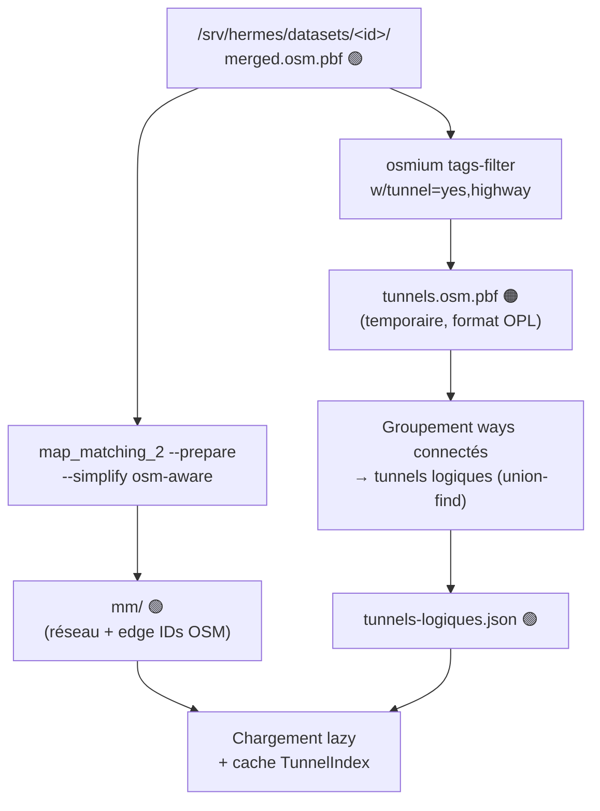
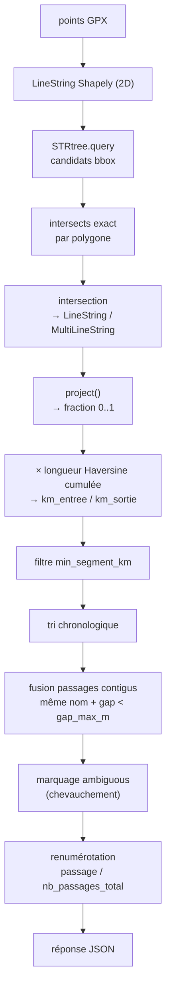
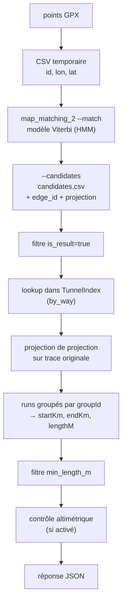
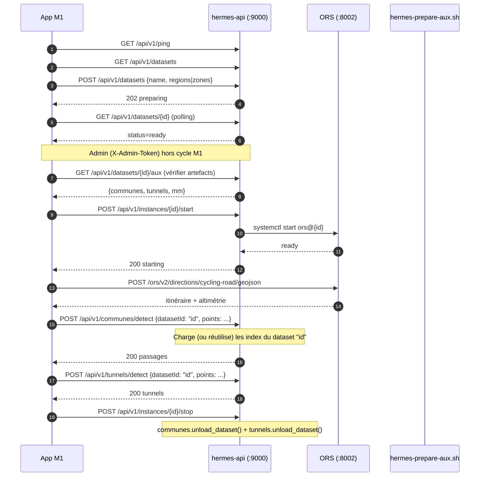

# Services d'enrichissement géographique — Serveur `hermes`

> Document de référence. Spécifie les deux services **Communes** et **Tunnels** au contrôleur `hermes-api` existant, en cohérence avec l'architecture `hermes` (ref_tech.md v1.10, hermes.md v1.10, hermes-api-contract.md v1.10). Décrit les pipelines de génération des artefacts auxiliaires par dataset, les interfaces REST, les algorithmes et l'intégration dans le service systemd `hermes-api.service`.
>
> **Version 1.10 — 9 novembre 2026.** Voir §14 (Changements v1.10) pour les écarts vs v1.0.

**Légende :**
- 🟢 **À conserver** : indispensable, ou regénérable seulement au prix d'un retéléchargement / recalcul coûteux.
- 🟠 **Temporaire** : regénérable en quelques minutes depuis les sources et les polygones.

---

## 1. Vue d'ensemble



**Trois services, un seul contrôleur.** Les deux nouveaux services sont **intégrés dans `hermes-api`** (même venv, même service systemd `hermes-api.service`, même port 9000, même préfixe `/api/v1`). Aucun nouveau service systemd, aucun nouveau port, aucune nouvelle dépendance système critique. Seuls des modules Python (`app/communes.py`, `app/tunnels.py`, `app/aux.py`) et des routes sont ajoutés.

**Artefacts stockés par dataset**, dans `/srv/hermes/datasets/<id>/` aux côtés de `graphs/`, `elevation_cache/`, `logs/` et `manifest.json` — cohérent avec l'arborescence hermes existante.

**Un seul dataset en mémoire à la fois.** Comme pour ORS (une seule instance active), les index communes et tunnels d'un seul dataset sont chargés en mémoire. Le client précise `datasetId` dans chaque requête ; le serveur décharge les index du dataset précédent si nécessaire. Pas de cache multi-datasets, pas de LRU.

---

## 2. Rappel de l'architecture `hermes` (v1.10)

| Élément | Valeur |
|---|---|
| Contrôleur | `hermes-api.service` (FastAPI + uvicorn), port **9000**, bind `10.15.58.131:9000` |
| Préfixe API | `/api/v1` |
| UI admin | `/admin` (Jinja2 + SPA JS) |
| ORS | `ors@<id>.service`, port **8002**, `-Xmx4g`, profils `driving-car` + `cycling-road` |
| Datasets | `/srv/hermes/datasets/<id>/` (graphs/, elevation_cache/, logs/, manifest.json, ors-config.yml, **merged.osm.pbf**) |
| PBF régionaux | `/srv/hermes/pbf/` (regions.json + fichiers .osm.pbf + .poly) |
| Polygones custom | `/srv/hermes/polygons/` (.geojson + index.json, supprimé si vide — T57-C) |
| Config unifiée | `/etc/hermes/hermes.conf` (640 root:hermes-api) |
| Comptes | `jmbaubet` (admin), `ors`, `hermes-api` ; groupes `hermes-datasets`, `systemd-journal` |
| Accès distant | ZeroTier `10.15.58.131` |
| Veille | Timer 5 min, grâce 15 min, signaux `build-lock`, **`aux-prepare-lock`**, `ssh`, `connection` |
| WoL | UDP/9 vers `87.91.31.205` (box FAI), MAC `68:5b:35:a8:5c:65` |
| **map_matching_2** | **v1.2.1 AppImage**, `/opt/map-matching-2/map_matching_2.AppImage` |
| **shapely** | **v2.2.0** (venv `hermes-api`) |

**Aucun changement à cette architecture.** Les nouveaux services s'y greffent.

---

## 3. Décisions d'architecture pour les nouveaux services

### 3.1 Intégration dans `hermes-api` (pas de service séparé)

- **Même venv** (`/opt/hermes-api/venv`), **même service systemd**, **même port 9000**.
- **Dépendances ajoutées** :
  - `shapely` 2.2.0 (Phase C, wheels précompilés Python 3.12 / Ubuntu 24.04)
  - `map_matching_2` 1.2.1 AppImage (Phase D, `/opt/map-matching-2/`)
  - Aucune dépendance système (pas de libosmium, pas de Boost, pas de compilation)
- **Nouvelles routes** sous le préfixe existant `/api/v1`.
- **Nouveaux modules** : `app/communes.py`, `app/tunnels.py`, `app/aux.py`.

### 3.2 Pas de PostGIS, un seul dataset en mémoire

Stockage GeoJSON + chargement en mémoire avec `STRtree` de Shapely 2.x.

- Un dataset PACA : **~960 communes** après filtre `admin_level=8`, **~1276 relations** en mémoire (toutes avec `admin_level`), **~25-30 Mo RSS**.
- **Un seul dataset chargé à la fois** en mémoire, comme pour ORS (une seule instance active).
- Chargement **lazy** au premier appel pour un `datasetId`, puis **conservation en mémoire** tant que les appels portent sur ce même dataset.
- Si un appel ultérieur demande un **autre** `datasetId`, les index courants sont **déchargés** et les nouveaux **chargés** — pas de cache multi-datasets, pas de LRU.
- `POST /api/v1/instances/{id}/stop` purge explicitement les index pour libérer la mémoire immédiatement.
- Aucune dépendance à un serveur PostgreSQL.

### 3.3 Pas de symlink "actif"

Contrairement à une version antérieure de ce document, **`hermes` n'utilise pas de symlink `datasets/active`**. Chaque dataset est un dossier autonome dans `/srv/hermes/datasets/<id>/`, et une seule instance ORS tourne à la fois.

Conséquence : le client M1 précise `datasetId` dans chaque requête communes/tunnels. C'est cohérent avec `POST /instances/{id}/start`, qui demande déjà au client de nommer le dataset.

### 3.4 Artefacts auxiliaires générés à la demande (pas à chaque build)

Le build ORS (`prepare_dataset`) reste **inchangé** : il produit `graphs/`, `elevation_cache/`, `logs/`, `manifest.json`, `ors-config.yml`. Il ne génère **pas** les artefacts communes/tunnels — pour ne pas allonger un build déjà long (525 s PACA, ~26 min PACA+Italie NW).

Les artefacts auxiliaires sont générés **séparément**, via :
- **Endpoint admin** `POST /api/v1/datasets/{id}/aux/prepare` (déclenchement à la demande).
- **Script CLI** `hermes-prepare-aux.sh <dataset_id>` (pour usage manuel ou scripté).

Cette séparation permet :
- de préparer les communes/tunnels pour un dataset **existant**, sans rebuild ORS.
- de préparer plusieurs datasets en séquence (chaque appel est indépendant).
- de ne pas bloquer la veille inutilement (le lock aux n'est posé que pendant la génération aux, pas pendant toute la vie du dataset).

### 3.5 Auth : pas de token pour les routes M1

Cohérent avec les routes M1 existantes (`GET /api/v1/datasets`, `POST /api/v1/datasets`, `POST /api/v1/instances/{id}/start`), les routes communes/tunnels sont **accessibles sans authentification** — protégées uniquement par le réseau ZeroTier privé.

Seule la route de **préparation aux** (`POST /api/v1/datasets/{id}/aux/prepare`) est **admin** (`X-Admin-Token`), cohérent avec `POST/PUT/DELETE /api/v1/regions`.

---

## 4. Artefacts auxiliaires par dataset

Pour chaque dataset `<id>` dans `/srv/hermes/datasets/<id>/`, trois artefacts auxiliaires sont générés :

```
/srv/hermes/datasets/<id>/
├── 🟢 merged.osm.pbf                          # dataset fusionné (nom canonique A1)
├── 🟢 manifest.json                            # manifest existant
├── 🟢 ors-config.yml                           # config ORS existante
├── 🟢 graphs/                                  # graphe ORS existant
├── 🟢 elevation_cache/                         # SRTM existant
├── 🟢 logs/                                    # logs existants
│
├── 🟢 communes.geojson                         # ← NOUVEAU (Phase C)
├── 🟢 tunnels-logiques.json                    # ← NOUVEAU (Phase D)
└── 🟢 mm/                                      # ← NOUVEAU (Phase D, réseau map-matching-2)
    ├── graph.bin
    ├── index.bin
    └── tags.bin
```

| Artefact | Taille indicative | Rôle |
|---|---|---|
| `merged.osm.pbf` | 3 Mo (Monaco) / 350 Mo (PACA) | PBF source du dataset (A1) |
| `communes.geojson` | 67 Ko (Monaco) / 27 Mo (PACA) | Relations `boundary=administrative` |
| `tunnels-logiques.json` | 12 Ko (Monaco) / ~500 Ko (PACA) | Tunnels groupés par ways connectés OSM (union-find) |
| `mm/` | 2.4 Mo (Monaco) / 50-200 Mo (PACA) | Réseau map-matching-2 préparé (edge IDs OSM) |

**Tous 🟢 à conserver** : régénérables en quelques minutes (Monaco : 1 s ; PACA : 10-15 min pour `mm/`), mais coûteux si systématiquement refaits.

**Permissions validées Phase E** :
- `communes.geojson`, `tunnels-logiques.json` : `640` (hermes-api:hermes-datasets)
- `mm/` : **dossier `750` (bit `x` obligatoire)**, fichiers `640`
- **Piège** : `chmod -R 640 mm/` rend le dossier non-traversable → `mm.modifiedAt=null` dans `GET /aux`. Le script `hermes-prepare-aux.sh` corrige automatiquement via `chmod 750 "$MM_DIR" && find "$MM_DIR" -type f -exec chmod 640 {} \;`.

---

## 5. Pipelines de génération des artefacts auxiliaires

### 5.1 Pipeline Communes



**Commandes (validées Phase C, `hermes-prepare-aux.sh`)** :

```bash
DATASET=/srv/hermes/datasets/<id>

# 1. Extraction des relations administratives (tous niveaux utiles)
osmium tags-filter "$DATASET/merged.osm.pbf" \
    r/boundary=administrative \
    -o /tmp/admin.osm.pbf --overwrite

# 2. Export en GeoJSON (--geometry-types CRUCIAL — A11)
osmium export /tmp/admin.osm.pbf \
    -f geojson --geometry-types=polygon,multipolygon \
    -o /tmp/communes.geojson --overwrite

# 3. Install atomique (mv, pas cp)
mv /tmp/communes.geojson "$DATASET/communes.geojson"
chmod 640 "$DATASET/communes.geojson"
rm -f /tmp/admin.osm.pbf
```

**Sans `--geometry-types`**, `osmium export` exporte aussi les **member ways des relations** (routes, rivières, etc.) → **45 Mo au lieu de 27 Mo** (PACA), avec **48 351 features au lieu de 1 506** (dont **42 220 sans `admin_level`**). A11.

**Temps mesuré (PACA, ~350 Mo PBF)** : ~20 s. Monaco : ~10 s.

**Mapping `admin_level` par pays** (appliqué au **chargement**, pas à l'extraction) :

| Pays | `admin_level` commune | Remarque |
|---|---|---|
| France | `8` | commune |
| Espagne | `8` | municipio |
| Italie | `8` | comune |
| Suisse | `8` | commune / Gemeinde |
| **Monaco** | **`8`** | **commune** (A4 confirmé 9 nov. 2026 : Monaco a `admin_level=2` pays + `admin_level=8` commune + `admin_level=10` quartiers — **pas de `admin_level=4`**) |

Le filtre d'extraction garde les niveaux `4, 6, 8` et plus ; le filtre de chargement (`_accept`) sélectionne le niveau correct selon `ISO3166-1:alpha2` (ou fallback `"8"` pour les pays non mappés, avec WARNING **dédupliqué** via `_warned_countries`).

### 5.2 Pipeline Tunnels



**Commandes (validées Phase D, `hermes-prepare-aux.sh`)** :

```bash
DATASET=/srv/hermes/datasets/<id>

# 1. Extraction des ways tunnels routiers (format OPL, plus rapide à parser)
osmium tags-filter "$DATASET/merged.osm.pbf" \
    w/tunnel=yes,highway -f opl \
    -o /tmp/tunnels.opl --overwrite

# 2. Groupement des ways connectés → tunnels logiques
python3 /opt/hermes-api/scripts/group_tunnels.py \
    /tmp/tunnels.opl /tmp/tunnels-logiques.json

# 3. Install
mv /tmp/tunnels-logiques.json "$DATASET/tunnels-logiques.json"
chmod 640 "$DATASET/tunnels-logiques.json"
rm -f /tmp/tunnels.opl

# 4. Préparation du réseau map-matching-2
mkdir -p "$DATASET/mm"
/opt/map-matching-2/map_matching_2.AppImage --prepare \
    --file "$DATASET/merged.osm.pbf" \
    --output "$DATASET/mm" \
    --simplify osm-aware \
    --verbose
# ATTENTION : dossier 750 (bit x obligatoire), fichiers 640
chmod 750 "$DATASET/mm"
find "$DATASET/mm" -type f -exec chmod 640 {} \;
```

**Temps mesuré** : Monaco (~1 s pour mm, ~30 s total), PACA (~5-10 min pour `mm`, ~10 s extraction).

**A12 — `--simplify osm-aware`** : préserve les IDs OSM des ways, indispensable pour que les `edge_ids` du match correspondent aux `wayIds` du `tunnels-logiques.json`.

**Format `tunnels-logiques.json` (A2 — `wayIds` SANS préfixe `w`)** :

```json
[
  {
    "groupId": "g-503230507",
    "name": "Tunnel Rainier III",
    "wayIds": ["503230507", "944079968", "1327492342", "1327492343"]
  }
]
```

**Pourquoi sans préfixe `w`** : `map_matching_2 --match` retourne les edge IDs comme entiers nus (`164338236,851792661,...`). `TunnelIndex.by_way` utilise donc des clés str sans préfixe. Le code tolère néanmoins `w123` à la lecture (`wid.lstrip("w")`) pour compatibilité avec d'éventuels anciens formats.

**Groupement des ways connectés (Python, parseur OPL, pas de pyosmium)** :

```python
# /opt/hermes-api/scripts/group_tunnels.py
import json
import sys
from pathlib import Path


def parse_opl(line: str):
    """Parse une ligne OPL de way. Retourne (way_id, nodes, tags) ou None."""
    fields = line.split()
    if not fields or not fields[0].startswith("w"):
        return None
    try:
        way_id = int(fields[0][1:])
    except ValueError:
        return None
    tags, nodes = {}, []
    for f in fields[1:]:
        if f.startswith("T"):
            for kv in f[1:].split(","):
                if "=" in kv:
                    k, v = kv.split("=", 1)
                    tags[k] = v
        elif f.startswith("N"):
            try:
                nodes = [int(n[1:]) for n in f[1:].split(",") if n.startswith("n")]
            except ValueError:
                nodes = []
    return way_id, nodes, tags


def group_tunnels(opl_in: Path, json_out: Path) -> None:
    ways: dict[int, dict] = {}
    node_to_ways: dict[int, list[int]] = {}

    with opl_in.open() as f:
        for line in f:
            parsed = parse_opl(line)
            if not parsed:
                continue
            way_id, nodes, tags = parsed
            ways[way_id] = {"nodes": nodes, "tags": tags}
            for n in nodes:
                node_to_ways.setdefault(n, []).append(way_id)

    # Union-find sur les node IDs partagés
    parent = {wid: wid for wid in ways}

    def find(x):
        while parent[x] != x:
            parent[x] = parent[parent[x]]
            x = parent[x]
        return x

    for wid_list in node_to_ways.values():
        for i in range(1, len(wid_list)):
            ra, rb = find(wid_list[0]), find(wid_list[i])
            if ra != rb:
                parent[rb] = ra

    groups: dict[int, list[int]] = {}
    for wid in ways:
        groups.setdefault(find(wid), []).append(wid)

    out = []
    for root, wids in groups.items():
        nom = next(
            (ways[w]["tags"].get("name") for w in wids
             if ways[w]["tags"].get("name")),
            None,
        )
        out.append({
            "groupId": f"g-{root}",
            "name": nom,
            "wayIds": [str(w) for w in wids],  # A2 : sans préfixe w
        })

    json_out.write_text(json.dumps(out, indent=2, ensure_ascii=False))
    print(f"[group_tunnels] {len(out)} tunnel(s) logique(s) écrit(s) dans {json_out}")


if __name__ == "__main__":
    if len(sys.argv) != 3:
        print("Usage: group_tunnels.py <input.opl> <output.json>", file=sys.stderr)
        sys.exit(1)
    group_tunnels(Path(sys.argv[1]), Path(sys.argv[2]))
```

**Limitation connue** : les groups union-find peuvent mélanger un tunnel avec la route de surface à son entrée (nœud partagé). Ex : Monaco, `Boulevard du Jardin Exotique` est un group "tunnel" à cause d'un nœud partagé avec `Tunnel Rainier III`. Un filtre `minLengthM=200` (côté client, `params.minLengthM`) élimine les fragments < 200 m.

### 5.3 Orchestration : `hermes-prepare-aux.sh`

```bash
#!/usr/bin/env bash
# /opt/hermes-api/scripts/hermes-prepare-aux.sh
# Usage : hermes-prepare-aux.sh <dataset_id> [--force] [--skip-mm]
set -euo pipefail

DATASET_ID="${1:-}"
[[ -z "$DATASET_ID" ]] && { echo "Usage: $0 <dataset_id> [--force] [--skip-mm]" >&2; exit 2; }
shift || true

FORCE=0; SKIP_MM=0
while [[ $# -gt 0 ]]; do
    case "$1" in
        --force)   FORCE=1; shift ;;
        --skip-mm) SKIP_MM=1; shift ;;
        *) echo "Option inconnue: $1" >&2; exit 2 ;;
    esac
done

DATASET="/srv/hermes/datasets/$DATASET_ID"
[[ -d "$DATASET" ]] || { echo "[aux] dataset '$DATASET_ID' inexistant" >&2; exit 1; }
PBF="$DATASET/merged.osm.pbf"
[[ -f "$PBF" ]] || { echo "[aux] PBF source manquant: $PBF" >&2; exit 1; }

MM_BINARY="/opt/map-matching-2/map_matching_2.AppImage"
GROUP_SCRIPT="/opt/hermes-api/scripts/group_tunnels.py"
log() { echo "[aux] $*"; }

# --- Communes ---
COMMUNES="$DATASET/communes.geojson"
if [[ $FORCE -eq 1 ]] || [[ ! -f "$COMMUNES" ]]; then
    log "extraction communes (tags-filter)..."
    osmium tags-filter "$PBF" r/boundary=administrative \
        -o "$DATASET/_admin.osm.pbf" --overwrite
    log "export communes (geojson, geometry-types=polygon)..."
    osmium export "$DATASET/_admin.osm.pbf" -f geojson \
        --geometry-types=polygon,multipolygon \
        -o "$COMMUNES.tmp" --overwrite
    mv "$COMMUNES.tmp" "$COMMUNES"
    chmod 640 "$COMMUNES"
    rm -f "$DATASET/_admin.osm.pbf"
    log "communes.geojson ($(stat -c%s "$COMMUNES") octets)"
else
    log "communes.geojson déjà présent (skip)"
fi

# --- Tunnels ---
TUNNELS="$DATASET/tunnels-logiques.json"
if [[ $FORCE -eq 1 ]] || [[ ! -f "$TUNNELS" ]]; then
    log "extraction tunnels (tags-filter, opl)..."
    osmium tags-filter "$PBF" w/tunnel=yes,highway -f opl \
        -o "$DATASET/_tunnels.opl" --overwrite
    log "groupement ways connectés..."
    python3 "$GROUP_SCRIPT" "$DATASET/_tunnels.opl" "$TUNNELS.tmp"
    mv "$TUNNELS.tmp" "$TUNNELS"
    chmod 640 "$TUNNELS"
    rm -f "$DATASET/_tunnels.opl"
    log "tunnels-logiques.json ($(stat -c%s "$TUNNELS") octets)"
else
    log "tunnels-logiques.json déjà présent (skip)"
fi

# --- mm/ ---
if [[ $SKIP_MM -eq 0 ]]; then
    MM_DIR="$DATASET/mm"
    if [[ $FORCE -eq 1 ]] || [[ ! -d "$MM_DIR" ]] || [[ -z "$(ls -A "$MM_DIR" 2>/dev/null)" ]]; then
        [[ -x "$MM_BINARY" ]] || { echo "[aux] map_matching_2 absent: $MM_BINARY" >&2; exit 1; }
        log "préparation réseau map-matching (peut prendre 5-15 min)..."
        mkdir -p "$MM_DIR"
        "$MM_BINARY" --prepare \
            --file "$PBF" --output "$MM_DIR" \
            --simplify osm-aware --verbose
        chmod 750 "$MM_DIR"
        find "$MM_DIR" -type f -exec chmod 640 {} \;
        log "mm/ prêt ($(du -sh "$MM_DIR" | cut -f1))"
    else
        log "mm/ déjà présent (skip)"
    fi
else
    log "mm/ ignoré (--skip-mm)"
fi

log "préparation aux terminée pour dataset=$DATASET_ID"
```

**Exécution :**

```bash
sudo -u hermes-api /opt/hermes-api/scripts/hermes-prepare-aux.sh provence-alpes-cote-dazur
```

Le script est **idempotent** : `--force` régénère tout, sans `--force` skip les artefacts présents, `--skip-mm` ignore `mm/` (rapide, juste communes + tunnels).

---

## 6. Interfaces REST

Toutes les nouvelles routes sont sous `/api/v1`, comme les routes existantes. Le format de réponse suit les conventions hermes (`snake_case` côté Pydantic, `camelCase` côté JSON via `alias`).

### 6.1 `POST /api/v1/communes/detect`

Détecte les communes traversées par une trace GPX.

**Contrat Pydantic v2 :**

```python
from pydantic import BaseModel, ConfigDict, Field

class CommuneParams(BaseModel):
    model_config = ConfigDict(populate_by_name=True, serialize_by_alias=True)

    admin_level: Optional[str] = Field(default=None, alias="adminLevel",
        description="Force un admin_level OSM. Défaut : mapping par pays.")
    min_segment_km: float = Field(default=0.005, alias="minSegmentKm", ge=0.0)
    gap_max_m: float = Field(default=50.0, alias="gapMaxM", ge=0.0)

class CommunePassage(BaseModel):
    model_config = ConfigDict(populate_by_name=True, serialize_by_alias=True)

    commune: str
    passage: int
    nb_passages_total: int = Field(alias="nbPassagesTotal")
    km_entree: float = Field(alias="kmEntree")
    km_sortie: float = Field(alias="kmSortie")
    longueur_km: float = Field(alias="longueurKm")
    ambiguous: bool = False

class CommunesDetectRequest(BaseModel):
    model_config = ConfigDict(populate_by_name=True)

    trace_id: str = Field(alias="traceId")
    dataset_id: str = Field(alias="datasetId")
    points: list[list[float]] = Field(..., description="[lon, lat] ou [lon, lat, ele]")
    params: CommuneParams = Field(default_factory=CommuneParams)

class CommunesDetectResponse(BaseModel):
    model_config = ConfigDict(populate_by_name=True, serialize_by_alias=True)

    trace_id: str = Field(alias="traceId")
    dataset_id: str = Field(alias="datasetId")
    detected_at: str = Field(alias="detectedAt")
    passages: list[CommunePassage]
```

**Exemple de requête :**

```json
{
  "traceId": "t-20261109-01",
  "datasetId": "provence-alpes-cote-dazur",
  "points": [
    [7.24152, 44.05123, 985.4],
    [7.24320, 44.05281, 987.1]
  ],
  "params": {
    "adminLevel": "8",
    "minSegmentKm": 0.005,
    "gapMaxM": 50.0
  }
}
```

**Exemple de réponse (runtime validé Phase C) :**

```json
{
  "traceId": "t-nice-monaco",
  "datasetId": "provence-alpes-cote-dazur",
  "detectedAt": "2026-11-09T12:52:20Z",
  "passages": [
    {"commune": "Nice", "passage": 1, "nbPassagesTotal": 1,
     "kmEntree": 0.0, "kmSortie": 6.685, "longueurKm": 6.685, "ambiguous": false},
    {"commune": "Villefranche-sur-Mer", "passage": 1, "nbPassagesTotal": 1,
     "kmEntree": 6.685, "kmSortie": 7.535, "longueurKm": 0.85, "ambiguous": false},
    {"commune": "Èze", "passage": 1, "nbPassagesTotal": 1,
     "kmEntree": 7.535, "kmSortie": 12.691, "longueurKm": 5.156, "ambiguous": false},
    {"commune": "La Turbie", "passage": 1, "nbPassagesTotal": 1,
     "kmEntree": 12.691, "kmSortie": 12.995, "longueurKm": 0.304, "ambiguous": false},
    {"commune": "Cap-d'Ail", "passage": 1, "nbPassagesTotal": 1,
     "kmEntree": 12.995, "kmSortie": 13.423, "longueurKm": 0.428, "ambiguous": false}
  ]
}
```

**Codes HTTP :**

| Code | Cas |
|---|---|
| `200` | Succès, même si `passages: []` |
| `404` | `datasetId` inconnu, ou `communes.geojson` absent (dataset non préparé) |
| `422` | Moins de 2 points, coordonnées invalides |
| `500` | Erreur interne (index corrompu, GeoJSON invalide) |

**Performances runtime (PACA, Mac mini 2012)** :
- Premier appel : **2.2 s** (parse 27 Mo + STRtree).
- Appels suivants : **17 ms** (index en mémoire).

### 6.2 `POST /api/v1/tunnels/detect`

Détecte les tunnels traversés par une trace GPX.

**Contrat Pydantic v2 :**

```python
class TunnelParams(BaseModel):
    model_config = ConfigDict(populate_by_name=True, serialize_by_alias=True)

    min_length_m: float = Field(default=50.0, alias="minLengthM", ge=0.0)
    altimetric_check: bool = Field(default=False, alias="altimetricCheck")
    altimetric_tolerance_m: float = Field(default=30.0, alias="altimetricToleranceM", ge=0.0)

class Tunnel(BaseModel):
    model_config = ConfigDict(populate_by_name=True, serialize_by_alias=True)

    id: str
    group_id: Optional[str] = Field(default=None, alias="groupId")
    name: Optional[str] = None
    start_km: float = Field(alias="startKm")
    end_km: float = Field(alias="endKm")
    length_m: float = Field(alias="lengthM")
    way_ids: list[str] = Field(default_factory=list, alias="wayIds")
    altimetric_ok: Optional[bool] = Field(default=None, alias="altimetricOk")

class TunnelsDetectRequest(BaseModel):
    model_config = ConfigDict(populate_by_name=True)

    trace_id: str = Field(alias="traceId")
    dataset_id: str = Field(alias="datasetId")
    points: list[list[float]] = Field(...)
    params: TunnelParams = Field(default_factory=TunnelParams)

class TunnelsDetectResponse(BaseModel):
    model_config = ConfigDict(populate_by_name=True, serialize_by_alias=True)

    version: int = 1
    trace_id: str = Field(alias="traceId")
    dataset_id: str = Field(alias="datasetId")
    detected_at: str = Field(alias="detectedAt")
    params: TunnelParams
    tunnels: list[Tunnel]
```

**Exemple de requête :**

```json
{
  "traceId": "t-tunnel-01",
  "datasetId": "test-monaco-ds",
  "points": [
    [7.4201, 43.7382, 45.0],
    [7.4215, 43.7390, 48.2]
  ],
  "params": {
    "minLengthM": 50.0,
    "altimetricCheck": false,
    "altimetricToleranceM": 30.0
  }
}
```

**Exemple de réponse (runtime validé Phase D — Monaco)** :

```json
{
  "version": 1,
  "traceId": "t-tunnel-01",
  "datasetId": "test-monaco-ds",
  "detectedAt": "2026-11-09T20:06:23Z",
  "params": {
    "minLengthM": 50.0,
    "altimetricCheck": false,
    "altimetricToleranceM": 30.0
  },
  "tunnels": []
}
```

**Interprétation `tunnels: []` (Monaco)** : **vrai négatif confirmé**. Les 3 points du test sont sur le Boulevard du Jardin Exotique **en surface**, pas dans le Tunnel Rainier III **en dessous**. Voir §11 pour la limitation et §7.2 pour le pipeline.

**Codes HTTP :**

| Code | Cas |
|---|---|
| `200` | Succès, même si `tunnels: []` |
| `404` | `datasetId` inconnu, ou `tunnels-logiques.json` / `mm/` absent |
| `422` | Moins de 2 points, coordonnées invalides |
| `500` | `map_matching_2` absent, timeout, ou erreur interne |

### 6.3 `POST /api/v1/datasets/{id}/aux/prepare` — **admin**

Déclenche la génération des artefacts auxiliaires. Route **admin** (`X-Admin-Token`).

**Contrat Pydantic v2 :**

```python
class AuxPrepareRequest(BaseModel):
    model_config = ConfigDict(populate_by_name=True)

    force: bool = False
    skip_mm: bool = Field(default=False, alias="skipMm")

class AuxPrepareResponse(BaseModel):
    model_config = ConfigDict(populate_by_name=True, serialize_by_alias=True)

    dataset_id: str = Field(alias="datasetId")
    status: str
    started_at: str = Field(alias="startedAt")
    message: Optional[str] = None
```

**Comportement runtime validé (Phase E)** :

- Vérifie que le dataset existe (`404` si absent).
- Vérifie qu'aucun **build ORS** n'est en cours (`/run/hermes-api/build.lock`). Si oui → **409**.
- Pose un **lock spécifique** `/run/hermes-api/aux-prepare.lock` (anti-race double-clic). Si déjà posé → **409**.
- Écrit `/run/hermes-api/aux-started-at` (ISO timestamp).
- Lance `hermes-prepare-aux.sh` en tâche de fond (`asyncio.create_task`).
- À la fin, invalide l'index en mémoire si le dataset préparé est celui actuellement chargé (`unload` conditionnel communes + tunnels).
- Retourne `202` avec `status: "preparing"`.

**Exemple de requête :**

```json
{"force": false, "skipMm": false}
```

**Exemple de réponse :**

```json
{
  "datasetId": "test-monaco-ds",
  "status": "preparing",
  "startedAt": "2026-11-09T20:40:44Z",
  "message": "Préparation en tâche de fond. Consulter GET /datasets/{id}/aux"
}
```

**Codes HTTP :**

| Code | Cas |
|---|---|
| `202` | Préparation lancée |
| `401` | Token absent ou invalide |
| `404` | Dataset inconnu |
| `409` | Build ORS en cours, ou préparation aux déjà en cours |
| `500` | Erreur interne |

**Timeout** : `AUX_PREPARE_TIMEOUT_S = 1800` (30 min, couvre `mm/` PACA).

### 6.4 `GET /api/v1/datasets/{id}/aux` — statut (M1 + admin)

Retourne l'état des artefacts auxiliaires **sur disque** et précise si les index sont actuellement **chargés en mémoire**.

**Contrat Pydantic v2 :**

```python
class AuxFileStatus(BaseModel):
    model_config = ConfigDict(populate_by_name=True, serialize_by_alias=True)

    name: str
    exists: bool
    size_bytes: Optional[int] = Field(default=None, alias="sizeBytes")
    modified_at: Optional[str] = Field(default=None, alias="modifiedAt")

class AuxStatusResponse(BaseModel):
    model_config = ConfigDict(populate_by_name=True, serialize_by_alias=True)

    dataset_id: str = Field(alias="datasetId")
    communes: AuxFileStatus
    tunnels: AuxFileStatus
    mm: AuxFileStatus
    preparing: bool
    started_at: Optional[str] = Field(default=None, alias="startedAt")
    last_error: Optional[str] = Field(default=None, alias="lastError")
    loaded_in_memory: bool = Field(alias="loadedInMemory")
    active_dataset: Optional[str] = Field(default=None, alias="activeDataset")
```

**Exemple de réponse (runtime validé Phase E)** :

```json
{
  "datasetId": "test-monaco-ds",
  "communes": {
    "name": "communes.geojson",
    "exists": true,
    "sizeBytes": 67140,
    "modifiedAt": "2026-11-09T20:40:45Z"
  },
  "tunnels": {
    "name": "tunnels-logiques.json",
    "exists": true,
    "sizeBytes": 12519,
    "modifiedAt": "2026-11-09T20:40:45Z"
  },
  "mm": {
    "name": "mm/",
    "exists": true,
    "sizeBytes": 2402864,
    "modifiedAt": "2026-11-09T20:40:45Z"
  },
  "preparing": false,
  "startedAt": null,
  "lastError": null,
  "loadedInMemory": false,
  "activeDataset": null
}
```

**`loadedInMemory` et `activeDataset`** : permettent au client ou à l'admin de savoir quel dataset occupe actuellement les ~25-30 Mo de cache — utile pour le diagnostic.

**`mm.sizeBytes`** : somme récursive des fichiers dans `mm/`. **`mm.modifiedAt` est `null` si le dossier n'est pas traversable** (bug `chmod -R 640` → fix `chmod 750 mm/`, A14).

Route **non-admin** (utilisable par M1 pour vérifier qu'un dataset est prêt avant d'envoyer une trace).

### 6.5 Résumé des nouvelles routes

| Méthode | Route | Auth | Rôle |
|---|---|---|---|
| `POST` | `/api/v1/communes/detect` | — | Détection communes (M1) |
| `POST` | `/api/v1/tunnels/detect` | — | Détection tunnels (M1) |
| `POST` | `/api/v1/datasets/{id}/aux/prepare` | `X-Admin-Token` | Génération aux (admin) |
| `GET`  | `/api/v1/datasets/{id}/aux` | — | Statut artefacts (M1 + admin) |

**Toutes les routes existantes `hermes` restent inchangées.**

---

## 7. Algorithmes détaillés

### 7.1 Communes — pipeline exact



**Principes actés (validés en runtime et tests)** :

- **Aucune simplification** de la trace (pas de Douglas-Peucker). Shapely traite sans problème une trace de 10 000 points en quelques dizaines de millisecondes.
- **Aucun échantillonnage**. On intersecte la ligne complète.
- **`minSegmentKm = 5 m`** par défaut (A8), filtre le bruit numérique (points doubles, arrondi). Pas pour absorber un village.
- **`gapMaxM = 50 m`** par défaut (A9), fusion des passages contigus de même nom (ex : Nice → Monaco 8 m → Nice, fusionné en un seul Nice).
- **Ordre critique (A8 + A9)** : intersections brutes → **filtre `minSegmentKm`** → tri → **fusion `gapMaxM`** → ambiguous → renumérotation.
- **Fusion** : après filtrage, on fusionne uniquement les passages **adjacents de même nom** (gap < 50 m). Un petit passage de Monaco entre deux Nice **bloque** la fusion (sauf s'il a été retiré par `minSegmentKm`).
- **`ambiguous`** : si deux passages de communes différentes se chevauchent de plus de 1 m (imprécision OSM sur les frontières), les deux sont marqués `ambiguous: true`.

**Calcul des bornes kilométriques :**

```python
def passage_communes(points, index, params):
    # Ligne 2D (ignore l'élévation, I4)
    coords = [(p[0], p[1]) for p in points]
    line = LineString(coords)
    if line.length == 0:
        return []
    total_km = sum(haversine_km(points[i - 1], points[i])
                   for i in range(1, len(points)))
    if total_km == 0:
        return []

    raw = []
    for _idx, name, geom in index.query(line, forced_level=params.admin_level):
        inter = line.intersection(geom)
        if inter.is_empty:
            continue
        segs = list(inter.geoms) if hasattr(inter, "geoms") else [inter]
        for seg in segs:
            if seg.is_empty or seg.length == 0:
                continue
            # Normalisation de l'ordre (I5)
            d0 = line.project(Point(seg.coords[0]))
            d1 = line.project(Point(seg.coords[-1]))
            f0, f1 = min(d0, d1) / line.length, max(d0, d1) / line.length
            raw.append({"commune": name, "km_entree": f0 * total_km,
                        "km_sortie": f1 * total_km, "ambiguous": False})

    # Filtre (A8)
    filtered = [p for p in raw
                if (p["km_sortie"] - p["km_entree"]) >= params.min_segment_km]

    # Tri chronologique
    filtered.sort(key=lambda p: p["km_entree"])

    # Fusion (A9)
    gap_max_km = params.gap_max_m / 1000.0
    merged = []
    for p in filtered:
        if (merged and merged[-1]["commune"] == p["commune"]
                and (p["km_entree"] - merged[-1]["km_sortie"]) < gap_max_km):
            merged[-1]["km_sortie"] = p["km_sortie"]
        else:
            merged.append(dict(p))

    # ... (ambiguous + renumérotation)
```

**Tests unitaires : 13/13 verts** (`tests/test_communes.py`). Couvre : haversine, filtre, fusion, non-fusion, mapping pays, `adminLevel` forcé, ambiguous, dégénérés.

### 7.2 Tunnels — pipeline `map_matching_2`



**Principes actés (validés en runtime Phase D)** :

- **Map-matching par modèle de Markov caché** via `map_matching_2 --match`. La topologie de transition entre edges successifs remplace toute heuristique angulaire.
- **Croisement binaire** : un edge ID est dans le tunnel ou il n'y est pas. Pas de score pondéré distance/angle.
- **Regroupement par tunnel logique** via `tunnels-logiques.json` (union-find sur les ways connectés) : un tunnel de 1,6 km n'est pas rapporté comme 3 tronçons.
- **`minLengthM = 50 m`** par défaut pour éliminer les ponts ferroviaires et porches d'immeubles.
- **Contrôle altimétrique optionnel** (`altimetricCheck=true`) : vérifie que la variation suit le profil interpolé (entrée/sortie). **Ne peut pas forcer le choix du tunnel** — seulement valider un tunnel déjà matché.
- **`--candidates` (A13)** : `--edge_ids` seul ne donne pas la position sur la trace. `--candidates` fournit `edge_id`, `projection` (WKT POINT de la position exacte sur le réseau) et `is_result` (true si retenu dans le match final). On projette chaque `projection` sur la trace originale → `startKm/endKm` fiables.

**Extrait `_run_map_matching` (Phase D) :**

```python
def _run_map_matching(points, network_dir, tmpdir):
    tracks_csv = tmpdir / "tracks.csv"
    matches_csv = tmpdir / "matches.csv"
    candidates_csv = tmpdir / "candidates.csv"

    # 1. tracks.csv (id, lon, lat)
    with tracks_csv.open("w", newline="") as f:
        w = csv.writer(f)
        w.writerow(["id", "lon", "lat"])
        for p in points:
            w.writerow(["t", p[0], p[1]])

    # 2. Subprocess map_matching_2
    cmd = [
        MM_BINARY, "--match",
        "--input", str(network_dir),
        "--tracks", str(tracks_csv),
        "--output", str(tmpdir),
        "--filename", matches_csv.name,
        "--x", "lon", "--y", "lat",
        "--columns", "id,aborted",
        "--candidates", candidates_csv.name,
        "--candidates-columns", "id,edge_id,projection,is_result",
    ]
    proc = subprocess.run(cmd, capture_output=True, text=True,
                          timeout=MM_MATCH_TIMEOUT_S)

    # 3. Lire candidates.csv : filtrer is_result=true
    candidates = []
    with candidates_csv.open() as f:
        for row in csv.DictReader(f):
            if row.get("is_result") != "true":
                continue
            proj = row.get("projection") or ""
            # projection = "POINT(lon lat)" WKT
            x = float(proj.split("(")[1].split()[0])
            y = float(proj.split("(")[1].split()[1].rstrip(")"))
            candidates.append({"edge_id": row["edge_id"], "lon": x, "lat": y})
    return candidates
```

**Contrôle altimétrique (extrait) :**

```python
def _check_altimetric(points, start_km, end_km, tolerance_m):
    if not points or len(points[0]) < 3:
        return None  # pas d'élévation
    cumul_km = [0.0]
    for i in range(1, len(points)):
        cumul_km.append(cumul_km[-1] + haversine_km(points[i - 1], points[i]))
    window = [(k, p[2]) for k, p in zip(cumul_km, points)
              if start_km <= k <= end_km and len(p) >= 3]
    if len(window) < 2:
        return None
    alt_in, alt_out = window[0][1], window[-1][1]
    d_total = window[-1][0] - window[0][0]
    for k, alt in window:
        t = (k - window[0][0]) / d_total
        expected = alt_in + (alt_out - alt_in) * t
        if abs(alt - expected) > tolerance_m:
            return False
    return True
```

**Tests unitaires : 9/9 verts** (`tests/test_tunnels.py`). Couvre : `TunnelIndex` lookup, tolérance préfixe `w`, détection simple, filtre `minLengthM`, edges inconnus ignorés, contrôle altimétrique (3 cas), validation `points`.

---

## 8. Intégration dans `hermes-api`

### 8.1 Nouveaux modules Python

```
/opt/hermes-api/app/
├── main.py                        # existant (+4 routes)
├── config.py                      # existant
├── datasets.py                    # existant
├── regions.py                     # existant
├── polygons.py                    # existant
├── geofabrik.py                   # existant
├── auth.py                        # existant (require_admin)
├── timeutils.py                   # ← NOUVEAU (Phase C, `utcnow_iso()`)
├── communes.py                    # ← NOUVEAU (Phase C)
├── tunnels.py                     # ← NOUVEAU (Phase D)
└── aux.py                         # ← NOUVEAU (Phase E)
```

### 8.2 Nouveaux scripts

```
/opt/hermes-api/scripts/
├── hermes-idle-check.sh           # existant (+signal aux-prepare-lock)
├── group_tunnels.py               # ← NOUVEAU (Phase D)
└── hermes-prepare-aux.sh          # ← NOUVEAU (Phase E)
```

### 8.3 Chargement lazy — un seul dataset en mémoire

```python
# app/communes.py (extrait)
_lock = threading.Lock()
_active_dataset: Optional[str] = None
_commune_index: Optional[CommuneIndex] = None

def load_dataset(dataset_id: str) -> None:
    global _active_dataset, _commune_index
    with _lock:
        if dataset_id == _active_dataset and _commune_index is not None:
            return
        path = Path(f"/srv/hermes/datasets/{dataset_id}/communes.geojson")
        if not path.exists():
            raise FileNotFoundError(
                f"communes.geojson absent pour dataset '{dataset_id}'")
        _commune_index = None   # libération explicite
        _commune_index = CommuneIndex.from_geojson(path)
        _active_dataset = dataset_id
        logger.info("[aux] communes index loaded dataset=%s (%d relations)",
                    dataset_id, _commune_index.count)

def unload_dataset() -> None:
    global _active_dataset, _commune_index
    with _lock:
        if _commune_index is None:
            return
        logger.info("[aux] communes index unloaded dataset=%s", _active_dataset)
        _commune_index = None
        _active_dataset = None

def active_dataset() -> Optional[str]:
    return _active_dataset
```

**Idem dans `app/tunnels.py`** (avec `TunnelIndex`, `active_dataset()`, `load_dataset()`, `unload_dataset()`).

**Coût mémoire** : ~25-30 Mo pour le dataset actif (960 communes PACA + 1276 relations). Pas de multiplication : basculer décharge le précédent.

**Chargement atomique communes + tunnels** : les deux index du même dataset sont chargés ensemble, ou aucun. Évite un état incohérent (communes sur A, tunnels sur B).

**`DATASETS_ROOT` (Phase E)** : exposé comme constante module (`DATASETS_ROOT = Path("/srv/hermes/datasets")`) dans `aux.py`, pour permettre aux tests de rediriger vers `tmp_path` via `monkeypatch.setattr(aux, "DATASETS_ROOT", tmp_path / "datasets")`.

### 8.4 Nouvelles routes dans `main.py`

```python
# Imports (haut du fichier)
from . import aux, communes, config, datasets, geofabrik, poly, polygons, systemd, tunnels
from .aux import AuxPrepareRequest, AuxPrepareResponse, AuxStatusResponse
from .auth import require_admin
from .communes import (
    CommunesDetectRequest, CommunesDetectResponse,
    get_commune_index, passage_communes,
)
from .tunnels import (
    TunnelsDetectRequest, TunnelsDetectResponse, get_tunnel_index,
)
from .tunnels import detect as tunnels_detect_algo
from .timeutils import utcnow_iso

# ... app = FastAPI(lifespan=lifespan) ...

@app.post("/api/v1/communes/detect",
          response_model=CommunesDetectResponse,
          response_model_by_alias=True)
async def communes_detect(req: CommunesDetectRequest):
    try:
        idx = get_commune_index(req.dataset_id)
    except FileNotFoundError as exc:
        raise HTTPException(404, str(exc))
    try:
        passages = passage_communes(req.points, idx, req.params)
    except ValueError as exc:
        raise HTTPException(422, str(exc))
    return CommunesDetectResponse(
        traceId=req.trace_id, datasetId=req.dataset_id,
        detectedAt=utcnow_iso(), passages=passages)

@app.post("/api/v1/tunnels/detect",
          response_model=TunnelsDetectResponse,
          response_model_by_alias=True)
async def tunnels_detect(req: TunnelsDetectRequest):
    try:
        idx = get_tunnel_index(req.dataset_id)
    except FileNotFoundError as exc:
        raise HTTPException(404, str(exc))
    try:
        found = tunnels_detect_algo(req.points, req.dataset_id, idx, req.params)
    except ValueError as exc:
        raise HTTPException(422, str(exc))
    except FileNotFoundError as exc:
        raise HTTPException(404, str(exc))
    except RuntimeError as exc:
        raise HTTPException(500, str(exc))
    return TunnelsDetectResponse(
        traceId=req.trace_id, datasetId=req.dataset_id,
        detectedAt=utcnow_iso(), params=req.params, tunnels=found)

@app.get("/api/v1/datasets/{dataset_id}/aux",
         response_model=AuxStatusResponse,
         response_model_by_alias=True)
async def aux_status(dataset_id: str):
    if not (config.DATASETS_DIR / dataset_id).exists():
        raise HTTPException(404, f"dataset '{dataset_id}' inexistant")
    return aux.get_status(dataset_id)

@app.post("/api/v1/datasets/{dataset_id}/aux/prepare",
          response_model=AuxPrepareResponse,
          response_model_by_alias=True,
          dependencies=[Depends(require_admin)])
async def aux_prepare(dataset_id: str, req: AuxPrepareRequest):
    try:
        return await aux.prepare(dataset_id, req)
    except FileNotFoundError as exc:
        raise HTTPException(404, str(exc))
    except RuntimeError as exc:
        raise HTTPException(409, str(exc))
```

**Libération des index sur stop d'instance** (A7) :

```python
@app.post("/api/v1/instances/{dataset_id}/stop")
async def stop_instance(dataset_id: str):
    d = config.DATASETS_DIR / dataset_id
    if not d.exists():
        raise HTTPException(404, "dataset introuvable")
    await systemd.stop(dataset_id)
    communes.unload_dataset()
    tunnels.unload_dataset()
    return {"id": dataset_id, "status": "stopped"}
```

### 8.5 Handler logger explicite

**Important** : `logger.setLevel(INFO)` seul ne suffit pas — le root logger d'uvicorn est à `WARNING` et filtre les INFO des modules `hermes.*`. Il faut un `StreamHandler` explicite sur chaque logger `hermes.<module>` :

```python
# app/communes.py, app/tunnels.py, app/aux.py — même pattern
logger = logging.getLogger("hermes.communes")
if not logger.handlers:
    _h = logging.StreamHandler()
    _h.setFormatter(logging.Formatter("[%(name)s] %(message)s"))
    logger.addHandler(_h)
    logger.setLevel(logging.INFO)
```

Sans ce bloc, les messages `logger.info(...)` sont perdus silencieusement (aucun `[aux]` dans journald).

### 8.6 Dépendances venv

```bash
# Ajoutée en Phase C (install via root ou après chown:chmod group-writable)
sudo -H /opt/hermes-api/venv/bin/pip install "shapely>=2.0"

# Vérification
/opt/hermes-api/venv/bin/python -c "import shapely, numpy; print(shapely.__version__, numpy.__version__)"
# attendu : 2.2.0 2.5.4
```

### 8.7 Signal `aux-prepare-lock` dans `hermes-idle-check.sh`

Sans ce signal, la veille peut se déclencher pendant `map_matching_2 --prepare` (5-15 min) et **corrompre `mm/`**. Ajout d'un 4e signal + flag `--ignore-aux` (symétrique de `--ignore-ssh`/`--ignore-conn`) :

```bash
# Variables (après BUILD_LOCK)
AUX_LOCK="$STATE_DIR/aux-prepare.lock"
IGNORE_AUX=0

# Case (dans la boucle d'arguments)
--ignore-aux) IGNORE_AUX=1 ;;

# Signal (après build-lock, avant ssh)
if [ "$IGNORE_AUX" -eq 0 ] && [ -f "$AUX_LOCK" ]; then
    ACTIVITY=1
    [ -z "$CAUSE" ] && CAUSE="aux-prepare-lock"
fi
```

Journalisation : `logger -t hermes-idle "Activité détectée (cause: aux-prepare-lock). Skip veille."`.

---

## 9. Déploiement

### 9.1 Ordre de déploiement

1. **Installer `map_matching_2`** :
   ```bash
   sudo mkdir -p /opt/map-matching-2
   sudo curl -L -o /opt/map-matching-2/map_matching_2.AppImage \
       "https://github.com/addy90/map-matching-2/releases/download/v1.2.1/map_matching_2-1.2.1-x86_64.AppImage"
   sudo chmod +x /opt/map-matching-2/map_matching_2.AppImage
   sudo -u hermes-api /opt/map-matching-2/map_matching_2.AppImage --version
   # attendu : Version: 1.2.1
   ```

2. **Rendre `/opt/hermes-api/` group-writable** (permet `pip install` sans sudo, `pytest.ini`, `.pytest_cache/`) :
   ```bash
   sudo chown -R root:hermes-api /opt/hermes-api
   sudo chmod -R g+w /opt/hermes-api
   ```
   **Sans risque runtime** : `ProtectSystem=strict` dans `hermes-api.service` prime sur les permissions POSIX (le process ne peut pas modifier son code).

3. **Installer `shapely`** :
   ```bash
   sudo -H /opt/hermes-api/venv/bin/pip install "shapely>=2.0"
   ```

4. **Copier les modules** `communes.py`, `tunnels.py`, `aux.py`, `timeutils.py` dans `/opt/hermes-api/app/`.

5. **Copier les scripts** `group_tunnels.py`, `hermes-prepare-aux.sh` dans `/opt/hermes-api/scripts/`, puis `chmod 755 hermes-prepare-aux.sh` et `chown root:hermes-api`.

6. **Ajouter les 4 routes** dans `main.py` (voir §8.4).

7. **Ajouter le signal** `aux-prepare-lock` dans `hermes-idle-check.sh` (voir §8.7).

8. **Restart** :
   ```bash
   cd /opt/hermes-api
   sudo -u hermes-api /opt/hermes-api/venv/bin/python -c "from app import main; print('main.py OK')"
   sudo systemctl restart hermes-api.service
   sleep 2
   curl -s http://10.15.58.131:9000/api/v1/ping
   # attendu : {"status":"ok"}
   ```

9. **Préparer les artefacts aux** pour les datasets existants :
   ```bash
   sudo -u hermes-api /opt/hermes-api/scripts/hermes-prepare-aux.sh <dataset_id>
   ```

### 9.2 Service systemd — inchangé

```ini
# /etc/systemd/system/hermes-api.service (extrait, inchangé)
[Service]
Type=simple
User=hermes-api
WorkingDirectory=/opt/hermes-api
ExecStart=/opt/hermes-api/venv/bin/uvicorn main:app \
          --host 10.15.58.131 --port 9000
Restart=on-failure
```

Aucun changement : `hermes-api.service` continue de servir `/api/v1` sur le port 9000.

### 9.3 Options de configuration

Ajout proposé à `/etc/hermes/hermes.conf` :

```
AUX_MM_PREPARE_TIMEOUT_S = 1800
```

**`AUX_MM_PREPARE_TIMEOUT_S`** : timeout pour `hermes-prepare-aux.sh` (30 min). Valeur par défaut dans `config.py` si `hermes.conf` illisible (cohérent avec T57-B).

**Pas de `AUX_MAX_CACHED_DATASETS`** : il n'y a pas de cache multi-datasets, un seul dataset est chargé en mémoire.

### 9.4 Cycle de vie M1 étendu



**Points clés :**
- `POST /api/v1/instances/{id}/start` déclenche ORS **uniquement** — pas la préparation aux (explicite, évite d'allonger le démarrage).
- Le client M1 peut utiliser communes et tunnels **sans instance ORS active** : les index sont chargés à la demande.
- Le premier appel à `communes/detect` ou `tunnels/detect` pour un dataset charge les index (~2 s PACA). Les appels suivants sur le même dataset sont instantanés (~17 ms).
- Un appel sur un dataset différent décharge les anciens index et charge les nouveaux. Pas de multiplication mémoire.
- `stop` libère explicitement les index (A7).

---

## 10. Arborescence finale avec statut des données

```
/srv/hermes/
│
├── 🟢 pbf/                                    # PBF régionaux (hermes existant)
│   ├── provence-alpes-cote-dazur.osm.pbf
│   ├── italy-nord-ovest.osm.pbf
│   ├── monaco.osm.pbf
│   ├── regions.json
│   └── ...
│
├── 🟢 polygons/                               # Polygones custom (hermes existant)
│   ├── ma-zone-nice.geojson
│   └── index.json (peut être absent si vide — T57-C)
│
└── 🟢 datasets/                               # Un dossier par dataset
    │
    ├── provence-alpes-cote-dazur/
    │   ├── 🟢 merged.osm.pbf (nom canonique A1)
    │   ├── 🟢 manifest.json
    │   ├── 🟢 ors-config.yml
    │   ├── 🟢 graphs/
    │   ├── 🟢 elevation_cache/
    │   ├── 🟢 logs/
    │   ├── 🟢 communes.geojson                # ← NOUVEAU (Phase C)
    │   ├── 🟢 tunnels-logiques.json           # ← NOUVEAU (Phase D)
    │   └── 🟢 mm/                             # ← NOUVEAU (Phase D)
    │       ├── graph.bin
    │       ├── index.bin
    │       └── tags.bin
    │
    └── autre-dataset/
        └── (même structure)

/opt/
├── 🟢 hermes-api/                             # hermes existant
│   ├── app/
│   │   ├── main.py                            # +4 routes
│   │   ├── communes.py                        # ← NOUVEAU
│   │   ├── tunnels.py                         # ← NOUVEAU
│   │   ├── aux.py                             # ← NOUVEAU
│   │   └── timeutils.py                       # ← NOUVEAU
│   ├── scripts/
│   │   ├── hermes-idle-check.sh               # +signal aux-prepare-lock
│   │   ├── group_tunnels.py                   # ← NOUVEAU
│   │   └── hermes-prepare-aux.sh              # ← NOUVEAU
│   ├── tests/
│   │   ├── test_communes.py                   # 13 tests
│   │   ├── test_tunnels.py                    # 9 tests
│   │   └── test_aux.py                        # 13 tests
│   ├── pytest.ini                             # pythonpath = .
│   └── venv/
│       └── lib/.../site-packages/
│           ├── shapely/                       # ← NOUVEAU
│           └── numpy/                         # dépendance shapely
│
└── 🟢 map-matching-2/
    └── map_matching_2.AppImage                # ← NOUVEAU

/etc/hermes/
└── 🟢 hermes.conf                             # +AUX_MM_PREPARE_TIMEOUT_S
```

### 10.1 Synthèse des données à conserver (🟢)

| Chemin | Contenu | Justification |
|---|---|---|
| `/srv/hermes/pbf/*.osm.pbf` | PBF régionaux | Évite le retéléchargement |
| `/srv/hermes/pbf/regions.json` | Métadonnées régions | Source de vérité hermes |
| `/srv/hermes/polygons/*.geojson` | Zones custom | Source de vérité hermes |
| `/srv/hermes/datasets/<id>/merged.osm.pbf` | Dataset fusionné | Résultat de la fusion |
| `/srv/hermes/datasets/<id>/manifest.json` | Métadonnées dataset | Source de vérité hermes |
| `/srv/hermes/datasets/<id>/ors-config.yml` | Config ORS | Nécessaire au démarrage |
| `/srv/hermes/datasets/<id>/graphs/` | Graphe ORS | Recalcul long |
| `/srv/hermes/datasets/<id>/elevation_cache/` | SRTM | Retéléchargement Internet |
| `/srv/hermes/datasets/<id>/logs/` | Logs ORS | Diagnostic |
| **`/srv/hermes/datasets/<id>/communes.geojson`** | Communes | **Utilisé à chaque appel** |
| **`/srv/hermes/datasets/<id>/tunnels-logiques.json`** | Tunnels groupés | **Utilisé à chaque appel** |
| **`/srv/hermes/datasets/<id>/mm/`** | Réseau map-matching-2 | **Recalcul `--prepare` long** |
| `/opt/hermes-api/`, `/opt/map-matching-2/` | Binaires | Non regénérables |

### 10.2 Synthèse des données temporaires (🟠)

| Chemin | Contenu | Coût de régénération |
|---|---|---|
| `/srv/hermes/datasets/<id>/_admin.osm.pbf` | Intermédiaire communes | Quelques secondes (supprimé après export) |
| `/srv/hermes/datasets/<id>/_tunnels.opl` | Intermédiaire tunnels | Quelques secondes (supprimé après groupement) |
| `/tmp/hermes-mm-*/` | Répertoire temporaire `_run_map_matching` | Recréé à chaque appel |

---

## 11. Points de vigilance

- **`--geometry-types=polygon,multipolygon`** sur `osmium export` (A11) — sans, 45 Mo au lieu de 27 Mo et 42k features parasites. Vérifié : PACA 48 351 features / 45 Mo sans l'option → 1 506 features / 27 Mo avec.
- **`--simplify osm-aware`** sur `mm --prepare` (A12) — préserve les OSM IDs des ways, indispensable pour croiser `edge_ids` avec `tunnels-logiques.json`. Sans, les edge IDs peuvent ne plus correspondre aux ways OSM.
- **`edge_ids` = entiers nus** (A2) — pas de préfixe `w`. `tunnels-logiques.json` stocke `wayIds: ["164338236", ...]`. Le code tolère `w123` en lecture mais retourne toujours sans préfixe.
- **Monaco = `admin_level=8`** (A4) — pas 4. Relation `admin_level=2` = pays, `admin_level=8` = commune, `admin_level=10` = quartiers.
- **`chmod 750 mm/`** (dossier, bit `x` obligatoire) — pas `chmod -R 640`. Symptôme d'erreur : `mm.modifiedAt=null` dans `GET /aux`, avec `mm.exists=true` mais `mm.sizeBytes=null`.
- **Signal `aux-prepare-lock`** dans `hermes-idle-check.sh` — sans, veille en plein `--prepare` → `mm/` corrompu → re-générer via `POST /aux/prepare {"force":true}`.
- **`shapely` 2.x + `numpy`** — install via `sudo -H /opt/hermes-api/venv/bin/pip install` (root) ou après `chown:chmod g+w` group-writable. Vérifier `pip install --dry-run` en `hermes-api`.
- **Un seul dataset en mémoire** — ~25-30 Mo RSS par dataset PACA (1276 relations). Bascule dataset décharge le précédent.
- **Chargement atomique communes + tunnels** — pas de mix A/B.
- **Build lock vs aux lock** — deux fichiers distincts, refus mutuel 409. `build.lock` = build ORS, `aux-prepare.lock` = génération aux.
- **Tunnels urbains (Monaco)** — **non détectés, cas limite documenté (A15)**. Voir détail ci-dessous.
- **`--candidates` pour `startKm/endKm`** (A13) — `--edge_ids` seul ne donne pas la position.
- **Tests bout-en-bout** — 35 tests unitaires verts (13 communes + 9 tunnels + 13 aux). Runtime validé sur Monaco (communes PACA, tunnels vrai négatif, aux force=true/false).
- **`DATASETS_ROOT` exposé** — pour tests via `monkeypatch` (Phase E).
- **Handler logger explicite** — `logging.StreamHandler()` sur `hermes.communes`, `hermes.tunnels`, `hermes.aux` (sinon INFO filtrés par root logger d'uvicorn à WARNING).
- **`_warned_countries`** — dédup warning pays manquant (1 par pays, pas 900 à chaque chargement).
- **Skip features sans `admin_level`** — au chargement, économie ~15 % mémoire. Log INFO `[aux] N feature(s) sans admin_level ou invalides ignorées dans <path>`.

### Détail A15 — Monaco et les tunnels urbains

**Contexte** : Monaco a 3-4 niveaux de routes superposés (surface, tunnels, galeries, parkings souterrains) dans un rayon de 20 m. Les GPX édités (Strava, RunWithGPS, Garmin Connect, OpenRunner) ont des altitudes **lissées par DEM** (pas barométriques).

**Symptômes observés** :
- 3 points à [7.42, 43.73] sur le Boulevard du Jardin Exotique en surface → 6 edges matchés → **intersection vide** avec les tunnels Monaco.
- Test avec `altimetricCheck=true` + altitude synthétique → `tunnels: []`.

**Causes** :
1. `map_matching_2` **n'utilise pas l'altitude** en entrée du HMM (seulement lon/lat).
2. Les GPX édités ont des altitudes **lissées par DEM**, pas de dépression réelle au passage du tunnel.
3. Sur Monaco, les routes de surface sont **toujours** à portée de main du HMM → il les choisit par proximité géométrique.
4. Les faux positifs OSM (galeries piétonnes, parkings tagués `tunnel=yes`) brouillent les groups union-find.

**Tunnels détectables** (validation attendue Phase F) :
- **Tunnels isolés** (Tende, Fréjus, Cluse) : aucune route alternative de surface → HMM forcé de matcher les ways du tunnel.
- **Pas** les tunnels urbains (Monaco, Nice centre-ville) sans données GPS 3D haute précision + altitude barométrique non lissée.

**Documentation client** : M1 doit être informé que la détection de tunnels **ne fonctionne pas** dans les réseaux urbains denses, et n'est fiable que sur les tunnels isolés (autoroutiers, alpins).

---

## 12. Écarts assumés par rapport aux documents antérieurs

| Aspect | Version antérieure (v1.0) | `hermes` (ce document, v1.10) | Raison |
|---|---|---|---|
| Port contrôleur | 8080 (générique) | **9000** (hermes existant) | Cohérence avec l'infrastructure |
| Préfixe API | `/api/v1` | `/api/v1` (inchangé) | Cohérence |
| Nom du paramètre dataset | `dataset` | **`datasetId`** (alias Pydantic) | Conventions camelCase hermes |
| Routes communes/tunnels | Service séparé | **Intégrées dans `hermes-api`** | Pas de nouveau service, un seul venv, un seul systemd |
| Auth | Aucune mention | **Aucune** (cohérent avec routes M1) + **`X-Admin-Token`** pour `aux/prepare` | Cohérence hermes |
| Stockage artefacts | `/data/datasets/<nom>/` | **`/srv/hermes/datasets/<id>/`** | Cohérence hermes |
| Notion de dataset actif | Symlink `active` | **Supprimée** : client nomme `datasetId` | Cohérence hermes (pas de symlink) |
| Génération aux | À chaque build | **À la demande** via endpoint admin + script CLI | Ne pas allonger le build ORS (525 s PACA) |
| `map_matching-2 --prepare` | Systématique | **Une fois par dataset**, réutilisé | Coût 5-15 min |
| Cache index | LRU multi-datasets (`AUX_MAX_CACHED_DATASETS = 5`) | **Un seul dataset en mémoire à la fois** | Cohérent avec ORS (une seule instance active) ; 8 Go de RAM |
| Filtre `admin_level` | Après chargement | **Après chargement** (mapping par pays) | Robuste aux différences FR/ES/IT/CH/MC |
| `minSegmentKm` | 5 m (conservé) | **5 m** | Bruit numérique uniquement |
| `minLengthM` tunnels | 50 m (conservé) | **50 m** | Éviter ponts et porches |
| `minRunLength` | 2 (supprimé) | **Supprimé** | Dépendant de la vitesse |
| Filtre `bboxMarginM` | Supprimé | **Supprimé** | Inutile avec PBF maîtrisés |
| Algorithme tunnels | Custom (R-Tree + score) | **`map_matching_2`** | Topologie HMM, tunnels groupés, robustesse |
| **A4** Monaco `admin_level` | 4 | **8** | Test réel 9 nov. 2026 |
| **A2** edge IDs | `w123` (préfixe) | **`123`** (nu) | Sortie map_matching_2 réelle |
| **A11** `osmium export` | Sans `--geometry-types` | **Avec** | -40 % taille, -97 % bruit |
| **A12** `mm --prepare` | Sans `--simplify` | **`osm-aware`** | Préserve OSM IDs |
| **A13** `startKm/endKm` | `--edge_ids` seul | **`--candidates` + projection** | Positions précises |
| **A14** lock | `build.lock` seul | **+ `aux-prepare.lock`** | Veille pendant `--prepare` |
| **A15** Monaco tunnels | Supposé OK | **Cas limite documenté** | GPX édités, altitude DEM |

---

## 13. Annexes

### A. Commandes utiles

```bash
# Préparer les artefacts d'un dataset (CLI)
sudo -u hermes-api /opt/hermes-api/scripts/hermes-prepare-aux.sh <dataset_id>

# Forcer (régénérer même si présents)
sudo -u hermes-api /opt/hermes-api/scripts/hermes-prepare-aux.sh <dataset_id> --force

# Skip mm/ (rapide, juste communes+tunnels)
sudo -u hermes-api /opt/hermes-api/scripts/hermes-prepare-aux.sh <dataset_id> --skip-mm

# Vérifier le statut
curl -s http://10.15.58.131:9000/api/v1/datasets/<id>/aux | jq

# Détecter communes
curl -s -X POST http://10.15.58.131:9000/api/v1/communes/detect \
  -H "Content-Type: application/json" \
  -d '{"traceId":"t-test","datasetId":"provence-alpes-cote-dazur","points":[[7.24152,44.05123],[7.24320,44.05281]]}' | jq

# Détecter tunnels
curl -s -X POST http://10.15.58.131:9000/api/v1/tunnels/detect \
  -H "Content-Type: application/json" \
  -d '{"traceId":"t-test","datasetId":"test-monaco-ds","points":[[7.4201,43.7382],[7.4215,43.7390]]}' | jq

# Déclencher une préparation (admin)
TOKEN=$(sudo awk -F= '/^ADMIN_TOKEN=/{print $2}' /etc/hermes/hermes.conf)
curl -s -X POST -H "X-Admin-Token: $TOKEN" \
  -H "Content-Type: application/json" \
  -d '{"force":false,"skipMm":false}' \
  http://10.15.58.131:9000/api/v1/datasets/<id>/aux/prepare | jq

# Tests unitaires
cd /opt/hermes-api
sudo -u hermes-api /opt/hermes-api/venv/bin/pytest tests/ -v
```

### B. Structures de fichiers

**`tunnels-logiques.json`** — voir §5.2.

**`communes.geojson`** — GeoJSON FeatureCollection standard, produit par `osmium export --geometry-types=polygon,multipolygon`. Chaque feature contient les tags OSM pertinents (`name`, `admin_level`, `ISO3166-1:alpha2`, `ref:INSEE`, etc.).

### C. Journalisation

- Événements aux à journaliser (niveau INFO) :
  - `[aux] <N> feature(s) sans admin_level ou invalides ignorées dans <path>`
  - `[aux] communes index loaded dataset=<id> (<N> relations)`
  - `[aux] tunnels index loaded dataset=<id> (<N> groups)`
  - `[aux] pays '<X>' non mappé, fallback admin_level=8 (warning affiché une seule fois par pays)` — niveau WARNING
  - `[aux] starting prepare dataset=<id> args=[...]`
  - `[aux] <stdout subprocess ligne par ligne>`
  - `[aux] prepare done dataset=<id>`
  - `[aux] <communes|tunnels> index unloaded dataset=<id>`
- Erreurs (niveau ERROR) :
  - `[aux] prepare failed dataset=<id>: <error>`
  - `[aux] prepare timeout dataset=<id>`
  - `[aux] prepare exception dataset=<id>: <error>`

Consultables via `journalctl -u hermes-api.service | grep "\[aux\]"`.

---

## 14. Changements v1.10 (par rapport à v1.0)

**Session du 8-9 novembre 2026 — implémentation et validation en runtime.**

- **A2** : edge IDs = **entiers nus** (testé sur Monaco, `map_matching_2 --match`). `tunnels-logiques.json` stocke `wayIds: ["164338236", ...]` (sans `w`).
- **A3** : CLI `map_matching_2` validée (`--prepare --file --output --simplify osm-aware`, `--match --input --tracks --x --y --columns --candidates`).
- **A4** : Monaco = **`admin_level=8`** (testé via `osmium tags-filter` sur `monaco.osm.pbf`).
- **A11** : `--geometry-types=polygon,multipolygon` sur `osmium export` (45 Mo → 27 Mo sur PACA, 48 351 features → 1 506).
- **A12** : `--simplify osm-aware` sur `--prepare` (préserve OSM IDs).
- **A13** : `--candidates` + projection pour `startKm`/`endKm` fiables.
- **A14** : lock `aux-prepare-lock` distinct de `build-lock` + signal `hermes-idle-check.sh` + flag `--ignore-aux`.
- **A15** : Monaco = **cas limite documenté** (tunnels urbains sans altitude barométrique).
- **Nouveau** : `DATASETS_ROOT` exposé pour tests (Phase E).
- **Nouveau** : `_warned_countries` dédup (Phase C).
- **Nouveau** : Skip features sans `admin_level` au chargement (Phase C).
- **Nouveau** : Handler logger explicite sur `hermes.communes`, `hermes.tunnels`, `hermes.aux` (sinon INFO filtrés par uvicorn WARNING).
- **Nouveau** : `chmod 750 mm/` (bit `x` obligatoire) au lieu de `chmod -R 640` (bug permissions).
- **Nouveau** : `mv` atomique au lieu de `cp` pour installation des artefacts (évite corruption si crash entre export et install).
- **Tests** : 35 unitaires verts (13 communes + 9 tunnels + 13 aux).
- **Runtime** : 3 routes validées + 3 pipelines (`force=false` skip, `force=true` régénère, `--skip-mm`).
- **Performances PACA mesurées** : `communes/detect` 2.2 s premier appel / 17 ms suivants ; `communes.geojson` 27 Mo chargé en 2.2 s ; index 1276 relations en ~25-30 Mo RSS.

---

*Fin du document. Référence : ref_tech.md v1.10, hermes.md v1.10, hermes-api-contract.md v1.10.*