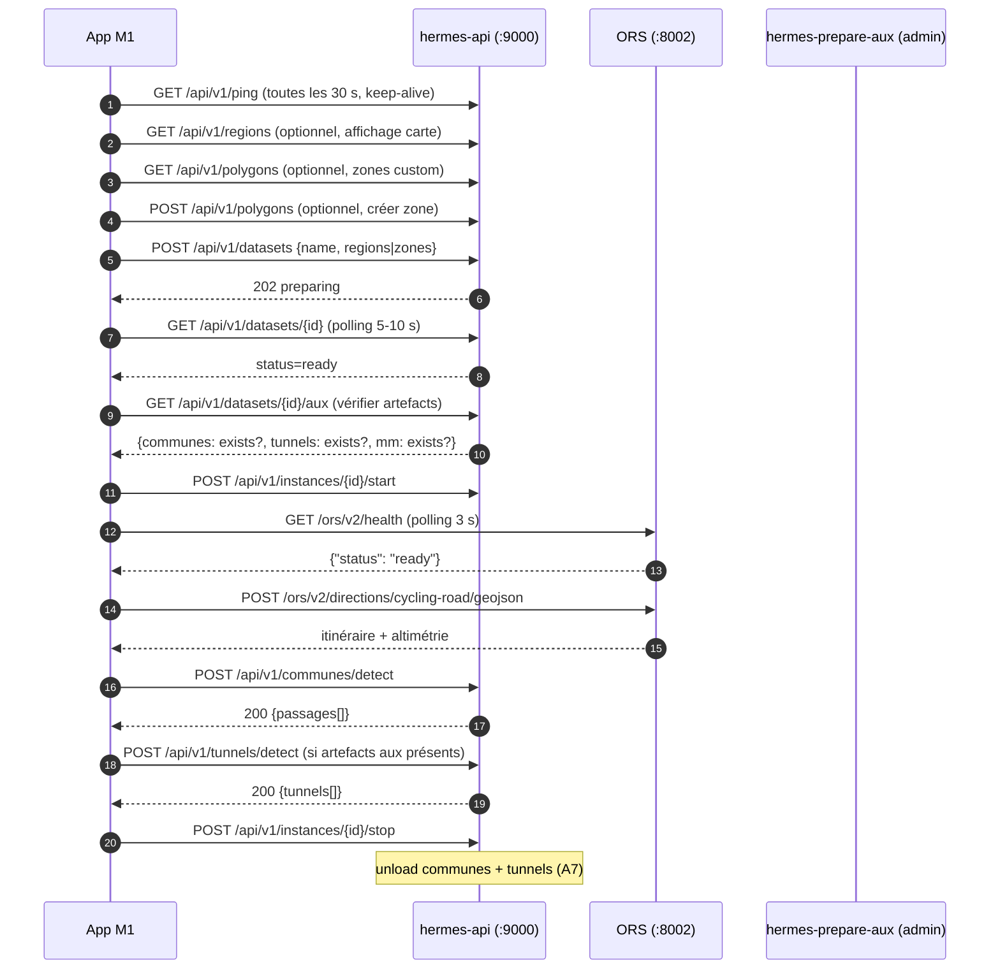

# hermes — contrat d'interface M1

> **Document de référence.** Contrat d'interface entre l'application **M1** (client Mac) et le serveur **`hermes`** (contrôleur `hermes-api` sur `:9000` + moteur ORS sur `:8002`). Spécifie les routes, les payloads, les codes HTTP, le cycle de vie client et les règles de robustesse.
>
> **Version 1.10 — 9 novembre 2026.** Intègre les services **Communes** et **Tunnels** (Phase 8) et les nouveaux endpoints **Aux**.
>
> **Documents liés** : `ref_tech.md` v1.10, `hermes.md` v1.10, `plan_action.md` v1.10, `communes & tunnels.md` v1.10.

**Légende :**
- 🟢 **Route M1** : utilisable par l'application M1 sans authentification (ZeroTier uniquement).
- 🔒 **Route admin** : réservée à l'application admin (`X-Admin-Token`). M1 ne doit pas l'appeler.
- 🆕 **v1.10** : route ajoutée en Phase 8.

---

## 1. Vue d'ensemble

`hermes` est un serveur backend dédié au traitement de traces GPX et au routage vélo/automobile. Il est accessible **uniquement** via le réseau privé ZeroTier `10.15.58.131` (aucune exposition publique sur Internet).

L'application M1 est un client :
- **Routage** : vélo de route / automobile via ORS (`:8002`).
- **Datasets** : choix des régions (PBF Geofabrik) ou zones custom (polygones M1) pour préparer un dataset ORS ad hoc.
- **Communes** 🆕 : liste des communes traversées par une trace.
- **Tunnels** 🆕 : liste des tunnels traversés (limité, voir §9).
- **Cycle de vie** : créer un dataset → lancer ORS → router → enrichir → arrêter ORS.

L'application M1 n'a **jamais** besoin de se connecter à ORS pour préparer un dataset ni pour communes/tunnels. Tout passe par `hermes-api` (`:9000`).

---

## 2. Configuration réseau M1

### 2.1 ZeroTier

| Élément | Valeur |
|---|---|
| Network ID | `08752e18b13fb847` |
| IP hermes | `10.15.58.131` |
| IP Mac M1 | `10.15.58.56` |
| Fallback DNS | IP ZeroTier directe (pas de DNS configuré, D6) |
| Test 4G | Hotspot iPhone avec « Maximize Compatibility » |

**Procédure d'invitation** :
1. Communiquer le Network ID à l'invité.
2. L'invité ajoute le réseau dans son client ZeroTier.
3. Autoriser son nœud dans ZeroTier Central.

### 2.2 URLs de base

| Service | URL |
|---|---|
| Contrôleur API | `http://10.15.58.131:9000/api/v1` |
| ORS | `http://10.15.58.131:8002/ors/v2` |
| UI admin (navigateur) | `http://10.15.58.131:9000/admin/` |
| Doc auto (OpenAPI) | `http://10.15.58.131:9000/docs` |

### 2.3 Réveil WoL

| Élément | Valeur |
|---|---|
| MAC cible | `68:5b:35:a8:5c:65` (interface `enp1s0f0`) |
| IP publique box | `87.91.31.205` (Bouygues) |
| Port UDP | `9` |

**Python (exemple)** :

```python
import socket

mac = bytes.fromhex("685b35a85c65")
pkt = b"\xff" * 6 + mac * 16
s = socket.socket(socket.AF_INET, socket.SOCK_DGRAM)
s.setsockopt(socket.SOL_SOCKET, socket.SO_BROADCAST, 1)
for _ in range(3):
    s.sendto(pkt, ("87.91.31.205", 9))
s.close()
```

**Temps de reprise mesuré** : ~50 s à ~1min52s (boot + services + ORS ready si instance active avant veille).

---

## 3. Conventions générales de l'API contrôleur

### 3.1 Formats

- **Timestamps** : `YYYY-MM-DDTHH:MM:SSZ` (UTC, secondes, suffixe `Z`).
- **Payload** : JSON, **camelCase** côté client (`traceId`, `datasetId`, `kmEntree`...). Le serveur utilise `snake_case` en interne et expose `camelCase` via Pydantic `alias`.
- **Réponse** : toujours JSON (sauf `204 No Content`).
- **Coordonnées** : `[lon, lat]` ou `[lon, lat, ele]` en WGS84 (EPSG:4326), comme ORS (GeoJSON standard).
- **Unités** : distances en **km** (sauf champs suffixés `_m`/`M` en mètres), durées en **secondes**, surfaces en **km²**.

### 3.2 Authentification

- **Routes M1 🟢** : **aucune authentification**. Protection par le réseau ZeroTier privé uniquement.
- **Routes admin 🔒** : header `X-Admin-Token: <hex64>`. Non utilisé par M1.

### 3.3 Codes HTTP standard

| Code | Signification |
|---|---|
| `200` | Succès |
| `201` | Création réussie (POST /polygons) |
| `202` | Accepté, traitement en tâche de fond (POST /datasets) |
| `204` | Succès sans contenu (DELETE) |
| `400` | Payload invalide (validation sémantique) |
| `401` | Token admin absent/invalide (routes 🔒 seulement) |
| `404` | Ressource inexistante |
| `409` | Conflit (build en cours, dataset déjà existant, lock posé) |
| `422` | Validation Pydantic échouée (champ manquant, type invalide) |
| `500` | Erreur interne serveur |

### 3.4 Format des erreurs

```json
{
  "detail": "message lisible en français"
}
```

Sur `422`, FastAPI ajoute un détail structuré :
```json
{
  "detail": [
    {"loc": ["body", "points"], "msg": "field required", "type": "value_error.missing"}
  ]
}
```

### 3.5 Robustesse client M1

- **Retry** : sur `5xx` ou timeout réseau, retry avec backoff exponentiel (1 s, 2 s, 4 s, max 3 tentatives).
- **Idempotence** : `GET` et `DELETE` sont idempotents. `POST /datasets` et `POST /communes/detect` **ne le sont pas** (chaque appel crée un nouveau dataset / relance une détection).
- **Keep-alive** : `GET /api/v1/ping` toutes les 30 s côté client (empêche la veille pendant un travail actif).
- **Timeout** : 30 s par défaut sur les routes courtes, **pas de timeout** sur `GET /datasets/{id}` (polling : le build peut durer 45 min).

---

## 4. Routes M1 — Datasets

### 4.1 🟢 `GET /api/v1/datasets`

Liste tous les datasets existants.

**Réponse 200** (tableau) :
```json
[
  {
    "id": "provence-alpes-cote-dazur",
    "regions": ["provence-alpes-cote-dazur"],
    "zones": null,
    "created_at": "2026-11-07T16:42:00Z",
    "status": "ready",
    "size_bytes": 1750000000,
    "ors_version": "9.9.0",
    "stale": false
  }
]
```

| Champ | Type | Description |
|---|---|---|
| `id` | str | Identifiant technique (dossier, unité systemd) |
| `regions` | list[str]\|null | Régions fusionnées (mode `regions`) |
| `zones` | list[str]\|null | Zones custom (mode `zones`) |
| `created_at` | str | Timestamp de création |
| `status` | str | `preparing` / `ready` / `failed` |
| `size_bytes` | int | Taille disque du dataset |
| `ors_version` | str | Version ORS utilisée |
| `stale` | bool | `true` si une région source a été mise à jour depuis `created_at` |

**Codes** : `200`, `403` (permissions), `500`.

### 4.2 🟢 `GET /api/v1/datasets/{id}`

Détail d'un dataset + `last_log_tail` si `status=failed`.

**Réponse 200** : même structure que `GET /datasets` + `last_log_tail: str|null`.

**Codes** : `200`, `404`, `403`.

### 4.3 🟢 `POST /api/v1/datasets`

Crée un dataset (mode `regions` **XOR** mode `zones`). Retourne `202` immédiatement, le build tourne en tâche de fond.

**Payload mode `regions`** :
```json
{
  "name": "paca-italy",
  "regions": ["provence-alpes-cote-dazur", "italy-nord-ovest"]
}
```

**Payload mode `zones`** :
```json
{
  "name": "nice-monaco",
  "zones": ["ma-zone-nice", "ma-zone-monaco"]
}
```

| Champ | Type | Contraintes |
|---|---|---|
| `name` | str\|null | Optionnel. Si absent, généré (`ds-<ts>-<slug>`) |
| `regions` | list[str]\|null | IDs de `GET /regions` |
| `zones` | list[str]\|null | IDs de `GET /polygons` |

**Contraintes serveur** (T53) :
- `regions` et `zones` mutuellement exclusifs (XOR strict). **Pas de mixte.**
- `max_regions` = 4 par défaut (`MAX_DATASET_REGIONS`).
- `max_zones` = 100 par défaut (`MAX_DATASET_ZONES`).
- `max_area_km2` = 50 000 km² par défaut (`MAX_DATASET_AREA_KM2`).
- Le mode `bbox` a été **supprimé** (T52). Utiliser `regions` ou `zones`.

**Réponse 202** :
```json
{
  "id": "nice-monaco",
  "status": "preparing"
}
```

**Codes** :
- `202` : accepté, build en cours.
- `400` : payload invalide. Messages possibles :
  - `"Aucun périmètre fourni (ni région ni zone)."`
  - `"La liste des régions est vide."`
  - `"La liste des zones est vide."`
  - `"Régions et zones ne peuvent pas être fournies ensemble."`
  - `"trop de régions: N (max M)"`
  - `"trop de zones: N (max M)"`
  - `"surface totale N km² (max M km²)"`
  - `"PBF manquant pour: <liste>"`
- `409` : `"build déjà en cours: <id>"` ou `"dataset existe déjà: <id>"`.

**Comportement M1** : après `202`, **polling** `GET /datasets/{id}` toutes les 5-10 s jusqu'à `status=ready` ou `status=failed`.

**Durées typiques** :
- Monaco (mode regions) : ~15 s.
- PACA (mode regions) : 525 s système chaud / ~700 s système froid.
- PACA + Italie NW (mode regions) : ~26 min.
- Nice + Monaco (mode zones, clipping) : ~80 s.

### 4.4 🟢 `DELETE /api/v1/datasets/{id}`

Supprime le dataset (dossier complet, y compris `graphs/`, `elevation_cache/`, `logs/`, `mm/`, `communes.geojson`, `tunnels-logiques.json`). Si ORS tourne pour ce dataset, il est arrêté avant.

**Codes** : `204`, `404`.

**Attention** : **irréversible**. M1 doit demander confirmation utilisateur.

---

## 5. Routes M1 — Instances ORS

### 5.1 🟢 `GET /api/v1/instances`

Liste les instances ORS actives (0 ou 1).

**Réponse 200** :
```json
[{"id": "provence-alpes-cote-dazur", "status": "active"}]
```

### 5.2 🟢 `POST /api/v1/instances/{id}/start`

Démarre ORS pour un dataset.

**Réponse 200** :
```json
{"id": "provence-alpes-cote-dazur", "status": "starting"}
```

**Codes** : `200`, `404`, `409` (ors-config.yml manquant).

**Attention** : `starting` ne signifie **pas** que ORS est prêt. Il faut attendre `GET http://10.15.58.131:8002/ors/v2/health` → `{"status":"ready"}`. Délai : **~70 s** pour PACA (2 profils), ~15 s pour Monaco (2 profils).

**Attente recommandée M1** :
```python
import time, httpx

def wait_ors_ready(max_wait_s=120, poll_s=3):
    t0 = time.time()
    while time.time() - t0 < max_wait_s:
        try:
            r = httpx.get("http://10.15.58.131:8002/ors/v2/health", timeout=2)
            if r.status_code == 200 and r.json().get("status") == "ready":
                return True
        except httpx.HTTPError:
            pass
        time.sleep(poll_s)
    return False
```

### 5.3 🟢 `POST /api/v1/instances/{id}/stop`

Arrête ORS **et libère les index communes/tunnels en mémoire** (A7).

**Réponse 200** :
```json
{"id": "provence-alpes-cote-dazur", "status": "stopped"}
```

**Codes** : `200`, `404`.

**Conséquence (A7)** : si M1 rappelle `communes/detect` ou `tunnels/detect` après un `stop`, le premier appel recharge l'index (~2 s PACA, ~1 s Monaco). Les appels suivants sont rapides (17 ms).

---

## 6. Routes M1 — Régions et polygones

### 6.1 🟢 `GET /api/v1/regions`

Liste les régions indexées avec leur contour GeoJSON.

**Réponse 200** :
```json
[
  {
    "id": "provence-alpes-cote-dazur",
    "bbox": [4.23, 42.98, 7.72, 45.13],
    "has_poly": true,
    "geojson": {"type": "Polygon", "coordinates": [[[4.23, 42.98], ...]]},
    "geofabrik_id": "europe/france/provence-alpes-cote-d-azur",
    "updated_at": "2026-11-07T16:00:00Z"
  }
]
```

| Champ | Type | Description |
|---|---|---|
| `id` | str | Clé technique (`regions.json`) |
| `bbox` | [lon_min, lat_min, lon_max, lat_max] | Métadonnée (indexation) |
| `has_poly` | bool | Contour réel disponible |
| `geojson` | GeoJSON Polygon\|null | Contour (ou bbox fallback) |
| `geofabrik_id` | str | ID Geofabrik (T56) |
| `updated_at` | str | Timestamp ISO UTC |

**Usage M1** : afficher les régions sur la carte pour permettre la sélection.

**Codes** : `200`, `403`.

### 6.2 🟢 `GET /api/v1/polygons`

Liste les zones custom M1 (polygones créés par M1).

**Réponse 200** :
```json
[
  {
    "id": "ma-zone-nice",
    "name": "Zone Nice - Col de Turini",
    "description": "Sortie gravel...",
    "color": "#3b82f6",
    "geometry": {"type": "Polygon", "coordinates": [[[7.26, 43.71], ...]]},
    "bbox": [7.26, 43.71, 7.28, 43.73],
    "created_at": "2026-11-06T10:30:00Z",
    "updated_at": "2026-11-06T10:30:00Z",
    "revision": 1
  }
]
```

### 6.3 🟢 `GET /api/v1/polygons/{id}`

Détail d'un polygone custom.

**Codes** : `200`, `400` (id invalide), `404`.

### 6.4 🟢 `POST /api/v1/polygons`

Crée un polygone custom (zone M1).

**Payload** :
```json
{
  "id": "ma-zone-nice",
  "name": "Zone Nice",
  "description": "Optionnel",
  "color": "#3b82f6",
  "geometry": {"type": "Polygon", "coordinates": [[[7.26, 43.71], [7.28, 43.71], [7.28, 43.73], [7.26, 43.73], [7.26, 43.71]]]}
}
```

| Champ | Type | Contraintes |
|---|---|---|
| `id` | str | Slug ASCII `[a-zA-Z0-9_-]{1,64}`, `"index"` réservé, unicité |
| `name` | str | Non vide, ≤ 200 chars |
| `description` | str\|null | ≤ 2000 chars |
| `color` | str\|null | `^#[0-9a-fA-F]{6}$` |
| `geometry` | GeoJSON Polygon | Voir validation ci-dessous |

**Validation géométrique serveur** (T54) :
- **Type** : `Polygon` uniquement (pas de MultiPolygon, pas de trous).
- **Fermeture** : auto-fermeture silencieuse si 1er ≠ dernier point.
- **Sommets** : max 1000 (après auto-fermeture).
- **Précision** : arrondi serveur à 5 décimales (~1 m).
- **Coordonnées** : WGS84 (lon/lat), bornes ±180 / ±90.

**Réponse 201** : objet complet (comme `GET /polygons/{id}`).

**Codes** :
- `201` : créé.
- `400` : géométrie invalide, id réservé, name/description/color invalide.
- `409` : `"polygone existe déjà: <id>"`.

### 6.5 🟢 `PUT /api/v1/polygons/{id}`

Remplace un polygone custom (remplacement **complet**, pas de PATCH).

**Payload** : `{name, description?, color?, geometry}`. `id` et `created_at` **immuables**. `bbox`, `updated_at`, `revision` recalculés côté serveur (`revision` incrémentée).

**Réponse 200** : objet complet.

**Codes** : `200`, `400`, `404`.

### 6.6 🟢 `DELETE /api/v1/polygons/{id}`

Supprime un polygone custom.

**Codes** : `204`, `400`, `404`.

**Attention** : si un dataset actif utilise ce polygone (`zones: [id]`), le dataset **reste fonctionnel** (son `merged.osm.pbf` est déjà généré). Mais il sera marqué `stale=true` au prochain `GET /datasets`.

---

## 7. Routes M1 — Communes (v1.10, Phase C) 🆕

### 7.1 🟢 `POST /api/v1/communes/detect`

Détecte les communes traversées par une trace GPX.

**Payload** :
```json
{
  "traceId": "t-20261109-01",
  "datasetId": "provence-alpes-cote-dazur",
  "points": [[7.24152, 44.05123], [7.24320, 44.05281]],
  "params": {
    "adminLevel": "8",
    "minSegmentKm": 0.005,
    "gapMaxM": 50.0
  }
}
```

| Champ | Type | Défaut | Description |
|---|---|---|---|
| `traceId` | str | — | ID client (traçabilité) |
| `datasetId` | str | — | Dataset cible (doit avoir `communes.geojson`) |
| `points` | list[[lon,lat(,ele)]] | — | Trace GPX, ≥ 2 points |
| `params.adminLevel` | str\|null | mapping pays | Force un `admin_level` OSM (voir §7.3) |
| `params.minSegmentKm` | float | `0.005` | Longueur min. d'une intersection (km) |
| `params.gapMaxM` | float | `50.0` | Tolérance fusion passages contigus (m) |

**Réponse 200** :
```json
{
  "traceId": "t-20261109-01",
  "datasetId": "provence-alpes-cote-dazur",
  "detectedAt": "2026-11-09T12:52:20Z",
  "passages": [
    {
      "commune": "Nice",
      "passage": 1,
      "nbPassagesTotal": 1,
      "kmEntree": 0.0,
      "kmSortie": 6.685,
      "longueurKm": 6.685,
      "ambiguous": false
    }
  ]
}
```

| Champ | Description |
|---|---|
| `commune` | Nom OSM de la commune |
| `passage` | Numéro de passage (1, 2, 3... si aller-retour) |
| `nbPassagesTotal` | Nombre total de passages pour cette commune |
| `kmEntree` | Distance cumulée (km) du début de la trace |
| `kmSortie` | Distance cumulée de sortie |
| `longueurKm` | Longueur du passage dans la commune |
| `ambiguous` | `true` si chevauchement avec une autre commune (frontière OSM imprécise) |

**Sémantique** :
- Les passages sont **ordonnés chronologiquement** (`kmEntree` croissant).
- Un **aller-retour** (Nice → Monaco → Nice) donne deux passages distincts pour Nice (`passage=1` et `passage=2`, gap 150 m non fusionné).
- Un **micro-passage parasite** (Nice → Monaco 8 m → Nice) est fusionné si filtré par `minSegmentKm` (gap 8 m < 50 m).
- **`ambiguous: true`** : chevauchement > 1 m avec une autre commune. Frontière OSM imprécise ou enclave. M1 peut avertir l'utilisateur.

**Codes HTTP** :
- `200` : succès, même si `passages: []` (trace hors communes).
- `404` : `datasetId` inconnu, ou `communes.geojson` absent. Message : `"communes.geojson absent pour dataset '<id>'"`.
- `422` : moins de 2 points, coordonnées invalides (Pydantic).
- `500` : index corrompu, GeoJSON invalide.

**Performances** :
- **Premier appel** sur un dataset : ~2.2 s (parse 27 Mo PACA + STRtree).
- **Appels suivants** : ~17 ms (index en mémoire).
- Bascule sur un autre dataset : recharge l'index (~2 s).
- Après `POST /instances/{id}/stop` : recharge au prochain appel.

### 7.2 Sémantique de la fusion (A9)

Deux passages **consécutifs de même nom** avec un gap < `gapMaxM` sont fusionnés en un seul.

| Cas | Comportement |
|---|---|
| `Nice(0-100), Nice(102-300)` (gap 2 m) | **Fusionné** en `Nice(0-300)` |
| `Nice(0-100), Monaco(100-102, 2 m), Nice(102-300)` avec `minSegmentKm=5 m` | Monaco filtré → fusionné en `Nice(0-300)` |
| `Nice(0-100), Monaco(100-200), Nice(200-300)` | **Non fusionné** (Monaco entre les deux) |
| `Nice(0-100), Monaco(100-120, 20 m), Nice(120-300)` avec `minSegmentKm=50 m` | Monaco filtré → fusionné en `Nice(0-300)` |
| `Nice(0-100), Monaco(100-120, 20 m), Nice(120-300)` avec `minSegmentKm=5 m` | Monaco conservé (20 m > 5 m) → **non fusionné** |

**Recommandation M1** : utiliser les défauts (`minSegmentKm=0.005`, `gapMaxM=50`). Ne les ajuster que pour des cas spécifiques.

### 7.3 Mapping `admin_level` (A4)

| Pays | `admin_level` commune | Notes |
|---|---|---|
| France | `8` | commune |
| Espagne | `8` | municipio |
| Italie | `8` | comune |
| Suisse | `8` | commune / Gemeinde |
| **Monaco** | **`8`** | commune (⚠️ **pas 4**) |
| Autres | `8` (fallback) | WARNING côté serveur |

**Cas Monaco** (A4) :
- Relation `admin_level=2` : pays (`country=MC`).
- Relation `admin_level=8` : commune (`Monaco`).
- Relations `admin_level=10` : quartiers (`Monte-Carlo`, `Fontvieille`...).
- Le défaut `admin_level=8` retourne **la commune entière** (1 seul polygone).

**Override M1** (rare) :
- `params.adminLevel="2"` → pays entier (frontière).
- `params.adminLevel="6"` → départements (France).
- `params.adminLevel="10"` → quartiers (Monaco, Nice).

### 7.4 Mapping pays manquant (A5)

Pour les pays non listés dans `COUNTRY_ADMIN_LEVELS`, le serveur applique `admin_level=8` par défaut et émet un WARNING **une seule fois par pays** (dédup). Aucune action M1 requise.

---

## 8. Routes M1 — Tunnels (v1.10, Phase D) 🆕

### 8.1 🟢 `POST /api/v1/tunnels/detect`

Détecte les tunnels traversés par une trace GPX (via `map_matching_2` + `tunnels-logiques.json` + `mm/`).

**Payload** :
```json
{
  "traceId": "t-tunnel-01",
  "datasetId": "test-monaco-ds",
  "points": [[7.4201, 43.7382, 45.0], [7.4215, 43.7390, 48.2]],
  "params": {
    "minLengthM": 50.0,
    "altimetricCheck": false,
    "altimetricToleranceM": 30.0
  }
}
```

| Champ | Type | Défaut | Description |
|---|---|---|---|
| `traceId` | str | — | ID client |
| `datasetId` | str | — | Dataset cible (doit avoir `tunnels-logiques.json` et `mm/`) |
| `points` | list[[lon,lat(,ele)]] | — | Trace GPX, ≥ 2 points |
| `params.minLengthM` | float | `50.0` | Longueur min. pour retenir un tunnel (m) |
| `params.altimetricCheck` | bool | `false` | Contrôle altimétrique a posteriori (voir §8.3) |
| `params.altimetricToleranceM` | float | `30.0` | Tolérance du contrôle altimétrique (m) |

**Réponse 200** :
```json
{
  "version": 1,
  "traceId": "t-tunnel-01",
  "datasetId": "test-monaco-ds",
  "detectedAt": "2026-11-09T20:06:23Z",
  "params": {
    "minLengthM": 50.0,
    "altimetricCheck": false,
    "altimetricToleranceM": 30.0
  },
  "tunnels": [
    {
      "id": "t-001",
      "groupId": "g-503230507",
      "name": "Tunnel Rainier III",
      "startKm": 14.215,
      "endKm": 15.820,
      "lengthM": 1605.0,
      "wayIds": ["503230507", "944079968", "1327492342", "1327492343"],
      "altimetricOk": null
    }
  ]
}
```

| Champ | Description |
|---|---|
| `id` | ID court du tunnel dans la trace (`t-001`, `t-002`...) |
| `groupId` | Identifiant du groupe logique (`tunnels-logiques.json`) |
| `name` | Nom OSM du tunnel (peut être `null`) |
| `startKm` | Point d'entrée sur la trace (km cumulés) |
| `endKm` | Point de sortie |
| `lengthM` | Longueur traversée (m) |
| `wayIds` | Ways OSM du tunnel (sans préfixe `w`, A2) |
| `altimetricOk` | `true`/`false`/`null` (si `altimetricCheck=false` ou pas d'élévation) |

**Codes HTTP** :
- `200` : succès, même si `tunnels: []`.
- `404` : `datasetId` inconnu, ou `tunnels-logiques.json` / `mm/` absent.
- `422` : moins de 2 points, coordonnées invalides.
- `500` : `map_matching_2` absent, timeout, ou erreur interne.

**Performances** : ~100-500 ms par appel (subprocess `map_matching_2 --match` + lecture index + projection).

### 8.2 ⚠️ Limitation importante — tunnels urbains (A15)

**La détection de tunnels ne fonctionne PAS dans les réseaux urbains denses** (Monaco, Nice centre-ville).

**Causes** (documentées, non résolues en v1.10) :
1. `map_matching_2` n'utilise **pas l'altitude** en entrée du HMM (seulement lon/lat).
2. Les GPX édités par **Strava, RunWithGPS, Garmin Connect, OpenRunner** ont des altitudes **lissées par DEM**, pas barométriques. Il n'y a donc pas de "dépression" détectable au passage du tunnel.
3. Monaco a **3-4 niveaux de routes superposés** (surface, tunnels, galeries, parkings). Les routes de surface sont toujours à portée du HMM.
4. Les **faux positifs OSM** (galeries piétonnes, parkings tagués `tunnel=yes`) brouillent les groups union-find.

**Conséquences pour M1** :

| Cas d'usage | Détection |
|---|---|
| Tunnel isolé (Tende, Fréjus, Cluse, autoroutier) | ✅ **Fonctionne** (aucune route alternative de surface) |
| Tunnel urbain (Monaco, Nice centre) avec GPX édité | ❌ **Ne fonctionne pas** |
| Tunnel urbain avec GPX 3D barométrique brut | ⚠️ **Non testé** en v1.10 (hors scope) |

**Recommandation M1** :
- Afficher la détection de tunnels **uniquement pour les traces hors milieu urbain dense**.
- OU avertir l'utilisateur que la détection est **indicative** en ville.
- Documenter côté M1 : "La détection de tunnels n'est fiable que sur les tunnels isolés (alpins, autoroutiers). En ville, elle peut renvoyer une liste vide alors que la trace traverse un tunnel."

**`altimetricCheck`** : **ne peut pas forcer** le choix du tunnel. Il **valide** un tunnel déjà matché (vérifie que la variation d'altitude est monotone sur le tunnel). Utile quand le GPS fournit une altitude non lissée.

### 8.3 Détail `altimetricCheck`

Si `altimetricCheck=true` **et** les points ont une 3e coordonnée (`ele`) **et** le tunnel a été matché :

- Le serveur extrait les points de la trace dans l'intervalle `[startKm, endKm]`.
- Vérifie que l'altitude suit le profil interpolé (entrée/sortie) avec une tolérance `altimetricToleranceM`.
- Retourne `altimetricOk: true` (OK), `false` (anomalie), ou `null` (pas de tunnel matché ou pas d'élévation).

**Si `tunnels: []`**, `altimetricCheck` n'a **aucun effet** (rien à valider).

---

## 9. Routes M1 — Aux (v1.10, Phase E) 🆕

### 9.1 🟢 `GET /api/v1/datasets/{id}/aux`

Statut des artefacts auxiliaires (communes, tunnels, mm) pour un dataset.

**Réponse 200** :
```json
{
  "datasetId": "provence-alpes-cote-dazur",
  "communes": {
    "name": "communes.geojson",
    "exists": true,
    "sizeBytes": 46502397,
    "modifiedAt": "2026-11-09T12:44:51Z"
  },
  "tunnels": {
    "name": "tunnels-logiques.json",
    "exists": true,
    "sizeBytes": 187432,
    "modifiedAt": "2026-11-09T20:29:01Z"
  },
  "mm": {
    "name": "mm/",
    "exists": true,
    "sizeBytes": 2402864,
    "modifiedAt": "2026-11-09T20:40:45Z"
  },
  "preparing": false,
  "startedAt": null,
  "lastError": null,
  "loadedInMemory": false,
  "activeDataset": null
}
```

| Champ | Description |
|---|---|
| `communes.exists` | `communes.geojson` présent sur disque |
| `tunnels.exists` | `tunnels-logiques.json` présent |
| `mm.exists` | `mm/` présent |
| `preparing` | `true` si `aux-prepare.lock` posé (génération en cours) |
| `lastError` | Message d'erreur du dernier `prepare` échoué (ou `null`) |
| `loadedInMemory` | Index actuellement chargés pour **ce** dataset |
| `activeDataset` | Dataset actuellement en mémoire (peut être différent de `id`) |

**Usage M1** :
- Avant d'appeler `communes/detect` ou `tunnels/detect`, vérifier `communes.exists` / `tunnels.exists`.
- Si absent, **ne pas appeler** `aux/prepare` (réservé admin). Afficher un message : *"Fonction non disponible pour ce dataset. Contactez l'administrateur."*
- `loadedInMemory` + `activeDataset` : diagnostic (savoir quel dataset occupe le cache).

**Codes** : `200`, `404` (dataset inconnu).

**Route non-admin** : utilisable par M1 directement.

### 9.2 🔒 `POST /api/v1/datasets/{id}/aux/prepare`

**Réservé à l'admin** (token `X-Admin-Token`). **M1 ne doit pas l'appeler.**

Si M1 a besoin qu'un dataset soit préparé, il doit afficher un message à l'utilisateur (« Contactez l'administrateur pour activer la détection communes/tunnels sur ce dataset »).

---

## 10. Routes admin (réservées, M1 ne doit pas appeler)

### 10.1 🔒 `GET /api/v1/geofabrik/regions`

Catalogue Geofabrik enrichi (admin UI). **M1 n'en a pas besoin.**

### 10.2 🔒 `POST /api/v1/regions`, `PUT /api/v1/regions/{id}`, `DELETE /api/v1/regions/{id}`

Ajout / mise à jour / suppression de régions depuis Geofabrik. **M1 n'en a pas besoin.**

### 10.3 🔒 `POST /api/v1/datasets/{id}/aux/prepare`

Génération des artefacts auxiliaires. **M1 n'en a pas besoin.**

**Si M1 tente d'appeler ces routes** : `401 Unauthorized` (token absent).

---

## 11. Contrat ORS (port 8002)

### 11.1 Route de routage

```
POST http://10.15.58.131:8002/ors/v2/directions/{profile}/geojson
Content-Type: application/json

{
  "coordinates": [[lon1, lat1], [lon2, lat2], ...],
  "elevation": true,
  "instructions": true,
  "geometry_simplify": false
}
```

**Profils actifs** : `driving-car`, `cycling-road`. `cycling-regular` **retiré** (inutile, coûteux — T36).

**Réponse** : GeoJSON FeatureCollection standard ORS (voir doc ORS v9).

### 11.2 Limite 100 km (T47)

ORS rejette les routes > **100 km** avec le code **2004**.

**Découpage M1 (T47)** : M1 doit découper en segments ≤ **50 km** et concaténer les résultats. La limite 100 km côté serveur reste un garde-fou.

### 11.3 Codes d'erreur ORS

| Code | Signification | Action M1 |
|---|---|---|
| `2004` | Route > 100 km | Découper en segments ≤ 50 km |
| `2010` | Waypoint hors réseau routable (rayon 400 m) | Vérifier la proximité des waypoints, avertir l'utilisateur |
| `2099` | Pas de connexion entre points | Segments non connectés, avertir |

### 11.4 Réponse exploitée

| Champ | Usage M1 |
|---|---|
| `features[0].geometry.coordinates` | Trace géométrique `[[lon, lat, ele], ...]` |
| `features[0].properties.ascent` | Dénivelé positif (m) |
| `features[0].properties.descent` | Dénivelé négatif (m) |
| `features[0].properties.summary.distance` | Distance totale (m) |
| `features[0].properties.summary.duration` | Durée estimée (s) |

### 11.5 Attente santé ORS

Après `POST /instances/{id}/start`, attendre `GET /ors/v2/health` → `{"status":"ready"}`.

| Dataset | Temps ready |
|---|---|
| Monaco (2 profils) | ~15 s |
| PACA (2 profils) | ~70 s |
| PACA + Italie NW (2 profils) | ~90 s (2 profils, gros PBF) |

**Recommandation M1** : poll toutes les 3 s, timeout 120 s.

---

## 12. Cycle de vie M1

### 12.1 Séquence typique



### 12.2 Étapes textuelles

1. **Keep-alive** : `GET /api/v1/ping` toutes les 30 s (empêche la veille pendant un travail actif).
2. **Carte** (optionnel) : `GET /api/v1/regions` + `GET /api/v1/polygons` → affichage.
3. **Zone custom** (optionnel) : `POST /api/v1/polygons {id, name, geometry}` → création.
4. **Création dataset** : `POST /api/v1/datasets {name, regions}` OU `{name, zones}` → `202`.
5. **Polling dataset** : `GET /api/v1/datasets/{id}` toutes les 5-10 s → `status=ready` (ou `failed`).
6. **Vérification aux** (v1.10) : `GET /api/v1/datasets/{id}/aux` → si communes/tunnels absents, désactiver les fonctions correspondantes côté UI.
7. **Démarrage ORS** : `POST /api/v1/instances/{id}/start` → `200`.
8. **Attente santé ORS** : `GET /ors/v2/health` toutes les 3 s → `ready` (~15-70 s).
9. **Routage** : pour chaque segment ≤ 50 km (T47), `POST /ors/v2/directions/{profile}/geojson`.
10. **Enrichissement communes** (v1.10) : `POST /api/v1/communes/detect` → `200 {passages[]}`.
11. **Enrichissement tunnels** (v1.10) : `POST /api/v1/tunnels/detect` (si artefacts présents) → `200 {tunnels[]}`.
12. **Arrêt ORS** : `POST /api/v1/instances/{id}/stop` → `200` (unload index).
13. **Veille auto** : après 15 min d'inactivité (timer serveur).
14. **Réveil** : WoL UDP/9 vers `87.91.31.205` (box FAI).

### 12.3 Cas d'erreur et reprise

| Situation | Comportement M1 |
|---|---|
| `POST /datasets` → `409` build en cours | Attendre la fin du build, retenter |
| `POST /datasets` → `400` payload invalide | Corriger payload, ne pas retenter à l'identique |
| Polling dataset → `status=failed` | Afficher `last_log_tail` à l'utilisateur, proposer `DELETE /datasets/{id}` puis retenter |
| ORS `2010` waypoint non routable | Avertir l'utilisateur, proposer d'ajuster les waypoints |
| ORS `2004` route > 100 km | Découper en segments ≤ 50 km (T47) |
| ORS timeout / 5xx | Retry 3× avec backoff, puis avertir |
| `communes/detect` → `404` `communes.geojson absent` | Afficher "Fonction indisponible pour ce dataset", désactiver l'UI |
| `tunnels/detect` → `500` `map_matching_2 absent` | Idem |
| `tunnels/detect` → `200 {tunnels: []}` | **Normal** (vrai négatif possible). Ne pas alerter. |
| `POST /instances/{id}/stop` → `404` | Dataset supprimé entre temps. Nettoyer côté M1. |

---

## 13. Construction GPX côté M1

ORS produit du `<rte>`/`<rtept>`. **M1 construit** `<trk>`/`<trkpt>` (T5) :

- `<time>` **uniquement** dans `<metadata>` (pas dans les `<trkpt>`).
- `<wpt>` nommés injectés par M1 (points d'intérêt utilisateur).
- `<trkpt>` générés depuis `features[0].geometry.coordinates` (lon, lat, ele).

**Structure type** :
```xml
<?xml version="1.0"?>
<gpx version="1.1" creator="M1">
  <metadata>
    <time>2026-11-09T12:00:00Z</time>
  </metadata>
  <wpt lat="43.70" lon="7.26"><name>Départ Nice</name></wpt>
  <wpt lat="43.73" lon="7.42"><name>Arrivée Monaco</name></wpt>
  <trk>
    <name>Nice → Monaco</name>
    <trkseg>
      <trkpt lat="43.70" lon="7.26"><ele>15.0</ele></trkpt>
      <trkpt lat="43.71" lon="7.28"><ele>45.0</ele></trkpt>
      ...
    </trkseg>
  </trk>
</gpx>
```

---

## 14. Tableau récapitulatif des routes M1

| Méthode | Route | Auth | Rôle |
|---|---|---|---|
| `GET` | `/api/v1/ping` | — | Keep-alive |
| `GET` | `/api/v1/datasets` | — | Liste datasets |
| `GET` | `/api/v1/datasets/{id}` | — | Détail dataset (+ polling) |
| `POST` | `/api/v1/datasets` | — | Créer dataset (202) |
| `DELETE` | `/api/v1/datasets/{id}` | — | Supprimer dataset |
| `GET` | `/api/v1/instances` | — | Lister instances ORS |
| `POST` | `/api/v1/instances/{id}/start` | — | Démarrer ORS |
| `POST` | `/api/v1/instances/{id}/stop` | — | Arrêter ORS + unload |
| `GET` | `/api/v1/regions` | — | Lister régions |
| `GET` | `/api/v1/polygons` | — | Lister zones custom |
| `GET` | `/api/v1/polygons/{id}` | — | Détail zone |
| `POST` | `/api/v1/polygons` | — | Créer zone (201) |
| `PUT` | `/api/v1/polygons/{id}` | — | Remplacer zone |
| `DELETE` | `/api/v1/polygons/{id}` | — | Supprimer zone |
| **`POST`** | **`/api/v1/communes/detect`** | — | **Détecter communes (v1.10)** |
| **`POST`** | **`/api/v1/tunnels/detect`** | — | **Détecter tunnels (v1.10)** |
| **`GET`** | **`/api/v1/datasets/{id}/aux`** | — | **Statut artefacts aux (v1.10)** |

**Routes admin (M1 ne doit pas appeler)** :
- `POST /api/v1/regions`, `PUT /api/v1/regions/{id}`, `DELETE /api/v1/regions/{id}`
- `GET /api/v1/geofabrik/regions`
- `POST /api/v1/datasets/{id}/aux/prepare`

---

## 15. Décisions clés impactant M1

| # | Décision | Impact M1 |
|---|---|---|
| **T47** | Découpage segments ≤ 50 km | M1 concatène les réponses ORS par segment |
| **T52** | Mode `bbox` supprimé | M1 utilise `regions` XOR `zones` (pas de mixte) |
| **T53** | Limites datasets | M1 valide côté client avant envoi (fail fast UX) |
| **T36** | Profils `driving-car`, `cycling-road` | M1 n'utilise pas `cycling-regular` (retiré) |
| **T39** | ORS `-Xmx4g` | M1 peut router 2 profils en parallèle sans OOM |
| **A7** | Unload sur `stop` | Après `stop`, premier appel `communes/detect` ~2 s |
| **A2** | Edge IDs entiers nus | M1 ne doit pas préfixer `w` en sortie (tunnels) |
| **A4** | Monaco `admin_level=8` | Défaut OK, override possible |
| **A9** | Fusion gap < 50 m | Un aller-retour = 2 passages, micro-passage fusionné |
| **A15** | Tunnels urbains non détectés | M1 avertit l'utilisateur (limitation) |

---

## 16. Annexes

### A. Exemple de cycle complet (Python httpx)

```python
import httpx
import time

BASE = "http://10.15.58.131:9000/api/v1"
ORS = "http://10.15.58.131:8002/ors/v2"
client = httpx.Client(timeout=30)

# 1. Ping
client.get(f"{BASE}/ping")

# 2. Créer un dataset
r = client.post(f"{BASE}/datasets", json={
    "name": "mon-ds",
    "regions": ["provence-alpes-cote-dazur"]
})
assert r.status_code == 202, r.text
ds_id = r.json()["id"]

# 3. Polling dataset
while True:
    r = client.get(f"{BASE}/datasets/{ds_id}")
    status = r.json()["status"]
    if status in ("ready", "failed"):
        break
    time.sleep(5)

assert status == "ready", r.json().get("last_log_tail")

# 4. Vérifier artefacts aux
r = client.get(f"{BASE}/datasets/{ds_id}/aux")
aux = r.json()
has_communes = aux["communes"]["exists"]
has_tunnels = aux["tunnels"]["exists"] and aux["mm"]["exists"]

# 5. Démarrer ORS
r = client.post(f"{BASE}/instances/{ds_id}/start")
assert r.status_code == 200

# 6. Attendre ready
while True:
    try:
        h = httpx.get(f"{ORS}/health", timeout=2)
        if h.status_code == 200 and h.json().get("status") == "ready":
            break
    except httpx.HTTPError:
        pass
    time.sleep(3)

# 7. Router (segment <= 50 km)
route = client.post(f"{ORS}/directions/cycling-road/geojson", json={
    "coordinates": [[7.26, 43.70], [7.42, 43.73]],
    "elevation": True,
    "instructions": True,
    "geometry_simplify": False
}).json()
coords = route["features"][0]["geometry"]["coordinates"]
ascent = route["features"][0]["properties"]["ascent"]

# 8. Enrichissement communes
if has_communes:
    passages = client.post(f"{BASE}/communes/detect", json={
        "traceId": "t-001",
        "datasetId": ds_id,
        "points": coords
    }).json()["passages"]

# 9. Enrichissement tunnels
if has_tunnels:
    tunnels = client.post(f"{BASE}/tunnels/detect", json={
        "traceId": "t-001",
        "datasetId": ds_id,
        "points": coords
    }).json()["tunnels"]

# 10. Stop ORS
client.post(f"{BASE}/instances/{ds_id}/stop")
```

### B. Modèles Pydantic (référence M1)

**Communes** :
```python
from pydantic import BaseModel, Field
from typing import Optional

class CommuneParams(BaseModel):
    admin_level: Optional[str] = Field(default=None, alias="adminLevel")
    min_segment_km: float = Field(default=0.005, alias="minSegmentKm", ge=0.0)
    gap_max_m: float = Field(default=50.0, alias="gapMaxM", ge=0.0)

class CommunePassage(BaseModel):
    commune: str
    passage: int
    nb_passages_total: int = Field(alias="nbPassagesTotal")
    km_entree: float = Field(alias="kmEntree")
    km_sortie: float = Field(alias="kmSortie")
    longueur_km: float = Field(alias="longueurKm")
    ambiguous: bool

class CommunesDetectRequest(BaseModel):
    trace_id: str = Field(alias="traceId")
    dataset_id: str = Field(alias="datasetId")
    points: list[list[float]]
    params: CommuneParams = Field(default_factory=CommuneParams)

class CommunesDetectResponse(BaseModel):
    trace_id: str = Field(alias="traceId")
    dataset_id: str = Field(alias="datasetId")
    detected_at: str = Field(alias="detectedAt")
    passages: list[CommunePassage]
```

**Tunnels** :
```python
class TunnelParams(BaseModel):
    min_length_m: float = Field(default=50.0, alias="minLengthM", ge=0.0)
    altimetric_check: bool = Field(default=False, alias="altimetricCheck")
    altimetric_tolerance_m: float = Field(default=30.0, alias="altimetricToleranceM", ge=0.0)

class Tunnel(BaseModel):
    id: str
    group_id: Optional[str] = Field(alias="groupId")
    name: Optional[str]
    start_km: float = Field(alias="startKm")
    end_km: float = Field(alias="endKm")
    length_m: float = Field(alias="lengthM")
    way_ids: list[str] = Field(alias="wayIds")
    altimetric_ok: Optional[bool] = Field(alias="altimetricOk")

class TunnelsDetectRequest(BaseModel):
    trace_id: str = Field(alias="traceId")
    dataset_id: str = Field(alias="datasetId")
    points: list[list[float]]
    params: TunnelParams = Field(default_factory=TunnelParams)

class TunnelsDetectResponse(BaseModel):
    version: int
    trace_id: str = Field(alias="traceId")
    dataset_id: str = Field(alias="datasetId")
    detected_at: str = Field(alias="detectedAt")
    params: TunnelParams
    tunnels: list[Tunnel]
```

### C. Points d'attention M1

- **Ne pas appeler les routes admin** (401 systématique).
- **Attendre `status=ready`** avant `start` d'instance (sinon 409 `ors-config.yml manquant`).
- **Attendre `health=ready`** avant routage (sinon 5xx ORS).
- **Découper en segments ≤ 50 km** (T47) pour éviter le code 2004.
- **Vérifier `aux.communes.exists`** avant `communes/detect` (sinon 404).
- **Vérifier `aux.tunnels.exists && aux.mm.exists`** avant `tunnels/detect`.
- **Tunnels urbains** : avertir l'utilisateur, ne pas bloquer (A15).
- **Retry 3× avec backoff** sur `5xx` / timeout réseau.
- **Keep-alive** : `GET /ping` toutes les 30 s.
- **Confirmations utilisateur** : sur `DELETE /datasets/{id}` (irréversible).
- **Un seul dataset en mémoire** : si M1 bascule A → B, l'index A est déchargé (rechargement ~2 s au retour).
- **`X-Admin-Token`** : M1 ne doit **jamais** le stocker ni l'envoyer.

---

*Fin du document. Référence : ref_tech.md v1.10, hermes.md v1.10, plan_action.md v1.10, communes & tunnels.md v1.10.*