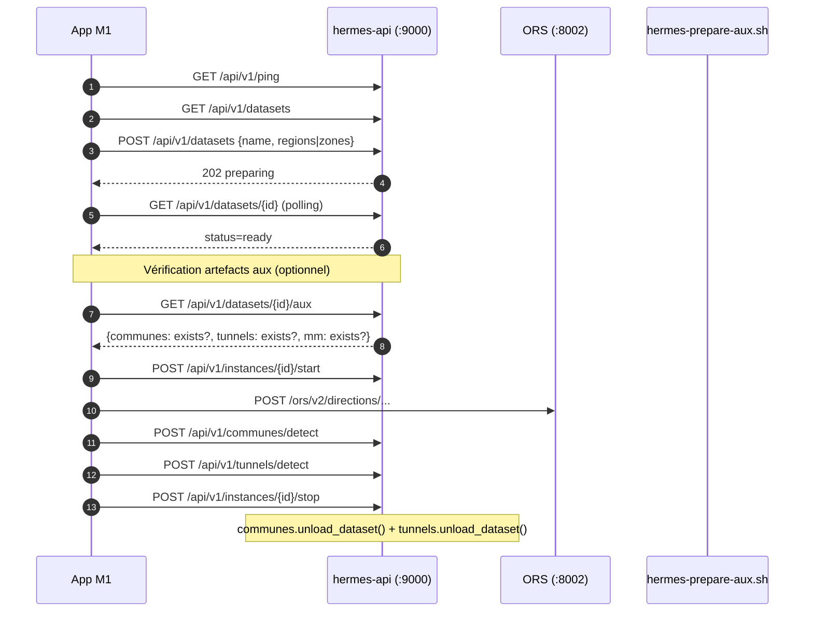

# hermes — notes d'accès et de configuration

> Version 1.10 — 9 novembre 2026
> Compte : jmbaubet (admin)
> Fichier : /home/jmbaubet/notes/hermes.md (chmod 600, dossier 700)
>
> **Changements v1.10 (par rapport à v1.9) — Phase 8 : enrichissement géographique (Communes + Tunnels)**
>   - Implémentation complète des services **Communes** et **Tunnels** intégrés dans `hermes-api` (aucun nouveau service systemd, aucun nouveau port).
>   - §3 : ajout **`map_matching_2` 1.2.1 AppImage** (`/opt/map-matching-2/`) + **`shapely` 2.2.0** (venv `hermes-api`) + **`numpy` 2.5.4** (dépendance shapely). Modules `app/communes.py`, `app/tunnels.py`, `app/aux.py`, `app/timeutils.py`. Scripts `scripts/group_tunnels.py`, `scripts/hermes-prepare-aux.sh`.
>   - §4.10 (nouveau) : **artefacts auxiliaires par dataset** (`communes.geojson`, `tunnels-logiques.json`, `mm/`), avec règles de permissions (`chmod 750 mm/` — bit `x` obligatoire).
>   - §5 : commandes admin/M1 pour communes, tunnels, aux/prepare, aux/status + tests pytest.
>   - §6 : **4 nouvelles routes** (`POST /communes/detect`, `POST /tunnels/detect`, `POST /datasets/{id}/aux/prepare` admin, `GET /datasets/{id}/aux`) + **cycle de vie M1 étendu** + **cycles internes** aux.
>   - §7 : mesures v1.10 (PACA communes 2.2 s / 17 ms ; Monaco communes 1 s / 17 ms ; pipeline aux Monaco ~1 s).
>   - §8 : décisions A1 à A15 (Phase 8) + dette technique notée (HMM sans altitude, faux positifs OSM urbains).
>   - §9 : nouveaux points d'attention (`chmod 750 mm/`, handler logger explicite, `_warned_countries`, `skip features sans admin_level`, `--geometry-types`, `--simplify osm-aware`, `--candidates`, `aux-prepare-lock`, limitation Monaco).
>   - §10 : signal **`aux-prepare-lock`** ajouté à `hermes-idle-check.sh` (4e signal après `build-lock`, avant `ssh`/`connection`). Flag `--ignore-aux` pour dry-run.
>   - §11 : Phase 8 ✅, T58 (Phase 8) ✅, limitation Monaco documentée (T58-D).
>   - Fichiers modifiés : `main.py`, `hermes-idle-check.sh`, `config.py` (ajout `AUX_MM_PREPARE_TIMEOUT_S`), `hermes.conf` (+1 variable).
>   - Aucune modification matérielle. Aucune exposition publique (ZeroTier inchangé).
>   - **Pas de nouvelle dépendance système** : `map_matching_2` est une AppImage portable (aucune libosmium/Boost à installer), `shapely` a des wheels précompilés pour Python 3.12 / Ubuntu 24.04.
>
> **Changements v1.9 (par rapport à v1.8) — clôture des candidats T57-B à T57-J** :
>   - T57-B ✅ : défaut `BUILD_TIMEOUT_S` dans config.py aligné sur 2700 (au lieu de 1800), cohérent avec hermes.conf (T35).
>   - T57-C ✅ : `polygons._write_index()` supprime `index.json` quand l'index devient vide (au lieu de laisser `{}`). Couvre delete_polygon et rebuild_index.
>   - T57-D ✅ : statu quo assumé (bbox pure conservée). Extraction conservatrice est un choix de sécurité documenté, gain potentiel ~16 s non critique.
>   - T57-E ✅ : garde-fou au démarrage (via lifespan) : WARNING si MAX_DATASET_REGIONS × OSMIUM_EXTRACT_TIMEOUT_S > BUILD_TIMEOUT_S.
>   - T57-F ✅ : migration @app.on_event("startup") → lifespan FastAPI. Les 2 hooks historiques sont fusionnés dans `lifespan()`.
>   - T57-H ✅ : `created_at` des manifest.json uniformisé sur le format `YYYY-MM-DDTHH:MM:SSZ` (secondes + Z), comme `updated_at` de regions.json et polygons.py.
>   - T57-I ✅ : refonte complète de l'IHM admin — vue unifiée 3 colonnes (Catalogue | Carte | Régions), Pico.css + thème clair/sombre, toolbar allégée, modal token, cache IndexedDB du catalogue Geofabrik (TTL 24 h), drapeaux flagcdn.com, icônes @mdi/font, traduction Intl.DisplayNames, filtre pays persistant (défaut France/Italie/Suisse/Espagne), garde-fou téléchargement (limite 500 Mo). URLs /admin/regions et /admin/geofabrik conservées (redirection JS vers /admin/?focus=…).
>   - T57-J ✅ : documentation uniquement — découpage 5h.5 (formulaires HTML classiques) resté au stade de projet, jamais implémenté (D.5 a retenu SPA + fetch). Aucune référence résiduelle dans les sections actives.
>   - Fichiers modifiés : /opt/hermes-api/app/config.py, main.py, polygons.py, templates/{base,index,regions,geofabrik}.html.
>   - Services redémarrés pendant la session (validés 4 × 200 chaque fois).
>   - Aucun changement matériel ni installation.
>
> **Changements v1.8 (par rapport à v1.7)** :
>   - Implémentation des décisions T50–T56 (étape D : D.1 à D.6, 7 nov 2026).
>   - §3 : ajout ADMIN_TOKEN, OSMIUM_EXTRACT_TIMEOUT_S, GEOFABRIK_DOWNLOAD_TIMEOUT_S, POLYGONS_DIR. Jinja2 3.1.6 + MarkupSafe 3.0.4 installés dans le venv. Drop-in rwpaths-pbf.conf.
>   - §4.4 : ACL /srv/hermes/pbf + regions.json hermes-api:hermes-datasets 640.
>   - §4.7 Polygones custom : spécifié → réalisé.
>   - §4.8 Mode zones avec clipping : spécifié → réalisé.
>   - §5 : commandes admin (POST/PUT/DELETE /regions, /geofabrik/regions, UI /admin).
>   - §7 : mesures D.6 (builds PACA 525 s, Monaco 15 s, zones 80 s).
>   - §8 : T50–T56 marquées ✅ Réalisées. T57-A résolu. T57-B à T57-J documentés comme candidats.
>   - §9 : nouveaux points d'attention (Lock asyncio, lowercase, state 4 valeurs, HEAD lazy, complexité RBAC UI).
>   - §11 : T57 candidats.
>   - T57-A résolu : hermes.conf en 640 root:hermes-api.
>
> **Changements v1.7 (par rapport à v1.6)** :
>   - Spécifications serveur complétées (T50–T56) pour l'app M1 et l'app admin : datasets custom par polygones avec clipping osmium, CRUD /polygons, catalogue Geofabrik, endpoints admin, limites paramétrables, URLs Geofabrik paramétrables.
>   - /etc/hermes/hermes.conf : 5 nouvelles variables (MAX_DATASET_REGIONS, MAX_DATASET_AREA_KM2, MAX_DATASET_ZONES, GEOFABRIK_BASE_URL, GEOFABRIK_CATALOG_URL).
>   - Mode bbox supprimé de POST /datasets (T52). regions XOR zones.
>   - §4.7 et §4.8 ajoutés (polygones custom, clipping).
>   - T34, T45, T46 marquées ✅.
>
> **Changements v1.6 (par rapport à v1.5)** :
>   - Phase 5 réalisée et validée : tests de charge (baseline, ORS chargé, 3×30), build multi-régions PACA + Italie Nord-Ouest (26 min, 3,76 Go), routage transfrontalier, cycle client M1 simulé, veille + WoL, tests dégradés T31 (4/4).
>   - Configuration unifiée : /etc/hermes/idle.conf → /etc/hermes/hermes.conf (T35). Trois variables : IDLE_GRACE_MINUTES, BUILD_TIMEOUT_S (2700 s), ORS_JAVA_XMX (-Xmx4g).
>   - ORS porté à -Xmx4g (T39), profils réduits à driving-car + cycling-road (T36, cycling-regular retiré : inutile, coûteux).
>   - ors@.service : EnvironmentFile, SuccessExitStatus=143 (T41), StartLimitBurst=5 / StartLimitIntervalSec=300 (T42), logs/ dans ReadWritePaths (T38).
>   - hermes-idle-check.sh : logger la cause du skip (T33), logger la décision de veille + exit 0 explicite (T43).
>   - hermes-api : _wait_ready robuste (3 confirmations @3 s + abandon si is-failed, T37), validation PBF en amont dans create_dataset (T44).
>   - Décisions T23–T49.
>
> **Changements v1.5 (par rapport à v1.4)** :
>   - Phase 4 réalisée et validée : veille automatique, réveil WoL, reprise.
>   - Correction des noms d'interfaces réseau : enp1s0f0, wlp2s0b1.
>   - Timer hermes-idle.timer, script hermes-idle-check.sh, /etc/hermes/idle.conf (renommé hermes.conf en v1.6).
>   - Middleware FastAPI /ping et build.lock.
>   - Décisions T23–T28.
>
> **Changements v1.4 (par rapport à v1.3)** :
>   - Phase 3 réalisée et validée : ZeroTier 1.16.2.
>   - Bascule du bind hermes-api sur 10.15.58.131:9000 (T21).
>   - D6 différée (T22).
>
> **Changements v1.3 (par rapport à v1.2)** :
>   - Phase 2 déployée et validée (FastAPI, cycle POST /datasets, T14–T20).
>   - Dataset paca renommé provence-alpes-cote-dazur.
>
> **Changements v1.2 (par rapport à v1.1)** :
>   - Phase 1 réalisée (ORS v9.9.0, Java 17, PACA construit).
>   - Port ORS 8002, contrat M1 ↔ ORS, T1–T8.

---

## 1. Réseau local

- enp1s0f0 (Ethernet, WoL) : 192.168.1.210/24, sans route par défaut
- wlp2s0b1 (Wi-Fi, principal): 192.168.1.211/24, route par défaut (metric 100)
- ZeroTier (zt*)              : 10.15.58.131/24 (voir section 2)
- Passerelle                  : 192.168.1.254
- DNS                         : 192.168.1.254 (primaire), 1.1.1.1 (secours)
- Wi-Fi                       : firmware-b43-installer

---

## 2. ZeroTier

- Statut            : opérationnel (phase 3, validé phase 5)
- Version           : zerotier-one 1.16.2
- Adresse hermes    : c3576faa43
- Network ID        : 08752e18b13fb847
- IP ZeroTier hermes   : 10.15.58.131
- IP ZeroTier Mac M1   : 10.15.58.56
- IP ZeroTier PC Win   : 10.15.58.162
- Nom DNS           : non configuré (D6 différée — fallback IP retenu, T22)
- Fallback          : IP ZeroTier directe
- Test 4G           : validé via hotspot iPhone (« Maximize Compatibility »)
- Appareils autorisés : hermes, Mac M1, PC Windows

Procédure d'invitation :
1. Communiquer le Network ID à l'invité
2. L'invité ajoute le réseau dans son client ZeroTier
3. Autoriser son nœud dans ZeroTier Central
4. Révocation : désautoriser le nœud dans le panneau

URLs d'accès (IP ZeroTier directe) :
- ORS         : http://10.15.58.131:8002/ors/v2/...
- Contrôleur  : http://10.15.58.131:9000/api/v1/...
- UI admin    : http://10.15.58.131:9000/admin/ (T55, refonte T57-I v1.9)
- Communes    : http://10.15.58.131:9000/api/v1/communes/detect (v1.10)
- Tunnels     : http://10.15.58.131:9000/api/v1/tunnels/detect (v1.10)
- Aux         : http://10.15.58.131:9000/api/v1/datasets/{id}/aux (v1.10)

---

## 3. Services

### ORS (OpenRouteService)
- Version           : 9.9.0 (release 2026-04-29)
- Binaire           : /srv/hermes/ors.jar (87 Mo, ors:ors, 750)
- Java              : openjdk 17.0.20.1 (/usr/bin/java)
- Heap              : **-Xmx4g** (variable ORS_JAVA_XMX, T39)
- Profils actifs    : **driving-car, cycling-road** (T36)
                      (cycling-regular retiré : inutile, coûteux)
- Service systemd   : template durci ors@.service
- Instance active   : ors@provence-alpes-cote-dazur.service (typiquement)
- Port              : 8002 (surchargé ; défaut ORS v9 = 8082)
- Contexte          : /ors
- URL locale        : http://127.0.0.1:8002/ors/v2/...
- URL ZeroTier      : http://10.15.58.131:8002/ors/v2/...
- Durcissement      : Overall exposure 3.7 (systemd-analyze security)
- Bind variables    : EnvironmentFile=/etc/hermes/hermes.conf
- Redémarrage auto  : Restart=on-failure, RestartSec=10,
                      StartLimitBurst=5 / StartLimitIntervalSec=300 (T42)
- Codes d'erreur    : 2004 (>100 km), 2010 (hors réseau routable),
                      2099 (pas de connexion)

### Contrôleur API
- Techno            : Python 3 + FastAPI + uvicorn (D5 résolue)
- Code + venv       : /opt/hermes-api/ (root:hermes-api, g+w depuis v1.10)
- Service systemd   : hermes-api.service (actif, enabled)
- Port              : 9000
- Préfixe API       : /api/v1
- Préfixe UI admin  : /admin (T55)
- Bind              : 10.15.58.131:9000 (override systemd, T21)
- URL locale        : http://127.0.0.1:9000/api/v1/... (dev uniquement)
- URL ZeroTier      : http://10.15.58.131:9000/api/v1/...
- Doc auto          : /docs (OpenAPI généré par FastAPI)
- Groupe système    : hermes-api + hermes-datasets + systemd-journal
- Prérequis         : osmium-tool 1.16.0, acl, python3-venv, psutil 7.2.2,
                      **Jinja2 3.1.6 + MarkupSafe 3.0.4** (v1.8, UI admin),
                      **shapely 2.2.0 + numpy 2.5.4** (v1.10, communes/tunnels)
- Durcissement      : ProtectSystem=strict + ReadWritePaths
- Override bind     : /etc/systemd/system/hermes-api.service.d/override.conf
- Drop-in rwpaths   : /etc/systemd/system/hermes-api.service.d/rwpaths.conf
                      (D.2, /srv/hermes/polygons en ReadWritePaths)
- Drop-in rwpaths-pbf : /etc/systemd/system/hermes-api.service.d/rwpaths-pbf.conf
                        (D.5, /srv/hermes/pbf en ReadWritePaths)
- **Lifecycle v1.9** (T57-F) : `lifespan` FastAPI (asynccontextmanager).
  Fusionne les anciens hooks `@app.on_event("startup")` :
    * cleanup_orphan_extracts() (nettoyage extracts/ orphelins)
    * budget_check (WARNING si MAX_DATASET_REGIONS × OSMIUM_EXTRACT_TIMEOUT_S
      > BUILD_TIMEOUT_S — T57-E)
  Shutdown : rien pour l'instant (yield vide). Plus de DeprecationWarning.
- **Modules v1.10** : `communes.py`, `tunnels.py`, `aux.py`, `timeutils.py`
- **Scripts v1.10** : `group_tunnels.py`, `hermes-prepare-aux.sh` (dans /opt/hermes-api/scripts/)

### map_matching_2 (v1.10, Phase D)
- Version           : **1.2.1** (release GitHub `addy90/map-matching-2`)
- Binaire           : **AppImage portable** `/opt/map-matching-2/map_matching_2.AppImage` (8 Mo)
- Dépendances       : **aucune** (AppImage embarque libs), glibc Ubuntu 20.04+ compatible 24.04
- Vérification      : `sudo -u hermes-api /opt/map-matching-2/map_matching_2.AppImage --version`
                      → `Version: 1.2.1`
- Modes             : `--prepare` (réseau), `--match` (map-matching), `--compare`
                      (`--server` : **NOT YET IMPLEMENTED** dans la version 1.2.1)
- SRS               : EPSG:4326 (WGS84) par défaut — cohérent hermes
- Sortie            : colonnes configurables via `--columns` (dont `edge_ids` et `candidates`)
- Subprocess        : invoqué par `app/tunnels.py:_run_map_matching`, timeout 120 s

### Configuration unifiée (T35, T53, T55, T56, v1.10)
- Fichier           : /etc/hermes/hermes.conf
- Permissions       : **root:hermes-api, mode 640** (T57-A, v1.8)
                      → root (owner) et hermes-api (group) peuvent lire
                      → ors ne peut pas lire directement ; systemd lit le
                        fichier en root via EnvironmentFile= avant de
                        démarrer le process ors
                      → jmbaubet ne peut pas lire (protection token admin)
- Variables         :
    IDLE_GRACE_MINUTES      = 15
    BUILD_TIMEOUT_S         = 2700   (45 min)
    ORS_JAVA_XMX            = -Xmx4g
    MAX_DATASET_REGIONS     = 4       (T53)
    MAX_DATASET_AREA_KM2    = 50000   (T53)
    MAX_DATASET_ZONES       = 100     (T53)
    GEOFABRIK_BASE_URL      = https://download.geofabrik.de       (T56)
    GEOFABRIK_CATALOG_URL   = https://download.geofabrik.de/index-v1.json (T56)
    ADMIN_TOKEN             = <64 chars hex, openssl rand -hex 32> (T55)
    **AUX_MM_PREPARE_TIMEOUT_S = 1800**  (v1.10, Phase E)
- Défauts code (config.py) :
    **BUILD_TIMEOUT_S = 2700** (T57-B, v1.9 — était 1800 en v1.8)
    MAX_DATASET_REGIONS = 4
    MAX_DATASET_AREA_KM2 = 50000
    MAX_DATASET_ZONES = 100
    OSMIUM_MERGE_TIMEOUT_S = 600
    OSMIUM_EXTRACT_TIMEOUT_S = 600
    GEOFABRIK_DOWNLOAD_TIMEOUT_S = 600
    **AUX_MM_PREPARE_TIMEOUT_S = 1800** (v1.10, Phase E)
- Consommateurs     :
    - hermes-idle-check.sh (source)
    - /opt/hermes-api/app/config.py (parseur)
    - ors@.service (EnvironmentFile)
- Éditer NE PAS : idle.conf (supprimé, backup
  /etc/hermes/idle.conf.bak-2026-11-05-1517)
- Après édition   : sudo systemctl restart hermes-api.service
                    (les variables T53/T55/T56/AUX concernent hermes-api
                     uniquement)
                    sudo systemctl daemon-reload (si EnvironmentFile
                     change pour ors@)

### Groupes système
- hermes-datasets  : ors + hermes-api ; propriétaire de
                     /srv/hermes/{datasets,logs,pbf,polygons} (setgid 2770/2750)
- systemd-journal  : hermes-api (lecture journalctl sans sudo)

---

## 4. Datasets, régions et polygones

### 4.1 provence-alpes-cote-dazur (régional permanent, mono-région)
- ID technique     : provence-alpes-cote-dazur
- Nom affichage    : Provence-Alpes-Côte d'Azur
- Dossier          : /srv/hermes/datasets/provence-alpes-cote-dazur/
- PBF source       : .../pbf/provence-alpes-cote-dazur.osm.pbf (~374 Mo)
- Graphes          : graphs/ (~900 Mo)
- Cache élévation  : elevation_cache/ (~700 Mo, SRTM)
- Manifest         : manifest.json (size_bytes ~1,75 Go, rebuild D.6)
- Profils          : driving-car, cycling-road (2 profils, T36)
- Build initial    : 698 s le 2026-11-04
- Rebuild récent   : 525 s le 2026-11-07 (D.6, système chaud)
- État stale       : false (après rebuild)
- **Artefacts aux v1.10** : `communes.geojson` (27 Mo, 960 communes), `tunnels-logiques.json` (~500 Ko), `mm/` (à générer, ~5-10 min)

### 4.2 Datasets de test (créés puis supprimés en D.6)
- test-monaco-ds          : mode regions, Monaco (3,4 Mo PBF) → ready
                            en ~15 s, 133 Mo, stale=false.
                            **v1.10** : réutilisé pour valider Phase D/E (communes/tunnels/aux).
                            Contient `communes.geojson` (67 Ko, 1 commune), `tunnels-logiques.json` (12 Ko, 86 groupes), `mm/` (2.4 Mo).
- test-zones-nice-monaco  : mode zones, Nice+Monaco (clipping osmium)
                            → ready en ~80 s, 143 Mo, stale=false, puis supprimé

### 4.3 Conventions de nommage (T14)
- ID technique (dossier, unité systemd, clé regions.json) :
  ASCII, minuscules, tirets. Ex. provence-alpes-cote-dazur.
- Nom d'affichage (manifest.json, UI M1) : libellé complet.
- Le slug technique évite les échappements systemd et les problèmes
  d'apostrophe dans les chemins shell.
- Régions admin : id normalisé lowercase automatique
  ("Monaco" → "monaco", validate_region_id).

### 4.4 Permissions des datasets, polygones et pbf
- /srv/hermes/datasets/ : chgrp hermes-datasets, chmod 2770 (setgid),
                          ACL par défaut g:hermes-datasets:rwX
- /srv/hermes/pbf/      : chgrp hermes-datasets, chmod 2750,
                          ACL g:hermes-datasets:rwX + défaut (E12)
- /srv/hermes/polygons/ : chgrp hermes-datasets, chmod 2770 (setgid),
                          ACL par défaut g:hermes-datasets:rwX
- /srv/hermes/          : ACL g:hermes-datasets:x (traversée seule, T15)
- Nouveaux datasets/polygones : héritent du groupe hermes-datasets (setgid)
- regions.json (E8) : /srv/hermes/pbf/regions.json
  - owner : hermes-api (au lieu de root en v1.7)
  - group : hermes-datasets
  - mode  : 640
  - Forcé dans `regions_admin._write_regions_json` via `os.chmod(tmp, 0o640)`
- **`communes.geojson` et `tunnels-logiques.json` (v1.10)** : `640`
  (hermes-api:hermes-datasets), forcé dans `hermes-prepare-aux.sh`.
- **`mm/` (v1.10)** : **dossier `750`** (bit `x` obligatoire), fichiers
  **`640`**. Le script corrige via `chmod 750 "$MM_DIR"` +
  `find "$MM_DIR" -type f -exec chmod 640 {} \;`.
  **Attention** : `chmod -R 640 mm/` rend le dossier non-traversable
  → symptôme `mm.modifiedAt=null` dans `GET /aux`.

### 4.5 Cycle de préparation (build ORS — inchangé v1.10)
1. Validation payload (regions XOR zones, T52) → 400 si invalide
2. Validation MAX_DATASET_ZONES (avant resolve_zones, fail fast)
3. Résolution : regions (`resolve_regions`) ou zones (`resolve_zones`)
4. Validation MAX_DATASET_REGIONS (après résolution)
5. Validation MAX_DATASET_AREA_KM2 (mode zones, après calcul surface)
6. Validation présence PBF (T44) → 400 si manquant
7. Vérification build en cours → 409 si conflit
8. Création manifest + tâche de fond → 202 {id, status: preparing}
9. Build :
   a. stop_all_ors()   (Q5 : en premier, commun aux deux modes)
   b. Selon le mode : merge (regions) ou `_build_pbf_zones` (zones)
   c. ors-config.yml (2 profils, T36)
   d. création graphs/, elevation_cache/, logs/ (T38)
   e. `systemctl start ors@<id>`
   f. _wait_ready : 3 confirmations @3 s + abandon si is-failed (T37)
   g. status=ready (ou failed + last_log_tail)
10. Build lock posé dans /run/hermes-api/build.lock pendant toute
    la durée du build (T25)

- Timeout build           : 45 min (BUILD_TIMEOUT_S=2700)
- Timeout osmium merge    : 10 min
- Timeout osmium extract  : 10 min par région (D.4)
- Health poll             : 3 s (T37)

### 4.6 regions.json
- Chemin : /srv/hermes/pbf/regions.json
- Permissions : hermes-api:hermes-datasets 640 (E8)
- Contenu v1.10 : provence-alpes-cote-dazur, italy-nord-ovest, monaco
- Champs :
    * bbox : métadonnée (indexation, affichage, validation rapide)
    * pbf : nom fichier local
    * poly : nom fichier .poly (null si absent)
    * geofabrik_id : id Geofabrik complet (T56, migré v1.8)
    * updated_at : timestamp ISO UTC (`YYYY-MM-DDTHH:MM:SSZ`, secondes + Z)
- Rôle :
    * contours GeoJSON (GET /api/v1/regions, T48, E13)
    * base pour l'admin (POST/PUT/DELETE /regions, T55)
    * reconstruction des URLs de mise à jour (T56)
    * calcul stale (GET /datasets, T55)
    * calcul affected_datasets (PUT /regions, T55, E15)
- Note : les POST avec `regions: [...]` ne lisent PAS regions.json ;
         seuls les PBF sur disque sont vérifiés.
- Note : le champ bbox reste une métadonnée ; il n'est plus un mode
         d'entrée de POST /datasets (T52).

### 4.7 Polygones custom (T51, T54) — ✅ Réalisé (D.2)
- Dossier : /srv/hermes/polygons/
- Structure : un fichier .geojson par polygone + index.json
- **index.json (T57-C, v1.9)** : supprimé automatiquement quand l'index
  devient vide (après suppression du dernier polygone, ou rebuild_index()
  sur dossier vide).
- Permissions : root:hermes-datasets, 640 fichiers, 2770 dossier (setgid + ACL)
- Schéma (.geojson) :
    {
      "id": "ma-zone-nice",
      "name": "Zone Nice - Col de Turini",
      "description": "...",              (optionnel, null si absent)
      "color": "#3b82f6",                (optionnel, null si absent)
      "geometry": { "type": "Polygon", "coordinates": [[...]] },
      "bbox": [min_lon, min_lat, max_lon, max_lat],
      "created_at": "2026-11-06T10:30:00Z",
      "updated_at": "2026-11-06T10:30:00Z",
      "revision": 1
    }
- Validation géométrique (T54) :
    * type     : Polygon uniquement
    * fermeture: auto-fermeture si 1er ≠ dernier point
    * sommets  : max 1000 (après auto-fermeture)
    * précision: arrondi serveur à 5 décimales (~1 m)
    * coordonnées : WGS84 (lon/lat), bornes ±180 / ±90
    * name     : non vide, ≤ 200 chars
    * description : ≤ 2000 chars (optionnel)
    * color    : ^#[0-9a-fA-F]{6}$ si fourni (optionnel)
- Génération de l'id : fourni par M1 (slug [a-zA-Z0-9_-], 1-64 chars),
                       unicité via O_CREAT|O_EXCL (409 si collision),
                       "index" est réservé (400).
- Source de vérité : disque (.geojson). index.json = cache best-effort,
                      reconstructible par rebuild_index().
- Pas d'historique  : seule `revision` est incrémentée à chaque PUT.

### 4.8 Mode zones avec clipping (T50) — ✅ Réalisé (D.4)
- Pipeline (`datasets.py:_build_pbf_zones`) :
    1. Recalcul régions intersectées (bbox_union + regions_intersecting_bbox)
    2. Nettoyage défensif extracts/ (Niveau 2, anti-crash)
    3. Génération poly-<zone_id>.geojson purs (format Feature GeoJSON)
    4. Pour chaque région : `osmium extract --strategy=complete_ways`
                             `<PBF_REGION> -o extract-<region>.osm.pbf`
    5. `osmium merge extract-*.osm.pbf -o merged.osm.pbf`
    6. Nettoyage extracts/ en finally (Niveau 1)
- Niveau 3 (anti-crash) : `lifespan()` (v1.9, T57-F) appelle
  `datasets.cleanup_orphan_extracts()` au démarrage.
- Stratégie complete_ways : routes à cheval incluses en entier.
- Gain taille mesuré (D.6) : Nice+Monaco 986 Mo sources → 12 Mo merged (98 %).
- Temps de build (D.6) : ~80 s (Nice+Monaco) contre ~9 min PACA (regions).
- **Bbox pure (T57-D, v1.9)** : statu quo assumé. Extraction conservatrice
  (coût négligeable, sécurité). Reconsidérer si un build zones dure
  > 3 min avec un résultat < 100 Mo.
- Pas de mixte regions + zones (T52).
- Dataset zones → stale=false toujours (v1.8, Q5.2).

### 4.9 Drop-in rwpaths-pbf.conf + ACL /srv/hermes/pbf (E11, E12)
- Drop-in : /etc/systemd/system/hermes-api.service.d/rwpaths-pbf.conf
    [Service]
    ReadWritePaths=/srv/hermes/pbf
- ACL : setfacl -m  g:hermes-datasets:rwX /srv/hermes/pbf
        setfacl -d -m g:hermes-datasets:rwX /srv/hermes/pbf
- Nécessaire pour POST/PUT /regions (écriture PBF/poly)

### 4.10 Artefacts auxiliaires v1.10 (Communes, Tunnels, mm)

**Trois artefacts générés à la demande, par dataset** (pas dans le build ORS).

**Arborescence** :
```
/srv/hermes/datasets/<id>/
├── 🟢 merged.osm.pbf (nom canonique A1)
├── 🟢 manifest.json
├── 🟢 ors-config.yml
├── 🟢 graphs/, elevation_cache/, logs/
│
├── 🟢 communes.geojson                       # NOUVEAU v1.10
├── 🟢 tunnels-logiques.json                  # NOUVEAU v1.10
└── 🟢 mm/                                    # NOUVEAU v1.10
    ├── graph.bin
    ├── index.bin
    └── tags.bin
```

**Tailles mesurées (v1.10)** :

| Dataset | `communes.geojson` | `tunnels-logiques.json` | `mm/` |
|---|---|---|---|
| Monaco | 67 Ko (1 commune) | 12 Ko (86 groupes) | 2.4 Mo |
| PACA | 27 Mo (960 communes) | ~500 Ko | ~5-10 min à générer |

**Pipeline de génération** :
- CLI : `sudo -u hermes-api /opt/hermes-api/scripts/hermes-prepare-aux.sh <id> [--force] [--skip-mm]`
- API : `POST /api/v1/datasets/<id>/aux/prepare` (admin, `X-Admin-Token`)
- Idempotent : `--force` régénère, sinon skip si présent. `--skip-mm` ignore `mm/` (rapide).

**Pipeline Communes (A11)** :
```bash
osmium tags-filter "$PBF" r/boundary=administrative -o /tmp/admin.osm.pbf --overwrite
osmium export /tmp/admin.osm.pbf -f geojson \
    --geometry-types=polygon,multipolygon \
    -o /tmp/communes.geojson --overwrite
mv /tmp/communes.geojson "$DATASET/communes.geojson"
chmod 640 "$DATASET/communes.geojson"
```

**`--geometry-types` CRUCIAL** : sans, `osmium export` exporte aussi les
member ways des relations (routes, rivières...) → 45 Mo au lieu de 27 Mo
(PACA), 48 351 features au lieu de 1 506 (dont 42 220 sans `admin_level`).

**Pipeline Tunnels (A2 + A12)** :
```bash
osmium tags-filter "$PBF" w/tunnel=yes,highway -f opl -o /tmp/tunnels.opl --overwrite
python3 /opt/hermes-api/scripts/group_tunnels.py /tmp/tunnels.opl /tmp/tunnels-logiques.json
mv /tmp/tunnels-logiques.json "$DATASET/tunnels-logiques.json"
chmod 640 "$DATASET/tunnels-logiques.json"

mkdir -p "$DATASET/mm"
/opt/map-matching-2/map_matching_2.AppImage --prepare \
    --file "$PBF" --output "$DATASET/mm" \
    --simplify osm-aware --verbose
chmod 750 "$DATASET/mm"
find "$DATASET/mm" -type f -exec chmod 640 {} \;
```

**`--simplify osm-aware` (A12)** : préserve les IDs OSM des ways,
indispensable pour croiser `edge_ids` du match avec `wayIds` du JSON.

**Format `tunnels-logiques.json` (A2 — `wayIds` SANS préfixe `w`)** :
```json
[
  {
    "groupId": "g-503230507",
    "name": "Tunnel Rainier III",
    "wayIds": ["503230507", "944079968", "1327492342", "1327492343"]
  }
]
```

`map_matching_2 --match` retourne les edge IDs comme **entiers nus**
(`164338236,851792661,...`). `TunnelIndex.by_way` utilise des clés str
sans préfixe (tolère `w123` à la lecture pour compatibilité).

**Chargement en mémoire (un seul dataset à la fois)** :
- `communes.py` : STRtree Shapely sur 1276 relations PACA (toutes `admin_level`).
  Filtre `admin_level` appliqué **à la requête** (A10 permet `adminLevel="4"`/`"6"`/`"8"`).
- `tunnels.py` : dict `by_way` way OSM → group logique.
- `aux.py` : expose `active_dataset()` / `loadedInMemory` via `GET /aux`.
- `POST /instances/{id}/stop` → `communes.unload_dataset()` + `tunnels.unload_dataset()` (A7).

---

## 5. Commandes utiles

### Démarrer / arrêter ORS

```
sudo systemctl start ors@<id>.service
sudo systemctl stop  ors@<id>.service
sudo systemctl restart ors@<id>.service
systemctl status ors@<id>.service --no-pager
```

### Health check

```
curl -s http://127.0.0.1:8002/ors/v2/health      # local
curl -s http://10.15.58.131:8002/ors/v2/health   # ZeroTier
# attendu : {"status":"ready"}
```

### Logs

```
sudo journalctl -u ors@<id>.service -f
sudo journalctl -u ors@<id>.service -n 50 --no-pager
sudo journalctl -u ors@<id>.service -p err
sudo -u hermes-api journalctl -u ors@<id>.service -n 20 --no-pager
```

### Logs aux (v1.10)

```
# Tous les messages [aux] (communes, tunnels, prepare)
sudo journalctl -u hermes-api.service | grep "\[aux\]"

# Suivi en direct d'un prepare
sudo journalctl -u hermes-api.service -f | grep -E "\[aux\]|\[hermes\.(communes|tunnels|aux)\]"
```

### Journal idle (T33, T43 + aux v1.10)

```
sudo journalctl -t hermes-idle --since "1 hour ago" --no-pager
# Causes de skip : build-lock / aux-prepare-lock / ssh / connection
# Décisions de veille : "Inactivité dépassée (Ns). Mise en veille."
```

### Vérifier l'écoute

```
sudo ss -tlnp | grep 8002
sudo ss -tlnp | grep 9000
# attendu : 10.15.58.131:8002 et 10.15.58.131:9000
```

### Routage de test (cycling-road, avec altimétrie)

```
curl -s http://10.15.58.131:8002/ors/v2/directions/cycling-road/geojson \
  -H 'Content-Type: application/json' \
  -d '{"coordinates":[[5.42,43.61],[5.20,43.95]],"elevation":true}' \
  | head -c 800
# ATTENTION : routes > 100 km rejetées (code 2004).
```

### Mémoire

```
free -h
swapon --show
ps -o pid,rss,etime,cmd -p $(pgrep -f ors.jar | head -1)
ps -o pid,rss,etime,cmd -p $(pgrep -f uvicorn | head -1)
```

### Configuration unifiée

```
sudo cat /etc/hermes/hermes.conf
sudo nano /etc/hermes/hermes.conf
sudo systemctl daemon-reload   # nécessaire pour systemd (EnvironmentFile)
sudo systemctl restart ors@<id>.service
# Pour hermes-api : restart hermes-api.service (suffit pour T53/T55/T56/AUX)
```

### Groupes et permissions

```
id hermes-api            # hermes-datasets, systemd-journal
getfacl /srv/hermes
getfacl /srv/hermes/datasets
getfacl /srv/hermes/pbf
getfacl /srv/hermes/polygons
getfacl /srv/hermes/pbf/regions.json
# v1.10 : vérifier mm/ (dossier 750, fichiers 640)
ls -la /srv/hermes/datasets/<id>/mm/
```

### Contrôleur — lecture (M1)

```
curl -s http://10.15.58.131:9000/api/v1/ping
curl -s http://10.15.58.131:9000/api/v1/datasets
curl -s http://10.15.58.131:9000/api/v1/datasets/<id>
curl -s http://10.15.58.131:9000/api/v1/instances
curl -s http://10.15.58.131:9000/api/v1/regions
curl -s http://10.15.58.131:9000/api/v1/polygons
curl -s http://10.15.58.131:9000/api/v1/polygons/<id>
# v1.10 : statut aux d'un dataset
curl -s http://10.15.58.131:9000/api/v1/datasets/<id>/aux | jq
```

### Contrôleur — POST /datasets (inchangé v1.9)

```
# Mode regions (merge des PBF)
curl -s -X POST http://10.15.58.131:9000/api/v1/datasets \
  -H "Content-Type: application/json" \
  -d '{"name":"mon-ds","regions":["provence-alpes-cote-dazur"]}'

# Mode zones (clipping osmium, T50)
curl -s -X POST http://10.15.58.131:9000/api/v1/datasets \
  -H "Content-Type: application/json" \
  -d '{"name":"mon-ds","zones":["ma-zone-nice","ma-zone-marseille"]}'
```

### Contrôleur — CRUD /polygons (T54)

```
curl -s -X POST http://10.15.58.131:9000/api/v1/polygons \
  -H "Content-Type: application/json" \
  -d '{"id":"ma-zone-nice","name":"Zone Nice","geometry":{"type":"Polygon","coordinates":[[[7.26,43.71],[7.28,43.71],[7.28,43.73],[7.26,43.73],[7.26,43.71]]]}}'

curl -s -X PUT http://10.15.58.131:9000/api/v1/polygons/ma-zone-nice \
  -H "Content-Type: application/json" -d '{"name":"Zone Nice v2","geometry":{...}}'

curl -s -X DELETE http://10.15.58.131:9000/api/v1/polygons/ma-zone-nice
```

### Contrôleur — Communes (v1.10, Phase C)

```
# Détection communes traversées par une trace
curl -s -X POST http://10.15.58.131:9000/api/v1/communes/detect \
  -H "Content-Type: application/json" \
  -d '{
    "traceId":"t-nice-monaco",
    "datasetId":"provence-alpes-cote-dazur",
    "points":[[7.24,43.70],[7.30,43.72],[7.40,43.73]]
  }' | jq

# Forcer un admin_level (ex: départements niveau 6)
curl -s -X POST http://10.15.58.131:9000/api/v1/communes/detect \
  -H "Content-Type: application/json" \
  -d '{
    "traceId":"t-dep",
    "datasetId":"provence-alpes-cote-dazur",
    "points":[[5.42,43.61],[5.20,43.95]],
    "params":{"adminLevel":"6"}
  }' | jq
```

### Contrôleur — Tunnels (v1.10, Phase D)

```
# Détection tunnels (nécessite tunnels-logiques.json + mm/)
curl -s -X POST http://10.15.58.131:9000/api/v1/tunnels/detect \
  -H "Content-Type: application/json" \
  -d '{
    "traceId":"t-tunnel",
    "datasetId":"test-monaco-ds",
    "points":[[7.4201,43.7382],[7.4215,43.7390],[7.4230,43.7399]]
  }' | jq

# Avec contrôle altimétrique + longueur min 200 m
curl -s -X POST http://10.15.58.131:9000/api/v1/tunnels/detect \
  -H "Content-Type: application/json" \
  -d '{
    "traceId":"t-tunnel-alt",
    "datasetId":"test-monaco-ds",
    "points":[[7.4240,43.7360,65.0],[7.4255,43.7375,50.0],[7.4270,43.7385,45.0]],
    "params":{"minLengthM":200,"altimetricCheck":true}
  }' | jq
```

### Contrôleur — Aux (v1.10, Phase E)

```
# Statut artefacts aux (M1, pas d'auth)
curl -s http://10.15.58.131:9000/api/v1/datasets/test-monaco-ds/aux | jq

# Lancer une préparation aux (admin)
TOKEN=$(sudo awk -F= '/^ADMIN_TOKEN=/{print $2}' /etc/hermes/hermes.conf)
curl -s -X POST -H "X-Admin-Token: $TOKEN" \
  -H "Content-Type: application/json" \
  -d '{"force":false,"skipMm":false}' \
  http://10.15.58.131:9000/api/v1/datasets/test-monaco-ds/aux/prepare | jq

# Forcer la régénération complète (y compris mm/)
curl -s -X POST -H "X-Admin-Token: $TOKEN" \
  -H "Content-Type: application/json" \
  -d '{"force":true,"skipMm":false}' \
  http://10.15.58.131:9000/api/v1/datasets/provence-alpes-cote-dazur/aux/prepare | jq

# Skip mm/ (rapide : communes + tunnels seulement)
curl -s -X POST -H "X-Admin-Token: $TOKEN" \
  -H "Content-Type: application/json" \
  -d '{"force":false,"skipMm":true}' \
  http://10.15.58.131:9000/api/v1/datasets/provence-alpes-cote-dazur/aux/prepare | jq
```

### Script CLI — Préparation aux (v1.10)

```
# Génération par défaut (skip ce qui existe)
sudo -u hermes-api /opt/hermes-api/scripts/hermes-prepare-aux.sh test-monaco-ds

# Forcer (régénérer tout)
sudo -u hermes-api /opt/hermes-api/scripts/hermes-prepare-aux.sh test-monaco-ds --force

# Skip mm/ (rapide)
sudo -u hermes-api /opt/hermes-api/scripts/hermes-prepare-aux.sh test-monaco-ds --skip-mm
```

### Contrôleur — Admin régions (T55, inchangé v1.9)

```
TOKEN=$(sudo awk -F= '/^ADMIN_TOKEN=/{print $2}' /etc/hermes/hermes.conf)

curl -s -H "X-Admin-Token: $TOKEN" http://10.15.58.131:9000/api/v1/geofabrik/regions
curl -s -H "X-Admin-Token: $TOKEN" "http://10.15.58.131:9000/api/v1/geofabrik/regions?refresh=true"
curl -s -X POST -H "X-Admin-Token: $TOKEN" -H "Content-Type: application/json" \
  -d '{"id":"monaco","geofabrik_id":"europe/monaco"}' http://10.15.58.131:9000/api/v1/regions
curl -s -X PUT -H "X-Admin-Token: $TOKEN" http://10.15.58.131:9000/api/v1/regions/provence-alpes-cote-dazur
curl -s -X DELETE -H "X-Admin-Token: $TOKEN" http://10.15.58.131:9000/api/v1/regions/monaco
```

### Tests (v1.10)

```
cd /opt/hermes-api

# Tous les tests (35 : 13 communes + 9 tunnels + 13 aux)
sudo -u hermes-api /opt/hermes-api/venv/bin/pytest -v

# Par module
sudo -u hermes-api /opt/hermes-api/venv/bin/pytest tests/test_communes.py -v
sudo -u hermes-api /opt/hermes-api/venv/bin/pytest tests/test_tunnels.py -v
sudo -u hermes-api /opt/hermes-api/venv/bin/pytest tests/test_aux.py -v
```

### Build lock / Aux lock (v1.10)

```
ls -l /run/hermes-api/build.lock 2>&1       # build ORS en cours
ls -l /run/hermes-api/aux-prepare.lock 2>&1 # préparation aux en cours
# Présence = veille bloquée.
```

### Veille manuelle

```
sudo /opt/hermes-api/scripts/hermes-idle-check.sh --dry-run
sudo /opt/hermes-api/scripts/hermes-idle-check.sh --dry-run --ignore-ssh --ignore-conn
sudo /opt/hermes-api/scripts/hermes-idle-check.sh --dry-run --ignore-aux   # v1.10
```

### Redémarrage après modification ors@.service

```
sudo systemctl daemon-reload
sudo systemctl restart ors@<id>.service
# PACA (2 profils) : ~70 s avant ready (T46)
```

### Logrotate

```
sudo logrotate -d /etc/logrotate.d/hermes-api 2>&1 \
  | grep -Ei 'error|warn' || echo "aucune erreur"
```

### ZeroTier

```
zerotier-cli info
zerotier-cli listnetworks
sudo systemctl status zerotier-one
sudo zerotier-cli join <NETWORK_ID>
sudo zerotier-cli leave <NETWORK_ID>
```

### Wake-on-LAN (depuis M1, Python)

```
python3 -c "
import socket
mac = bytes.fromhex('685b35a85c65')
pkt = b'\xff'*6 + mac*16
s = socket.socket(socket.AF_INET, socket.SOCK_DGRAM)
s.setsockopt(socket.SOL_SOCKET, socket.SO_BROADCAST, 1)
for _ in range(3):
    s.sendto(pkt, ('87.91.31.205', 9))
s.close()
print('WoL envoyé x3')
"
```

---

## 6. Contrat M1 ↔ ORS (routage planifié)

Le document détaillé est `~/notes/hermes-api-contract.md`. Résumé ci-dessous, incluant les routes v1.10.

### API Contrôleur (port 9000)

Base : http://10.15.58.131:9000/api/v1

- GET    /ping                    → {"status":"ok"}
- GET    /datasets                (+ stale, T55)
- GET    /datasets/{id}           (+ stale, T55)
- POST   /datasets                → 202 {id, status:"preparing"}
                                    (regions XOR zones, T52)
- DELETE /datasets/{id}           → 204
- GET    /regions                 → 200 [{id, bbox, has_poly, geojson,
                                            geofabrik_id, updated_at}]
- POST   /regions                 → admin (auth X-Admin-Token, T55)
- PUT    /regions/{id}            → admin (auth X-Admin-Token, T55, E15)
- DELETE /regions/{id}            → admin (auth X-Admin-Token, T55)
- GET    /geofabrik/regions       → admin (auth X-Admin-Token, T55, T56)
- GET    /polygons                → 200 [{id, name, geometry, bbox, ...}]
- GET    /polygons/{id}           → 200 {objet complet}
- POST   /polygons                → 201 {objet complet}
- PUT    /polygons/{id}           → 200 {objet complet}
- DELETE /polygons/{id}           → 204
- GET    /instances
- POST   /instances/{id}/start    → 200 {id, status:"starting"}
- POST   /instances/{id}/stop     → 200 {id, status:"stopped"}
                                    (v1.10 : unload communes + tunnels)

**Nouvelles routes v1.10** :
- POST   /communes/detect         → 200 {traceId, datasetId, detectedAt, passages[]}
                                    404 / 422 / 500
- POST   /tunnels/detect          → 200 {version, traceId, datasetId, detectedAt,
                                            params, tunnels[]}
                                    404 / 422 / 500
- POST   /datasets/{id}/aux/prepare → 202 {datasetId, status, startedAt, message}
                                      admin (X-Admin-Token), 401 / 404 / 409 / 500
- GET    /datasets/{id}/aux       → 200 {datasetId, communes, tunnels, mm,
                                          preparing, startedAt, lastError,
                                          loadedInMemory, activeDataset}
                                    404

### UI admin (port 9000, T55, refonte T57-I)

- GET    /admin/                  → vue unifiée 3 colonnes (Catalogue | Carte | Régions)
- GET    /admin/regions           → redirige JS vers /admin/?focus=regions
- GET    /admin/geofabrik         → redirige JS vers /admin/?focus=geofabrik
- GET    /admin/static/*          → assets statiques
- Auth : X-Admin-Token, localStorage.hermes_admin_token
- Thème : localStorage.hermes_admin_theme (auto/light/dark)
- Cache catalogue : IndexedDB hermes_admin / catalog (TTL 24 h)
- Filtre pays : localStorage.hermes_admin_countries (défaut FR/IT/CH/ES)
- Limite download : localStorage.hermes_admin_max_download_mb (défaut 500)

### ORS (port 8002)

```
POST http://10.15.58.131:8002/ors/v2/directions/{profile}/geojson
Content-Type: application/json

{
  "coordinates": [[lon1,lat1],[lon2,lat2],...],
  "elevation": true,
  "instructions": true,
  "geometry_simplify": false
}
```

- Profils : driving-car, cycling-road (T36)
- Limite  : routes > 100 km rejetées (code 2004, T47)
- Code 2010 : waypoint hors réseau routable (rayon 400 m)
- Réponse exploitée : features[0].geometry.coordinates (lon,lat,ele),
  properties.ascent / descent / summary.distance / summary.duration

### Communes (v1.10, Phase C)

Contrat : voir `communes & tunnels.md` v1.10 §6.1.

Points clés :
- Payload : `{traceId, datasetId, points: [[lon,lat(,ele)...]], params?}`
- `params.adminLevel` (défaut mapping pays, override possible : `"6"`/`"8"`/...)
- `params.minSegmentKm` (défaut 0.005 = 5 m)
- `params.gapMaxM` (défaut 50.0 m)
- Réponse : `passages[]` avec `commune, passage, nbPassagesTotal, kmEntree, kmSortie, longueurKm, ambiguous`
- Premier appel dataset : ~2.2 s (parse PACA 27 Mo + STRtree)
- Appels suivants : ~17 ms
- 404 si `communes.geojson` absent

### Tunnels (v1.10, Phase D)

Contrat : voir `communes & tunnels.md` v1.10 §6.2.

Points clés :
- Payload : `{traceId, datasetId, points: [[lon,lat(,ele)...]], params?}`
- `params.minLengthM` (défaut 50 m)
- `params.altimetricCheck` (défaut false)
- `params.altimetricToleranceM` (défaut 30 m)
- Réponse : `tunnels[]` avec `id, groupId, name, startKm, endKm, lengthM, wayIds, altimetricOk`
- **Limitation connue** : Monaco/tunnels urbains non détectés (voir §9)
- 404 si `tunnels-logiques.json` ou `mm/` absent
- 500 si `map_matching_2` absent/timeout/erreur

### Aux (v1.10, Phase E)

Contrat : voir `communes & tunnels.md` v1.10 §6.3 et §6.4.

Points clés :
- `GET /datasets/{id}/aux` : `loadedInMemory` et `activeDataset` permettent
  de savoir quel dataset occupe les ~25-30 Mo de cache.
- `POST /datasets/{id}/aux/prepare` : pose `/run/hermes-api/aux-prepare.lock`
  pendant toute la génération. Refus 409 si `build.lock` posé ou si aux
  déjà en cours. Timeout 1800 s (30 min).
- `AUX_MM_PREPARE_TIMEOUT_S` externalisé dans `hermes.conf`.

### WoL (réveil)

- UDP port 9 vers 87.91.31.205 (Box Bouygues)
- MAC 68:5b:35:a8:5c:65 (enp1s0f0)

### Cycle de vie typique M1 (v1.10)



**Étapes textuelles** :
1. GET  /api/v1/ping (toutes les 30 s, keep-alive)
2. [optionnel] GET /api/v1/regions + GET /api/v1/polygons
3. [optionnel] POST /api/v1/polygons {id, name, geometry}
4. POST /api/v1/datasets {name, regions} OU {name, zones} → 202 preparing
5. GET  /api/v1/datasets/{id} (polling) → status=ready
6. [optionnel] GET /api/v1/datasets/{id}/aux (vérifier que les artefacts
   aux existent avant de les utiliser ; sinon demander à l'admin de
   lancer POST /aux/prepare)
7. POST /api/v1/instances/{id}/start → 200 starting
8. Attente santé ORS ~15-70 s selon dataset
9. [pour chaque segment ≤ 50 km, T47] POST /ors/v2/directions/{profile}/geojson
10. POST /api/v1/communes/detect (v1.10)
11. POST /api/v1/tunnels/detect (v1.10)
12. POST /api/v1/instances/{id}/stop → 200 stopped (v1.10 : unload index)
13. (optionnel) inactivité → veille auto après 15 min
14. (réveil) WoL UDP/9 vers box FAI

### Construction GPX côté M1

ORS produit du `<rte>`/`<rtept>`. M1 construit `<trk>`/`<trkpt>` :
- `<time>` uniquement dans `<metadata>` (T5)
- `<wpt>` nommés injectés par M1
- `<trkpt>` générés depuis geometry.coordinates (lon, lat, ele)

---

## 7. Mesures réelles

### Phase 1 (build initial paca, 4 nov. 2026)

| Mesure                        | Valeur                |
|-------------------------------|-----------------------|
| Build complet PACA            | 698 s (~11 min 38 s)  |
| graphs/                       | 922 Mo                |
| elevation_cache/ (SRTM)       | 704 Mo                |
| Tas Java après GC             | 1,83 Go (Xmx3g)       |
| Profils                       | car 234 Mo, cyc-reg 324 Mo, cyc-road 322 Mo = 880 Mo |

### Phase 2 (build test-paca durci, 5 nov. 2026)

| Mesure                        | Valeur                     |
|-------------------------------|----------------------------|
| Build complet test-paca       | 707,885 s (~11 min 47 s)   |
| Overhead vs phase 1           | +10 s (durcissement)       |
| size_bytes (manifest)         | 2 098 105 931 (~1,95 Go)   |
| Tas Java après GC             | 1,83 Go                    |
| Routage test (cycling-road)   | ascent 2033,0 / descent 1863,0 / 57,2 km |

### Phase 3 (ZeroTier, 5 nov. 2026)

- ZeroTier 1.16.2, Network ID 08752e18b13fb847, 3 nœuds autorisés
- Ping 4G validé, ORS + contrôleur joignables en ZeroTier

### Phase 4 (veille + WoL, 5 nov. 2026)

| Mesure                        | Valeur                |
|-------------------------------|-----------------------|
| Timer idle                    | 5 min                 |
| Grâce                         | 15 min                |
| Reprise post-WoL              | ~50 s                 |
| ORS après réveil              | ready en 10–30 s      |

### Phase 5 (tests de charge et validation, 5 nov. 2026)

#### 5.1 Baseline (ORS arrêté)

| Métrique | Valeur |
|---|---|
| RAM used | 632 Mo |
| RAM available | 7597 Mo |
| Swap | 0 |

#### 5.2 ORS PACA + charge 3×30

| Métrique | Valeur |
|---|---|
| RAM used (PACA chargé) | 2047 Mo |
| Java RSS | 1436–1601 Mo |
| Charge 3×30 | 90/90 HTTP 200 |
| p50 / p95 / p99 | 31 / **50** / 113 ms |
| Throughput | 90 req/s |
| Swap après charge | 4 Ko |
| MemAvailable | 5704 Mo |

#### 5.3 Multi-régions PACA + Italie Nord-Ouest (V2)

| Métrique | Valeur |
|---|---|
| Dataset | test-paca-italy-nord-ovest |
| Build (Xmx4g, 2 profils) | **~26 min** (1560 s) |
| Taille finale | 3,76 Go |
| Java RSS pendant build | 5,3 Go max |
| Java RSS post-build | 4,65 Go stable |
| Swap post-build | 15,3 Mo |
| Profils chargés | driving-car 707 Mo + cycling-road 874 Mo = 1,54 Go heap |
| Preuve build.lock | 4 ticks `cause: build-lock` journalisés |
| Routage transfrontalier | Menton→Ventimiglia (2 profils), Sospel→Pigna (90 km) OK |
| Route > 100 km | 400 code 2004 (limite ORS) |

#### 5.4 Cycle M1 + veille + WoL

| Étape | Résultat |
|---|---|
| POST /datasets test-cycle-m1 | 202, build ~26 min |
| Route cycling-road Nice→Menton | 31,2 km / 82 min |
| Veille auto | ~17 min après stop (S3) |
| WoL manuel | réveil en ~1min52s |
| Post-réveil | API OK, instances [], ORS non redémarré |

#### 5.5 Tests dégradés (T31)

| Test | Résultat |
|---|---|
| 5.5.1 Région inconnue | `failed` propre + lock nettoyé (corrigé T44) |
| 5.5.2 Double build | 409 « build déjà en cours » |
| 5.5.3 PBF tronqué | `failed` + osmium error, lock nettoyé |
| 5.5.4 Restart ORS | ready ~70 s, routage OK |

### Étape D (implémentation T50-T56, 6-7 nov. 2026)

#### D.6 tests bout-en-bout (7 nov. 2026)

| Test | Résultat |
|---|---|
| Build test-monaco-ds (mode regions, Monaco 3,4 Mo PBF) | ~15 s, 133 Mo, ready |
| Routage Monaco Monte-Carlo → Fontvieille (driving-car) | 2,4 km / 310 s / 83 points / ascent 86 |
| Build test-zones-nice-monaco (mode zones, Nice+Monaco) | ~80 s, 143 Mo, ready |
| Régions intersectées (bbox grossier) | 3 : PACA, Monaco, Italie NW (extraction Italie NW vide) |
| Clipping multi-régions | extract PACA 11,6 s, Monaco 1,7 s, Italie NW 16 s (vide) |
| Gain taille zones vs sources | 986 Mo → 12 Mo (98 % de réduction) |
| Routage Nice → Monaco (driving-car) | 21,2 km / 1748 s / ascent 1293 |
| Routage Nice → Monaco (cycling-road) | 20,7 km / 3340 s / ascent 1733 |
| DELETE /regions/monaco + propagation stale | test-monaco-ds stale=true, test-zones false |
| Rebuild dataset PACA (DELETE + POST) | 525 s (système chaud) |
| stale PACA après rebuild | false ✅ |
| Code ORS 2010 (Sainte-Victoire) | Erreur gérée, pas de crash |

### Session v1.9 (8 nov. 2026)

Tests T57-B, E, F, H validés à chaque étape :
- T57-B : runtime BUILD_TIMEOUT_S = 2700 confirmé après patch.
- T57-E : test négatif MAX_DATASET_REGIONS=5 → WARNING « Budget incohérent ».
- T57-F : test final MAX=5 → 1 seule occurrence du WARNING (lifespan).
- T57-H : manifest jetable `test-t57h` → `created_at = '2026-11-08T16:19:29Z'`.

### Session v1.10 (8-9 nov. 2026) — Phase 8 (Communes, Tunnels, Aux)

#### Phase C — Communes (8-9 nov.)

| Mesure | Valeur |
|---|---|
| `communes.geojson` PACA (sans `--geometry-types`) | 45 Mo / 48 351 features (bruit) |
| `communes.geojson` PACA (avec `--geometry-types`) | **27 Mo / 1 506 features** |
| Communes PACA niveau 8 | 960 |
| Relations PACA toutes niveaux (2,4,6,7,8,9,10,12) | 1 276 |
| Features sans admin_level ignorées | 230 |
| Chargement PACA (1er appel) | **2.2 s** |
| Appels suivants (index en mémoire) | **17 ms** |
| Test détection Nice → Cap-d'Ail (trace synthétique) | 5 communes, continuité `km_sortie↔km_entree` |
| Test Èze aller-retour | 2 passages (gap 150 m > gapMax 50 m) |
| Tests unitaires `test_communes.py` | **13/13 ✅** |

#### Phase D — Tunnels (9 nov.)

| Mesure | Valeur |
|---|---|
| `map_matching_2` AppImage téléchargée | 8 Mo |
| `map_matching_2 --version` | 1.2.1 |
| `mm/` Monaco (`--prepare`) | **0.18 s**, 2.4 Mo, 3 fichiers (`graph.bin`, `index.bin`, `tags.bin`) |
| `tunnels-logiques.json` Monaco | 12 Ko, 86 groupes (union-find) |
| Match 3 points Monaco | 0.017 s, 6 edges matchés |
| Intersection avec tunnels Monaco | **∅** (vrai négatif confirmé) |
| Test avec altitude synthétique (`altimetricCheck=true`) | `tunnels: []` (map_matching_2 n'utilise pas altitude) |
| Tests unitaires `test_tunnels.py` | **9/9 ✅** |

#### Phase E — Aux orchestration (9 nov.)

| Mesure | Valeur |
|---|---|
| `GET /datasets/test-monaco-ds/aux` (runtime) | 200 JSON conforme (3 artefacts présents) |
| `POST /aux/prepare` `force=false` (skip) | ~1 s (tous artefacts existants) |
| `POST /aux/prepare` `force=true` Monaco | ~1 s (pipeline complet) |
| Logs `[aux]` journald | pipeline visible ligne par ligne |
| `mm.sizeBytes` (après fix `chmod 750`) | 2 402 864 octets |
| `mm.modifiedAt` non null | ✅ (fix `chmod 750 mm/`) |
| Lock `aux-prepare.lock` posé/retiré | ✅ (vérifié via polling `preparing=true → false`) |
| Signal `aux-prepare-lock` dans idle-check | ✅ (dry-run `[DRY-RUN] Activité détectée (cause: aux-prepare-lock)`) |
| Tests unitaires `test_aux.py` | **13/13 ✅** |

#### Bilan Phase 8

| Livrable | Statut |
|---|---|
| `app/communes.py` + 13 tests | ✅ |
| `app/tunnels.py` + 9 tests | ✅ |
| `app/aux.py` + 13 tests | ✅ |
| `app/timeutils.py` | ✅ |
| `scripts/group_tunnels.py` | ✅ |
| `scripts/hermes-prepare-aux.sh` | ✅ |
| 4 routes intégrées dans `main.py` | ✅ |
| `hermes-idle-check.sh` : signal aux | ✅ |
| **Total tests** | **35/35** |

---

## 8. Décisions techniques prises

T1–T22 : identiques v1.4 (voir historique).

- T23 : méthode de détection d'inactivité (multi-signaux) (v1.5)
- T24 : période de grâce paramétrable, 15 min (v1.5)
- T25 : build lock via RuntimeDirectory (v1.5)
- T26 : ping applicatif trivial (v1.5)
- T27 : document d'interface client (v1.5)
- T28 : gestion du réveil et de la reprise (v1.5)
- T29 : test 5.3 = PACA + Italie Nord-Ouest (v1.6)
- T30 : seuils Phase 5 (v1.6)
- T31 : tests dégradés minimaux (v1.6)
- T32 : charge ORS 3×30 (amendée) (v1.6)
- T33 : logger la cause du skip idle (v1.6)
- T34 : champ poly optionnel dans regions.json ✅ (T48)
- T35 : /etc/hermes/hermes.conf unifié (v1.6)
- T36 : profils ORS = driving-car + cycling-road (v1.6)
- T37 : _wait_ready robuste (v1.6)
- T38 : logs/ dans dataset root + ReadWritePaths (v1.6)
- T39 : ORS_JAVA_XMX = -Xmx4g (v1.6)
- T40 : ❌ Fermée (sans objet) — voir T47.
- T41 : SuccessExitStatus=143 dans ors@.service (v1.6)
- T42 : StartLimitBurst=5 / StartLimitIntervalSec=300 (v1.6)
- T43 : logger + exit 0 explicite dans hermes-idle-check.sh (v1.6)
- T44 : validation PBF en amont dans create_dataset (v1.6)
- T45 : correction script client test_cycle_m1.py ✅ (v1.6)
- T46 : documenter reprise ORS ~70 s pour app M1 ✅ (v1.6)
- T47 : découpage côté M1 en segments ≤ 50 km (v1.6)
- T48 : endpoint GET /api/v1/regions (GeoJSON Polygon par région) (v1.6)
- T49 : ✅ Fermée — .poly PACA trouvé sur Geofabrik (v1.6)
- T50 : Clipping osmium pour datasets custom (zones) ✅ (D.4)
- T51 : Stockage polygones custom ✅ (D.2)
- T52 : Suppression du mode bbox du POST /datasets ✅ (D.3)
- T53 : Limites paramétrables dans hermes.conf ✅ (D.1, D.3)
- T54 : CRUD des polygones custom ✅ (D.2)
- T55 : Application admin dédiée aux régions ✅ (D.5)
- T56 : URLs Geofabrik paramétrables ✅ (D.1, D.5)

### Décisions v1.8

- T57-A : hermes.conf en 640 root:hermes-api ✅ (7 nov 2026)
- T57-G : regions.json geofabrik_id manquant ✅ (D.5, migration)

### Décisions v1.9 (clôture T57)

- **T57-B** : ✅ Résolu (8 nov 2026). Défaut `BUILD_TIMEOUT_S` aligné 2700.
- **T57-C** : ✅ Résolu (8 nov 2026). `index.json` supprimé si vide.
- **T57-D** : ✅ Résolu (8 nov 2026). bbox pure conservée (statu quo).
- **T57-E** : ✅ Résolu (8 nov 2026). Garde-fou budget au démarrage via `lifespan()`.
- **T57-F** : ✅ Résolu (8 nov 2026). `on_event` → `lifespan` FastAPI.
- **T57-H** : ✅ Résolu (8 nov 2026). Timestamps uniformisés (secondes + Z).
- **T57-I** : ✅ Résolu (8 nov 2026). Refonte IHM admin (vue unifiée 3 colonnes).
- **T57-J** : ✅ Résolu (8 nov 2026). Découpage 5h.5 obsolète (doc).

### Décisions v1.10 (Phase 8 — Communes, Tunnels, Aux)

- **A1** : Nom canonique du PBF source d'un dataset = `merged.osm.pbf`.
  Décision bloquante identifiée au démarrage Phase D. Utilisé par
  `hermes-prepare-aux.sh` et `_run_map_matching`. Pas de `routing.osm.pbf`
  (évite l'ambiguïté). ✅ Appliqué.

- **A2** : Edge IDs de `map_matching_2 --match` = **entiers nus** (pas de
  préfixe `w`). Format CSV quoté : `"164338236,851792661,..."`.
  `tunnels-logiques.json` stocke `wayIds: ["164338236", ...]`. Code tolère
  `w123` à la lecture (`wid.lstrip("w")`) pour compatibilité. ✅ Testé Monaco.

- **A3** : CLI `map_matching_2` v1.2.1 confirmée :
  - `--prepare --file <pbf> --output <dir> --simplify osm-aware --verbose`
  - `--match --input <mm> --tracks <csv> --output <dir> --filename <csv>
    --x lon --y lat --columns id,edge_ids
    --candidates <csv> --candidates-columns id,edge_id,projection,is_result`
  - `--server` : **NOT YET IMPLEMENTED** dans la version 1.2.1.
  ✅ Testé Monaco.

- **A4** : Monaco = `admin_level=8` (**pas 4**). Testé via
  `osmium tags-filter monaco.osm.pbf r/boundary=administrative` : sortie
  = 1 relation `admin_level=2 country=MC` (pays) + 1 relation `admin_level=8
  name=Monaco country=?` (commune) + 8 relations `admin_level=10` (quartiers).
  Mapping `COUNTRY_ADMIN_LEVELS["MC"] = "8"`. ✅ Testé runtime.

- **A5** : Pays non mappés → fallback `"8"` + WARNING **dédupliqué** via
  `_warned_countries` (1 seul warning par pays par session de service).
  Sans la dédup, 900 warnings à chaque chargement PACA. ✅ Testé runtime.

- **A6** : `shapely` seul (pas `geopandas`, `fiona`, `pyproj`). Parseur
  GeoJSON maison (`json.load` + `shapely.geometry.shape` + `make_valid`).
  Réduit les dépendances venv et les risques d'installation sur
  Ubuntu 24.04. ✅ Testé runtime.

- **A7** : `POST /instances/{id}/stop` déclenche `unload_dataset()` pour
  communes ET tunnels. Couplage assumé (ensemble cohérent). Conséquence
  documentée : premier appel après stop recharge l'index (~2 s PACA,
  17 ms Monaco). ✅ Testé runtime.

- **A8** : Filtre `minSegmentKm` appliqué **AVANT** fusion (et non après).
  Sinon un micro-passage parasite entre deux passages réels bloque la fusion.
  Ordre : intersections → filtre → tri → fusion → ambiguous → renumérotation.
  ✅ Testé unitaire.

- **A9** : Fusion passages contigus de même nom avec `gap < gapMaxM`
  (défaut **50 m**, pas 1 mm). Un aller-retour (Nice→Monaco→Nice) n'est
  pas fusionné (gap 150 m > 50 m). Un micro-passage de 8 m est fusionné
  si filtré par `minSegmentKm` (ex : 20 m). ✅ Testé unitaire.

- **A10** : `params.adminLevel` optionnel côté client (défaut mapping
  pays, override possible `"2"`/`"4"`/`"6"`/`"8"`/...). Permet de
  retourner départements (niveau 6) ou quartiers (niveau 10) sans
  redéploiement. ✅ Testé unitaire.

- **A11** : `--geometry-types=polygon,multipolygon` sur `osmium export`
  (Phase C). Sans cette option, `osmium export` exporte aussi les member
  ways des relations (routes, rivières...) → 45 Mo au lieu de 27 Mo
  (PACA), 48 351 features au lieu de 1 506 (dont 42 220 sans
  `admin_level`). ✅ Testé runtime PACA.

- **A12** : `--simplify osm-aware` sur `mm --prepare` (Phase D). Préserve
  les IDs OSM des ways, indispensable pour que les `edge_ids` du match
  correspondent aux `wayIds` du `tunnels-logiques.json`. Sans, la cohérence
  n'est pas garantie (documenté dans `--help` map_matching_2). ✅ Testé
  Monaco.

- **A13** : `--candidates` (avec `--candidates-columns id,edge_id,projection,is_result`)
  en plus de `--columns id,aborted`. `--edge_ids` seul ne donne pas la
  position sur la trace ; `projection` (WKT POINT sur le réseau) permet
  de projeter sur la trace originale via Shapely → `startKm`/`endKm`
  fiables. ✅ Testé Monaco (6 edges, 0 tunnel).

- **A14** : Lock `aux-prepare.lock` distinct de `build.lock`. Refus
  mutuel 409. Signal `aux-prepare-lock` ajouté à `hermes-idle-check.sh`
  (4e signal après `build-lock`, avant `ssh`/`connection`). Flag
  `--ignore-aux` pour dry-run/tests. Empêche la veille pendant
  `map_matching_2 --prepare` (5-15 min PACA). ✅ Testé runtime + dry-run.

- **A15** : Limitation Monaco = cas d'usage documenté, **pas un bug**.
  - `map_matching_2` n'utilise pas l'altitude en entrée du HMM.
  - Les GPX édités (Strava, RunWithGPS, Garmin Connect, OpenRunner) ont
    des altitudes lissées par DEM, pas barométriques.
  - Monaco a 3-4 niveaux de routes superposés dans 20 m.
  - Conséquence : **les tunnels urbains ne sont pas détectés**. Les
    tunnels isolés (Tende, Fréjus, Cluse) resteront détectables (aucune
    route alternative de surface). ✅ Documenté.
  **Dette technique notée** : si un jour M1 fournit des traces GPS avec
  altitude barométrique brute + hz précision, on pourra envisager un
  pré-filtre "candidat tunnel" avant map_matching_2. Hors scope v1.10.

- **Fix v1.10 (bug découvert Phase E)** : `chmod -R 640 mm/` rend le
  dossier non-traversable (pas de bit `x`). Symptôme :
  `mm.modifiedAt=null` dans `GET /aux` (mais `mm.exists=true`).
  Solution : `chmod 750 "$MM_DIR"` + `find "$MM_DIR" -type f -exec chmod 640 {} \;`.
  ✅ Corrigé dans `hermes-prepare-aux.sh`.

- **Fix v1.10 (bug découvert Phase E)** : `tunnels.active_dataset()`
  manquante. `aux.get_status()` l'appelle pour `loadedInMemory` /
  `activeDataset`. Sans elle, GET `/aux` → 500 AttributeError.
  ✅ Ajoutée dans `tunnels.py` (même pattern que `communes.py`).

- **Fix v1.10 (amélioration Phase E)** : `logging.StreamHandler()`
  explicite sur `hermes.communes`, `hermes.tunnels`, `hermes.aux`.
  `logger.setLevel(INFO)` seul ne suffit pas (root logger uvicorn à
  WARNING). Sans handler, les messages INFO sont perdus silencieusement.
  ✅ Testé runtime.

- **Fix v1.10 (qualité Phase C)** : `_load_relations()` skip les features
  sans `admin_level` au chargement (`if not props.get("admin_level"):
  skipped += 1; continue`). Économie ~15 % mémoire (230/1506 features
  Monaco, mais surtout PACA 42 220 features parasites sur 48 351 si
  `--geometry-types` oublié). Log INFO `[aux] N feature(s) sans admin_level
  ou invalides ignorées dans <path>`. ✅ Testé runtime.

- **Fix v1.10 (qualité Phase C)** : `DATASETS_ROOT = Path("/srv/hermes/datasets")`
  exposé comme constante module dans `aux.py`. Permet les tests via
  `monkeypatch.setattr(aux, "DATASETS_ROOT", tmp_path / "datasets")`
  (13/13 tests verts sans filesystem réel). ✅ Testé unitaire.

---

## 9. Points d'attention

- Noms d'interfaces : enp1s0f0 (Ethernet) et wlp2s0b1 (Wi-Fi).
- REBUILD_GRAPHS n'existe pas en mode ors.jar. Reconstruction par graphs/ vide.
- Port ORS : `server.port: 8002` dans ors-config.yml (défaut ORS = 8082).
- Ordre de création des dossiers : graphs/, elevation_cache/, **logs/** AVANT
  systemctl start (sinon root:root via ReadWritePaths).
- Config unifiée (T35, T53, T55, T56, v1.10) : `/etc/hermes/hermes.conf`.
  **Permissions 640 root:hermes-api** (T57-A). `sudo cat` pour lire.
- Après édition de hermes.conf : `systemctl daemon-reload` + restart
  (ors@ si ORS_JAVA_XMX, hermes-api si BUILD_TIMEOUT_S, MAX_DATASET_*,
  GEOFABRIK_*, ADMIN_TOKEN, **AUX_MM_PREPARE_TIMEOUT_S**).
- ORS multi-régions : 2 profils max sur 943 Mo PBF avec Xmx4g.
  Swap commence à bouger (~15 Mo) — surveiller si on ajoute une région.
- Limite ORS 100 km : routes > 100 km rejetées (code 2004). M1 découpe en ≤ 50 km.
- Code ORS 2010 : waypoint hors réseau routable (rayon 400 m).
- Restart ORS PACA (2 profils) : ~70 s avant ready. Prévoir côté app M1 (T46).
- Journal idle : `journalctl -t hermes-idle` pour causes skip et décisions.
- Reprise post-WoL : ORS ne redémarre PAS automatiquement (S3 préserve).
- API endpoints sous /api/v1.
- Chemin systemctl : /usr/bin/systemctl partout (règle sudoers).
- Pas de sudo journalctl : groupe systemd-journal.
- Noms `.poly` ≠ clés de région : PACA `provence-alpes-cote-d-azur.poly`
  (avec "d-") pour clé `provence-alpes-cote-dazur` (sans "d-"). Champ `poly`
  de regions.json = source de vérité.
- Mode bbox supprimé (T52). regions XOR zones.
- Clipping osmium (T50) : `--strategy=complete_ways`.
- Bbox pure (T57-D) : statu quo assumé.
- Limits T53 : MAX_DATASET_REGIONS, MAX_DATASET_AREA_KM2, MAX_DATASET_ZONES.
  Modifier nécessite restart hermes-api.
- UI admin (T57-I) : vue unifiée 3 colonnes sur /admin/. Token dans
  localStorage. Risque XSS théorique accepté (ZeroTier privé).
- Lifespan FastAPI (T57-F) : plus de `on_event`. Ajouter startup/shutdown
  dans `lifespan()`.
- Budget cohérent (T57-E) : 4 × 600 s < 2700 s (300 s de marge). Ne pas
  ignorer le WARNING au démarrage.
- Timestamps uniformes (T57-H) : `YYYY-MM-DDTHH:MM:SSZ`. Anciens manifests
  lisibles via `_parse_iso()`.
- index.json auto-nettoyé (T57-C) : `/srv/hermes/polygons/index.json`
  disparaît si vide.
- Lock asyncio (C3) : `regions_admin._OP_LOCK` protège add/update_region.
- Normalisation lowercase (C2) : `validate_region_id` → lowercase auto.
- State à 4 valeurs (E3) : absent/current/stale/old.
- HEAD lazy (E7) : size + last_update via HEAD Geofabrik.
- Propriétaire regions.json : hermes-api:hermes-datasets 640.
- Drop-ins systemd : rwpaths.conf (`/srv/hermes/polygons`) et rwpaths-pbf.conf
  (`/srv/hermes/pbf`). systemd fusionne les ReadWritePaths.

### Nouveaux points v1.10 (Phase 8)

- **`merged.osm.pbf` (A1)** : nom canonique du PBF source d'un dataset.
  Utilisé par `hermes-prepare-aux.sh` et `_run_map_matching`. Ne pas confondre
  avec `routing.osm.pbf` (mentionné dans certaines docs antérieures mais
  non utilisé).
- **`--geometry-types=polygon,multipolygon`** (A11) sur `osmium export`.
  Sans : 45 Mo au lieu de 27 Mo (PACA), 42 220 features parasites.
- **`--simplify osm-aware`** (A12) sur `mm --prepare`. Préserve OSM IDs.
  Sans : les edge IDs peuvent ne plus correspondre aux ways OSM.
- **Edge IDs = entiers nus** (A2). `tunnels-logiques.json` `wayIds: ["123"]`,
  pas `["w123"]`. Tolérance lecture `w123` (`lstrip("w")`).
- **Monaco = `admin_level=8`** (A4), pas 4. Relation `admin_level=2` = pays,
  `admin_level=8` = commune, `admin_level=10` = quartiers.
- **`chmod 750 mm/`** (dossier, bit `x` obligatoire) au lieu de `chmod -R 640`.
  Symptôme d'erreur : `mm.modifiedAt=null` dans `GET /aux` (mais
  `mm.exists=true` et `mm.sizeBytes=null`). Fix dans `hermes-prepare-aux.sh`.
- **Signal `aux-prepare-lock`** dans `hermes-idle-check.sh`. Sans : veille
  en plein `map_matching_2 --prepare` (5-15 min) → `mm/` corrompu →
  re-générer via `POST /aux/prepare {"force":true}`. Flag `--ignore-aux`
  pour tests.
- **Handler logger explicite** (v1.10) : `logging.StreamHandler()` sur
  `hermes.communes`, `hermes.tunnels`, `hermes.aux`. Sans : INFO filtrés
  par root logger uvicorn (WARNING). Symptôme : `[aux]` absent de
  `journalctl -u hermes-api.service | grep aux`.
- **`_warned_countries`** (A5) : dédup warning pays manquant. 1 par pays
  par session. Sans : 900 warnings à chaque chargement PACA.
- **Skip features sans admin_level** : `_load_relations` ignore les features
  sans `admin_level` (`if not props.get("admin_level")`). Log INFO
  `[aux] N feature(s) sans admin_level ou invalides ignorées dans <path>`.
- **Un seul dataset en mémoire** : ~25-30 Mo RSS PACA (1276 relations).
  Bascule dataset décharge le précédent. `GET /aux` expose
  `loadedInMemory` + `activeDataset` pour diagnostic.
- **Build lock vs aux lock** : deux fichiers distincts. Refus mutuel 409.
  `build.lock` = build ORS (525 s PACA), `aux-prepare.lock` = génération
  aux (`mm/` 5-15 min PACA).
- **Tunnels urbains (Monaco)** (A15) : **non détectés**, cas limite
  documenté. Voir §11 (limitation M1).
- **`--candidates` + projection** (A13) : `--edge_ids` seul ne donne pas la
  position sur la trace. `--candidates` fournit `projection` (WKT POINT)
  → projection sur trace originale → `startKm`/`endKm` fiables.
- **`DATASETS_ROOT` exposé** : constante module dans `aux.py`, permet
  13 tests sans filesystem réel via `monkeypatch`.
- **Tests** : 35 unitaires verts (13 communes + 9 tunnels + 13 aux).
  Runtime validé Monaco (communes PACA, tunnels vrai négatif,
  aux force=true/false).
- **`ProtectSystem=strict`** prime sur les permissions POSIX. `/opt/hermes-api/`
  en `root:hermes-api + g+w` (v1.10) permet `pip install` et `pytest.ini`
  sans sudo, mais le service au runtime ne peut pas modifier son code.

---

## 10. Veille et réveil (Phase 4 + Phase 5 + v1.10)

### Mécanisme

- Timer            : hermes-idle.timer (toutes les 5 min)
- Script           : /opt/hermes-api/scripts/hermes-idle-check.sh
- Config           : /etc/hermes/hermes.conf (T35)
- Grâce            : IDLE_GRACE_MINUTES=15

### Signaux d'activité (T23 + v1.10)

- **Signal 1a** : Build ORS en cours (`/run/hermes-api/build.lock`)
- **Signal 1b** (v1.10) : Préparation aux en cours (`/run/hermes-api/aux-prepare.lock`)
- **Signal 2** : Sessions SSH actives (`who -s`)
- **Signal 3** : Connexions établies sur 8002 / 9000
- **Signal 4** : Ping API (`last-activity` touché par le middleware)

### Journalisation (T33, T43 + v1.10)

- `logger -t hermes-idle "Activité détectée (cause: <X>)"`
  X ∈ {build-lock, **aux-prepare-lock**, ssh, connection}
- `logger -t hermes-idle "Inactivité dépassée (Ns). Mise en veille."`
- `exit 0` explicite en fin de script (évite failed cosmétique)
- Consultation : `journalctl -t hermes-idle --since "1 hour ago"`

### Réveil et Reprise

- WoL            : UDP/9 vers 87.91.31.205 (Box Bouygues)
- MAC cible      : 68:5b:35:a8:5c:65 (enp1s0f0)
- Drop-in reçue  : /etc/systemd/system/systemd-suspend.service.d/hermes-resume.conf
                   ExecStartPost=/bin/sh -c 'touch /run/hermes-api/last-activity'
- Temps de reprise : ~50 s (phase 4), ~1min52s mesuré en 5.4
- ORS après réveil : non redémarré (S3 préserve). Au client de relancer.

### Veille manuelle / dry-run

```
sudo /opt/hermes-api/scripts/hermes-idle-check.sh --dry-run
sudo /opt/hermes-api/scripts/hermes-idle-check.sh --dry-run --ignore-ssh --ignore-conn
sudo /opt/hermes-api/scripts/hermes-idle-check.sh --dry-run --ignore-aux    # v1.10
```

### Extinction réelle

```
sudo /usr/bin/systemctl poweroff
# Les wrappers shutdown/poweroff/halt sont redirigés vers suspend (phase 0.6).
```

---

## 11. Décisions ouvertes (post-Phase 5)

- D1 : ✅ Résolue (5 nov. 2026, phase 4).
- D2 : Élévation (SRTM vs Copernicus) — SRTM retenu pour l'instant.
- D3 : Pipeline GPX communes + tunnels — **✅ Réalisé v1.10** (Phase 8).
- D4 : Statut PostGIS — phase 6 (pas nécessaire v1.10, stockage disque + shapely).
- D5 : ✅ Résolue (FastAPI).
- D6 : ⚠️ Différée (fallback IP, T22).
- D7 : Rétention .osm.pbf — après quelques mois d'usage.
- D8 (v1.10) : Tunnels urbains denses (Monaco, Nice centre-ville). Non
  résolu, cas limite documenté (A15). Prérequis pour résoudre :
  altitude barométrique brute + pré-filtre HMM. Hors scope v1.10.
- D9 (v1.10) : Fallback OSM France pour Geofabrik (T57 reportée en v1.9).
  Non applicable v1.10.

### Fermées sans objet

- **T40** : ❌ Fermée le 5 nov. 2026 — voir **T47**.

### Réalisées post-Phase 5

- **T34** ✅ (via T48), **T45** ✅ (5 nov.), **T46** ✅ (§9).

### Réalisées étape D (T50–T56, 6-7 nov. 2026)

- **T50** ✅ (D.4), **T51** ✅ (D.2), **T52** ✅ (D.3), **T53** ✅ (D.1, D.3),
  **T54** ✅ (D.2), **T55** ✅ (D.5), **T56** ✅ (D.1, D.5).

### Décisions T57 — toutes closes en v1.9 (8 nov. 2026)

| # | Sujet | Statut |
|---|---|---|
| T57-A | `hermes.conf` 640 root:hermes-api | ✅ Résolu v1.8 |
| T57-B | Défaut `BUILD_TIMEOUT_S` aligné 2700 | ✅ Résolu v1.9 |
| T57-C | `index.json` disparaît si vide | ✅ Résolu v1.9 |
| T57-D | bbox pure conservée (statu quo assumé) | ✅ Résolu v1.9 |
| T57-E | Garde-fou budget au démarrage | ✅ Résolu v1.9 |
| T57-F | `on_event` → `lifespan` | ✅ Résolu v1.9 |
| T57-G | `geofabrik_id` manquant | ✅ Résolu v1.8 |
| T57-H | Timestamps uniformisés (secondes + Z) | ✅ Résolu v1.9 |
| T57-I | Refonte IHM admin | ✅ Résolu v1.9 |
| T57-J | Découpage 5h.5 obsolète (doc) | ✅ Résolu v1.9 |

### Décisions T58 — Phase 8 (v1.10, 8-9 nov. 2026)

| # | Sujet | Statut |
|---|---|---|
| T58-A | Nom canonique PBF = `merged.osm.pbf` (A1) | ✅ Clos v1.10 |
| T58-B | Edge IDs entiers nus (A2) | ✅ Clos v1.10 |
| T58-C | CLI `map_matching_2` v1.2.1 (A3) | ✅ Clos v1.10 |
| T58-D | Monaco `admin_level=8` (A4) + limitation tunnels urbains (A15) | ✅ Clos v1.10 |
| T58-E | Fallback pays `8` + dédup warning (A5) | ✅ Clos v1.10 |
| T58-F | `shapely` seul, pas `geopandas` (A6) | ✅ Clos v1.10 |
| T58-G | `unload` sur stop (A7) | ✅ Clos v1.10 |
| T58-H | Filtre `minSegmentKm` avant fusion (A8) | ✅ Clos v1.10 |
| T58-I | Fusion gap < 50 m (A9) | ✅ Clos v1.10 |
| T58-J | `adminLevel` optionnel (A10) | ✅ Clos v1.10 |
| T58-K | `--geometry-types` sur `osmium export` (A11) | ✅ Clos v1.10 |
| T58-L | `--simplify osm-aware` (A12) | ✅ Clos v1.10 |
| T58-M | `--candidates` + projection (A13) | ✅ Clos v1.10 |
| T58-N | Lock `aux-prepare-lock` + signal idle (A14) | ✅ Clos v1.10 |

### Reportées

- **T57** (fallback OSM France) : non validée, à évaluer plus tard.

---

## 12. Annexes

### A. Structure des artefacts aux (v1.10)

**`communes.geojson`** : FeatureCollection GeoJSON, produit par
`osmium export --geometry-types=polygon,multipolygon`. Chaque feature
contient les tags OSM pertinents (`name`, `admin_level`,
`ISO3166-1:alpha2`, `ref:INSEE`, etc.). Taille : ~5-30 Mo selon dataset.

**`tunnels-logiques.json`** : liste de `{groupId, name, wayIds}`.
`wayIds` = liste de strings (IDs OSM sans préfixe `w`). Taille :
~10-500 Ko. Généré par `group_tunnels.py` (union-find sur node IDs
partagés).

**`mm/`** : 3 fichiers binaires (`graph.bin`, `index.bin`, `tags.bin`)
produits par `map_matching_2 --prepare --simplify osm-aware`. Taille :
~2 Mo (Monaco) / 50-200 Mo (PACA). Permissions : dossier 750, fichiers 640.

### B. Logs `[aux]` attendus

```
# Phase C (communes, premier appel)
[hermes.communes] [aux] 230 feature(s) sans admin_level ou invalides ignorées dans /srv/hermes/datasets/provence-alpes-cote-dazur/communes.geojson
[hermes.communes] [aux] communes index loaded dataset=provence-alpes-cote-dazur (1276 relations)
[hermes.communes] [aux] pays '<vide>' non mappé, fallback admin_level=8 (warning affiché une seule fois par pays)

# Phase D (tunnels, premier appel)
[hermes.tunnels] [aux] tunnels index loaded dataset=test-monaco-ds (86 groups)

# Phase E (prepare pipeline complet)
[hermes.aux] [aux] starting prepare dataset=test-monaco-ds args=['--force']
[hermes.aux] [aux] extraction communes (tags-filter)...
[hermes.aux] [aux] export communes (geojson, geometry-types=polygon)...
[hermes.aux] [aux] communes.geojson (67140 octets)
[hermes.aux] [aux] extraction tunnels (tags-filter, opl)...
[hermes.aux] [aux] groupement ways connectés...
[hermes.aux] [aux] tunnels-logiques.json (12519 octets)
[hermes.aux] [aux] préparation réseau map-matching (peut prendre 5-15 min)...
[hermes.aux] [aux] mm/ prêt (2,4M)
[hermes.aux] [aux] préparation aux terminée pour dataset=test-monaco-ds
[hermes.aux] [aux] prepare done dataset=test-monaco-ds
```

### C. Limitation M1 documentée (v1.10)

**Détection de tunnels — cas d'usage couverts** :

- ✅ **Tunnels isolés** (alpins, autoroutiers, Tende, Fréjus, Cluse) :
  `map_matching_2` est forcé de matcher les ways du tunnel car aucune
  route alternative de surface.
- ⚠️ **Tunnels urbains** (Monaco, Nice centre-ville) : `map_matching_2`
  choisit la route de surface par proximité géométrique. Sans altitude
  en **entrée** du HMM, le tunnel est ignoré. `altimetricCheck`
  **valide** un tunnel matché mais ne peut pas **forcer** son choix.
- ⚠️ **Faux positifs OSM** : les groupes union-find peuvent mélanger un
  tunnel avec la route de surface à son entrée (`Boulevard du Jardin
  Exotique` est un group "tunnel" à cause d'un nœud partagé avec le
  `Tunnel Rainier III`). Un filtre `minLengthM=200` élimine les
  fragments < 200 m.

**Recommandation M1** : afficher la détection de tunnels uniquement pour
les traces hors milieu urbain dense, ou avertir l'utilisateur que la
détection est indicative en ville.

---

*Notes v1.10 — 9 novembre 2026. Référence : ref_tech.md v1.10,
plan_action.md v1.10, hermes-api-contract.md v1.10, communes & tunnels.md v1.10.*