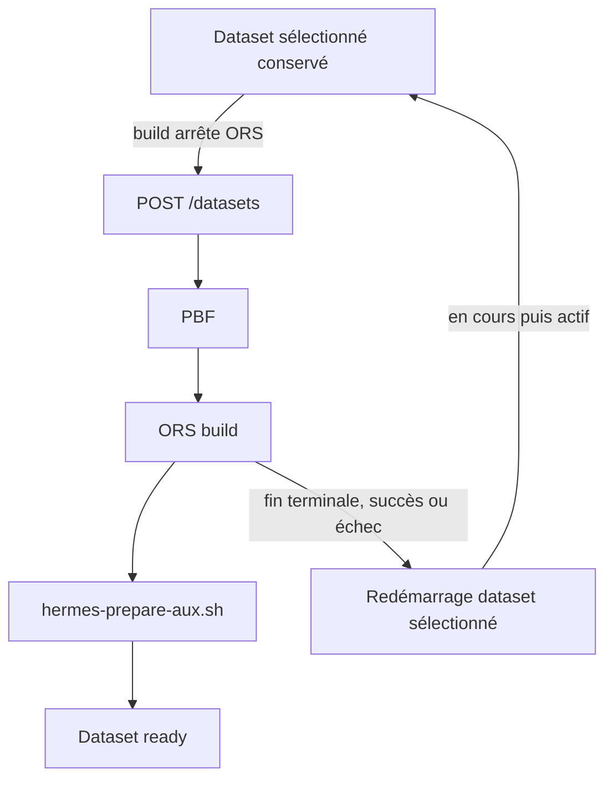
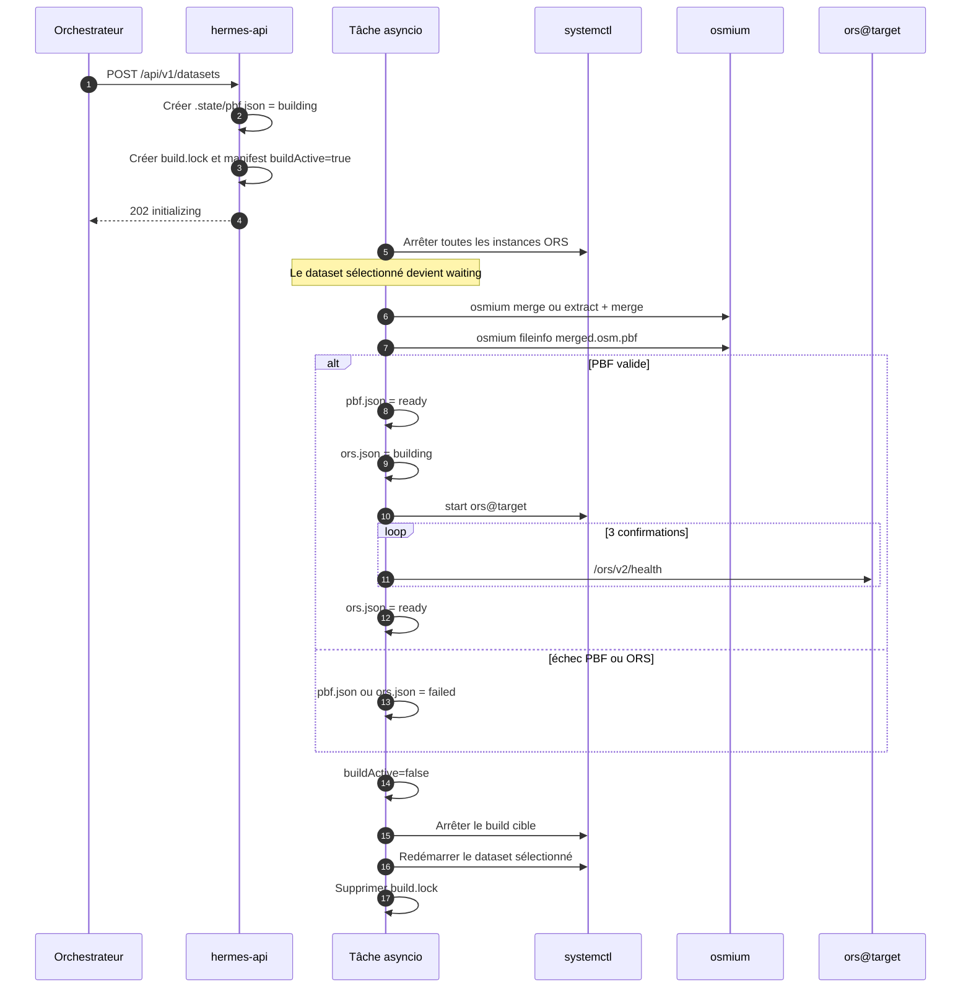
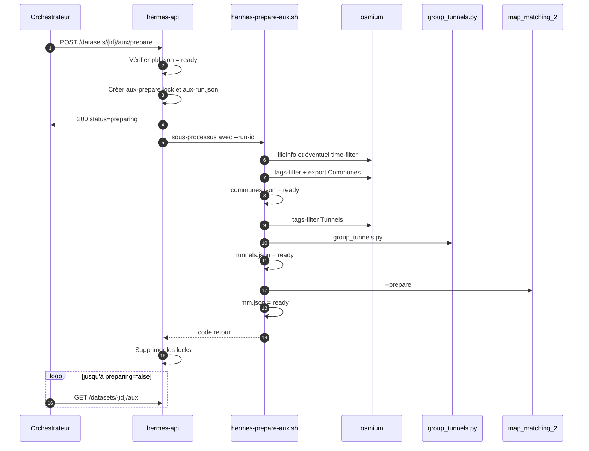
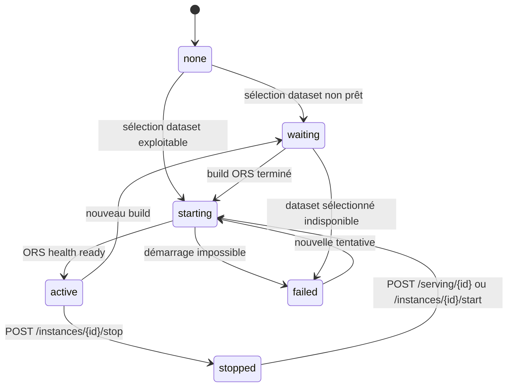

# Séquencement Hermes : états dataset, dataset servi et artefacts

> Version 1.10 — 23 novembre 2026.
>
> Source de vérité technique : `/opt/hermes-api`, marqueurs `.state/*.json` dans chaque dataset.
>
> Contrat d’interface associé : `hermes-api-contract.md` v1.10.

## 1. Principes

Hermes distingue :

1. **l’état individuel d’un dataset** : PBF, ORS, Communes, Tunnels et MM ;
2. **l’état global du dataset servi** : dataset sélectionné et disponibilité du service ORS.

Un nouveau build **ne devient pas automatiquement le dataset sélectionné**. Le dataset sélectionné est conservé dans `/srv/hermes/serving.json`. Pendant un build, il est arrêté et exposé comme `waiting`; à la fin terminale du build ORS, Hermes relance ce dataset sélectionné.

## 2. États individuels

| Identifiant API | Libellé | Condition |
|---|---|---|
| `initializing` | Initialisation | PBF en construction |
| `building` | Construction | PBF validé, ORS ou auxiliaires non terminés |
| `ready` | Prêt | PBF, ORS, Communes, Tunnels et MM validés |
| `unavailable` | Indisponible | PBF ou graphe ORS en échec |
| `degradedCommunes` | Dégradé — Communes | Communes en échec uniquement |
| `degradedTunnels` | Dégradé — Tunnels | Tunnels et/ou MM en échec, Communes prêtes |
| `degradedAux` | Dégradé — Auxiliaires | Communes en échec et Tunnels et/ou MM en échec |

### Priorité de dérivation

```text
PBF en échec ou ORS en échec
    → unavailable
PBF non prêt
    → initializing
ORS non prêt
    → building
Communes en échec et (Tunnels ou MM en échec)
    → degradedAux
Communes en échec
    → degradedCommunes
Tunnels ou MM en échec
    → degradedTunnels
PBF + ORS + Communes + Tunnels + MM prêts
    → ready
sinon
    → building
```

### Compatibilité du champ historique `status`

| Nouvel état | Ancien `status` |
|---|---|
| `initializing`, `building` | `preparing` |
| `ready`, `degraded*` | `ready` |
| `unavailable` | `failed` |

L’orchestrateur doit utiliser `state`, pas `status`.

## 3. États d’un artefact

Les cinq séquences contrôlées sont :

- `pbf` ;
- `ors` ;
- `communes` ;
- `tunnels` ;
- `mm`.

Chaque séquence expose :

```text
pending | building | ready | failed
```

Exemple de manifest enrichi :

```json
{
  "id": "Monaco",
  "state": "building",
  "stateLabel": "Construction",
  "phase": "mm",
  "status": "preparing",
  "runId": "f4b3...",
  "artifacts": {
    "pbf": {"state": "ready", "completedAt": "..."},
    "ors": {"state": "ready", "completedAt": "..."},
    "communes": {"state": "ready", "completedAt": "..."},
    "tunnels": {"state": "ready", "completedAt": "..."},
    "mm": {"state": "building", "startedAt": "..."}
  }
}
```

## 4. Marqueurs de fin de séquence

Les marqueurs sont écrits atomiquement dans :

```text
/srv/hermes/datasets/<dataset_id>/.state/
├── pbf.json
├── ors.json
├── communes.json
├── tunnels.json
├── mm.json
└── aux-run.json
```

| Séquence | Condition de `ready` |
|---|---|
| PBF | Fichier produit et validation `osmium fileinfo` réussie |
| ORS | Trois confirmations consécutives health `ready` + service actif |
| Communes | GeoJSON final écrit et JSON valide |
| Tunnels | JSON final écrit, JSON valide et structure de liste |
| MM | `map_matching_2 --prepare` code retour 0, dossier non vide, puis marqueur `ready` |

> **Règle critique** : la seule existence de `mm/` ne vaut jamais `ready`. Le dossier est créé avant la fin du calcul. Seul `mm.json` avec `state=ready` prouve que la préparation est terminée.

En cas de redémarrage de Hermes, les builds et auxiliaires interrompus sont réconciliés en `failed`; les anciens marqueurs ne sont pas laissés en `building` indéfiniment.

### Prérequis de démarrage du service

Le service utilise `ProtectSystem=strict` et des chemins `ReadWritePaths`.
Le répertoire suivant doit donc exister **avant** le démarrage de
`hermes-api.service` :

```text
/srv/hermes/datasets
```

Le script de déploiement dev le recrée avec les droits
`hermes-api:hermes-datasets` et le mode `2770` avant de redémarrer le service.
Si le répertoire est supprimé pendant que le service tourne, une création de
dataset échoue en `EROFS`; il faut recréer le répertoire puis redémarrer
`hermes-api`.

## 5. Vue d’ensemble



## 6. Séquence build dataset



### Scripts et processus requis

| Élément | Mode regions | Mode zones |
|---|---:|---:|
| `hermes-api.service` | Oui | Oui |
| `/usr/bin/osmium merge` | Oui | Oui |
| `/usr/bin/osmium extract` | Non | Oui, par région |
| `/usr/bin/systemctl` | Oui | Oui |
| `ors@<target>.service` et Java | Oui | Oui |
| `ors@<selected>.service` | Redémarrage final | Redémarrage final |

## 7. Séquence auxiliaire



### Scripts requis

> **Script principal** : `/opt/hermes-api/scripts/hermes-prepare-aux.sh`

> **Groupement Tunnels** : `/opt/hermes-api/scripts/group_tunnels.py`

> **Binaire MM** : `/opt/map-matching-2/map_matching_2.AppImage`

MM est obligatoire. `skipMm` n’est plus accepté par l’API ; une requête qui l’envoie reçoit HTTP 422.

## 8. Dataset servi

| Identifiant | Libellé | Signification |
|---|---|---|
| `none` | Aucun | Aucune sélection |
| `waiting` | En attente | Build en cours ou dataset sélectionné indisponible temporairement |
| `starting` | En cours | Démarrage demandé, health non encore prêt |
| `active` | Actif | ORS actif et health `ready` |
| `stopped` | Arrêté | Arrêt volontaire |
| `failed` | Échec | Dataset absent, indisponible ou démarrage impossible |



## 9. API de sélection

### `GET /api/v1/serving`

```json
{
  "datasetId": "Monaco",
  "state": "waiting",
  "stateLabel": "En attente",
  "datasetState": "building",
  "since": "2026-11-23T12:00:00Z",
  "reason": "construction en cours"
}
```

### `PUT /api/v1/serving/{dataset_id}`

- persiste la sélection ;
- démarre automatiquement ORS si le dataset est exploitable ;
- ne dépend pas du dataset actuellement construit.

### `DELETE /api/v1/serving`

- arrête ORS ;
- efface la sélection.

### Sélection et delete/recreate

Lorsqu’un dataset sélectionné est mis à jour par `DELETE` puis `POST`, sa sélection est conservée par id. Hermes expose `waiting` avec `pendingRebuild=true`, puis redémarre le dataset dès que le build ORS restauré atteint un état terminal.

Un échec de redémarrage conserve la sélection et produit `failed`.

## 10. Cardinalité des appels

| Opération | Appel | Nombre |
|---|---|---:|
| Sélectionner le dataset servi | `PUT /api/v1/serving/{id}` | 0 ou 1 |
| Lire l’état servi | `GET /api/v1/serving` | N |
| Créer un dataset | `POST /api/v1/datasets` | 1 |
| Suivre le dataset | `GET /api/v1/datasets/{id}` | N |
| Lancer les auxiliaires | `POST /api/v1/datasets/{id}/aux/prepare` | 1 |
| Suivre les auxiliaires | `GET /api/v1/datasets/{id}/aux` | N |
| Vérifier les instances actives | `GET /api/v1/instances` | 0 ou 1 selon diagnostic |

Un seul POST aux lance Communes, Tunnels et MM. Il n’y a pas un POST par artefact.

## 11. Conditions terminales côté orchestrateur

### Dataset individuel

```text
GET /datasets/{id}
state ∈ {
  ready,
  unavailable,
  degradedCommunes,
  degradedTunnels,
  degradedAux
}
```

`initializing` et `building` ne sont pas terminaux.

### Auxiliaires

```text
preparing == false
lastError == null
communes.state == ready
tunnels.state == ready
mm.state == ready
```

### Dataset servi

```text
state == active
```

Un état servi `active` peut coexister avec un état dataset `degradedCommunes` ou `degradedTunnels`.

## 12. Erreurs et reprises

| Situation | Réponse | Action |
|---|---:|---|
| Build déjà actif | 409 | Attendre le build en cours |
| Aux déjà actives | 409 | Poller `GET /aux` |
| PBF absent ou non validé | 409 | Reconstruire le PBF |
| Dataset `unavailable` | 200 | Supprimer/recréer via le flux prévu |
| Aux en échec | 200 + `lastError` | Corriger puis relancer avec `force=true` |
| MM partiel | `mm.state=pending/building` | Ne pas démarrer Tunnels |
| Redémarrage sélectionné impossible | served `failed` | Sélection conservée, nouvelle tentative possible |

## 13. Procédure orchestrateur

```text
1. GET /api/v1/ping
2. GET /api/v1/serving
3. PUT /api/v1/serving/{dataset_id} si sélection nécessaire
4. POST /api/v1/datasets
5. Poller GET /api/v1/datasets/{id}
6. Attendre un état terminal du PBF/ORS
7. Lancer POST /api/v1/datasets/{id}/aux/prepare avec {"force":false}
8. Poller GET /api/v1/datasets/{id}/aux
9. Exiger communes=ready, tunnels=ready, mm=ready
10. Attendre que le dataset sélectionné soit served=active
```

Le build cible et le dataset servi sont deux objets distincts : ne jamais considérer que le dernier dataset construit est automatiquement celui qui doit rester sélectionné.

## 14. Correctifs intégrés en v1.10

- Le script aux accepte un marqueur `pending` sans `startedAt`, y compris
  sous `set -euo pipefail`. Un tel marqueur ne doit plus interrompre
  silencieusement la première exécution d’une étape.
- Le trap d’erreur du script aux ne masque plus l’erreur si l’écriture du
  marqueur `failed` échoue à son tour.
- `GET /api/v1/datasets` enrichit chaque manifest avec `d.name`; l’utilisation
  de `d.id` sur un `Path` provoquait une erreur 500.
- Les tests de régression couvrent un marqueur `pending` sans `startedAt`
  ainsi que la liste `GET /api/v1/datasets`.

Après un échec auxiliaire, relancer avec :

```http
POST /api/v1/datasets/{id}/aux/prepare
{
  "force": true
}
```
