# Manuel utilisateur — GPX Climb Analyzer v3.9.2

**Public** : utilisateurs avancés, organisateurs d'événements, data analysts
**Objet** : comprendre précisément l'effet de chaque paramètre et option sur la détection des pentes, sur la carte 3D et sur le widget profil

> **Stabilité du vocabulaire.** Depuis la v3.5.2, les noms de paramètres sont figés et identiques dans l'interface et dans tous les documents (manuel, algorithmes, note technique, PRD).

---

## Table des matières

1. [Comment lire ce manuel](#1-comment-lire-ce-manuel)
2. [Vue d'ensemble du pipeline](#2-vue-densemble-du-pipeline)
3. [Interface 3 colonnes](#3-interface-3-colonnes)
4. [Les 15 paramètres numériques](#4-les-15-paramètres-numériques)
   - [4.1 Pas de rééchantillonnage](#41-pas-de-rééchantillonnage)
   - [4.2 Anti-pic : fenêtre](#42-anti-pic--fenêtre)
   - [4.3 Anti-pic : seuil](#43-anti-pic--seuil)
   - [4.4 Lissage altitude](#44-lissage-altitude)
   - [4.5 Lissage pente](#45-lissage-pente)
   - [4.6 Fenêtre de calcul pente](#46-fenêtre-de-calcul-pente)
   - [4.7 Seuil détection](#47-seuil-détection)
   - [4.8 Longueur min. pente](#48-longueur-min-pente)
   - [4.9 Écart min. entre montées](#49-écart-min-entre-montées)
   - [4.10 Recherche extrema](#410-recherche-extrema)
   - [4.11 Filtre médian](#411-filtre-médian)
   - [4.12 Lissage gaussien](#412-lissage-gaussien)
   - [4.13 Correction plateaux](#413-correction-plateaux)
   - [4.14 Segments debug](#414-segments-debug)
   - [4.15 Pas du profil exporté](#415-pas-du-profil-exporté)
5. [Les 2 options toggles](#5-les-2-options-toggles)
6. [Interactions critiques](#6-interactions-critiques)
7. [Recettes par type de trace](#7-recettes-par-type-de-trace)
8. [Diagnostic de configuration](#8-diagnostic-de-configuration)
9. [Carte Mapbox 3D](#9-carte-mapbox-3d)
10. [Widget profil altimétrique](#10-widget-profil-altimétrique)
11. [Groupes de montées (séparation / refusion)](#11-groupes-de-montées)
12. [Création manuelle d'une montée](#12-création-manuelle-dune-montée)
13. [Suppression d'une montée](#13-suppression-dune-montée)
14. [Cas pratiques](#14-cas-pratiques)
15. [Tableau de diagnostic rapide](#15-tableau-de-diagnostic-rapide)
16. [Rappel des défauts](#16-rappel-des-défauts)
17. [Glossaire](#17-glossaire)

---

## 1. Comment lire ce manuel

Chaque paramètre est présenté avec la même structure :

- **Rôle** : ce que fait le paramètre
- **Plage et défaut** : la valeur par défaut et les bornes acceptées
- **Impact sur la détection** : nul, faible, moyen, fort ou critique
- **Effet visuel** : ce qui change concrètement dans l'affichage (avec schémas mermaid)
- **Recommandations** : table de valeurs par type de trace
- **Pièges** : erreurs courantes à éviter
- **Interactions** : dépendances avec d'autres paramètres
- **Comment vérifier** : quels indicateurs observer (extraits de logs à l'appui)

**Vocabulaire** : les noms utilisés dans ce manuel sont **strictement** ceux des libellés UI. Les noms techniques n'apparaissent qu'en italique, entre parenthèses, à la première occurrence.

**Unités** : les valeurs sont suivies de leur unité (m, %, pts, px).

**Nouveautés v3.9.2** (signalées par 🆕 dans le texte) :
- Échelle X du widget montée passée de 5 à **10 m/px**
- Chargement automatique de la carte si un token existe
- Suppression de montées individuelles via ✕
- Multi-marqueurs sur la carte pour les montées groupées
- Widget montée affichant **toute la trace** à 10 m/px, avec scroll centré sur la montée sélectionnée
- Trace sur la carte = **points bruts du GPX** (pas la grille resamplée)

---

## 2. Vue d'ensemble du pipeline

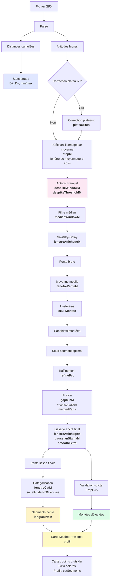

**Légende visuelle :**
- 🟦 Bleu clair : statistiques indépendantes des paramètres
- 🩷 Rose : filtre anti-pic
- 🟩 Vert : résultat principal (montées)
- 🟨 Jaune : résultat secondaire (segmentation pente)
- 🟡 Jaune pâle : rendu (carte + profil)
- **Gras** : paramètre(s) actif(s) à cette étape

**Notes clés :**

- **Rééchantillonnage par moyenne** (v3.5) : chaque point de la grille est la moyenne des points bruts dans une fenêtre centrée `min(max(Pas, 75 m), 3 × Pas)`. Atténue le bruit haute fréquence.
- **Anti-pic en mètres** (v3.6) : la fenêtre Hampel est exprimée en mètres, indépendante du Pas.
- **Catégorisation non ancrée** (v3.8.1) : la couleur des segments est calculée sur une altitude lissée **non ancrée**, distincte de la courbe affichée (ancrée). Cela évite les changements de couleur pendant le drag des poignées et garantit que la carte et le profil partagent exactement les mêmes segments.
- **Trace sur la carte = points bruts** (v3.9.2) : la trace colorée sur la carte suit les points **du fichier GPX d'origine**, pas la grille resamplée. La catégorie de chaque point brut est déterminée par sa distance cumulée.
- **Fusion avec `mergedParts`** (v3.9.0) : quand deux montées sont fusionnées (écart < `gapMinM`), les bornes de chaque sous-montée d'origine sont **conservées** pour permettre la séparation ultérieure.
- **Groupes persistants** (v3.9.1) : après séparation, les sous-montées portent un `groupId` et un `subIndex` (`#N.M`), ce qui permet de les refusionner.

**Trois groupes fonctionnels :**

| Groupe | Paramètres | Rôle |
|---|---|---|
| **A. Préparation** | Pas, Plateaux, Anti-pic (×2) | Normalise la trace avant analyse |
| **B. Détection** | Médiane, Lissage altitude, Lissage pente, Seuil, Recherche extrema, Écart min., Gaussien, Double SG | Identifie les montées |
| **C. Présentation** | Fenêtre de calcul pente, Longueur min. pente, Segments debug, Pas du profil exporté, Lissage segments | N'affecte **PAS** la détection, seulement l'affichage ou l'export |

---

## 3. Interface 3 colonnes

L'application utilise un layout 3 colonnes fixe, complété par une barre d'outils supérieure.

### 3.1 Barre d'outils

En haut, une toolbar de **56 px** contient :

- **Marque + version** (à gauche)
- **Zone de dépôt persistante** : glisser-déposer d'un GPX **n'importe où dans la fenêtre**, ou clic pour ouvrir un sélecteur. Après chargement, elle passe en mode compact et affiche `nom_fichier.gpx · N pts bruts → M pts resamplés`.
- **Bouton 🐛 Debug** : ouvre/ferme le panneau de log en bas à droite.
- **Bouton ⚙️ Paramètres** : ouvre/replie le volet droit (340 px).

### 3.2 Colonne gauche — Montées détectées

Largeur **320 px**. Liste verticale des montées, une carte par montée.

**En-tête de carte** :
- Numéro : `#N` (autonome) ou `#N.M` (groupé)
- Kilomètre du point de vallée
- Badges : `⊕` (fusions), `⤺` (repli), `•` (modifiée), `🔗 N` (groupée)
- Boutons : **✂ Séparer** (si fusionnée), **🔗 Refusionner** (si groupée), **✕** (suppression)

**Corps de carte** :
- Longueur en km
- D+ en mètres
- Pente moyenne colorée selon la catégorie

**Bandeau de groupe** : un liseré coloré `🔗 GROUPE #N · X montées` apparaît avant la première carte d'un groupe. Les cartes du groupe ont une bordure gauche de la couleur du groupe (couleur stable par `groupId`).

**Sélection** : un clic sélectionne la montée, passe en mode montée sur le widget profil, et zoome la carte. Si la montée appartient à un groupe, **le zoom couvre l'ensemble du groupe** 🆕.

### 3.3 Colonne centrale — Carte + Profil

Division verticale :
- **Carte Mapbox 3D** (en haut, flex) — voir §9
- **Widget profil** (en bas, max 45vh) — voir §10

### 3.4 Colonne droite — Paramètres

Volet repliable (⚙️) de **340 px** contenant :
- Champ **Token Mapbox** + bouton **OK**
- Toggle **Courbes de niveau**
- Bandeau d'avertissements (résumé diagnostic)
- 15 paramètres numériques regroupés par thème
- 2 toggles (Lissage renforcé, Lissage segments)
- Bouton **↺ Recharger depuis auto**
- Bouton **💾 Exporter JSON**

---

## 4. Les 15 paramètres numériques

### 4.1 Pas de rééchantillonnage

| | |
|---|---|
| **Nom UI** | Pas de rééchantillonnage |
| **Nom technique** | `stepM` |
| **Plage** | 2 – 200 m |
| **Défaut** | **50 m** |
| **Impact** | **Fondamental** — agit sur TOUT le pipeline en aval |
| **Catégorie** | Principal |

#### Rôle

Avant tout filtrage, la trace est rééchantillonnée à espacement régulier de **Pas** mètres. Depuis la v3.5, ce rééchantillonnage se fait par **moyenne** : chaque point rééchantillonné est la moyenne de tous les points bruts dont la distance cumulée tombe dans une fenêtre centrée de largeur `min(max(Pas, 75 m), 3 × Pas)`. Cela convertit les traces GPS/éditeur à densité variable en une série à pas constant, tout en atténuant le bruit haute fréquence.

#### Effet sur la détection

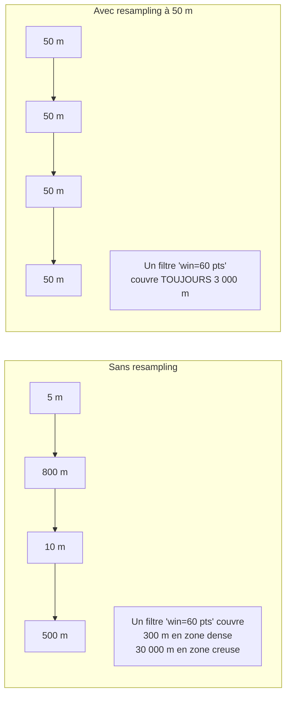

#### Choisir la valeur

| Type de trace | Pas recommandé | Motif |
|---|---|---|
| GPS terrain haute fréquence | 15 – 25 m | Conserver le détail |
| **Trace éditeur (Openrunner/SRTM)** | **50 m** | Compromis taille / fidélité |
| Trace très longue (> 100 km) | 75 – 100 m | Éviter le sur-échantillonnage |

#### Pièges

⚠️ **Trop petit (< 15 m)** :
- Sur-échantillonne : 400 points bruts → 4 000 points resamplés
- Aucun gain de précision (les points intermédiaires sont moyennés)
- Ralentit les recalculs
- Le log debug affiche une réduction négative importante

⚠️ **Trop grand (> 150 m)** :
- Perte des montées courtes (< 500 m)
- Écrête les sommets
- Le log debug affiche `Réduction : +85 %`

#### Interactions

| Couplé avec | Règle |
|---|---|
| Lissage altitude | `Pas × 10 ≤ Lissage altitude` (fenêtre SG ≥ 10 pts) |
| Lissage pente | `Pas × 3 ≤ Lissage pente` (fenêtre pente ≥ 3 pts) |
| Filtre médian | `Pas × 3 ≤ Filtre médian` (fenêtre médiane ≥ 3 pts) |
| Lissage gaussien | `Pas × 0.5 ≤ Gaussien` (σ ≥ 0.5 pt) |
| **Anti-pic : fenêtre** | **Aucune règle spécifique** — la fenêtre est déjà en mètres |
| Longueur min. pente | `Pas ≤ Longueur min. pente` (sinon inopérant) |
| Écart min. entre montées | `Pas ≤ Écart min.` (sinon inopérant) |

#### Comment vérifier

Le panneau Debug (🐛) affiche au chargement :
```
Trace brute : 3312 points
Pas brut : min 0.3 m · médian 22.4 m · moy 33.1 m · max 892.5 m
Trace resamplée : 2190 points à pas fixe 50 m · fenêtre de moyennage 75 m
```

**Règle empirique** : `Pas ≈ 2 × pas médian` pour un bon compromis.

**v3.9.2** : le Pas n'a plus d'impact sur la fidélité visuelle de la carte (trace = points bruts), seulement sur les analyses et le profil.

---

### 4.2 Anti-pic : fenêtre

| | |
|---|---|
| **Nom UI** | Anti-pic : fenêtre |
| **Nom technique** | `despikeWindowM` |
| **Plage** | 50 – 500 m |
| **Défaut** | **200 m** |
| **Impact** | **Moyen** sur la propreté du signal |
| **Catégorie** | Principal |

#### Rôle

Largeur (en mètres) du voisinage inspecté par le filtre Hampel autour de chaque point. La fenêtre est convertie en points au moment de l'exécution : `winPts = max(3, round(windowM / Pas) | 1)`. Une fenêtre de 200 m couvre **±100 m** autour de chaque point.

Le filtre Hampel **remplace** un point par la médiane de sa fenêtre **uniquement** si l'écart entre le point et cette médiane dépasse le seuil (paramètre suivant).

#### Effet visuel

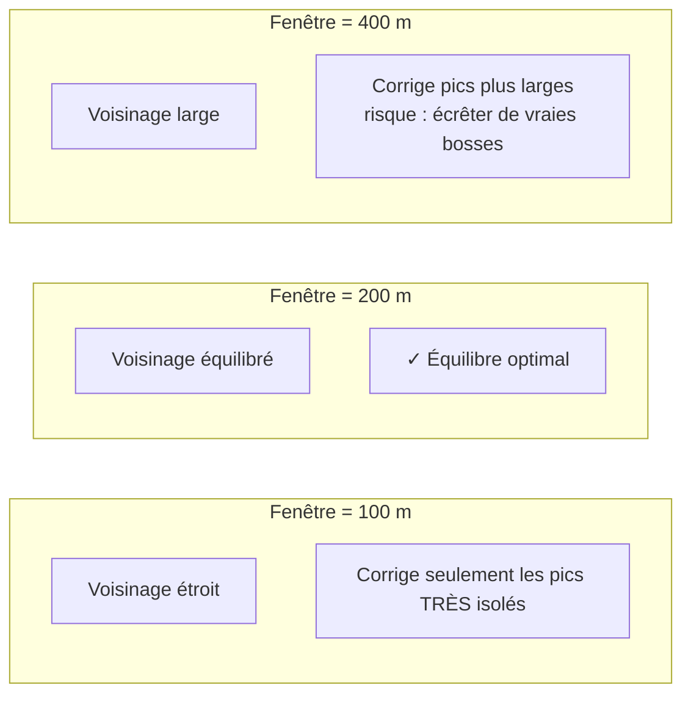

#### Choisir la valeur

| Type de trace | Fenêtre | Motif |
|---|---|---|
| Trace très propre | 100 m | Détection fine |
| **Trace GPS terrain** | **200 m** | Équilibre bruit / relief |
| Trace éditeur (SRTM) | 200 – 250 m | Glitch SRTM isolé |
| Vraies bosses larges | 300 m | Préserver les reliefs |
| Séries de glitchs | 400 – 500 m | Corriger des groupes de glitchs |

#### Pièges

⚠️ **Trop petite (< 100 m)** : inefficace, le filtre ne corrige que les pics très isolés — diagnostic 🟠 orange.

⚠️ **Trop grande (> 400 m)** :
- Risque de couper de vraies bosses
- Diagnostic 🟠 orange

⚠️ **Fenêtre < 2 × Pas** : l'arrondi en points force la fenêtre effective à un minimum de 3 pts (soit 3 × Pas mètres), ce qui élargit la fenêtre demandée. Diagnostic 🟠.

#### Interactions

| Couplé avec | Règle |
|---|---|
| Anti-pic : seuil | Si seuil = 0, la fenêtre est ignorée |
| Pas | Aucune — la fenêtre est déjà en mètres |
| Filtre médian | **Redondant** — si anti-pic actif, désactiver filtre médian |

#### Comment vérifier

Le panneau Debug affiche au chargement :
```
🩹 Anti-pic (fenêtre=200 m → 5 pts ≈ 250 m, seuil=15 m) : 2 point(s) corrigé(s) sur 2190
```

- **0 point corrigé** : soit la trace est propre, soit le seuil est trop haut, soit la fenêtre est trop petite
- **2–10 points corrigés** : normal sur une trace SRTM
- **Plus de 50 points corrigés** : seuil trop bas ou fenêtre trop grande

Le panneau Diagnostic affiche la valeur effective :
```
● Anti-pic : fenêtre ..... 200 m · 5 pts effectifs ≈ 250 m
```

---

### 4.3 Anti-pic : seuil

| | |
|---|---|
| **Nom UI** | Anti-pic : seuil |
| **Nom technique** | `despikeThresholdM` |
| **Plage** | 0 – 100 m |
| **Défaut** | **15 m** |
| **Impact** | **Moyen** — détermine l'agressivité du filtre |
| **Catégorie** | Principal |

#### Rôle

Écart minimal (en mètres) entre le point et sa médiane locale pour déclencher la correction. En dessous du seuil, le point est conservé tel quel.

#### Effet visuel

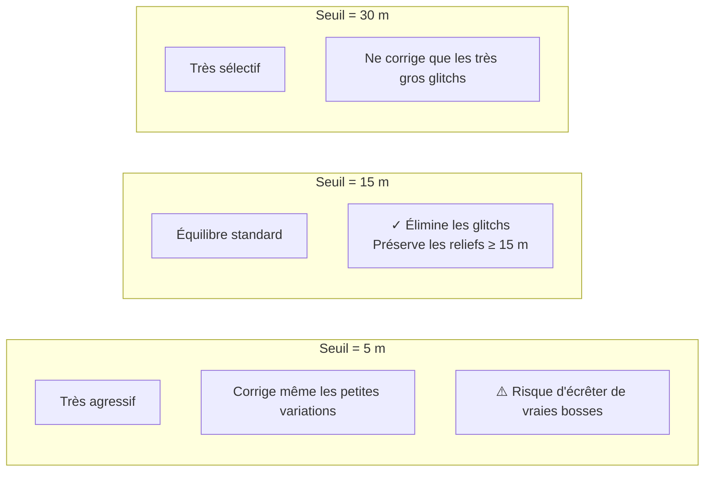

#### Schémas avant/après

**Cas 1 — Glitch isolé (corrigé avec seuil = 15 m)**
```
Fenêtre = 200 m, seuil = 15 m

Avant :  [1180, 1182, 1183, 1250, 1185, 1186, 1187]
                          ^^^^^ écart de 67 m → CORRIGÉ
Après :  [1180, 1182, 1183, 1183, 1185, 1186, 1187]
                          ^^^^^ remplacé par la médiane
```

**Cas 2 — Vrai relief (préservé avec seuil = 15 m)**
```
Fenêtre = 200 m, seuil = 15 m

Avant :  [1180, 1182, 1183, 1190, 1198, 1205, 1210]
                          ^^^^^ écart de 7 m → PRÉSERVÉ
Après :  [1180, 1182, 1183, 1190, 1198, 1205, 1210]
                          ^^^^^ inchangé
```

#### Choisir la valeur

| Type de trace | Seuil | Motif |
|---|---|---|
| Trace très propre | 10 m | Détection fine |
| **SRTM standard** | **15 m** | Bon équilibre |
| GPS capteur bruité | 20–30 m | Le bruit peut atteindre 30 m |
| Vraies bosses larges | 25 m | Préserver les reliefs de +25 m |
| Désactiver | **0** | Comportement avant anti-pic |

#### Pièges

⚠️ **Trop bas** (< 5 m) :
- Corrige même les petites variations normales
- Risque d'écrêter de vraies bosses
- Le diagnostic affiche 🟠 orange

⚠️ **Trop haut** (> 50 m) :
- Ne capturera que les glitchs très importants
- Le diagnostic affiche 🟠 orange

⚠️ **Seuil = 0** : filtre complètement désactivé
- Retour au comportement sans anti-pic
- Le diagnostic affiche ⚪ gris (désactivé)

#### Interactions

| Couplé avec | Règle |
|---|---|
| Anti-pic : fenêtre | Si fenêtre < 2 × Pas, la fenêtre effective est élargie |
| Lissage altitude | L'anti-pic **avant** le SG → SG reçoit un signal propre |
| Filtre médian | **Redondant** — désactiver si anti-pic actif |
| Correction plateaux | Complémentaire — plateaux traités avant anti-pic |

#### Comment vérifier

Le panneau Debug affiche :
```
🩹 Anti-pic (fenêtre=200 m → 5 pts ≈ 250 m, seuil=15 m) : 2 point(s) corrigé(s) sur 2190
```

Après correction, ouvrez la carte (🗺️) : un pic aigu dans la trace colorée doit avoir disparu.

Le panneau Diagnostic affiche :
```
● Anti-pic : seuil ....... 15 m
```

---

### 4.4 Lissage altitude

| | |
|---|---|
| **Nom UI** | Lissage altitude |
| **Nom technique** | `fenetreAffichageM` |
| **Plage** | 20 – ∞ m |
| **Défaut** | **500 m** |
| **Impact** | **Fort** — définit la résolution verticale |
| **Catégorie** | Principal |

#### Rôle

Contrôle le Savitzky-Golay appliqué à l'altitude, utilisé à **trois** fins depuis la v3.8.1 :

1. **Détection initiale** (via la pente dérivée)
2. **Courbe affichée** sur le profil (via lissage ancré, `eleDisplay`)
3. **Catégorisation des couleurs** (via une version **non ancrée** de ce lissage, `eleBaseCat`)

#### Effet sur la détection

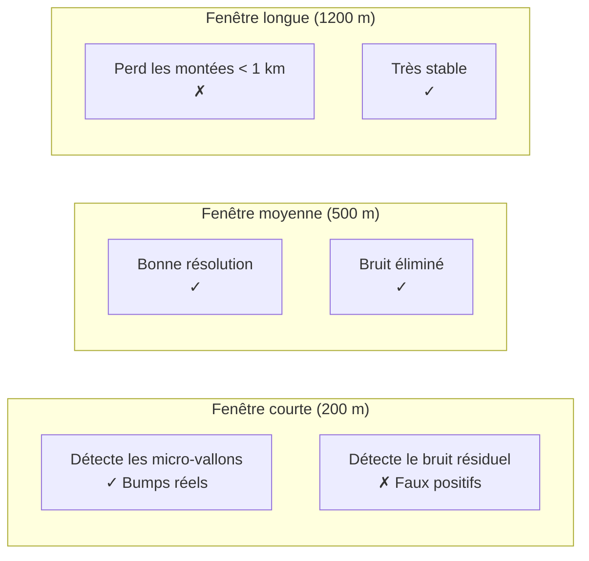

#### Valeur effective en points

La fenêtre effective en points = `Lissage altitude / Pas`. Pour que le SG soit efficace, il faut **≥ 10 points**.

| Pas | Lissage alt. | Fenêtre | SG efficace |
|---|---|---|---|
| 50 m | 300 m | 6 pts | ❌ inefficace |
| **50 m** | **500 m** | **10 pts** | ✅ juste |
| 50 m | 1000 m | 20 pts | ✅ optimal |
| 100 m | 300 m | 3 pts | ❌ inefficace |

**Important** : avec `Pas = 100 m` et `Lissage altitude = 300 m`, la fenêtre SG n'est que de **3 points** — le lissage altitude est donc **inefficace**. Le panneau Diagnostic vous avertit (🔴 rouge).

#### Recommandations cohérentes

| Pas | Lissage alt. recommandé |
|---|---|
| 25 m | 400 m |
| **50 m** | **500 m** |
| 100 m | 1000 m |

#### Pièges

⚠️ **Trop court** : la montée peut être fragmentée en 5–10 micro-montées à cause du bruit de pente.

⚠️ **Trop long** : une montée de 4 km sera vue comme un long faux-plat.

⚠️ **Non cohérent avec le Pas** : fenêtre SG < 10 pts → lissage inefficace. Le diagnostic vous avertit.

#### Interactions

| Couplé avec | Règle |
|---|---|
| Pas | `Pas × 10 ≤ Lissage altitude` |
| Lissage pente | `Lissage pente ≤ Lissage altitude / 2` |
| Recherche extrema | Ancre les extrema dans la courbe |

#### Comment vérifier

Le panneau Diagnostic affiche la valeur effective :
```
● Lissage altitude ..... ≈ 10 points   optimal 10-40 pts
```

Si vous modifiez le lissage et que la valeur effective tombe sous 10, un avertissement apparaît :
```
⚠ Le Lissage altitude produit une fenêtre de 8 points. Recommandé ≥ 10.
```

**v3.9.2** : sur le profil, la courbe affichée reste ancrée sur les bornes des montées. Mais les **couleurs** (segments de catégorie) sont calculées sur une version non ancrée — ce qui garantit leur stabilité pendant le drag des poignées.

---

### 4.5 Lissage pente

| | |
|---|---|
| **Nom UI** | Lissage pente |
| **Nom technique** | `fenetrePenteM` |
| **Plage** | 10 – ∞ m |
| **Défaut** | **150 m** |
| **Impact** | **Fort** — détermine la sensibilité de l'hystérésis |
| **Catégorie** | Principal |

#### Rôle

Après le calcul de la pente instantanée, une moyenne mobile est appliquée. Cette pente lissée est utilisée **uniquement** pour l'hystérésis de détection.

#### Effet

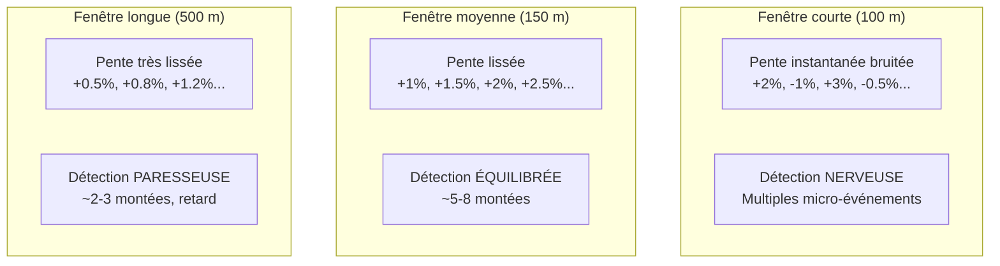

#### Retard de détection

Le retard de détection ≈ `Lissage pente / 2`.

| Lissage pente | Retard |
|---|---|
| 100 m | 50 m |
| 150 m | 75 m |
| 500 m | 250 m |

#### Recommandations

| Sensibilité souhaitée | Valeur |
|---|---|
| Détection très sensible (trail) | 100–150 m |
| **Équilibrée** (route, cyclotourisme) | **150–250 m** |
| Robuste (grandes sorties) | 300–400 m |

#### Pièges

⚠️ **Trop courte** : la pente lissée oscille autour du seuil → fragmentation.

⚠️ **Trop longue** : les montées courtes et raides (mur de 300 m) deviennent **invisibles**.

#### Interactions

| Couplé avec | Règle |
|---|---|
| Lissage altitude | `Lissage pente ≤ Lissage altitude / 2` |
| Seuil détection | Retard ≈ `Lissage pente / 2` |

#### Comment vérifier

Le panneau Diagnostic affiche :
```
● Lissage pente ........ ≈ 3 points   optimal 3-10 pts
● Seuil détection ...... 0.5 %   Retard ≈ 75 m
```

Un ratio `Lissage altitude / Lissage pente < 2` déclenche un avertissement 🔴.

---

### 4.6 Fenêtre de calcul pente

| | |
|---|---|
| **Nom UI** | Fenêtre de calcul pente |
| **Nom technique** | `fenetreCatM` |
| **Plage** | 50 – ∞ m |
| **Défaut** | **100 m** |
| **Impact** | **Aucun** sur la détection — **affichage uniquement** |
| **Catégorie** | Principal |

#### Rôle

Contrôle la largeur de la fenêtre glissante utilisée pour calculer la pente qui **colore la trace sur la carte** et **le fond du profil**. N'affecte **jamais** les montées détectées.

#### Effet visuel

```
Trace avec alternance plat / montée / plat / montée (chaque zone = 300 m)

Fenêtre de calcul pente = 100 m :
[▁▁▁▁][▂▂▂▂][▁▁▁▁][▂▂▂▂]   ← 4 zones alternées, grande finesse
vert   orange vert   orange

Fenêtre de calcul pente = 500 m :
[──────▂───────────▂──]   ← 2 zones moyennes (lissage)
vert     orange    vert

Fenêtre de calcul pente = 1500 m :
[──────orange──────────────────]  ← 1 seule zone (tout fondu)
```

#### Recommandations

| Trace | Valeur |
|---|---|
| **Trace découpée (relances)** | **100–200 m** |
| Route classique | 200–300 m |
| Trace longue (> 100 km) | 500–800 m |

#### Pièges

⚠️ **Trop courte** : la bande de coloration devient un patchwork illisible.

⚠️ **Trop longue** : toute la trace paraît « orange uniforme ».

**Indépendance** : `Fenêtre de calcul pente` peut différer de `Lissage pente` — ce sont deux usages différents.

#### Comment vérifier

Observez la trace colorée sur la carte (🗺️) et le remplissage coloré du profil. Si le patchwork est trop morcelé, augmentez la fenêtre. Si tout est uniforme, réduisez-la.

**v3.8.1** : cette pente est calculée sur l'altitude **non ancrée** (elle ne change donc pas quand vous déplacez une poignée sur le profil).

---

### 4.7 Seuil détection

| | |
|---|---|
| **Nom UI** | Seuil détection |
| **Nom technique** | `seuilMontee` |
| **Plage** | 0.1 – ∞ % |
| **Défaut** | **0.5 %** |
| **Impact** | **Critique** — définit ce qu'est « une montée » |
| **Catégorie** | Principal |

#### Rôle

Hystérésis : on entre en mode « montée » quand la pente lissée dépasse `+Seuil`, on sort quand elle descend sous `−Seuil`.

#### Effet

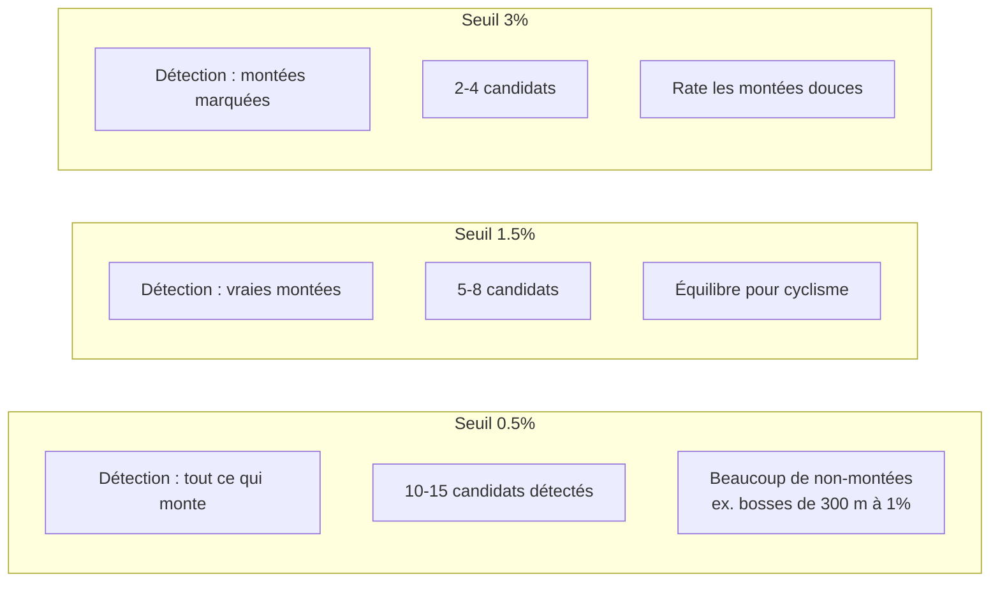

#### Hystérésis

L'hystérésis utilise deux seuils :
- **Entrée en montée** : pente > +Seuil
- **Sortie de montée** : pente < −Seuil

Cela évite les oscillations quand la pente est proche de zéro.

#### Recommandations

| Objectif | Valeur |
|---|---|
| Détecter toutes les bosses | 0.3–0.5 % |
| **Équilibré** | **0.5–1.0 %** |
| Ne garder que les vraies montées | 1.5–2.0 % |
| Ne garder que les cols | 3.0 % |

#### Pièges

⚠️ **Trop bas** : fragmentation, nécessite une fusion forte.

⚠️ **Trop haut** : rate les montées douces (cols à 3–4 % moyen).

#### Interaction critique avec Écart min. entre montées

Avec un seuil bas, la détection **fragmente** les montées. La fusion (§4.9) est là pour rattraper.

Recommandation : **garder un seuil bas** (0.5%) + **une fusion** (250 m) plutôt que monter le seuil.

#### Comment vérifier

Le panneau Debug affiche le nombre de candidats et le résultat final :
```
[v3.9.2] 2 fusion(s)
[v3.9.2] 5 conservées, 1 replis
```

Comptez les montées dans la colonne gauche. Si vous en avez 15 avec beaucoup de `⊕`, le seuil est trop bas. Si vous en avez 1 et que vous savez qu'il y en a 5, il est trop haut.

---

### 4.8 Longueur min. pente

| | |
|---|---|
| **Nom UI** | Longueur min. pente |
| **Nom technique** | `longueurMin` |
| **Plage** | 0 – ∞ m |
| **Défaut** | **200 m** |
| **Impact** | **Aucun** sur la détection — **affichage uniquement** |
| **Catégorie** | Principal |

#### Rôle

Fusionne les segments de pente (catégorie) plus courts que cette longueur dans leur voisin le plus long. Évite les micro-taches de couleur sur la carte et le profil.

#### Effet visuel

```
Trace avec 3 alternances rapides de 80 m chacune :

Longueur min. pente = 0 :
[vert][orange][vert][orange][vert]   ← patchwork

Longueur min. pente = 200 :
[────orange────────────────────]     ← fondue en orange
```

#### Recommandations

| Type de trace | Valeur |
|---|---|
| Trace très courte | 100–150 m |
| **Route classique** | **200–250 m** |
| Trace longue | 300–500 m |

#### Piège

⚠️ **Trop grand** : le fond perd les micro-pentes.

⚠️ **Longueur min. pente < Pas** : paramètre **inopérant** — le diagnostic vous le signale.

**Note** : ce paramètre n'affecte **que** le fond de couleur et le tableau statistique par catégorie.

#### Comment vérifier

Comparez la trace colorée avant/après modification. Si vous voyez des taches de 10 m de large, augmentez la valeur.

---

### 4.9 Écart min. entre montées

| | |
|---|---|
| **Nom UI** | Écart min. entre montées |
| **Nom technique** | `gapMinM` |
| **Plage** | 0 – 5000 m |
| **Défaut** | **250 m** |
| **Impact** | **Fort** sur la cohérence des montées |
| **Catégorie** | Avancé |

#### Rôle

Deux montées détectées séparées de moins de **Écart min.** sont **fusionnées** en une seule. Le nouveau sommet est le plus haut des deux, le nouveau creux est le plus bas.

**Nouveauté v3.9.0** : chaque fusion **conserve les bornes** de chaque sous-montée d'origine dans `mergedParts`. Cela permet de **séparer** la montée fusionnée ultérieurement (voir §11).

#### Le problème résolu

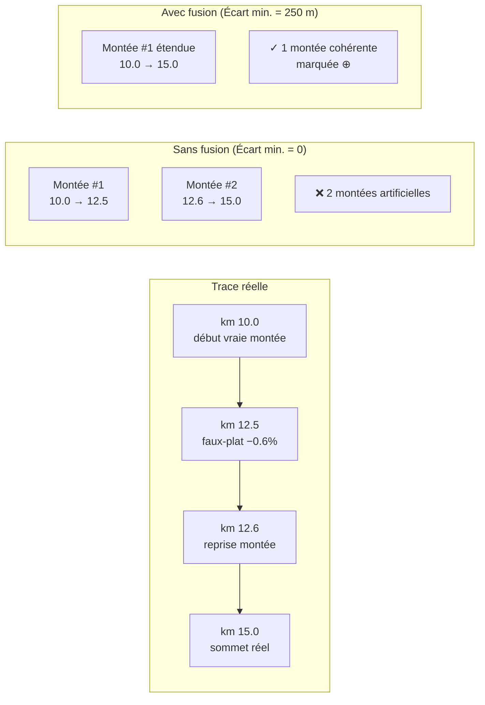

#### Effet sur la pente moyenne

⚠️ La fusion **dilue la pente**. Un faux-plat de 100 m dans une montée de 5 km à 8 % peut ramener la pente à 7.9 %.

C'est pour cette raison que la **validation stricte (v3.1)** intervient après : si les bornes finales fusionnées passent sous le seuil, elles sont **repliées sur le sous-segment valide** avec l'indicateur `⤺`.

#### Recommandations

| Type de trace | Valeur |
|---|---|
| **Col enchaîné (Mortirolo)** | **200–300 m** |
| Route sinueuse | 250–400 m |
| Gravel / VTT nerveux | 150–250 m |
| Route droite | 0–100 m |
| Désactiver | **0** |

#### Comment vérifier

Le panneau Debug affiche :
```
[v3.9.2] 2 fusion(s) — écart min. 250 m
⊕ Montée #6 étendue : écart 1 m < 250 m → km 71.750–75.750 (4.00 km)
```

L'indicateur `⊕` apparaît sur les lignes fusionnées du tableau. Un bouton **✂ Séparer** apparaît sur la carte pour découper la montée en ses sous-montées d'origine.

---

### 4.10 Recherche extrema

| | |
|---|---|
| **Nom UI** | Recherche extrema |
| **Nom technique** | `refinePct` |
| **Plage** | 1 – 500 % |
| **Défaut** | **60 %** |
| **Impact** | **Fort** sur la précision des bornes |
| **Catégorie** | Avancé |

#### Rôle

Après la détection initiale, chaque montée cherche son **vrai** creux et **vrai** sommet dans un rayon de `clamp(Recherche extrema% × longueur, 1500, 8000)` mètres.

#### Formule

```
effectiveRefine = min(8000, max(1500, Recherche extrema% × longueurDétectée))
```

#### Table d'exemples

| Longueur détectée | 30% | 60% | 150% |
|---|---|---|---|
| 500 m | 1500 m (plancher) | 1500 m (plancher) | 1500 m (plancher) |
| 3 km | 1500 m (plancher) | 1800 m | 4500 m |
| 8 km | 2400 m | 4800 m | 8000 m (plafond) |
| 15 km | 4500 m | 8000 m (plafond) | 8000 m (plafond) |

#### Choisir la valeur

| Cas | Valeur | Motif |
|---|---|---|
| Trace très fiable (SRTM propre) | **40 – 60 %** | Recherche serrée |
| Trace bruitée | 80 – 120 % | Chercher large |
| Montées très définies | 30 – 50 % | Éviter d'avaler les voisines |
| Montées enchaînées | **50 – 80 %** | Compromis |

#### Piège

⚠️ **Trop grand** : la recherche peut déborder sur la montée suivante et produire un chevauchement (résolu par la contrainte anti-chevauchement, mais avec un `⚠` orange).

⚠️ **Trop petit** : le vrai sommet peut être 500 m après le candidat brut.

#### Comment vérifier

La colonne Extrema du tableau affiche la valeur effective par montée :
```
Extrema
1500
1800
4500
```

Une valeur proche de 1500 (plancher) indique une montée courte. Une valeur proche de 8000 (plafond) indique une longue montée avec latitude maximale.

---

### 4.11 Filtre médian

| | |
|---|---|
| **Nom UI** | Filtre médian |
| **Nom technique** | `medianWindowM` |
| **Plage** | 0 – 300 m |
| **Défaut** | **0 m** (désactivé) |
| **Impact** | **Faible** — élimination des pics isolés |
| **Catégorie** | Avancé |

#### Rôle

Élimine les valeurs aberrantes isolées AVANT tout autre traitement.

**Depuis v3.3, l'anti-pic Hampel rend le filtre médian largement redondant.** Le rééchantillonnage par moyenne (v3.5) renforce encore cette redondance. Recommandation : **le laisser désactivé (0)** si l'anti-pic est actif.

#### Effet

Pour `Filtre médian = 0` : désactivé
Pour `Filtre médian = 50 m` : avec `Pas = 50 m`, la fenêtre effective = **1 point** → peu efficace
Pour `Filtre médian = 200 m` : fenêtre de 4 points → commence à agir

#### Recommandations

| Trace | Valeur | Motif |
|---|---|---|
| GPS capteur très bruité | 100–150 m | Débruitage complémentaire |
| **Toutes traces en v3.5+** | **0** | **Anti-pic + moyennage suffisent** |
| Trace avec pics très nombreux | 50–100 m | Renfort du débruitage |

#### Piège

⚠️ **Avec `Pas = 50 m`, 100 m → fenêtre = 2 pts → filtre inopérant**.
- Le diagnostic vous le signale 🟠 orange
- Augmentez à 200 m ou désactivez

**Recommandation v3.9.2** : préférez l'**anti-pic** au filtre médian. Gardez `Filtre médian = 0` si `Anti-pic : seuil > 0`.

#### Comment vérifier

Le panneau Diagnostic affiche :
```
● Filtre médian ........ désactivé
```
ou
```
● Filtre médian ........ ≈ 4 points   optimal désactivé ou ≥ 3 pts
```

---

### 4.12 Lissage gaussien

| | |
|---|---|
| **Nom UI** | Lissage gaussien |
| **Nom technique** | `gaussianSigmaM` |
| **Plage** | 0 – 500 m |
| **Défaut** | **75 m** |
| **Impact** | **Moyen** — adoucissement global |
| **Catégorie** | Avancé |

#### Rôle

Après le SG et avant l'ancrage final, applique une convolution gaussienne d'écart-type σ. Adoucit les transitions entre segments.

#### Effet

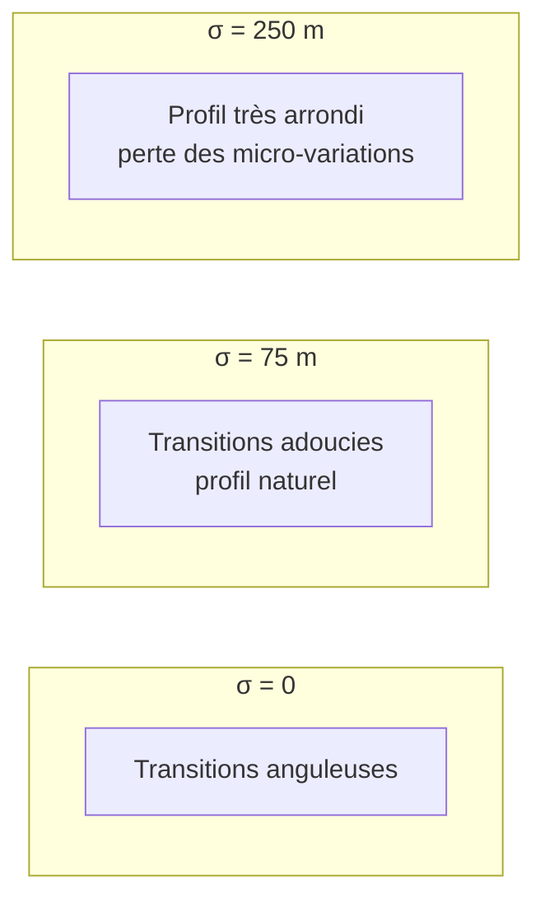

#### Valeur effective en points

σ en points = `Lissage gaussien / Pas`. Pour que le filtre soit efficace, il faut **σ ≥ 0.5 point**.

| Pas | σ | Points | Efficace |
|---|---|---|---|
| 25 m | 75 m | 3 pts | ✅ |
| 50 m | 75 m | 1.5 pts | ✅ |
| 100 m | 75 m | 0.75 pt | ⚠️ limite |

**Important** : avec `Pas = 100 m` et `Gaussien = 75 m`, σ = **0.75 point** — le filtre est **quasiment inopérant**. Le panneau Diagnostic vous avertit (🟠 orange).

#### Recommandations

| Trace | σ |
|---|---|
| Analyse précise | 30–50 m |
| Équilibré | 75–100 m |
| Profil très lissé | 150–250 m |
| Désactivé | **0** |

**Recommandation cohérente** : `σ ≥ 0.5 × Pas`. Avec `Pas = 50 m` → σ ≥ 25 m minimum, idéalement 75 m.

#### Piège

⚠️ σ trop grand (> 5 × Pas) → perte des micro-dénivelés et aspect « écrasé ».

#### Comment vérifier

Le panneau Diagnostic affiche :
```
● Lissage gaussien ..... σ ≈ 1.5 points   optimal 0.5-5 pts
```

Un σ sous 0.5 pt déclenche un avertissement :
```
⚠ Le Lissage gaussien produit un σ de 0.4 point. Recommandé ≥ 0.5.
```

---

### 4.13 Correction plateaux

| | |
|---|---|
| **Nom UI** | Correction plateaux |
| **Nom technique** | `plateauRun` |
| **Plage** | 0 – 20 pts |
| **Défaut** | **6 pts** |
| **Impact** | **Variable** — utile sur MNT, inutile sur GPS |
| **Catégorie** | Avancé |

#### Rôle

Détecte les séries de **Correction plateaux** points consécutifs ayant une altitude identique (ou ±1 m) et les interpole linéairement.

**Sur les traces éditeur/MNT SRTM** : les altitudes sont entières (MNT quantifié au mètre). Un long tronçon plat peut apparaître comme une série de `1211, 1211, 1211, 1211, 1211, 1211, 1210, 1210...`.

#### Schéma

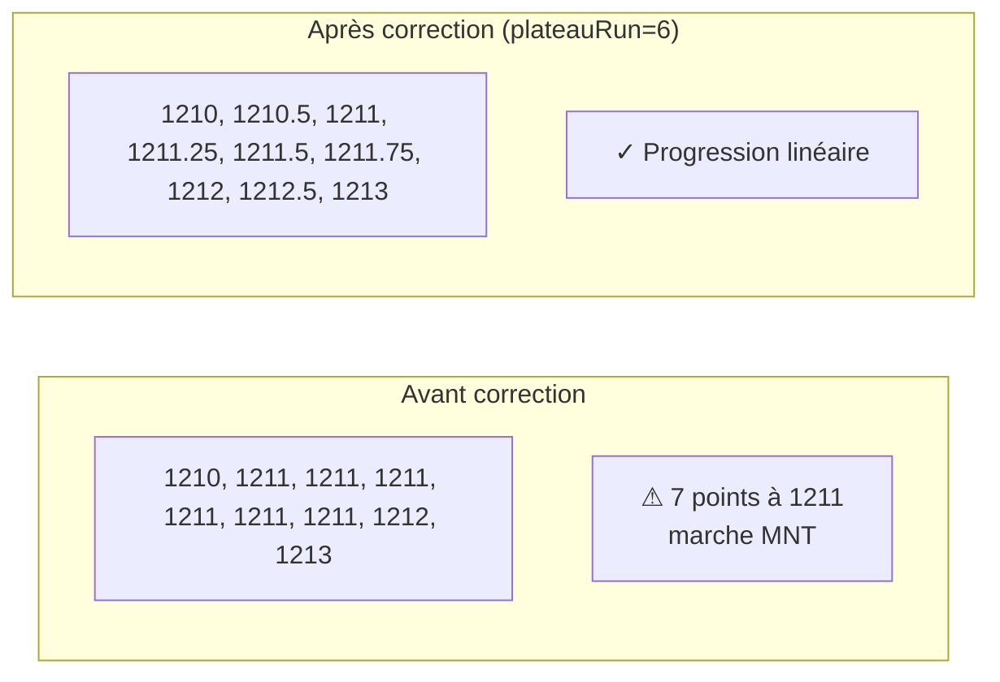

#### Recommandations

| Trace | Valeur |
|---|---|
| **Trace éditeur (SRTM)** | **4 – 8** |
| Trace GPS propre | 0 – 4 |
| Trace GPS bruitée | 0 (désactivé) |

#### Interaction avec le Pas

Après un rééchantillonnage à `Pas > 50 m`, les marches MNT de 30 m sont **diluées** par la moyenne. Le filtre devient souvent inutile.

**Conseil** : passer `Correction plateaux` à **0** si `Pas > 50 m`.

⚠️ Sur les **vrais arrêts** GPS, l'altitude reste constante → le filtre va créer à tort une pente artificielle.

#### Comment vérifier

Le panneau Debug affiche :
```
🟧 Correction plateaux (run=6) : 12
```

Un nombre élevé (> 50) indique soit une trace très MNT, soit un `plateauRun` trop permissif.

---

### 4.14 Segments debug

| | |
|---|---|
| **Nom UI** | Segments debug |
| **Nom technique** | `segmentLogM` |
| **Plage** | 10 – 2000 m |
| **Défaut** | **100 m** |
| **Impact** | **Aucun** — debug uniquement |
| **Catégorie** | Debug |

#### Rôle

Contrôle la granularité du log détaillé d'une montée (affiché dans le panneau Debug quand vous cliquez sur une ligne du tableau).

N'affecte **rien** dans la détection ni dans l'affichage.

#### Exemple de sortie debug

```
📊 Montée #6  km 71.750 → 75.750
   Total : 4.000 km  |  D+ 341 m  |  Pente moy. 8.5 %

   Seg │  km début → km fin  │ Long. │  D+   │  Pente
   ──────────────────────────────────────────────────
     1 │ 71.750 → 71.850 │  100 m │   12 m │  12.0 %   ◀ vallée
     2 │ 71.850 → 71.950 │  100 m │   11 m │  11.0 %
     3 │ 71.950 → 72.050 │  100 m │    8 m │   8.0 %
   ...
    40 │ 75.650 → 75.750 │  100 m │    6 m │   6.0 %   ◀ sommet
```

#### Utilité

- Vérifier si une montée contient un faux-plat (où ?)
- Analyser la régularité d'un col
- Détecter les irrégularités locales

**Recommandation** : laisser à 100 m. Augmenter à 250 m pour une vue macro, réduire à 50 m pour un audit fin.

---

### 4.15 Pas du profil exporté 🆕

| | |
|---|---|
| **Nom UI** | Pas du profil exporté |
| **Nom technique** | `exportProfileStepM` |
| **Plage** | 10 – 500 m |
| **Défaut** | **50 m** |
| **Impact** | **Aucun** sur la détection — **export JSON uniquement** |
| **Catégorie** | Export |

#### Rôle

Granularité cible (en mètres) des tranches de `slopeProfile` dans le JSON exporté. Chaque tranche appartient intégralement à un seul segment global.

#### Effet sur l'export

Un `slopeProfile` de pas 50 m découpe chaque montée en tranches de 50 m (ou moins si le segment global est plus court). Un pas de 20 m génère plus de tranches mais plus de détail.

#### Contrainte

`Pas du profil exporté ≤ Longueur min. pente` (sinon diagnostic 🟠). Si supérieur, les tranches sont raccourcies dynamiquement pour rester dans un seul segment.

#### Recommandations

| Usage | Valeur |
|---|---|
| Analyse détaillée | 20–30 m |
| **Export standard** | **50 m** |
| Export compact | 100 m |

#### Comment vérifier

Le panneau Diagnostic affiche :
```
● Pas du profil exporté  50 m   optimal ≤ 200 m
```

Un avertissement apparaît si `exportProfileStepM > longueurMin` :
```
⚠ Le Pas du profil exporté (300 m) est supérieur à Longueur min. pente (200 m).
```

---

## 5. Les 2 options toggles

### 5.1 Lissage renforcé (double SG)

| | |
|---|---|
| **Nom UI** | Lissage renforcé (double SG) |
| **Nom technique** | `smoothExtra` |
| **Type** | Toggle (on/off) |
| **Défaut** | **ON** |
| **Impact** | **Moyen** sur le profil affiché |

#### Rôle

Après le lissage ancré final, applique un **second** Savitzky-Golay de fenêtre double (`2 × Lissage altitude`). Les ancres sont ensuite re-forcées pour préserver les extrema.

#### Schéma

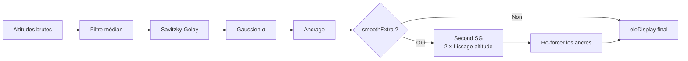

#### Effet

- **Sans** : le profil peut avoir de légères oscillations résiduelles
- **Avec** : profil plus lisse, transitions très adoucies

#### Recommandation

- `ON` si `Lissage altitude ≤ 600 m`
- `OFF` si `Lissage altitude > 1000 m` (risque d'écraser les micro-détails)

### 5.2 Lissage des pentes de segment

| | |
|---|---|
| **Nom UI** | Lissage des pentes de segment |
| **Nom technique** | `segmentSmooth` |
| **Type** | Toggle (on/off) |
| **Défaut** | **ON** |
| **Impact** | **Aucun** — debug uniquement |

#### Rôle

Dans le log détaillé par segments (panneau Debug), applique une **médiane mobile à 3** sur les pentes des segments consécutifs. Élimine les pics isolés dans le log.

**N'affecte PAS** la détection ni l'affichage. Seul le log Debug est modifié.

#### Utilité

- Affiche les segments lissés marqués `·lissé`
- Rend le log plus lisible

---

## 6. Interactions critiques

### 6.1 Règles de cohérence

```
1. Pas × 10 ≤ Lissage altitude   (fenêtre SG ≥ 10 pts)
2. Lissage altitude ≥ 2 × Lissage pente
3. Filtre médian ≥ 3 × Pas (ou 0)
4. Lissage gaussien ≥ 0.5 × Pas (ou 0)
5. Écart min. entre montées ≥ Pas (ou 0)
6. Longueur min. pente ≥ Pas (ou 0)
7. Anti-pic : fenêtre ≥ 2 × Pas (ou seuil = 0)
8. Anti-pic : seuil ≥ 5 m (ou 0)
9. Pas du profil exporté ≤ Longueur min. pente
```

### 6.2 Matrice d'interactions

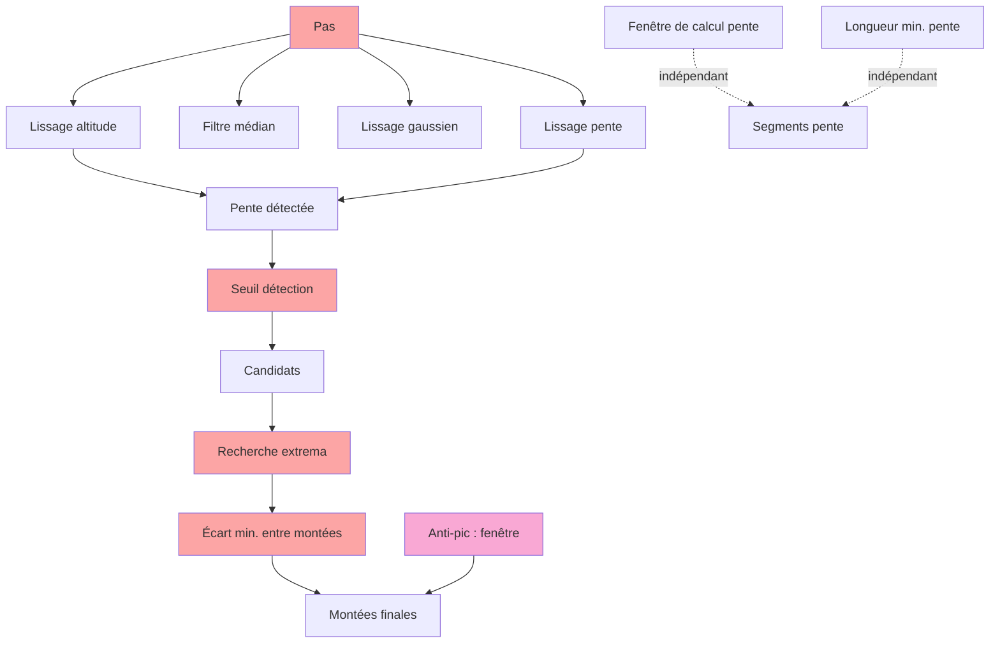

Les paramètres en **rouge** ont un impact direct sur la détection. Le paramètre **rose** est l'anti-pic.

### 6.3 Chaîne de la fragmentation

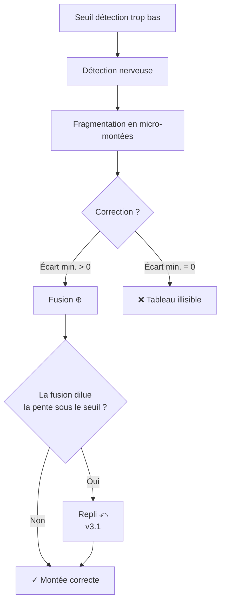

**Conclusion** : une chaîne bien configurée est :
```
Seuil détection = 0.5%
+ Lissage pente = 150 m
+ Écart min. entre montées = 250 m
+ Validation stricte activée (v3.1)
```

### 6.4 Chaîne de la sur-correction anti-pic

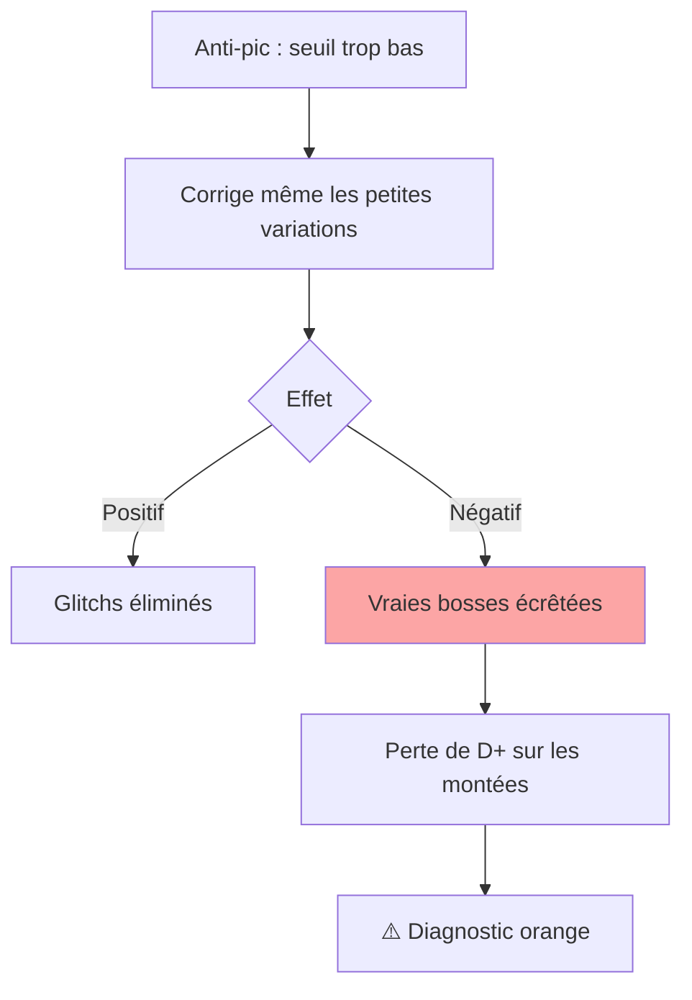

**Recommandation** : garder un seuil ≥ 10 m pour préserver les vraies bosses.

### 6.5 Dépendances entre paramètres — chaîne de cohérence

> **Principe.** Aucun paramètre ne se règle seul. Le **Pas de rééchantillonnage** est la racine de tout : chaque filtre s'exprime en mètres, mais s'exécute en **points**, et le nombre de points couverts par un filtre dépend du Pas. Modifier le Pas sans réviser les autres paramètres casse silencieusement le pipeline.

#### 6.5.1 Graphe de dépendance

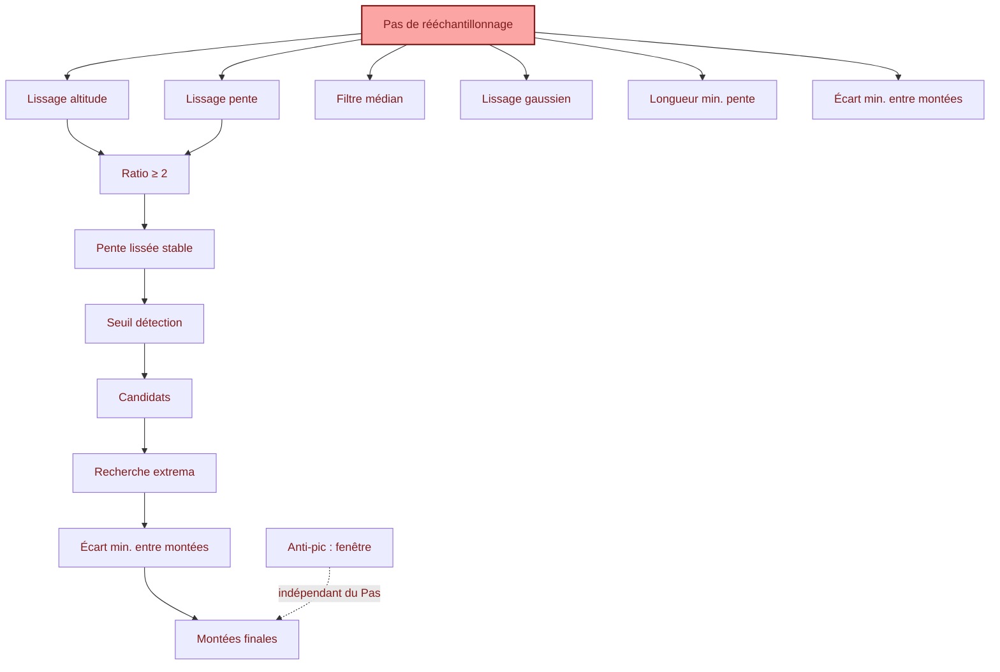

**Légende :** rouge = paramètre racine. Une flèche A → B signifie « A fixe la plage utile de B ».

#### 6.5.2 Les 8 règles de cohérence (à connaître par cœur)

| # | Règle | Pourquoi | Si violée |
|---|---|---|---|
| R1 | `Lissage altitude ≥ 10 × Pas` | SG a besoin de ≥ 10 pts pour agir | SG inopérant, diagnostic 🔴 |
| R2 | `Lissage altitude ≥ 2 × Lissage pente` | Sinon la pente est plus lisse que l'altitude → détection incohérente | diagnostic 🔴 |
| R3 | `Lissage pente ≥ 3 × Pas` | En dessous : fenêtre < 3 pts, moy. mobile dégénérée | diagnostic 🔴 |
| R4 | `Filtre médian ≥ 3 × Pas` (ou 0) | < 3 pts, la médiane est le point lui-même | diagnostic 🟠 |
| R5 | `Lissage gaussien ≥ 0.5 × Pas` (ou 0) | σ < 0.5 pt → noyau dégénéré | diagnostic 🟠 |
| R6 | `Longueur min. pente ≥ Pas` (ou 0) | Sinon un segment fait moins d'1 point | diagnostic 🟠 |
| R7 | `Écart min. entre montées ≥ Pas` (ou 0) | Sinon la fusion n'a aucun candidat à fusionner | diagnostic 🟠 |
| R8 | `Anti-pic : fenêtre ≥ 2 × Pas` (si seuil > 0) | Sinon l'arrondi force une fenêtre > demandée | diagnostic 🟠 |

#### 6.5.3 Chaîne de dépendance de second ordre

Trois dépendances ne s'expriment pas par une simple inégalité :

**a) `Lissage pente` → retard de détection**
Retard ≈ `Lissage pente / 2`. Si on augmente le lissage pente, le début de chaque montée est détecté plus tard. Ce n'est pas une erreur, mais cela crée un décalage systématique sur les bornes.

**b) `Écart min. entre montées` × `Recherche extrema` → dilatation des bornes**
Les deux paramètres **étendent** les bornes (l'un vers la droite du côté sommet, l'autre vers la gauche du côté creux). Combinés de façon agressive (Écart > 500 m **et** Recherche > 100 %), une montée peut « avaler » sa voisine → diagnostic 🟠.

**c) `Anti-pic : fenêtre` → indépendance vis-à-vis du Pas**
La fenêtre est en mètres, donc sa couverture physique **ne dépend plus du Pas**. C'est le grand changement de la v3.6 : plus besoin d'ajuster la fenêtre quand on modifie le Pas.

#### 6.5.4 Cascade : modifier le Pas

Modifier le Pas est l'opération la plus risquée. Ordre à respecter :

```
1. Changer le Pas
2. Réviser Lissage altitude    → pour que R1 reste vrai
3. Réviser Lissage pente       → pour que R2, R3 restent vrais
4. Réviser Filtre médian       → R4, ou passer à 0
5. Réviser Lissage gaussien    → R5, ou passer à 0
6. Vérifier Anti-pic : fenêtre → doit rester ≥ 2 × Pas (R8)
7. Vérifier le diagnostic      → doit rester 🟢
```

**Exemple concret** — passer de Pas = 100 m à Pas = 50 m (facteur ÷2) :

| Paramètre | Avant (Pas=100) | Après (Pas=50) | Règle |
|---|---|---|---|
| Lissage altitude | 1000 m (10 pts) | **500 m** (10 pts) | R1 |
| Lissage pente | 300 m (3 pts) | **150 m** (3 pts) | R2/R3 |
| Filtre médian | 0 (désactivé) | **0** | R4 |
| Lissage gaussien | 200 m (2 pts) | **100 m** (2 pts) | R5 |
| Anti-pic : fenêtre | 200 m | **200 m** | ✅ pas d'ajustement |
| Écart min. entre montées | 250 m | 250 m (≥ Pas) | R7 ✅ |

#### 6.5.5 Comment détecter une violation

Trois outils, dans l'ordre :

1. **Le panneau Diagnostic** (§8) — il liste les violations et propose une valeur cible.
2. **Les indicateurs colorés sous chaque champ** — 🟢 optimal / 🟠 limite / 🔴 incohérent.
3. **Le log Debug** — chercher `Point(s) corrigé(s)` anormalement élevé (anti-pic trop agressif) ou `fenêtre = N pts` (filtre inopérant).

---

## 7. Recettes par type de trace

### 7.1 Trace GPS terrain (montre, téléphone)

| Paramètre | Valeur |
|---|---|
| Pas | **50 m** |
| Anti-pic : fenêtre | **200 m** |
| Anti-pic : seuil | **20 m** |
| Lissage altitude | **500 m** |
| Lissage pente | 150 m |
| Filtre médian | **0** |
| Lissage gaussien | 75 m |
| Correction plateaux | 0 |
| Double SG | ON |

### 7.2 Trace éditeur SRTM (Openrunner, Garmin Connect)

| Paramètre | Valeur |
|---|---|
| **Pas de rééchantillonnage** | **50 m** |
| **Anti-pic : fenêtre** | **200 m** |
| **Anti-pic : seuil** | **15 m** |
| **Lissage altitude** | **500 m** |
| **Lissage pente** | **150 m** |
| **Filtre médian** | **0** |
| **Lissage gaussien** | **75 m** |
| **Correction plateaux** | **6** |
| **Double SG** | **ON** |

### 7.3 Col enchaîné (type Marmotte, Mortirolo)

| Paramètre | Valeur |
|---|---|
| **Écart min. entre montées** | **250 – 300 m** |
| Recherche extrema | 60 % |
| Seuil détection | 0.5 % |
| Fenêtre de calcul pente | 100 – 200 m |

Après détection, les montées fusionnées peuvent être **séparées** (✂) si l'utilisateur veut voir les sous-cols individuellement.

### 7.4 Gravel / VTT nerveux

| Paramètre | Valeur |
|---|---|
| Pas de rééchantillonnage | 25 m |
| Anti-pic : fenêtre | 200 m |
| Anti-pic : seuil | 25 m |
| Lissage altitude | 300 m |
| Lissage pente | 80 m |
| Seuil détection | 0.8 % |
| Écart min. entre montées | 150 m |
| Longueur min. pente | 150 m |

### 7.5 Ultra-distance (> 200 km)

| Paramètre | Valeur |
|---|---|
| Pas de rééchantillonnage | 75 – 100 m |
| Anti-pic : fenêtre | 250 m |
| Lissage altitude | 800 m |
| Lissage pente | 250 m |
| Seuil détection | 0.5 % |
| Écart min. entre montées | 500 m |
| Longueur min. pente | 500 m |
| Fenêtre de calcul pente | 500 m |

---

## 8. Diagnostic de configuration

### 8.1 Présentation

Le panneau **Diagnostic de configuration** (en haut du volet de droite) affiche en temps réel :

- **Statut global** : 🟢 Cohérent, 🟠 Avertissements, 🔴 Incohérences
- **Grille** : une ligne par paramètre avec valeur effective et point coloré
- **Avertissements** : liste détaillée des problèmes avec suggestions

### 8.2 Exemple de diagnostic

```
┌─────────────────────────────────────────────────────────┐
│ 🔍 Diagnostic de configuration      🟢 Cohérent         │
├─────────────────────────────────────────────────────────┤
│ ● Pas ................... 50 m                          │
│ ● Anti-pic : fenêtre ..... 200 m · 5 pts ≈ 250 m        │
│ ● Anti-pic : seuil ....... 15 m                         │
│ ● Lissage altitude ....... 10 points                    │
│ ● Lissage pente .......... 3 points                     │
│ ● Fenêtre de calcul pente  2 points                     │
│ ● Seuil détection ........ 0.5 %                        │
│ ● Longueur min. pente .... 200 m                        │
│ ● Écart min. entre montées  250 m                       │
│ ● Recherche extrema ...... 60 %                         │
│ ● Filtre médian .......... désactivé                    │
│ ● Lissage gaussien ....... σ ≈ 1.5 point                │
│ ● Correction plateaux .... 6 points                     │
│ ● Pas du profil exporté .. 50 m                         │
│                                                         │
│ Aucun problème détecté. Configuration cohérente.        │
└─────────────────────────────────────────────────────────┘
```

### 8.3 Comment utiliser le diagnostic

**Étape 1** : Chargez votre trace
**Étape 2** : Regardez la pastille à côté du titre « Paramètres » dans le header du volet de droite (🟢 / 🟠 / 🔴)
**Étape 3** : Si 🟠 ou 🔴, ouvrez le volet (⚙️) et lisez les avertissements
**Étape 4** : Modifiez les paramètres, le diagnostic se met à jour en temps réel

### 8.4 Statuts détaillés

| Statut | Signification | Exemple |
|---|---|---|
| 🟢 Vert | Valeur optimale | Fenêtre SG = 10 pts |
| 🟠 Orange | Limite / avertissement | Fenêtre SG = 8 pts |
| 🔴 Rouge | Incohérence critique | Fenêtre SG = 3 pts |
| ⚪ Gris | Désactivé / non applicable | Filtre médian = 0 |

---

## 9. Carte Mapbox 3D

### 9.1 Activation

- **Chargement automatique** 🆕 (v3.9.2) : si un token Mapbox (`pk.*`) est présent dans `localStorage`, la carte se charge automatiquement au démarrage de l'application. Le statut affiche « Carte OK (auto) ».
- **Chargement manuel** : saisir le token dans le volet Paramètres et cliquer **OK**. Le token est persisté dans `localStorage.mapboxToken`.

Un token public (`pk.*`) gratuit est requis. Vous pouvez en créer un sur mapbox.com.

### 9.2 Contenu de la carte

- **Terrain 3D** : tuiles DEM `mapbox.mapbox-terrain-dem-v1`, exagération verticale 1×.
- **Ciel / brume** : effet atmosphérique Mapbox (`setFog`).
- **Trace colorée** 🆕 (v3.9.2) : une `LineString` par segment de catégorie. **Les coordonnées sont les points bruts du fichier GPX**, pas la grille resamplée. La couleur de chaque point est déterminée par sa distance cumulée dans les segments de catégorie.
- **Marqueurs vallée/sommet** :
  - Montée non groupée sélectionnée : 2 marqueurs (vert vallée, rouge sommet)
  - 🆕 Montée groupée sélectionnée (v3.9.2) : **TOUS** les points vallée/sommet de **TOUS** les membres du groupe. Le membre actif est dessiné plus grand (rayon 10) et avec un contour plus épais (4 px). Les autres sont plus petits (rayon 8, contour 2.5 px).
- **Courbes de niveau** (option) : activables via le toggle dans le volet de droite. Deux couches :
  - `contour-lines` (fines, couleur `#7a5733`)
  - `contour-index` (index ≥ 5, plus épaisses, couleur `#5e3f1d`)

### 9.3 Contrôles

- 🛰️ / 🗺️ : bascule satellite ↔ standard
- 🎯 : recentre sur la trace entière
- Navigation Mapbox standard en haut à gauche (zoom, rotation, pitch)

### 9.4 Zoom sur une montée

Un clic sur une montée dans la liste :
- Si la montée **n'appartient pas à un groupe** : `fitBounds` sur la montée + marge 20 %
- 🆕 Si la montée **appartient à un groupe** (v3.9.2) : `fitBounds` sur **toutes les montées du groupe** (min startKm / max endKm) + marge 20 %

Un changement de basemap réapplique automatiquement le zoom sur la montée sélectionnée après le `style.load`.

### 9.5 Drag des poignées

Pendant le drag d'une poignée sur le widget profil, les marqueurs de la carte sont mis à jour en temps réel (throttle 30 ms). Au relâchement, un `renderAll()` complet rafraîchit la carte.

### 9.6 Courbes de niveau

Le toggle dans le volet de droite permet d'afficher/masquer les courbes. L'état est persisté dans `localStorage.showContours`.

Les courbes sont insérées **sous la trace** (via `beforeId: 'trace-line-layer'`), pour ne pas masquer la trace colorée.

### 9.7 Comment vérifier

- **Token invalide** : message d'erreur rouge dans le volet de droite
- **Carte non chargée** : placeholder visible au centre
- **Trace présente** : ligne colorée qui suit le tracé GPX
- **Marqueurs présents** : 2 points (vert/rouge) après sélection d'une montée
- **Courbes visibles** : lignes brunes si toggle activé

---

## 10. Widget profil altimétrique

### 10.1 Deux modes

- **Profil complet** (défaut) : toute la trace, échelle **50 m/px** en X, 10 m/px en Y.
- **Widget montée** (quand une montée est sélectionnée) : 🆕 **toute la trace** affichée à l'échelle **10 m/px** en X (v3.9.2). Le canvas est donc plus large que le conteneur, avec scroll horizontal. **La vue est automatiquement centrée sur la montée sélectionnée** via `scrollLeft`.

### 10.2 Contenu

- **Courbe d'altitude** : ligne de crête noire (altitude lissée ancrée)
- **Remplissage coloré** : par segment de catégorie, **via `catSegments`** — strictement identique à la carte
- **Lignes verticales** : vallée (verte continue), sommet (rouge pointillé). 🆕 Les montées groupées utilisent la **couleur du groupe** pour les deux lignes (v3.9.1).
- **Surbrillance** : fond jaune sur la montée sélectionnée
- **Poignées** : triangles verts/rouges draggables sur le widget montée

### 10.3 Échelle fixe

Quel que soit le mode, l'échelle X est **strictement constante** :
- Mode full : `50 m/px`
- 🆕 Mode montée : `10 m/px` (v3.9.2, au lieu de 5 m/px)

La largeur du canvas est **exactement** `(viewEndM − viewStartM) / scaleX`. Pour une trace courte, le canvas peut être plus étroit que le conteneur (vide à droite) — c'est normal, l'échelle est respectée.

### 10.4 Scroll horizontal (mode montée)

En mode montée, le canvas affiche toute la trace à 10 m/px. Le scroll horizontal permet de naviguer. Après chaque rendu, le widget **scrolle automatiquement** pour centrer la montée sélectionnée.

🆕 Le scroll n'est **pas réajusté** pendant un drag (pour éviter les sauts pendant l'interaction). Il reprend au relâchement.

### 10.5 Hint textuel

Le header du profil affiche un hint contextuel :
- Mode full : `💡 Double-cliquez sur le profil pour créer une montée`
- Création en cours : `🎯 Cliquez-glissez pour définir le sommet · Échap pour annuler` (vert pulsant)
- Drag en cours : `🎯 Relâchez pour valider le sommet` (rouge)
- Mode montée : `💡 Glissez les poignées · ✕ pour revenir au profil complet`

### 10.6 Bouton ✕

En mode montée, un bouton **✕** apparaît dans le header. Un clic désélectionne la montée et revient au profil complet.

### 10.7 Comment vérifier

- **Échelle X** : mesurez la distance entre deux points sur le canvas. Elle doit être exactement 50 m/px (full) ou 10 m/px (montée).
- **Cohérence carte/profil** : les couleurs doivent être strictement identiques entre la trace sur la carte et le remplissage du profil.
- **Centrage automatique** : après sélection d'une montée, elle doit être au centre de la vue visible.

---

## 11. Groupes de montées

### 11.1 Séparation d'une montée fusionnée

Quand une montée est le résultat d'une fusion (`gapMinM`), chaque sous-montée d'origine est conservée dans `mergedParts` (tableau de `{startKm, endKm}`).

Un bouton **✂ Séparer** apparaît sur la carte si `mergedParts.length >= 2`. Un clic :
- Alloue un nouveau `groupId` (identifiant entier depuis un compteur)
- Retire la montée fusionnée
- Crée une montée pour chaque sous-montée, avec `groupId` + `subIndex` (1, 2, …)
- Numérotation affichée : `#N.M` (ex. `#3.1`, `#3.2`)
- Sélectionne la première sous-montée
- 🆕 Zoome la carte sur **l'ensemble du groupe** (v3.9.2 : `zoomMapToGroup` calcule les bornes du groupe)

**Résultat visuel** :
- Bandeau coloré `🔗 GROUPE #N · X montées` avant le premier membre
- Bordure gauche colorée sur chaque carte du groupe (couleur stable par `groupId`)
- Badge `🔗 N` dans l'en-tête de chaque membre
- Numéro coloré avec la couleur du groupe (sauf si sélectionné)

### 11.2 Multi-marqueurs sur la carte

🆕 Quand une montée groupée est sélectionnée (v3.9.2), la carte affiche **les points vallée et sommet de tous les membres du groupe**. Cela permet de visualiser :
- Où commence chaque sous-montée
- Où finit chaque sous-montée
- Les éventuelles zones de chevauchement (normalement évitées)

Le membre actif est dessiné plus grand (rayon 10) et avec un contour plus épais (4 px). Les autres membres sont plus petits (rayon 8, contour 2.5 px).

### 11.3 Refusion d'un groupe

Un bouton **🔗 Refusionner** apparaît sur chaque membre du groupe. Un clic :
- Récupère tous les membres du groupe
- Fusionne leurs **bornes actuelles** (après éventuelles éditions)
- Reconstruit `mergedParts` avec les bornes courantes
- Crée une nouvelle montée fusionnée avec `mergedCount = nombre de membres − 1`
- Retire tous les membres du groupe

La montée redevient séparable avec ✂.

### 11.4 Nettoyage automatique

Si, après une suppression ou une édition, un groupe ne contient plus qu'un seul membre, le `groupId` est automatiquement retiré et la montée redevient autonome. Cette logique est dans `normalizeGroups()`, appelée à la fin des drags et de `recomputeAuto`.

### 11.5 Drag d'une poignée d'une montée groupée

Le drag modifie les bornes de la montée **individuelle** (pas du groupe). Les autres membres du groupe ne bougent pas. Les marqueurs de la carte se mettent à jour en temps réel.

### 11.6 Export JSON

Les champs `groupId` et `subIndex` sont présents dans chaque `climb` exporté. Un consommateur externe peut reconstituer les groupes.

### 11.7 Comment vérifier

- **Séparation** : après ✂, la liste doit montrer `#N.1`, `#N.2` avec bandeau coloré
- **Refusion** : après 🔗, la montée redevient un seul élément avec `⊕ N`
- **Multi-marqueurs** : sélectionner un membre d'un groupe doit afficher tous les marqueurs du groupe sur la carte
- **Édition préservée** : après édition + séparation + refusion, les bornes éditées doivent être conservées

---

## 12. Création manuelle d'une montée

### 12.1 Principe

Dans le widget profil **en mode full uniquement**, on peut créer une nouvelle montée par :

1. **Double-clic** sur le profil → pose la **vallée**
2. **Clic-glisser** → définit le **sommet** en temps réel
3. **Relâchement** → validation

### 12.2 Contraintes

- ❌ **Impossible de créer une montée qui chevauche une montée existante.** Le double-clic est refusé (flash rouge) si la vallée tombe dans une montée existante. Le relâchement est refusé si la plage `[vallée, sommet]` chevauche une montée existante.
- ❌ **Longueur minimale** : 50 m (`MANUAL_MIN_LEN_KM = 0.05`).
- ❌ **Pas de création** dans une montée existante (vallée ou sommet).

### 12.3 Indicateurs visuels

- **Hint** dans le header du profil :
  - Mode attente : `💡 Double-cliquez sur le profil pour créer une montée`
  - Vallée posée : `🎯 Cliquez-glissez pour définir le sommet · Échap pour annuler` (vert pulsant)
  - Drag en cours : `🎯 Relâchez pour valider le sommet` (rouge)
- **Zone colorée** : verte si plage valide, rouge si chevauchement
- **Lignes verticales** : vallée (verte continue), sommet (rouge pointillé, ou rouge vif si invalide)
- **Curseur** : `crosshair` sur le canvas en mode création
- **Échap** : annule la création en cours

### 12.4 Insertion dans la liste

Après validation, la nouvelle montée est insérée dans `STATE.userClimbs` (triée par `startKm`), automatiquement sélectionnée, et la carte est zoomée dessus.

### 12.5 Export

La nouvelle montée porte `groupId: null` et `subIndex: null`. Elle apparaît dans le JSON comme une montée standard.

### 12.6 Comment vérifier

- **Création refusée** : double-clic dans une montée existante → flash rouge
- **Création acceptée** : zone verte pendant le drag, ligne vallée verte et sommet rouge
- **Insertion correcte** : la nouvelle montée apparaît à la bonne place dans la liste (triée par km)
- **Annulation** : Échap pendant le drag → pas de création

---

## 13. Suppression d'une montée

### 13.1 Principe

🆕 Chaque carte de montée affiche un bouton **✕** rouge en haut à droite (toujours visible, sans hover). Un clic supprime la montée.

### 13.2 Comportement

- Retire la montée de `STATE.userClimbs`
- **Renumérote les `subIndex`** du groupe affecté (si la montée était groupée)
- **Dissout le groupe** s'il ne reste qu'un seul membre
- **Ajuste la sélection** :
  - Si la montée supprimée était sélectionnée → désélectionne, retour au profil complet
  - Si l'index sélectionné était supérieur à l'index supprimé → décrémente
- Re-render complet (liste, profil, carte)

### 13.3 Ce qui ne change pas

La suppression n'affecte pas les autres montées, ni les paramètres, ni le fichier GPX chargé.

### 13.4 Cas d'usage

| Cas | Avant | Après suppression |
|---|---|---|
| Groupe à 3 membres, supprimer #3.2 | #3.1, #3.2, #3.3 | #3.1, #3.2 (renumérotés) |
| Groupe à 2 membres, supprimer #5.1 | #5.1, #5.2 | #N (dissolution) |
| Montée autonome, supprimer #2 | #1, #2, #3 | #1, #2 (ex-#3, renuméroté) |

### 13.5 Comment vérifier

- **Suppression d'une montée autonome** : la liste doit passer de N à N−1 éléments
- **Suppression d'un membre de groupe** : les autres membres doivent être renumérotés
- **Dissolution** : un groupe à 2 membres qui perd un membre doit voir l'autre redevenir autonome (plus de bandeau, plus de badge `🔗`)

---

## 14. Cas pratiques

### 14.1 « Un pic aigu apparaît sur la carte »

**Symptôme** : pic vertical sur la trace colorée, alors que la courbe d'altitude ne montre presque rien.

**Cause** : glitch d'altitude isolé (1–2 points), amplifié par la dérivée.

**Solution** :
1. Activer l'anti-pic : `Fenêtre = 200 m`, `Seuil = 15 m`
2. Vérifier dans le panneau Debug : `🩹 Anti-pic : 2 point(s) corrigé(s)`
3. Si le pic persiste, réduire le seuil à 10 m
4. Si le pic fait plus de 3 points de large, augmenter la fenêtre à 300 m

### 14.2 « Les montées sont fragmentées en 5–10 micro-montées »

**Symptôme** : le tableau affiche beaucoup de montées très courtes, souvent collées.

**Cause** : seuil détection trop bas ou lissage pente trop court.

**Solution** :
1. Augmenter `Écart min. entre montées` à 300–400 m
2. Vérifier que `Lissage pente ≥ 150 m`
3. Ne PAS augmenter le seuil détection (risque de rater des montées douces)

### 14.3 « Une vraie bosse a disparu »

**Symptôme** : une bosse visible sur la trace n'apparaît pas dans le tableau.

**Cause possible 1** : seuil détection trop haut → réduire à 0.5 % ou moins

**Cause possible 2** : anti-pic trop agressif → augmenter `Anti-pic : seuil` à 25 m ou plus

**Cause possible 3** : lissage altitude trop long → réduire à 300–400 m

### 14.4 « Le profil est complètement écrasé »

**Symptôme** : la courbe d'altitude est trop lisse, plus de détail.

**Cause** : lissage gaussien ou lissage altitude trop longs.

**Solution** :
1. Réduire `Lissage gaussien` à 30–50 m
2. Désactiver `Double SG`
3. Réduire `Lissage altitude` à 300 m

### 14.5 « Aucune montée détectée »

**Symptôme** : trace plate ou montées très douces.

**Vérifications** :
1. Le fichier contient-il des `<ele>` ? (regarder le log debug)
2. La trace a-t-elle du dénivelé ? (D+ brut dans les stats)
3. `Seuil détection` à 0.5 % ou moins
4. `Lissage altitude` cohérent avec `Pas`

### 14.6 « Le D+ affiché est différent de la réalité »

**Symptôme** : D+ brut ne correspond pas à la réalité.

**Note** : le D+ brut est calculé sur les **altitudes GPX d'origine**, pas sur les données resamplées. Il peut différer légèrement de la réalité si :
- La trace contient des doublons GPS (ignorés)
- Les altitudes sont quantifiées au mètre

**Vérification** : comparer avec un autre outil (Strava, Garmin) qui utilise la même méthode.

### 14.7 « La trace sur la carte ne ressemble pas au tracé GPX »

🆕 **Ce problème a été corrigé en v3.9.2**. La trace sur la carte utilise désormais les points bruts du fichier GPX. Si le problème persiste, vérifier que le fichier a bien été rechargé après la mise à jour.

### 14.8 « Je veux séparer une montée fusionnée »

**Solution** :
1. Localiser la montée avec badge `⊕ N`
2. Cliquer sur **✂ Séparer**
3. Les sous-montées apparaissent groupées (`#N.1`, `#N.2`…) avec la carte zoomée sur tout le groupe
4. Les marqueurs de la carte montrent tous les points vallée/sommet du groupe

### 14.9 « Je veux refusionner un groupe que j'avais séparé »

**Solution** :
1. Repérer un membre du groupe (badge `🔗 N`)
2. Cliquer sur **🔗 Refusionner**
3. La montée fusionnée réapparaît, séparable à nouveau

### 14.10 « Je veux supprimer une montée qui n'aurait pas dû être détectée »

**Solution** : cliquer sur le **✕** en haut à droite de la carte de montée. Si elle appartenait à un groupe, les `subIndex` restants sont renumérotés et le groupe est dissous s'il ne reste qu'un membre.

### 14.11 « Je veux ajouter une montée manuellement »

**Solution** :
1. S'assurer d'être en mode **profil complet** (pas de montée sélectionnée)
2. Double-cliquer à l'endroit de la vallée → ligne verte apparaît
3. Cliquer-glisser pour définir le sommet → zone verte si valide
4. Relâcher → montée créée et sélectionnée
5. Si erreur : `Échap` annule

### 14.12 « Le profil montée est vide ou ne se centre pas »

🆕 **v3.9.2** : en mode montée, le canvas affiche **toute la trace** à 10 m/px et scrolle pour centrer la montée. Vérifier :
1. Que la montée est bien sélectionnée (bordure bleue dans la liste)
2. Que le scroll horizontal n'a pas été déplacé manuellement
3. Si le scroll n'est pas centré après re-sélection, cliquer à nouveau sur la carte de montée

### 14.13 « Les couleurs sur la carte et le profil ne sont pas identiques »

🆕 **v3.8.1** : ce problème a été corrigé. Les deux utilisent `catSegments`. Si vous voyez encore une divergence :
1. Vérifier que la trace a bien été rechargée après la mise à jour
2. Comparer visuellement : le changement de couleur entre deux segments doit être au même km près sur les deux affichages

### 14.14 « L'échelle du profil change quand je déplace une poignée »

🆕 **v3.8.3** : ce problème a été corrigé. L'échelle X est **strictement fixe** (50 m/px full, 10 m/px montée). Si vous voyez encore un changement :
1. Vérifier que vous êtes sur la dernière version
2. L'échelle ne change que si vous changez de mode (full ↔ montée) ou de montée sélectionnée

---

## 15. Tableau de diagnostic rapide

### 15.1 Symptômes → Actions

| Symptôme observé | Paramètre à ajuster | Action |
|---|---|---|
| **Pic aigu sur carte** | **Anti-pic : seuil** | **↓ Réduire à 10 m** |
| **Pic persiste après anti-pic** | **Anti-pic : fenêtre** | **↑ Augmenter à 300 m** |
| **Vraie bosse écrêtée** | **Anti-pic : seuil** | **↑ Augmenter à 25 m** |
| Beaucoup de micro-montées collées | Écart min. entre montées | ↑ Augmenter |
| Montées trop fusionnées (perte de détail) | Écart min. entre montées | ↓ Réduire |
| Sommets coupés (arrêtés avant le vrai sommet) | Recherche extrema | ↑ Augmenter |
| Sommets avalant la descente suivante | Recherche extrema | ↓ Réduire |
| Pente moyenne sous son seuil | Bug v3.1 corrigé (`⤺`) | Vérifier `⤺` |
| Montées raides ratées | Lissage altitude | ↓ Réduire |
| Montées ratées malgré forte pente | Seuil détection | ↓ Réduire |
| Pic de pente isolé dans le graphique | Anti-pic | Vérifier seuil/fenêtre |
| Profil « écrasé » | Lissage gaussien ou Double SG | ↓ Réduire / OFF |
| Démarrage des montées en retard | Lissage pente | ↓ Réduire |
| Bande de couleur = patchwork | Fenêtre de calcul pente ou Longueur min. pente | ↑ Augmenter |
| Altitudes avec marches d'escalier visibles | Correction plateaux | ↑ Augmenter |
| Détection en retard sur montées courtes | Lissage pente | ↓ Réduire |
| D+ des montées incohérent | Vérifier stats brutes | — |
| **Filtre médian inefficace** | **Filtre médian** | **Désactiver (0) ou augmenter** |
| **Lissage altitude inefficace** | **Lissage altitude** | **Augmenter (≥ 10 × Pas)** |
| **Anti-pic : fenêtre trop petite** | **Anti-pic : fenêtre** | **↑ Augmenter (≥ 2 × Pas)** |
| **Trace carte ≠ tracé GPX** | **v3.9.2 corrigé** | **Vérifier version** |
| **Couleurs carte ≠ profil** | **v3.8.1 corrigé** | **Vérifier version** |
| **Échelle profil change au drag** | **v3.8.3 corrigé** | **Vérifier version** |
| **Contours invisibles** | **v3.8.5 corrigé** | **Vérifier version** |
| **Clic sur montée ne zoome pas** | **v3.8.2 corrigé** | **Vérifier version** |
| **Séparation sans refusion possible** | **v3.9.1 corrigé** | **Vérifier version** |

### 15.2 Arbre de décision

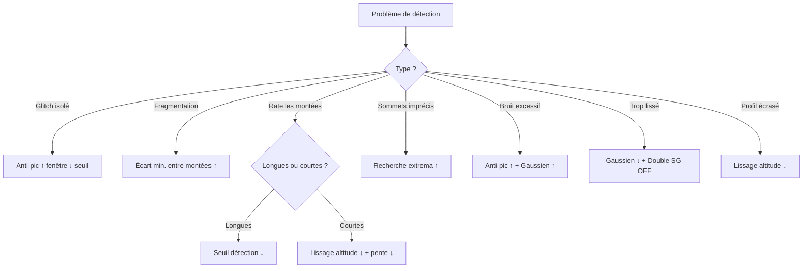

### 15.3 Vérification rapide après modification

Après modification d'un paramètre :

1. Regarder le **statut global** du diagnostic (🟢🟠🔴)
2. Observer le **nombre de montées** détectées (change-t-il de façon cohérente ?)
3. Vérifier les **indicateurs `⊕` et `⤺`** dans le tableau
4. Ouvrir le **log Debug d'une montée** (clic sur la ligne) pour voir la pente segment par segment
5. Vérifier que la carte ne montre pas de pics aigus

---

## 16. Rappel des défauts

### 16.1 Valeurs par défaut v3.9.2

| Paramètre | Défaut | Catégorie |
|---|---|---|
| Pas de rééchantillonnage | **50 m** | Principal |
| Anti-pic : fenêtre | **200 m** | Principal |
| Anti-pic : seuil | **15 m** | Principal |
| Lissage altitude | **500 m** | Principal |
| Lissage pente | **150 m** | Principal |
| Fenêtre de calcul pente | **100 m** | Principal |
| Seuil détection | **0.5 %** | Principal |
| Longueur min. pente | **200 m** | Principal |
| Écart min. entre montées | **250 m** | Avancé |
| Recherche extrema | **60 %** | Avancé |
| Filtre médian | **0 m** | Avancé |
| Lissage gaussien | **75 m** | Avancé |
| Correction plateaux | **6 pts** | Avancé |
| Segments debug | **100 m** | Debug |
| Pas du profil exporté | **50 m** | Export |
| Double SG | **ON** | Toggle |
| Lissage segments | **ON** | Toggle |

### 16.2 Configuration cohérente recommandée

**Avec ces défauts**, le diagnostic affiche :

- Pas : 50 m 🟢
- Anti-pic : fenêtre : 200 m · 5 pts ≈ 250 m 🟢
- Anti-pic : seuil : 15 m 🟢
- Lissage altitude : 10 pts 🟢
- Lissage pente : 3 pts 🟢
- Fenêtre de calcul pente : 2 pts 🟢
- Longueur min. pente : 200 m ≥ Pas 🟢
- Écart min. : 250 m ≥ Pas 🟢
- Filtre médian : désactivé ⚪
- Lissage gaussien : σ ≈ 1.5 pts 🟢
- Pas du profil exporté : 50 m 🟢

**Recommandation** : la configuration par défaut est cohérente. Voici deux profils types :

#### Profil A — Trace GPS dense (Pas = 25 m)

| Paramètre | Valeur |
|---|---|
| Pas | 25 m |
| Anti-pic : fenêtre | 200 m |
| Anti-pic : seuil | 20 m |
| Lissage altitude | 400 m |
| Lissage pente | 150 m |
| Filtre médian | 0 |
| Gaussien σ | 75 m |

→ Fenêtres SG : 16 pts, pente : 6 pts, σ : 3 pts → tous 🟢

#### Profil B — Trace éditeur (Pas = 50 m)

| Paramètre | Valeur |
|---|---|
| Pas | 50 m |
| Anti-pic : fenêtre | 200 m |
| Anti-pic : seuil | 15 m |
| Lissage altitude | 500 m |
| Lissage pente | 150 m |
| Filtre médian | 0 |
| Gaussien σ | 75 m |

→ Fenêtres SG : 10 pts, pente : 3 pts, σ : 1.5 pts → tous 🟢

### 16.3 Recommandation globale v3.9.2

Pour une trace éditeur Openrunner standard :

```
Pas ............................. 50 m
Anti-pic : fenêtre .............. 200 m
Anti-pic : seuil ................ 15 m
Lissage altitude ................ 500 m
Lissage pente ................... 150 m
Fenêtre de calcul pente ......... 100 m
Seuil détection ................. 0.5 %
Longueur min. pente ............. 200 m
Écart min. entre montées ........ 250 m
Recherche extrema ............... 60 %
Filtre médian ................... 0
Lissage gaussien ................ 75 m
Correction plateaux ............. 6 pts
Segments debug .................. 100 m
Pas du profil exporté ........... 50 m
Double SG ....................... ON
Lissage segments ................ ON
```

Cette configuration donne un diagnostic 🟢 **Cohérent** et exploite correctement le moyennage v3.5, l'anti-pic v3.6, la validation stricte v3.1, les groupes v3.9.1 et la trace brute sur carte v3.9.2.

---

## 17. Glossaire

| Terme | Définition |
|---|---|
| **GPX** | GPS Exchange Format — format XML standardisé pour l'échange de données GPS |
| **Vallée** | Point bas précédant une montée |
| **Sommet** | Point haut terminant une montée |
| **D+** | Dénivelé positif cumulé (somme des montées) |
| **D−** | Dénivelé négatif cumulé |
| **MNT** | Modèle Numérique de Terrain (ex. SRTM à 30 m) |
| **SRTM** | Shuttle Radar Topography Mission (NASA, 2000) |
| **Hystérésis** | Technique de détection avec seuil aller et seuil retour distincts |
| **Argmin / argmax** | Indice du minimum / maximum d'un tableau dans un intervalle |
| **Lissage ancré** | Moyenne mobile forcée à passer exactement par certains points |
| **Fenêtre glissante** | Intervalle mobile de N mètres autour d'un point de référence |
| **Pente instantanée** | Pente calculée sur 3 points consécutifs (différence centrée) |
| **Pente fenêtrée** | Pente calculée sur une portion de N mètres |
| **Sous-échantillonnage** | Réduction du nombre de points pour performance |
| **Garde-fou hybride** | `clamp(pct × longueur, min, max)` pour la recherche des extrema |
| **Drag & drop** | Édition directe des poignées vallée/sommet sur le graphique |
| **Drop-zone persistante** | Zone de dépôt toujours visible, mode compact après chargement |
| **Désélection** | Sortir du mode édition d'une montée (clic ✕ ou re-clic carte) |
| **Rééchantillonnage** | Conversion d'une série irrégulière en pas fixe |
| **Rééchantillonnage par moyenne** | Chaque point de sortie = moyenne des points bruts dans une fenêtre centrée |
| **Fusion (`⊕`)** | Montée étendue pour englober une suivante trop proche |
| **Repli (`⤺`)** | Repli sur le meilleur sous-segment valide |
| **SG** | Savitzky-Golay, lisseur polynomial |
| **Plateau GPS/MNT** | Série d'altitudes identiques (capteur figé ou même cellule MNT) |
| **Anti-pic** | Filtre médian conditionnel — ne remplace que les points aberrants |
| **Fenêtre anti-pic** | Largeur (en mètres) du voisinage inspecté |
| **Diagnostic** | Panneau de cohérence en temps réel des paramètres |
| **Valeur effective** | Valeur calculée en points (= paramètre en mètres ÷ Pas) |
| **`totalDistRawM`** | Longueur réelle de la trace GPX d'origine, avant resampling |
| **`totalDistSampledM`** | Longueur couverte par la grille resamplée (multiple de `stepM`) |
| **`trailingGapM`** | Queue de trace au-delà du dernier multiple de `stepM`, ignorée par le resampling |
| **`startProgress` / `endProgress`** | Fractions 0–1 de la longueur totale, compatibles `line-gradient` Mapbox |
| **`slopeProfile`** | Sous-profil de pente d'une montée, découpé en tranches alignées sur les segments globaux |
| **`catSegments`** | Liste des segments de catégorie fusionnés (utilisée par la carte ET le profil) |
| **`eleDisplay`** | Altitude lissée **ancrée** sur les bornes des montées (courbe affichée) |
| **`eleBaseCat`** | Altitude lissée **non ancrée** (utilisée pour la catégorisation des couleurs) |
| **`groupId`** | Identifiant entier du groupe de montées (null si autonome) |
| **`subIndex`** | Position d'un membre dans son groupe (1, 2, 3…) |
| **`mergedParts`** | Tableau des bornes des sous-montées d'origine (permet la séparation) |
| **`mergedCount`** | Nombre de fusions ayant contribué à une montée |
| **Mapbox GL JS** | Bibliothèque de cartographie vectorielle 3D (Mapbox) |
| **`mapbox-terrain-v2`** | Source vectorielle Mapbox pour les courbes de niveau (10 m d'intervalle) |
| **`mapbox-dem`** | Source raster-dem Mapbox pour le terrain 3D |
| **`fitBounds`** | Fonction Mapbox pour zoomer sur une emprise |
| **`localStorage`** | Stockage persistant du navigateur (token, préférences) |
| **Séparation (`✂`)** | Découpage d'une montée fusionnée en ses sous-montées d'origine |
| **Refusion (`🔗`)** | Reconstitution d'une montée fusionnée à partir de ses sous-montées |
| **Normalisation** | Dissolution automatique des groupes à 1 membre |
| **Suppression (`✕`)** | Retrait d'une montée de la liste |

---

**Fin du manuel utilisateur v3.9.2**