# Manuel utilisateur — GPX Climb Analyzer v3.6

**Public** : utilisateurs avancés, organisateurs d'événements, data analysts
**Objet** : comprendre précisément l'effet de chaque paramètre et option sur la détection des pentes

> **Stabilité du vocabulaire.** Depuis la v3.5.2, les noms de paramètres sont figés et identiques dans l'interface et dans tous les documents (manuel, algorithmes, note technique, PRD).

---

## Table des matières

1. [Comment lire ce manuel](#1-comment-lire-ce-manuel)
2. [Vue d'ensemble du pipeline](#2-vue-densemble-du-pipeline)
3. [Les 14 paramètres](#3-les-14-paramètres)
   - [3.1 Pas de rééchantillonnage](#31-pas-de-rééchantillonnage)
   - [3.2 Anti-pic : fenêtre](#32-anti-pic--fenêtre)
   - [3.3 Anti-pic : seuil](#33-anti-pic--seuil)
   - [3.4 Lissage altitude](#34-lissage-altitude)
   - [3.5 Lissage pente](#35-lissage-pente)
   - [3.6 Fenêtre de calcul pente](#36-fenêtre-de-calcul-pente)
   - [3.7 Seuil détection](#37-seuil-détection)
   - [3.8 Longueur min. pente](#38-longueur-min-pente)
   - [3.9 Écart min. entre montées](#39-écart-min-entre-montées)
   - [3.10 Recherche extrema](#310-recherche-extrema)
   - [3.11 Filtre médian](#311-filtre-médian)
   - [3.12 Lissage gaussien](#312-lissage-gaussien)
   - [3.13 Correction plateaux](#313-correction-plateaux)
   - [3.14 Segments debug](#314-segments-debug)
4. [Les 2 options supplémentaires](#4-les-2-options-supplémentaires)
5. [Interactions critiques](#5-interactions-critiques)
   - [5.1 Règles de cohérence](#51-règles-de-cohérence)
   - [5.2 Matrice d'interactions](#52-matrice-dinteractions)
   - [5.3 Chaîne de la fragmentation](#53-chaîne-de-la-fragmentation)
   - [5.4 Chaîne de la sur-correction anti-pic](#54-chaîne-de-la-sur-correction-anti-pic)
   - [5.5 Dépendances entre paramètres](#55-dépendances-entre-paramètres--chaîne-de-cohérence)
6. [Recettes par type de trace](#6-recettes-par-type-de-trace)
7. [Diagnostic de configuration](#7-diagnostic-de-configuration)
8. [Cas pratiques](#8-cas-pratiques)
9. [Tableau de diagnostic rapide](#9-tableau-de-diagnostic-rapide)
10. [Rappel des défauts](#10-rappel-des-défauts)
11. [Glossaire des paramètres](#11-glossaire-des-paramètres)

---

## 1. Comment lire ce manuel

Chaque paramètre est présenté avec la même structure :

- **Rôle** : ce que fait le paramètre
- **Plage et défaut** : la valeur par défaut et les bornes acceptées
- **Impact sur la détection** : nul, faible, moyen, fort ou critique
- **Effet visuel** : ce qui change concrètement dans l'affichage
- **Recommandations** : table de valeurs par type de trace
- **Pièges** : erreurs courantes à éviter
- **Interactions** : dépendances avec d'autres paramètres
- **Comment vérifier** : quels indicateurs observer

**Vocabulaire** : les noms utilisés dans ce manuel sont **strictement** ceux des libellés UI. Les noms techniques n'apparaissent qu'en italique, entre parenthèses, à la première occurrence.

**Unités** : les valeurs sont suivies de leur unité (m, %, pts).

---

## 2. Vue d'ensemble du pipeline

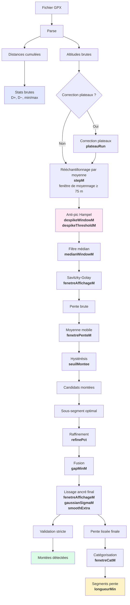

**Légende visuelle :**
- 🟦 Bleu clair : statistiques indépendantes des paramètres
- 🩷 Rose : filtre anti-pic
- 🟩 Vert : résultat principal (montées)
- 🟨 Jaune : résultat secondaire (segmentation pente)
- **Gras** : paramètre(s) actif(s) à cette étape

**Note v3.5 — rééchantillonnage par moyenne.** Le rééchantillonnage ne fait plus une interpolation linéaire entre deux points, mais une **moyenne** de tous les points bruts dont la distance cumulée tombe dans une fenêtre centrée sur le point cible. Cette fenêtre vaut `min(max(Pas, 75 m), 3 × Pas)`. Effet : le bruit haute fréquence est atténué dès cette étape, ce qui rend le pipeline beaucoup plus prévisible quelle que soit la valeur du Pas.

**Note v3.6 — anti-pic en mètres.** La fenêtre de l'anti-pic est désormais exprimée en **mètres** (et non plus en points). Son comportement est donc indépendant de la valeur du Pas.

**Trois groupes fonctionnels :**

| Groupe | Paramètres | Rôle |
|---|---|---|
| **A. Préparation** | Pas, Plateaux, Anti-pic (×2) | Normalise la trace avant analyse |
| **B. Détection** | Médiane, Lissage altitude, Lissage pente, Seuil, Recherche extrema, Écart min., Gaussien, Double SG | Identifie les montées |
| **C. Présentation** | Fenêtre de calcul pente, Longueur min. pente, Segments debug, Lissage segments | N'affecte **PAS** la détection, seulement l'affichage |

---

## 3. Les 14 paramètres

### 3.1 Pas de rééchantillonnage

| | |
|---|---|
| **Nom UI** | Pas de rééchantillonnage |
| **Nom technique** | `stepM` |
| **Plage** | 2 – 200 m |
| **Défaut** | **50 m** |
| **Unité** | mètres |
| **Impact** | **Fondamental** — agit sur TOUT le pipeline en aval |
| **Catégorie** | Principal |

#### Rôle

Avant tout filtrage, la trace est rééchantillonnée à espacement régulier de **Pas** mètres. Depuis la v3.5, ce rééchantillonnage se fait par **moyenne** : chaque point rééchantillonné est la moyenne de tous les points bruts dont la distance cumulée tombe dans une fenêtre centrée de largeur `min(max(Pas, 75 m), 3 × Pas)`. Cela convertit les traces GPS/éditeur à densité variable en une série à pas constant, tout en atténuant le bruit haute fréquence.

#### Effet sur la détection

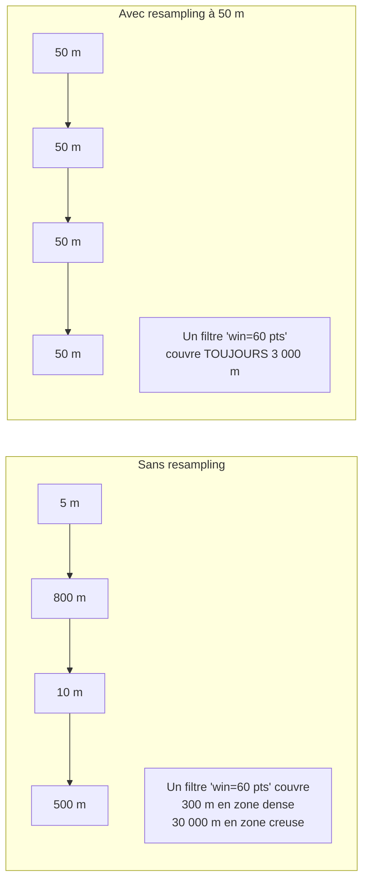

#### Choisir la valeur

| Type de trace | Pas recommandé | Motif |
|---|---|---|
| GPS terrain haute fréquence | 15 – 25 m | Conserver le détail |
| **Trace éditeur (Openrunner/SRTM)** | **50 m** | Compromis taille / fidélité |
| Trace très longue (> 100 km) | 75 – 100 m | Éviter le sur-échantillonnage |

#### Pièges

⚠️ **Trop petit (< 15 m)** :
- Sur-échantillonne : 400 points bruts → 4 000 points resamplés
- Aucun gain de précision (les points intermédiaires sont moyennés)
- Ralentit les recalculs
- Le log debug affiche une réduction négative importante

⚠️ **Trop grand (> 150 m)** :
- Perte des montées courtes (< 500 m)
- Écrête les sommets
- Le log debug affiche `Réduction : +85 %`

#### Interactions

| Couplé avec | Règle |
|---|---|
| Lissage altitude | `Pas × 10 ≤ Lissage altitude` (fenêtre SG ≥ 10 pts) |
| Lissage pente | `Pas × 3 ≤ Lissage pente` (fenêtre pente ≥ 3 pts) |
| Filtre médian | `Pas × 3 ≤ Filtre médian` (fenêtre médiane ≥ 3 pts) |
| Lissage gaussien | `Pas × 0.5 ≤ Gaussien` (σ ≥ 0.5 pt) |
| **Anti-pic : fenêtre** | **Aucune règle spécifique** — la fenêtre est déjà en mètres |
| Longueur min. pente | `Pas ≤ Longueur min. pente` (sinon inopérant) |
| Écart min. entre montées | `Pas ≤ Écart min.` (sinon inopérant) |

#### Comment vérifier

Le panneau Debug (🐛) affiche au chargement :
```
Trace brute : 3312 points
Pas brut : min 0.3 m · médian 22.4 m · moy 33.1 m · max 892.5 m
Trace resamplée : 2190 points à pas fixe 50 m · fenêtre de moyennage 75 m
```

**Règle empirique** : `Pas ≈ 2 × pas médian` pour un bon compromis.

---

### 3.2 Anti-pic : fenêtre

| | |
|---|---|
| **Nom UI** | Anti-pic : fenêtre |
| **Nom technique** | `despikeWindowM` |
| **Plage** | 50 – 500 m |
| **Défaut** | **200 m** |
| **Unité** | mètres |
| **Impact** | **Moyen** sur la propreté du signal |
| **Catégorie** | Principal |

#### Rôle

Largeur (en mètres) du voisinage inspecté par le filtre Hampel autour de chaque point. La fenêtre est convertie en points au moment de l'exécution : `winPts = max(3, round(windowM / Pas) | 1)`. Une fenêtre de 200 m couvre **±100 m** autour de chaque point.

Le filtre Hampel **remplace** un point par la médiane de sa fenêtre **uniquement** si l'écart entre le point et cette médiane dépasse le seuil (paramètre suivant).

#### Effet visuel

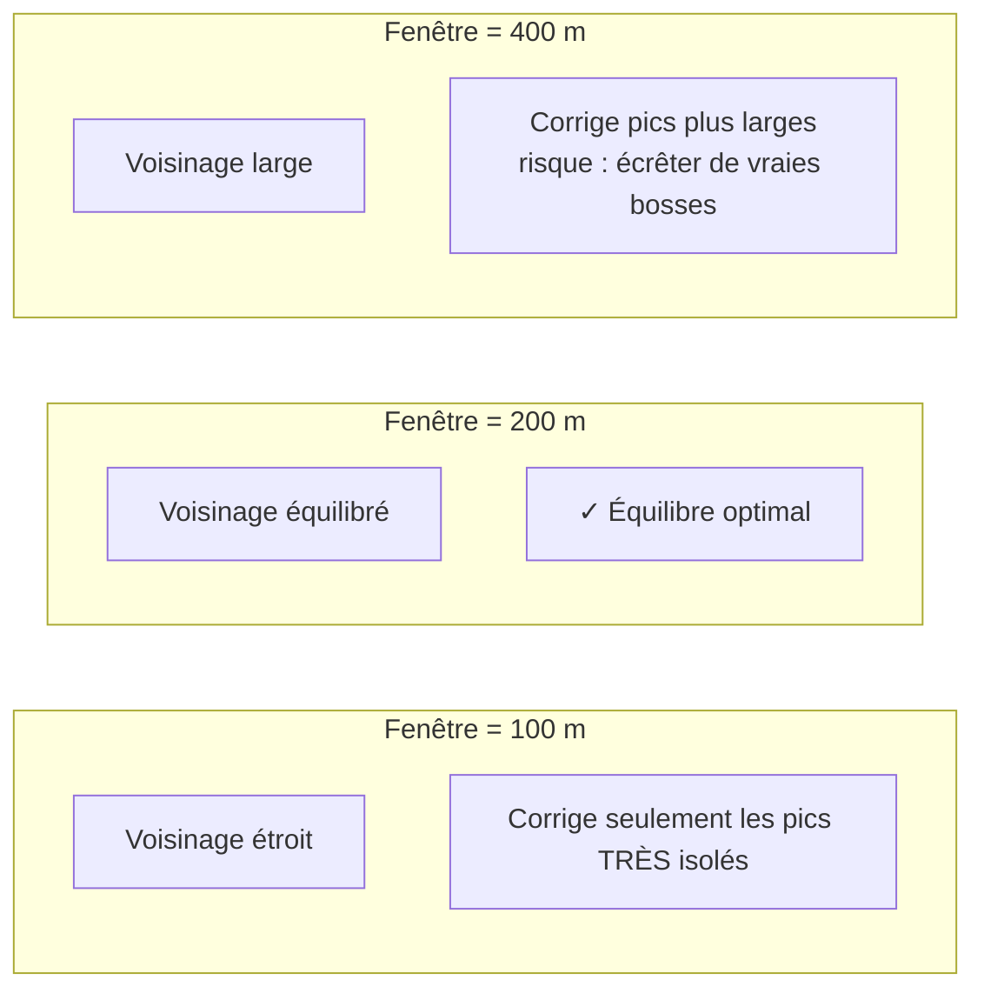

#### Choisir la valeur

| Type de trace | Fenêtre | Motif |
|---|---|---|
| Trace très propre | 100 m | Détection fine |
| **Trace GPS terrain** | **200 m** | Équilibre bruit / relief |
| Trace éditeur (SRTM) | 200 – 250 m | Glitch SRTM isolé |
| Vraies bosses larges | 300 m | Préserver les reliefs |
| Séries de glitchs | 400 – 500 m | Corriger des groupes de glitches |

#### Pièges

⚠️ **Trop petite (< 100 m)** : inefficace, le filtre ne corrige que les pics très isolés — diagnostic 🟠 orange.

⚠️ **Trop grande (> 400 m)** :
- Risque de couper de vraies bosses
- Diagnostic 🟠 orange

⚠️ **Fenêtre < 2 × Pas** : l'arrondi en points force la fenêtre effective à un minimum de 3 pts (soit 3 × Pas mètres), ce qui élargit la fenêtre demandée. Diagnostic 🟠.

#### Interactions

| Couplé avec | Règle |
|---|---|
| Anti-pic : seuil | Si seuil = 0, la fenêtre est ignorée |
| Pas | Aucune — la fenêtre est déjà en mètres |
| Filtre médian | **Redondant** — si anti-pic actif, désactiver filtre médian |

#### Comment vérifier

Le panneau Debug affiche au chargement :
```
🩹 Anti-pic (fenêtre=200 m → 5 pts ≈ 250 m, seuil=15 m) : 2 point(s) corrigé(s) sur 2190
```

- **0 point corrigé** : soit la trace est propre, soit le seuil est trop haut, soit la fenêtre est trop petite
- **2–10 points corrigés** : normal sur une trace SRTM
- **Plus de 50 points corrigés** : seuil trop bas ou fenêtre trop grande

Le panneau Diagnostic affiche la valeur effective :
```
● Anti-pic : fenêtre ..... 200 m · 5 pts effectifs ≈ 250 m
```

---

### 3.3 Anti-pic : seuil

| | |
|---|---|
| **Nom UI** | Anti-pic : seuil |
| **Nom technique** | `despikeThresholdM` |
| **Plage** | 0 – 100 m |
| **Défaut** | **15 m** |
| **Unité** | mètres |
| **Impact** | **Moyen** — détermine l'agressivité du filtre |
| **Catégorie** | Principal |

#### Rôle

Écart minimal (en mètres) entre le point et sa médiane locale pour déclencher la correction. En dessous du seuil, le point est conservé tel quel.

#### Effet visuel

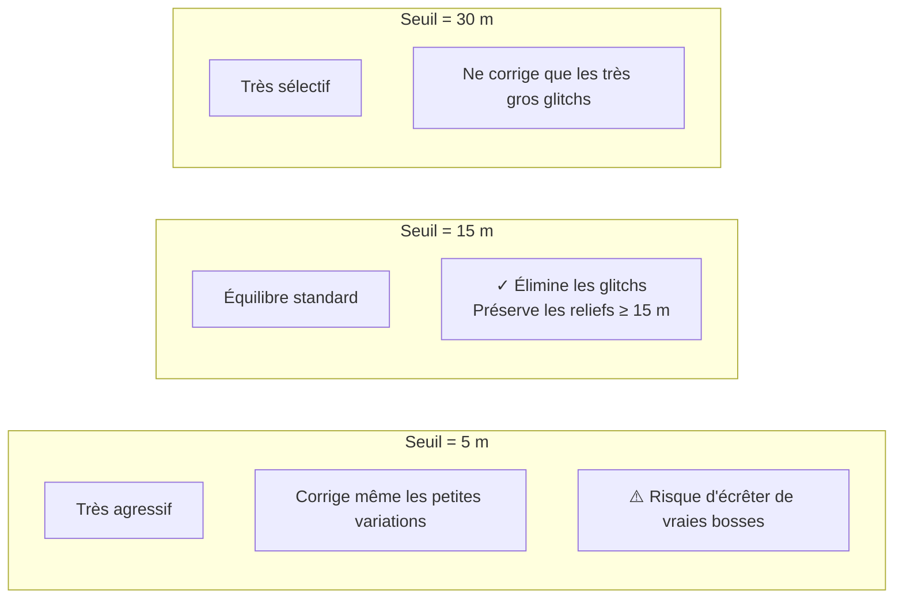

#### Schémas avant/après

**Cas 1 — Glitch isolé (corrigé avec seuil = 15 m)**
```
Fenêtre = 200 m, seuil = 15 m

Avant :  [1180, 1182, 1183, 1250, 1185, 1186, 1187]
                          ^^^^^ écart de 67 m → CORRIGÉ
Après :  [1180, 1182, 1183, 1183, 1185, 1186, 1187]
                          ^^^^^ remplacé par la médiane
```

**Cas 2 — Vrai relief (préservé avec seuil = 15 m)**
```
Fenêtre = 200 m, seuil = 15 m

Avant :  [1180, 1182, 1183, 1190, 1198, 1205, 1210]
                          ^^^^^ écart de 7 m → PRÉSERVÉ
Après :  [1180, 1182, 1183, 1190, 1198, 1205, 1210]
                          ^^^^^ inchangé
```

#### Choisir la valeur

| Type de trace | Seuil | Motif |
|---|---|---|
| Trace très propre | 10 m | Détection fine |
| **SRTM standard** | **15 m** | Bon équilibre |
| GPS capteur bruité | 20–30 m | Le bruit peut atteindre 30 m |
| Vraies bosses larges | 25 m | Préserver les reliefs de +25 m |
| Désactiver | **0** | Comportement avant anti-pic |

#### Pièges

⚠️ **Trop bas** (< 5 m) :
- Corrige même les petites variations normales
- Risque d'écrêter de vraies bosses
- Le diagnostic affiche 🟠 orange

⚠️ **Trop haut** (> 50 m) :
- Ne capturera que les glitchs très importants
- Le diagnostic affiche 🟠 orange

⚠️ **Seuil = 0** : filtre complètement désactivé
- Retour au comportement sans anti-pic
- Le diagnostic affiche ⚪ gris (désactivé)

#### Interactions

| Couplé avec | Règle |
|---|---|
| Anti-pic : fenêtre | Si fenêtre < 2 × Pas, la fenêtre effective est élargie |
| Lissage altitude | L'anti-pic **avant** le SG → SG reçoit un signal propre |
| Filtre médian | **Redondant** — désactiver si anti-pic actif |
| Correction plateaux | Complémentaire — plateaux traités avant anti-pic |

#### Comment vérifier

Le panneau Debug affiche :
```
🩹 Anti-pic (fenêtre=200 m → 5 pts ≈ 250 m, seuil=15 m) : 2 point(s) corrigé(s) sur 2190
```

Après correction, ouvrez le graphe de pente (📈). Le pic aigu doit avoir disparu.

Le panneau Diagnostic affiche :
```
● Anti-pic : seuil ....... 15 m
```

---

### 3.4 Lissage altitude

| | |
|---|---|
| **Nom UI** | Lissage altitude |
| **Nom technique** | `fenetreAffichageM` |
| **Plage** | 20 – ∞ m |
| **Défaut** | **500 m** |
| **Unité** | mètres |
| **Impact** | **Fort** — définit la résolution verticale |
| **Catégorie** | Principal |

#### Rôle

Contrôle le Savitzky-Golay appliqué à l'altitude, utilisé :
1. Pour la détection initiale (via la pente dérivée)
2. Pour le lissage ancré final (courbe affichée)

#### Effet sur la détection

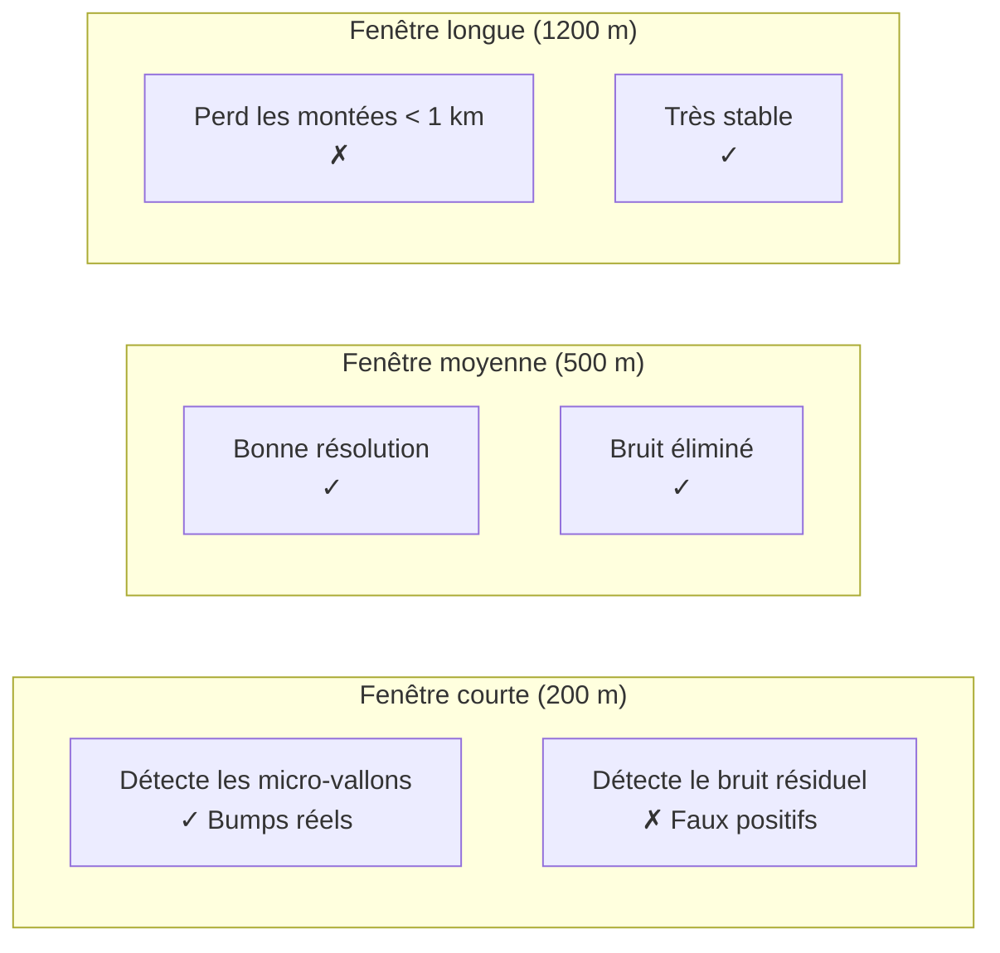

#### Valeur effective en points

La fenêtre effective en points = `Lissage altitude / Pas`. Pour que le SG soit efficace, il faut **≥ 10 points**.

| Pas | Lissage alt. | Fenêtre | SG efficace |
|---|---|---|---|
| 50 m | 300 m | 6 pts | ❌ inefficace |
| **50 m** | **500 m** | **10 pts** | ✅ juste |
| 50 m | 1000 m | 20 pts | ✅ optimal |
| 100 m | 300 m | 3 pts | ❌ inefficace |

**Important** : avec `Pas = 100 m` et `Lissage altitude = 300 m`, la fenêtre SG n'est que de **3 points** — le lissage altitude est donc **inefficace**. Le panneau Diagnostic vous avertit (🔴 rouge).

#### Recommandations cohérentes

| Pas | Lissage alt. recommandé |
|---|---|
| 25 m | 400 m |
| **50 m** | **500 m** |
| 100 m | 1000 m |

#### Pièges

⚠️ **Trop court** : la montée peut être fragmentée en 5–10 micro-montées à cause du bruit de pente.

⚠️ **Trop long** : une montée de 4 km sera vue comme un long faux-plat.

⚠️ **Non cohérent avec le Pas** : fenêtre SG < 10 pts → lissage inefficace. Le diagnostic vous avertit.

#### Interactions

| Couplé avec | Règle |
|---|---|
| Pas | `Pas × 10 ≤ Lissage altitude` |
| Lissage pente | `Lissage pente ≤ Lissage altitude / 2` |
| Recherche extrema | Ancre les extrema dans la courbe |

---

### 3.5 Lissage pente

| | |
|---|---|
| **Nom UI** | Lissage pente |
| **Nom technique** | `fenetrePenteM` |
| **Plage** | 10 – ∞ m |
| **Défaut** | **150 m** |
| **Unité** | mètres |
| **Impact** | **Fort** — détermine la sensibilité de l'hystérésis |
| **Catégorie** | Principal |

#### Rôle

Après le calcul de la pente instantanée, une moyenne mobile est appliquée. Cette pente lissée est utilisée **uniquement** pour l'hystérésis de détection.

#### Effet

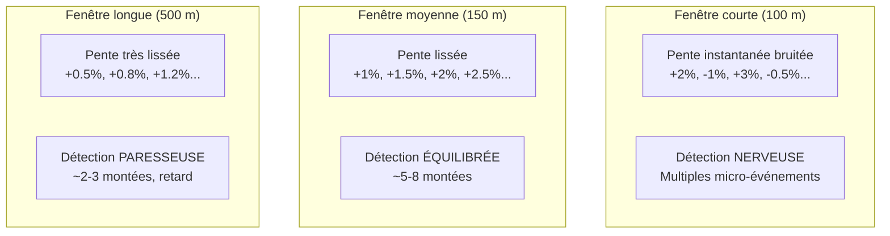

#### Retard de détection

Le retard de détection ≈ `Lissage pente / 2`.

| Lissage pente | Retard |
|---|---|
| 100 m | 50 m |
| 150 m | 75 m |
| 500 m | 250 m |

#### Recommandations

| Sensibilité souhaitée | Valeur |
|---|---|
| Détection très sensible (trail) | 100–150 m |
| **Équilibrée** (route, cyclotourisme) | **150–250 m** |
| Robuste (grandes sorties) | 300–400 m |

#### Pièges

⚠️ **Trop courte** : la pente lissée oscille autour du seuil → fragmentation.

⚠️ **Trop longue** : les montées courtes et raides (mur de 300 m) deviennent **invisibles**.

#### Interactions

| Couplé avec | Règle |
|---|---|
| Lissage altitude | `Lissage pente ≤ Lissage altitude / 2` |
| Seuil détection | Retard ≈ `Lissage pente / 2` |

---

### 3.6 Fenêtre de calcul pente

| | |
|---|---|
| **Nom UI** | Fenêtre de calcul pente |
| **Nom technique** | `fenetreCatM` |
| **Plage** | 50 – ∞ m |
| **Défaut** | **100 m** |
| **Unité** | mètres |
| **Impact** | **Aucun** sur la détection — **affichage uniquement** |
| **Catégorie** | Principal |

#### Rôle

Contrôle la largeur de la fenêtre glissante utilisée pour calculer la pente qui **colore la bande de segmentation** sous les graphiques et le fond des graphiques. N'affecte **jamais** les montées détectées.

#### Effet visuel

```
Trace avec alternance plat / montée / plat / montée (chaque zone = 300 m)

Fenêtre de calcul pente = 100 m :
[▁▁▁▁][▂▂▂▂][▁▁▁▁][▂▂▂▂]   ← 4 zones alternées, grande finesse
vert   orange vert   orange

Fenêtre de calcul pente = 500 m :
[──────▂───────────▂──]   ← 2 zones moyennes (lissage)
vert     orange    vert

Fenêtre de calcul pente = 1500 m :
[──────orange──────────────────]  ← 1 seule zone (tout fondu)
```

#### Recommandations

| Trace | Valeur |
|---|---|
| **Trace découpée (relances)** | **100–200 m** |
| Route classique | 200–300 m |
| Trace longue (> 100 km) | 500–800 m |

#### Pièges

⚠️ **Trop courte** : la bande de segmentation devient un patchwork illisible.

⚠️ **Trop longue** : toute la trace paraît « orange uniforme ».

**Indépendance** : `Fenêtre de calcul pente` peut différer de `Lissage pente` — ce sont deux usages différents.

---

### 3.7 Seuil détection

| | |
|---|---|
| **Nom UI** | Seuil détection |
| **Nom technique** | `seuilMontee` |
| **Plage** | 0.1 – ∞ % |
| **Défaut** | **0.5 %** |
| **Unité** | pourcentage |
| **Impact** | **Critique** — définit ce qu'est « une montée » |
| **Catégorie** | Principal |

#### Rôle

Hystérésis : on entre en mode « montée » quand la pente lissée dépasse `+Seuil`, on sort quand elle descend sous `−Seuil`.

#### Effet

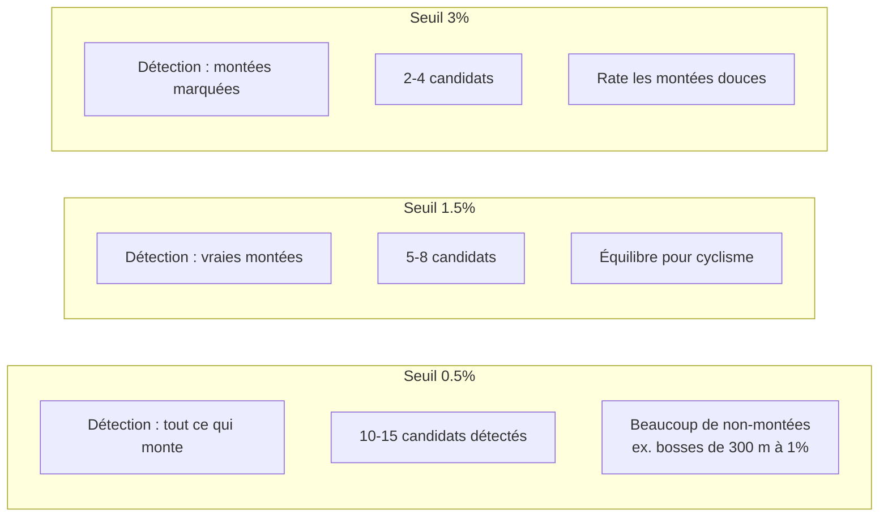

#### Hystérésis

L'hystérésis utilise deux seuils :
- **Entrée en montée** : pente > +Seuil
- **Sortie de montée** : pente < −Seuil

Cela évite les oscillations quand la pente est proche de zéro.

#### Recommandations

| Objectif | Valeur |
|---|---|
| Détecter toutes les bosses | 0.3–0.5 % |
| **Équilibré** | **0.5–1.0 %** |
| Ne garder que les vraies montées | 1.5–2.0 % |
| Ne garder que les cols | 3.0 % |

#### Pièges

⚠️ **Trop bas** : fragmentation, nécessite une fusion forte.

⚠️ **Trop haut** : rate les montées douces (cols à 3–4 % moyen).

#### Interaction critique avec Écart min. entre montées

Avec un seuil bas, la détection **fragmente** les montées. La fusion (§3.9) est là pour rattraper.

Recommandation : **garder un seuil bas** (0.5%) + **une fusion** (250 m) plutôt que monter le seuil.

---

### 3.8 Longueur min. pente

| | |
|---|---|
| **Nom UI** | Longueur min. pente |
| **Nom technique** | `longueurMin` |
| **Plage** | 0 – ∞ m |
| **Défaut** | **200 m** |
| **Unité** | mètres |
| **Impact** | **Aucun** sur la détection — **affichage uniquement** |
| **Catégorie** | Principal |

#### Rôle

Fusionne les segments de pente (catégorie) plus courts que cette longueur dans leur voisin le plus long. Évite les micro-taches de couleur.

#### Effet visuel

```
Trace avec 3 alternances rapides de 80 m chacune :

Longueur min. pente = 0 :
[vert][orange][vert][orange][vert]   ← patchwork

Longueur min. pente = 200 :
[────orange────────────────────]     ← fondue en orange
```

#### Recommandations

| Type de trace | Valeur |
|---|---|
| Trace très courte | 100–150 m |
| **Route classique** | **200–250 m** |
| Trace longue | 300–500 m |

#### Piège

⚠️ **Trop grand** : le fond perd les micro-pentes.

⚠️ **Longueur min. pente < Pas** : paramètre **inopérant** — le diagnostic vous le signale.

**Note** : ce paramètre n'affecte **que** le fond de couleur et le tableau statistique par catégorie.

---

### 3.9 Écart min. entre montées

| | |
|---|---|
| **Nom UI** | Écart min. entre montées |
| **Nom technique** | `gapMinM` |
| **Plage** | 0 – 5000 m |
| **Défaut** | **250 m** |
| **Unité** | mètres |
| **Impact** | **Fort** sur la cohérence des montées |
| **Catégorie** | Avancé (v3.0) |

#### Rôle

Deux montées détectées séparées de moins de **Écart min.** sont **fusionnées** en une seule. Le nouveau sommet est le plus haut des deux, le nouveau creux est le plus bas.

#### Le problème résolu

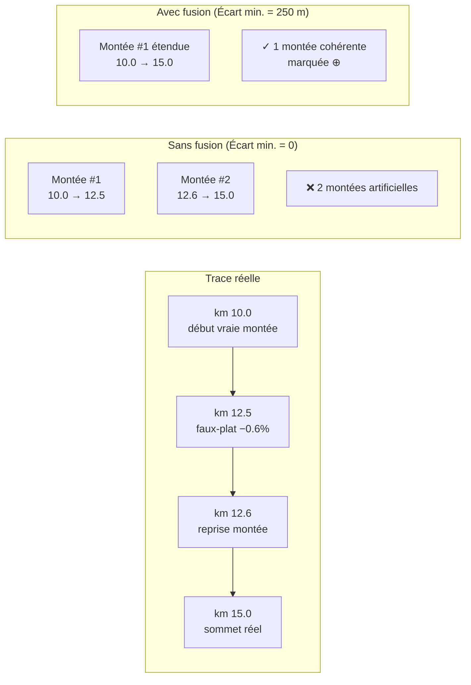

#### Effet sur la pente moyenne

⚠️ La fusion **dilue la pente**. Un faux-plat de 100 m dans une montée de 5 km à 8 % peut ramener la pente à 7.9 %.

C'est pour cette raison que la **validation stricte (v3.1)** intervient après : si les bornes finales fusionnées passent sous le seuil, elles sont **repliées sur le sous-segment valide** avec l'indicateur `⤺`.

#### Recommandations

| Type de trace | Valeur |
|---|---|
| **Col enchaîné (Mortirolo)** | **200–300 m** |
| Route sinueuse | 250–400 m |
| Gravel / VTT nerveux | 150–250 m |
| Route droite | 0–100 m |
| Désactiver | **0** |

#### Comment vérifier

Le panneau Debug (🐛) affiche :
```
[v3.6] 2 fusion(s) — écart min. 250 m
⊕ Montée #6 étendue : écart 1 m < 250 m → km 71.750–75.750 (4.00 km)
```

L'indicateur `⊕` apparaît sur les lignes fusionnées du tableau.

---

### 3.10 Recherche extrema

| | |
|---|---|
| **Nom UI** | Recherche extrema |
| **Nom technique** | `refinePct` |
| **Plage** | 1 – 500 % |
| **Défaut** | **60 %** |
| **Unité** | pourcentage |
| **Impact** | **Fort** sur la précision des bornes |
| **Catégorie** | Avancé |

#### Rôle

Après la détection initiale, chaque montée cherche son **vrai** creux et **vrai** sommet dans un rayon de `clamp(Recherche extrema% × longueur, 1500, 8000)` mètres.

#### Formule

```
effectiveRefine = min(8000, max(1500, Recherche extrema% × longueurDétectée))
```

#### Table d'exemples

| Longueur détectée | 30% | 60% | 150% |
|---|---|---|---|
| 500 m | 1500 m (plancher) | 1500 m (plancher) | 1500 m (plancher) |
| 3 km | 1500 m (plancher) | 1800 m | 4500 m |
| 8 km | 2400 m | 4800 m | 8000 m (plafond) |
| 15 km | 4500 m | 8000 m (plafond) | 8000 m (plafond) |

#### Choisir la valeur

| Cas | Valeur | Motif |
|---|---|---|
| Trace très fiable (SRTM propre) | **40 – 60 %** | Recherche serrée |
| Trace bruitée | 80 – 120 % | Chercher large |
| Montées très définies | 30 – 50 % | Éviter d'avaler les voisines |
| Montées enchaînées | **50 – 80 %** | Compromis |

#### Piège

⚠️ **Trop grand** : la recherche peut déborder sur la montée suivante et produire un chevauchement (résolu par la contrainte anti-chevauchement, mais avec un `⚠` orange).

⚠️ **Trop petit** : le vrai sommet peut être 500 m après le candidat brut.

---

### 3.11 Filtre médian

| | |
|---|---|
| **Nom UI** | Filtre médian |
| **Nom technique** | `medianWindowM` |
| **Plage** | 0 – 300 m |
| **Défaut** | **0 m** (désactivé) |
| **Unité** | mètres (0 = désactivé) |
| **Impact** | **Faible** — élimination des pics isolés |
| **Catégorie** | Avancé |

#### Rôle

Élimine les valeurs aberrantes isolées AVANT tout autre traitement.

**Depuis v3.3, l'anti-pic Hampel rend le filtre médian largement redondant.** Le rééchantillonnage par moyenne (v3.5) renforce encore cette redondance. Recommandation : **le laisser désactivé (0)** si l'anti-pic est actif.

#### Effet

Pour `Filtre médian = 0` : désactivé
Pour `Filtre médian = 50 m` : avec `Pas = 50 m`, la fenêtre effective = **1 point** → peu efficace
Pour `Filtre médian = 200 m` : fenêtre de 4 points → commence à agir

#### Recommandations

| Trace | Valeur | Motif |
|---|---|---|
| GPS capteur très bruité | 100–150 m | Débruitage complémentaire |
| **Toutes traces en v3.5+** | **0** | **Anti-pic + moyennage suffisent** |
| Trace avec pics très nombreux | 50–100 m | Renfort du débruitage |

#### Piège

⚠️ **Avec `Pas = 50 m`, 100 m → fenêtre = 2 pts → filtre inopérant**.
- Le diagnostic vous le signale 🟠 orange
- Augmentez à 200 m ou désactivez

**Recommandation v3.5** : préférez l'**anti-pic** au filtre médian. Gardez `Filtre médian = 0` si `Anti-pic : seuil > 0`.

---

### 3.12 Lissage gaussien

| | |
|---|---|
| **Nom UI** | Lissage gaussien |
| **Nom technique** | `gaussianSigmaM` |
| **Plage** | 0 – 500 m |
| **Défaut** | **75 m** |
| **Unité** | mètres |
| **Impact** | **Moyen** — adoucissement global |
| **Catégorie** | Avancé |

#### Rôle

Après le SG et avant l'ancrage final, applique une convolution gaussienne d'écart-type σ. Adoucit les transitions entre segments.

#### Effet

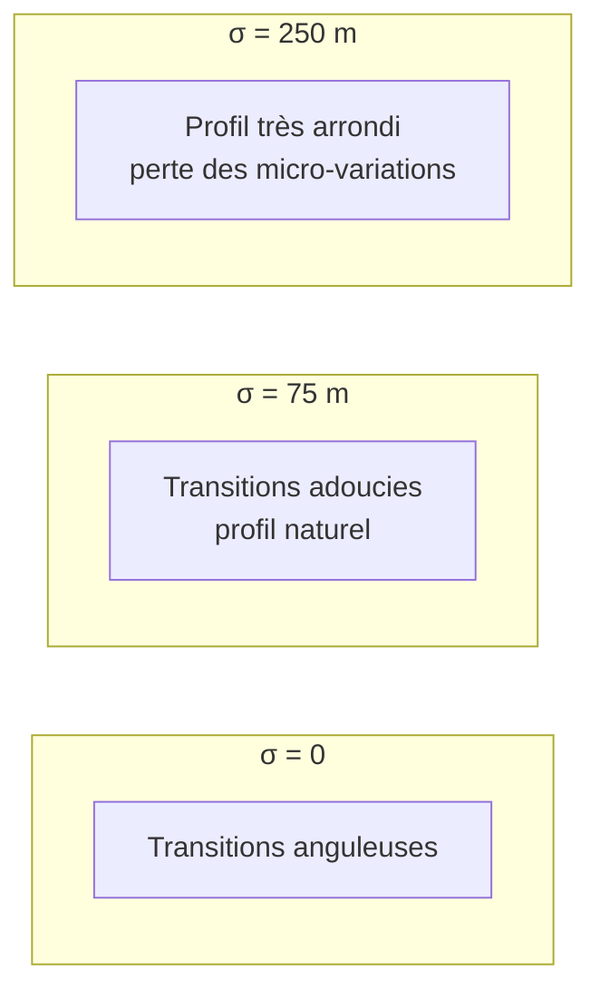

#### Valeur effective en points

σ en points = `Lissage gaussien / Pas`. Pour que le filtre soit efficace, il faut **σ ≥ 0.5 point**.

| Pas | σ | Points | Efficace |
|---|---|---|---|
| 25 m | 75 m | 3 pts | ✅ |
| 50 m | 75 m | 1.5 pts | ✅ |
| 100 m | 75 m | 0.75 pt | ⚠️ limite |

**Important** : avec `Pas = 100 m` et `Gaussien = 75 m`, σ = **0.75 point** — le filtre est **quasiment inopérant**. Le panneau Diagnostic vous avertit (🟠 orange).

#### Recommandations

| Trace | σ |
|---|---|
| Analyse précise | 30–50 m |
| Équilibré | 75–100 m |
| Profil très lissé | 150–250 m |
| Désactivé | **0** |

**Recommandation cohérente** : `σ ≥ 0.5 × Pas`. Avec `Pas = 50 m` → σ ≥ 25 m minimum, idéalement 75 m.

#### Piège

⚠️ σ trop grand (> 5 × Pas) → perte des micro-dénivelés et aspect « écrasé ».

---

### 3.13 Correction plateaux

| | |
|---|---|
| **Nom UI** | Correction plateaux |
| **Nom technique** | `plateauRun` |
| **Plage** | 0 – 20 pts |
| **Défaut** | **6 pts** |
| **Unité** | points consécutifs |
| **Impact** | **Variable** — utile sur MNT, inutile sur GPS |
| **Catégorie** | Avancé |

#### Rôle

Détecte les séries de **Correction plateaux** points consécutifs ayant une altitude identique (ou ±1 m) et les interpole linéairement.

**Sur les traces éditeur/MNT SRTM** : les altitudes sont entières (MNT quantifié au mètre). Un long tronçon plat peut apparaître comme une série de `1211, 1211, 1211, 1211, 1211, 1211, 1210, 1210...`.

#### Schéma

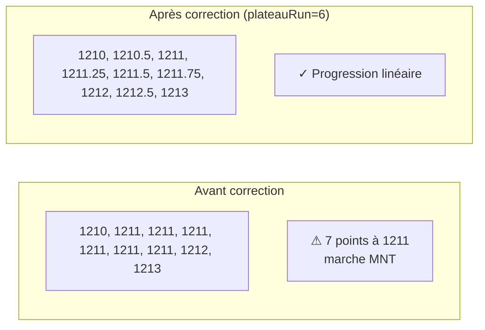

#### Recommandations

| Trace | Valeur |
|---|---|
| **Trace éditeur (SRTM)** | **4 – 8** |
| Trace GPS propre | 0 – 4 |
| Trace GPS bruitée | 0 (désactivé) |

#### Interaction avec le Pas

Après un rééchantillonnage à `Pas > 50 m`, les marches MNT de 30 m sont **diluées** par la moyenne. Le filtre devient souvent inutile.

**Conseil** : passer `Correction plateaux` à **0** si `Pas > 50 m`.

⚠️ Sur les **vrais arrêts** GPS, l'altitude reste constante → le filtre va créer à tort une pente artificielle.

---

### 3.14 Segments debug

| | |
|---|---|
| **Nom UI** | Segments debug |
| **Nom technique** | `segmentLogM` |
| **Plage** | 10 – 2000 m |
| **Défaut** | **100 m** |
| **Unité** | mètres |
| **Impact** | **Aucun** — debug uniquement |
| **Catégorie** | Debug |

#### Rôle

Contrôle la granularité du log détaillé d'une montée (affiché dans le panneau Debug quand vous cliquez sur une ligne du tableau).

N'affecte **rien** dans la détection ni dans l'affichage.

#### Exemple de sortie debug

```
📊 Montée #6  km 71.750 → 75.750
   Total : 4.000 km  |  D+ 341 m  |  Pente moy. 8.5 %

   Seg │  km début → km fin  │ Long. │  D+   │  Pente
   ──────────────────────────────────────────────────
     1 │ 71.750 → 71.850 │  100 m │   12 m │  12.0 %   ◀ vallée
     2 │ 71.850 → 71.950 │  100 m │   11 m │  11.0 %
     3 │ 71.950 → 72.050 │  100 m │    8 m │   8.0 %
   ...
    40 │ 75.650 → 75.750 │  100 m │    6 m │   6.0 %   ◀ sommet
```

#### Utilité

- Vérifier si une montée contient un faux-plat (où ?)
- Analyser la régularité d'un col
- Détecter les irrégularités locales

**Recommandation** : laisser à 100 m. Augmenter à 250 m pour une vue macro, réduire à 50 m pour un audit fin.

---

## 4. Les 2 options supplémentaires

### 4.1 Lissage renforcé (double SG)

| | |
|---|---|
| **Nom UI** | Lissage renforcé (double SG) |
| **Nom technique** | `smoothExtra` |
| **Type** | Toggle (on/off) |
| **Défaut** | **ON** |
| **Impact** | **Moyen** sur le profil affiché |

#### Rôle

Après le lissage ancré final, applique un **second** Savitzky-Golay de fenêtre double (`2 × Lissage altitude`). Les ancres sont ensuite re-forcées pour préserver les extrema.

#### Schéma

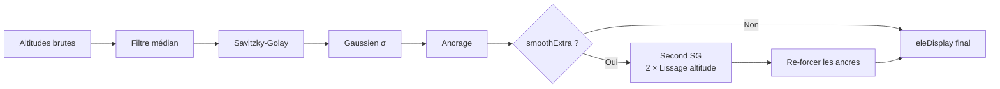

#### Effet

- **Sans** : le profil peut avoir de légères oscillations résiduelles
- **Avec** : profil plus lisse, transitions très adoucies

#### Recommandation

- `ON` si `Lissage altitude ≤ 600 m`
- `OFF` si `Lissage altitude > 1000 m` (risque d'écraser les micro-détails)

### 4.2 Lissage des pentes de segment

| | |
|---|---|
| **Nom UI** | Lissage des pentes de segment |
| **Nom technique** | `segmentSmooth` |
| **Type** | Toggle (on/off) |
| **Défaut** | **ON** |
| **Impact** | **Aucun** — debug uniquement |

#### Rôle

Dans le log détaillé par segments (panneau Debug), applique une **médiane mobile à 3** sur les pentes des segments consécutifs. Élimine les pics isolés dans le log.

**N'affecte PAS** la détection ni l'affichage. Seul le log Debug est modifié.

#### Utilité

- Affiche les segments lissés marqués `·lissé`
- Rend le log plus lisible

---

## 5. Interactions critiques

### 5.1 Règles de cohérence

```
1. Pas × 10 ≤ Lissage altitude   (fenêtre SG ≥ 10 pts)
2. Lissage altitude ≥ 2 × Lissage pente
3. Filtre médian ≥ 3 × Pas (ou 0)
4. Lissage gaussien ≥ 0.5 × Pas (ou 0)
5. Écart min. entre montées ≥ Pas (ou 0)
6. Longueur min. pente ≥ Pas (ou 0)
7. Anti-pic : fenêtre ≥ 2 × Pas (ou seuil = 0)
8. Anti-pic : seuil ≥ 5 m (ou 0)
```

### 5.2 Matrice d'interactions

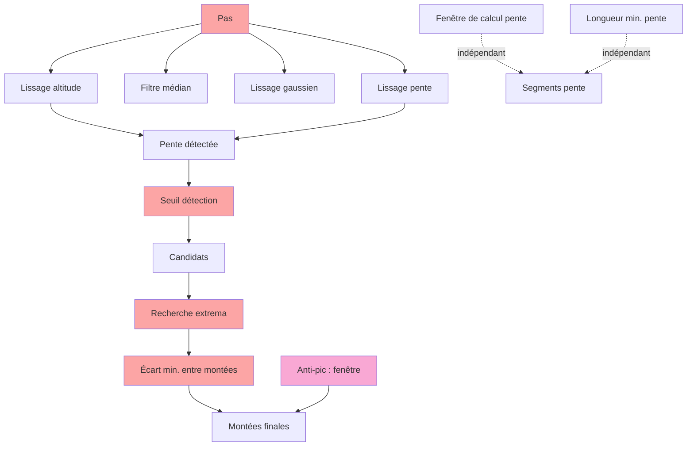

Les paramètres en **rouge** ont un impact direct sur la détection. Le paramètre **rose** est l'anti-pic.

### 5.3 Chaîne de la fragmentation

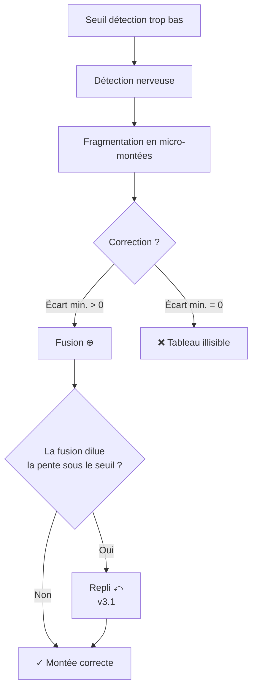

**Conclusion** : une chaîne bien configurée est :
```
Seuil détection = 0.5%
+ Lissage pente = 150 m
+ Écart min. entre montées = 250 m
+ Validation stricte activée (v3.1)
```

### 5.4 Chaîne de la sur-correction anti-pic

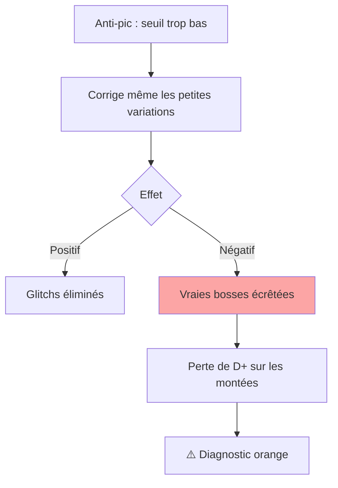

**Recommandation** : garder un seuil ≥ 10 m pour préserver les vraies bosses.

### 5.5 Dépendances entre paramètres — chaîne de cohérence

> **Principe.** Aucun paramètre ne se règle seul. Le **Pas de rééchantillonnage** est la racine de tout : chaque filtre s'exprime en mètres, mais s'exécute en **points**, et le nombre de points couverts par un filtre dépend du Pas. Modifier le Pas sans réviser les autres paramètres casse silencieusement le pipeline.

#### 5.5.1 Graphe de dépendance

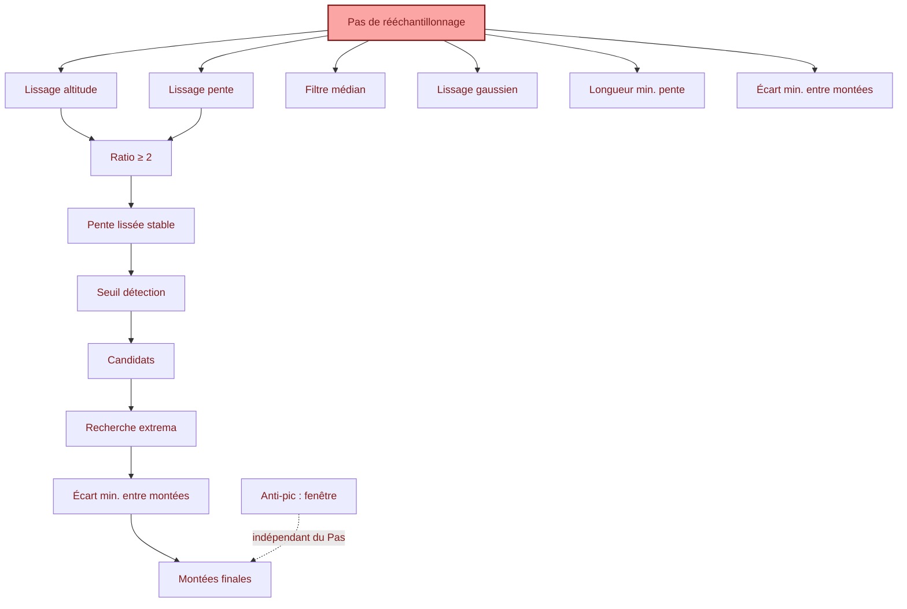

**Légende :** rouge = paramètre racine. Une flèche A → B signifie « A fixe la plage utile de B ».

#### 5.5.2 Les 8 règles de cohérence (à connaître par cœur)

| # | Règle | Pourquoi | Si violée |
|---|---|---|---|
| R1 | `Lissage altitude ≥ 10 × Pas` | SG a besoin de ≥ 10 pts pour agir | SG inopérant, diagnostic 🔴 |
| R2 | `Lissage altitude ≥ 2 × Lissage pente` | Sinon la pente est plus lisse que l'altitude → détection incohérente | diagnostic 🔴 |
| R3 | `Lissage pente ≥ 3 × Pas` | En dessous : fenêtre < 3 pts, moy. mobile dégénérée | diagnostic 🔴 |
| R4 | `Filtre médian ≥ 3 × Pas` (ou 0) | < 3 pts, la médiane est le point lui-même | diagnostic 🟠 |
| R5 | `Lissage gaussien ≥ 0.5 × Pas` (ou 0) | σ < 0.5 pt → noyau dégénéré | diagnostic 🟠 |
| R6 | `Longueur min. pente ≥ Pas` (ou 0) | Sinon un segment fait moins d'1 point | diagnostic 🟠 |
| R7 | `Écart min. entre montées ≥ Pas` (ou 0) | Sinon la fusion n'a aucun candidat à fusionner | diagnostic 🟠 |
| R8 | `Anti-pic : fenêtre ≥ 2 × Pas` (si seuil > 0) | Sinon l'arrondi force une fenêtre > demandée | diagnostic 🟠 |

#### 5.5.3 Chaîne de dépendance de second ordre

Trois dépendances ne s'expriment pas par une simple inégalité :

**a) `Lissage pente` → retard de détection**
Retard ≈ `Lissage pente / 2`. Si on augmente le lissage pente, le début de chaque montée est détecté plus tard. Ce n'est pas une erreur, mais cela crée un décalage systématique sur les bornes.

**b) `Écart min. entre montées` × `Recherche extrema` → dilatation des bornes**
Les deux paramètres **étendent** les bornes (l'un vers la droite du côté sommet, l'autre vers la gauche du côté creux). Combinés de façon agressive (Écart > 500 m **et** Recherche > 100 %), une montée peut « avaler » sa voisine → diagnostic 🟠.

**c) `Anti-pic : fenêtre` → indépendance vis-à-vis du Pas**
La fenêtre est en mètres, donc sa couverture physique **ne dépend plus du Pas**. C'est le grand changement de la v3.6 : plus besoin d'ajuster la fenêtre quand on modifie le Pas.

#### 5.5.4 Cascade : modifier le Pas

Modifier le Pas est l'opération la plus risquée. Ordre à respecter :

```
1. Changer le Pas
2. Réviser Lissage altitude    → pour que R1 reste vrai
3. Réviser Lissage pente       → pour que R2, R3 restent vrais
4. Réviser Filtre médian       → R4, ou passer à 0
5. Réviser Lissage gaussien    → R5, ou passer à 0
6. Vérifier Anti-pic : fenêtre → doit rester ≥ 2 × Pas (R8)
7. Vérifier le diagnostic      → doit rester 🟢
```

**Exemple concret** — passer de Pas = 100 m à Pas = 50 m (facteur ÷2) :

| Paramètre | Avant (Pas=100) | Après (Pas=50) | Règle |
|---|---|---|---|
| Lissage altitude | 1000 m (10 pts) | **500 m** (10 pts) | R1 |
| Lissage pente | 300 m (3 pts) | **150 m** (3 pts) | R2/R3 |
| Filtre médian | 0 (désactivé) | **0** | R4 |
| Lissage gaussien | 200 m (2 pts) | **100 m** (2 pts) | R5 |
| Anti-pic : fenêtre | 200 m | **200 m** | ✅ pas d'ajustement |
| Écart min. entre montées | 250 m | 250 m (≥ Pas) | R7 ✅ |

#### 5.5.5 Comment détecter une violation

Trois outils, dans l'ordre :

1. **Le panneau Diagnostic** (§7) — il liste les violations et propose une valeur cible.
2. **Les indicateurs colorés sous chaque champ** — 🟢 optimal / 🟠 limite / 🔴 incohérent.
3. **Le log Debug** — chercher `Point(s) corrigé(s)` anormalement élevé (anti-pic trop agressif) ou `fenêtre = N pts` (filtre inopérant).

---

## 6. Recettes par type de trace

### 6.1 Trace GPS terrain (montre, téléphone)

| Paramètre | Valeur |
|---|---|
| Pas | **50 m** |
| Anti-pic : fenêtre | **200 m** |
| Anti-pic : seuil | **20 m** |
| Lissage altitude | **500 m** |
| Lissage pente | 150 m |
| Filtre médian | **0** |
| Lissage gaussien | 75 m |
| Correction plateaux | 0 |
| Double SG | ON |

### 6.2 Trace éditeur SRTM (Openrunner, Garmin Connect)

| Paramètre | Valeur |
|---|---|
| **Pas de rééchantillonnage** | **50 m** |
| **Anti-pic : fenêtre** | **200 m** |
| **Anti-pic : seuil** | **15 m** |
| **Lissage altitude** | **500 m** |
| **Lissage pente** | **150 m** |
| **Filtre médian** | **0** |
| **Lissage gaussien** | **75 m** |
| **Correction plateaux** | **6** |
| **Double SG** | **ON** |

### 6.3 Col enchaîné (type Marmotte, Mortirolo)

| Paramètre | Valeur |
|---|---|
| **Écart min. entre montées** | **250 – 300 m** |
| Recherche extrema | 60 % |
| Seuil détection | 0.5 % |
| Fenêtre de calcul pente | 100 – 200 m |

### 6.4 Gravel / VTT nerveux

| Paramètre | Valeur |
|---|---|
| Pas de rééchantillonnage | 25 m |
| Anti-pic : fenêtre | 200 m |
| Anti-pic : seuil | 25 m |
| Lissage altitude | 300 m |
| Lissage pente | 80 m |
| Seuil détection | 0.8 % |
| Écart min. entre montées | 150 m |
| Longueur min. pente | 150 m |

### 6.5 Ultra-distance (> 200 km)

| Paramètre | Valeur |
|---|---|
| Pas de rééchantillonnage | 75 – 100 m |
| Anti-pic : fenêtre | 250 m |
| Lissage altitude | 800 m |
| Lissage pente | 250 m |
| Seuil détection | 0.5 % |
| Écart min. entre montées | 500 m |
| Longueur min. pente | 500 m |
| Fenêtre de calcul pente | 500 m |

---

## 7. Diagnostic de configuration

### 7.1 Présentation

Le panneau **Diagnostic de configuration** (en haut de la carte Paramètres) affiche en temps réel :

- **Statut global** : 🟢 Cohérent, 🟠 Avertissements, 🔴 Incohérences
- **Grille** : une ligne par paramètre avec valeur effective et point coloré
- **Avertissements** : liste détaillée des problèmes avec suggestions

### 7.2 Exemple de diagnostic

```
┌─────────────────────────────────────────────────────────┐
│ 🔍 Diagnostic de configuration      🟢 Cohérent         │
├─────────────────────────────────────────────────────────┤
│ ● Pas ................... 50 m                          │
│ ● Anti-pic : fenêtre ..... 200 m · 5 pts ≈ 250 m        │
│ ● Anti-pic : seuil ....... 15 m                         │
│ ● Lissage altitude ....... 10 points                    │
│ ● Lissage pente .......... 3 points                     │
│ ● Fenêtre de calcul pente  2 points                     │
│ ● Seuil détection ........ 0.5 %                        │
│ ● Longueur min. pente .... 200 m                        │
│ ● Écart min. entre montées  250 m                       │
│ ● Recherche extrema ...... 60 %                         │
│ ● Filtre médian .......... désactivé                    │
│ ● Lissage gaussien ....... σ ≈ 1.5 point                │
│ ● Correction plateaux .... 6 points                     │
│                                                         │
│ Aucun problème détecté. Configuration cohérente.        │
└─────────────────────────────────────────────────────────┘
```

### 7.3 Comment utiliser le diagnostic

**Étape 1** : Chargez votre trace
**Étape 2** : Regardez le statut global (en haut à droite)
- 🟢 → rien à faire
- 🟠 → quelques ajustements recommandés
- 🔴 → corriger avant de continuer

**Étape 3** : Lisez les avertissements, chacun indique une **action concrète**

**Étape 4** : Modifiez les paramètres concernés, le diagnostic se met à jour

### 7.4 Statuts détaillés

| Statut | Signification | Exemple |
|---|---|---|
| 🟢 Vert | Valeur optimale | Fenêtre SG = 10 pts |
| 🟠 Orange | Limite / avertissement | Fenêtre SG = 8 pts |
| 🔴 Rouge | Incohérence critique | Fenêtre SG = 3 pts |
| ⚪ Gris | Désactivé / non applicable | Filtre médian = 0 |

---

## 8. Cas pratiques

### 8.1 « Un pic aigu apparaît sur le graphe de pente »

**Symptôme** : pic vertical de ±25 % sur le graphe de pente, alors que la courbe d'altitude ne montre presque rien.

**Cause** : glitch d'altitude isolé (1–2 points), amplifié par la dérivée.

**Solution** :
1. Activer l'anti-pic : `Fenêtre = 200 m`, `Seuil = 15 m`
2. Vérifier dans le panneau Debug : `🩹 Anti-pic : 2 point(s) corrigé(s)`
3. Si le pic persiste, réduire le seuil à 10 m
4. Si le pic fait plus de 3 points de large, augmenter la fenêtre à 300 m

### 8.2 « Les montées sont fragmentées en 5–10 micro-montées »

**Symptôme** : le tableau affiche beaucoup de montées très courtes, souvent collées.

**Cause** : seuil détection trop bas ou lissage pente trop court.

**Solution** :
1. Augmenter `Écart min. entre montées` à 300–400 m
2. Vérifier que `Lissage pente ≥ 150 m`
3. Ne PAS augmenter le seuil détection (risque de rater des montées douces)

### 8.3 « Une vraie bosse a disparu »

**Symptôme** : une bosse visible sur la trace n'apparaît pas dans le tableau.

**Cause possible 1** : seuil détection trop haut
→ Réduire à 0.5 % ou moins

**Cause possible 2** : anti-pic trop agressif
→ Augmenter `Anti-pic : seuil` à 25 m ou plus

**Cause possible 3** : lissage altitude trop long
→ Réduire à 300–400 m

### 8.4 « Le profil est complètement écrasé »

**Symptôme** : la courbe d'altitude est trop lisse, plus de détail.

**Cause** : lissage gaussien ou lissage altitude trop longs.

**Solution** :
1. Réduire `Lissage gaussien` à 30–50 m
2. Désactiver `Double SG`
3. Réduire `Lissage altitude` à 300 m

### 8.5 « Aucune montée détectée »

**Symptôme** : trace plate ou montées très douces.

**Vérifications** :
1. Le fichier contient-il des `<ele>` ? (regarder le log debug)
2. La trace a-t-elle du dénivelé ? (D+ brut dans les stats)
3. `Seuil détection` à 0.5 % ou moins
4. `Lissage altitude` cohérent avec `Pas`

### 8.6 « Le D+ affiché est différent de la réalité »

**Symptôme** : D+ brut ne correspond pas à la réalité.

**Note** : le D+ brut est calculé sur les **altitudes GPX d'origine**, pas sur les données resamplées. Il peut différer légèrement de la réalité si :
- La trace contient des doublons GPS (ignorés)
- Les altitudes sont quantifiées au mètre

**Vérification** : comparer avec un autre outil (Strava, Garmin) qui utilise la même méthode.

### 8.7 « Le graphe de pente est totalement plat »

**Symptôme** : la courbe de pente est presque une ligne horizontale.

**Cause** : lissage pente trop long ou écrêtage.

**Vérifications** :
1. `Lissage pente` ≤ 200 m
2. Le graphe de pente est-il déplié ? (cliquer sur le titre)
3. Y a-t-il vraiment du dénivelé sur la portion ?

### 8.8 « Les segments de couleur ne ressemblent à rien »

**Symptôme** : la bande de couleur est un patchwork illisible.

**Solution** :
1. Augmenter `Fenêtre de calcul pente` à 200–300 m
2. Augmenter `Longueur min. pente` à 300 m

### 8.9 « La pente moyenne d'une montée est sous son seuil »

**Symptôme** : une montée est détectée mais sa pente affichée est < 3 %.

**Cause** : l'ancien bug (v3.0) où la validation était faite sur un sous-segment mais les bornes stockées étaient les bornes raffinées + fusionnées.

**Solution** : ce bug est **corrigé en v3.1** via la validation stricte avec repli (`⤺`).

**Vérification** :
- L'indicateur `⤺` doit apparaître sur la ligne
- Le log debug doit tracer le repli :
  ```
  ⤺ Repli km 71.750–79.050 → 71.750–76.050
  ```

### 8.10 « Je veux juste visualiser sans détection »

**Solution** : mettre `Seuil détection` à 10 % (aucune montée détectée). La trace reste affichée avec sa segmentation.

---

## 9. Tableau de diagnostic rapide

### 9.1 Symptômes → Actions

| Symptôme observé | Paramètre à ajuster | Action |
|---|---|---|
| **Pic aigu sur graphe pente** | **Anti-pic : seuil** | **↓ Réduire à 10 m** |
| **Pic persiste après anti-pic** | **Anti-pic : fenêtre** | **↑ Augmenter à 300 m** |
| **Vraie bosse écrêtée** | **Anti-pic : seuil** | **↑ Augmenter à 25 m** |
| Beaucoup de micro-montées collées | Écart min. entre montées | ↑ Augmenter |
| Montées trop fusionnées (perte de détail) | Écart min. entre montées | ↓ Réduire |
| Sommets coupés (arrêtés avant le vrai sommet) | Recherche extrema | ↑ Augmenter |
| Sommets avalant la descente suivante | Recherche extrema | ↓ Réduire |
| Pente moyenne sous son seuil | Bug v3.1 corrigé (`⤺`) | Vérifier `⤺` |
| Montées raides ratées | Lissage altitude | ↓ Réduire |
| Montées ratées malgré forte pente | Seuil détection | ↓ Réduire |
| Pic de pente isolé dans le graphique | Anti-pic | Vérifier seuil/fenêtre |
| Profil « écrasé » | Lissage gaussien ou Double SG | ↓ Réduire / OFF |
| Démarrage des montées en retard | Lissage pente | ↓ Réduire |
| Bande de couleur = patchwork | Fenêtre de calcul pente ou Longueur min. pente | ↑ Augmenter |
| Altitudes avec marches d'escalier visibles | Correction plateaux | ↑ Augmenter |
| Détection en retard sur montées courtes | Lissage pente | ↓ Réduire |
| D+ des montées incohérent | Vérifier stats brutes | — |
| **Filtre médian inefficace** | **Filtre médian** | **Désactiver (0) ou augmenter** |
| **Lissage altitude inefficace** | **Lissage altitude** | **Augmenter (≥ 10 × Pas)** |
| **Anti-pic : fenêtre trop petite** | **Anti-pic : fenêtre** | **↑ Augmenter (≥ 2 × Pas)** |

### 9.2 Arbre de décision

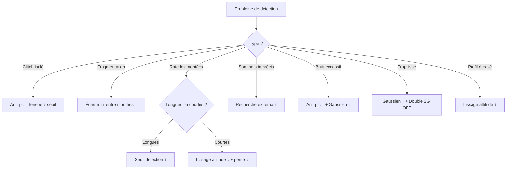

### 9.3 Vérification rapide après modification

Après modification d'un paramètre :

1. Regarder le **statut global** du diagnostic (🟢🟠🔴)
2. Observer le **nombre de montées** détectées (change-t-il de façon cohérente ?)
3. Vérifier les **indicateurs `⊕` et `⤺`** dans le tableau
4. Ouvrir le **log Debug d'une montée** (clic sur la ligne) pour voir la pente segment par segment
5. Vérifier que le graphe de pente ne montre pas de pics aigus

---

## 10. Rappel des défauts

### 10.1 Valeurs par défaut v3.6

| Paramètre | Défaut | Catégorie |
|---|---|---|
| Pas de rééchantillonnage | **50 m** | Principal |
| Anti-pic : fenêtre | **200 m** | Principal |
| Anti-pic : seuil | **15 m** | Principal |
| Lissage altitude | **500 m** | Principal |
| Lissage pente | **150 m** | Principal |
| Fenêtre de calcul pente | **100 m** | Principal |
| Seuil détection | **0.5 %** | Principal |
| Longueur min. pente | **200 m** | Principal |
| Écart min. entre montées | **250 m** | Avancé |
| Recherche extrema | **60 %** | Avancé |
| Filtre médian | **0 m** | Avancé |
| Lissage gaussien | **75 m** | Avancé |
| Correction plateaux | **6 pts** | Avancé |
| Segments debug | **100 m** | Debug |
| Double SG | **ON** | Toggle |
| Lissage segments | **ON** | Toggle |

### 10.2 Configuration cohérente recommandée

**Avec ces défauts**, le diagnostic affiche :

- Pas : 50 m 🟢
- Anti-pic : fenêtre : 200 m · 5 pts ≈ 250 m 🟢
- Anti-pic : seuil : 15 m 🟢
- Lissage altitude : 10 pts 🟢
- Lissage pente : 3 pts 🟢
- Fenêtre de calcul pente : 2 pts 🟢
- Longueur min. pente : 200 m ≥ Pas 🟢
- Écart min. : 250 m ≥ Pas 🟢
- Filtre médian : désactivé ⚪
- Lissage gaussien : σ ≈ 1.5 pts 🟢

**Recommandation** : la configuration par défaut est cohérente. Voici deux profils types :

#### Profil A — Trace GPS dense (Pas = 25 m)

| Paramètre | Valeur |
|---|---|
| Pas | 25 m |
| Anti-pic : fenêtre | 200 m |
| Anti-pic : seuil | 20 m |
| Lissage altitude | 400 m |
| Lissage pente | 150 m |
| Filtre médian | 0 |
| Gaussien σ | 75 m |

→ Fenêtres SG : 16 pts, pente : 6 pts, σ : 3 pts → tous 🟢

#### Profil B — Trace éditeur (Pas = 50 m)

| Paramètre | Valeur |
|---|---|
| Pas | 50 m |
| Anti-pic : fenêtre | 200 m |
| Anti-pic : seuil | 15 m |
| Lissage altitude | 500 m |
| Lissage pente | 150 m |
| Filtre médian | 0 |
| Gaussien σ | 75 m |

→ Fenêtres SG : 10 pts, pente : 3 pts, σ : 1.5 pts → tous 🟢

### 10.3 Recommandation globale v3.6

Pour une trace éditeur Openrunner standard :

```
Pas ............................. 50 m
Anti-pic : fenêtre .............. 200 m
Anti-pic : seuil ................ 15 m
Lissage altitude ................ 500 m
Lissage pente ................... 150 m
Fenêtre de calcul pente ......... 100 m
Seuil détection ................. 0.5 %
Longueur min. pente ............. 200 m
Écart min. entre montées ........ 250 m
Recherche extrema ............... 60 %
Filtre médian ................... 0
Lissage gaussien ................ 75 m
Correction plateaux ............. 6 pts
Segments debug .................. 100 m
Double SG ....................... ON
Lissage segments ................ ON
```

Cette configuration donne un diagnostic 🟢 **Cohérent** et exploite correctement le moyennage v3.5, l'anti-pic v3.6 et la validation stricte v3.1.

---

## 11. Glossaire des paramètres

Ce glossaire recense l'ensemble des paramètres de l'application avec leur **nom canonique** (utilisé partout : interface, documents, code exposé). Les noms techniques internes (clés du code) ne sont pas exposés.

### 11.1 Groupe A — Préparation de la trace

Ces paramètres normalisent la trace avant toute analyse.

| Nom | Unité | Plage | Défaut | Impact | Rôle |
|---|---|---|---|---|---|
| **Pas de rééchantillonnage** | m | 2–200 | **50** | Fondamental | Espacement entre deux points après réécriture à pas constant |
| **Anti-pic : fenêtre** | **m** | **50–500** | **200** | Moyen | **Largeur de la fenêtre d'inspection du filtre anti-pic** |
| **Anti-pic : seuil** | m | 0–100 | 15 | Moyen | Écart minimal à la médiane locale pour corriger un point aberrant |
| **Correction plateaux** | pts | 0–20 | 6 | Variable | Interpole les séries d'altitudes identiques (marches MNT/GPS) |

**Pas de rééchantillonnage** — La trace brute a un espacement irrégulier entre ses points. Le rééchantillonnage la réécrit **avec un pas constant**. Chaque point de sortie est la **moyenne** des points bruts tombant dans une fenêtre centrée (largeur ≥ 75 m). Après cette étape, tous les filtres sont exprimés en mètres.

**Anti-pic : fenêtre** — Pour chaque point, on calcule la médiane de son voisinage. La fenêtre détermine la largeur du voisinage inspecté, **exprimée en mètres**. Elle est convertie en points au moment de l'exécution (`winPts = max(3, round(windowM / Pas) | 1)`).

**Anti-pic : seuil** — Détermine l'agressivité du filtre. Un point est corrigé seulement si son écart à la médiane locale dépasse ce seuil. Un seuil à 0 désactive le filtre.

**Correction plateaux** — Détecte les séries de points à altitude identique (marches MNT) et les remplace par une interpolation linéaire.

### 11.2 Groupe B — Détection des montées

Ces paramètres pilotent l'identification des montées.

| Nom | Unité | Plage | Défaut | Impact | Rôle |
|---|---|---|---|---|---|
| **Lissage altitude** | m | 20–∞ | **500** | Fort | Largeur de fenêtre du lissage Savitzky-Golay sur l'altitude |
| **Lissage pente** | m | 10–∞ | 150 | Fort | Largeur de fenêtre du lissage de la pente instantanée |
| **Filtre médian** | m | 0–300 | 0 | Faible | Largeur du filtre médian (redondant avec anti-pic) |
| **Lissage gaussien** | m | 0–500 | 75 | Moyen | Écart-type σ de la convolution gaussienne appliquée après SG |
| **Seuil détection** | % | 0.1–∞ | 0.5 | Critique | Seuil d'hystérésis : entrée si pente > +Seuil, sortie si pente < −Seuil |
| **Écart min. entre montées** | m | 0–5000 | 250 | Fort | Fusionne deux montées séparées de moins que cette distance |
| **Recherche extrema** | % | 1–500 | 60 | Fort | Rayon d'extension pour trouver le vrai creux et le vrai sommet |

**Lissage altitude** — Réglage le plus important pour la douceur du profil. Plus la fenêtre est large, plus la courbe est lissée. Optimal : 10 à 40 points, soit 10 × Pas à 40 × Pas.

**Lissage pente** — Lisse la pente instantanée avant l'hystérésis. Plus la fenêtre est large, plus la détection est stable mais retardée (retard ≈ moitié de la fenêtre).

**Filtre médian** — Remplace chaque altitude par la médiane de son voisinage. Redondant avec l'anti-pic depuis v3.3. Recommandation : laisser à 0.

**Lissage gaussien** — Second lissage, de nature gaussienne, qui adoucit les transitions entre segments. Complémentaire du Savitzky-Golay.

**Seuil détection** — Détermine ce qu'on appelle une montée. En dessous du seuil, la variation de pente est ignorée. Optimal : 0.5 à 1 %.

**Écart min. entre montées** — Corrige la fragmentation due aux faux-plats. Deux montées trop proches sont fusionnées en une seule.

**Recherche extrema** — Après détection initiale, chaque montée cherche son vrai creux et son vrai sommet dans un rayon proportionnel à sa longueur (borné entre 1500 m et 8000 m).

### 11.3 Groupe C — Affichage & Debug

Ces paramètres n'affectent **pas** la détection, uniquement le rendu visuel ou les logs.

| Nom | Unité | Plage | Défaut | Impact | Rôle |
|---|---|---|---|---|---|
| **Fenêtre de calcul pente** | m | 50–∞ | 100 | Affichage | Largeur de fenêtre pour la pente utilisée par la coloration |
| **Longueur min. pente** | m | 0–∞ | 200 | Affichage | Longueur minimale d'un segment de pente avant fusion dans son voisin |
| **Segments debug** | m | 10–2000 | 100 | Debug | Granularité du log détaillé par segments |

**Fenêtre de calcul pente** — Contrôle la pente moyenne utilisée pour colorer la bande de segmentation. Une fenêtre courte révèle les micro-variations (patchwork) ; une fenêtre longue fond tout en une couleur moyenne.

**Longueur min. pente** — Lors de la construction de la bande colorée, les segments plus courts que cette longueur sont absorbés dans leur voisin le plus long. Évite les micro-taches illisibles.

**Segments debug** — Contrôle la granularité du log détaillé affiché quand vous cliquez sur une montée dans le tableau.

### 11.4 Toggles

| Nom | Défaut | Rôle |
|---|---|---|
| **Lissage renforcé (double SG)** | ON | Second passage Savitzky-Golay après ancrage final |
| **Lissage des pentes de segment** | ON | Médiane mobile à 3 sur les pentes du log Debug |

---

**Fin du manuel utilisateur v3.6**