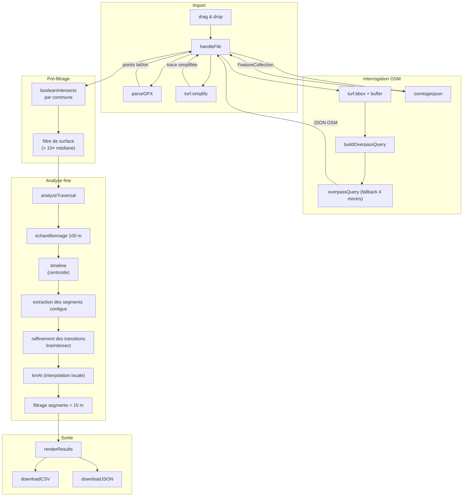

# Communes GPX — Documentation technique

**Application de détection des communes traversées par une trace GPX**

Version : v1.0 (arbitrage centroïde, interpolation locale, export tabulaire)
Fichier : `communes.html` (application monolithique HTML/CSS/JavaScript)
Dépendances : [Turf.js 6](https://turfjs.org/) (géométrie), [osmtogeojson 3](https://github.com/tyrasd/osmtogeojson) (conversion OSM → GeoJSON), OpenStreetMap (données).

---

## Table des matières

1. [Vue d'ensemble](#1-vue-densemble)
2. [Enchaînement des appels](#2-enchaînement-des-appels)
3. [Rôle détaillé de chaque fonction](#3-rôle-détaillé-de-chaque-fonction)
4. [Structures de données](#4-structures-de-données)
5. [Paramètres et influence](#5-paramètres-et-influence)
6. [Notes d'implémentation](#6-notes-dimplémentation)

---

## 1. Vue d'ensemble

L'application traite **une trace GPX** et interroge l'API Overpass d'OpenStreetMap pour identifier les **communes** (relations `boundary=administrative`, `admin_level=8`) traversées, puis calcule les **kilomètres d'entrée et de sortie** de chaque passage.

Le traitement s'organise en quatre chaînes :

| Chaîne | Déclencheur | Fonction d'entrée |
|---|---|---|
| **Import** | Drag & drop ou sélection de fichier | `handleFile` |
| **Analyse** | Automatique après import | `analyzeTraversal` |
| **Rendu** | Fin d'analyse | `renderResults` |
| **Export** | Clic sur CSV / JSON | `downloadCSV`, `downloadJSON` |

L'état est minimal : pas de variable globale mutable, tout passe par les arguments et les closures.

---

## 2. Enchaînement des appels



---

## 3. Rôle détaillé de chaque fonction

### 3.1 Utilitaires

#### `log(...)`, `warn(...)`, `err(...)`

Wrappers pour `console.log` / `warn` / `error` préfixés `[GPX]` et colorés. Contrôlés par `CONFIG.debug`.

#### `nextFrame()`

Promesse résolue après un `requestAnimationFrame` + `setTimeout(0)`. Permet de rendre la main au navigateur entre deux étapes d'analyse pour ne pas figer l'interface.

#### `escapeHtml(s)`

Échappe `<`, `>`, `&`, `"`, `'` pour insertion sûre dans le DOM.

#### `fmt(n, d)`

Formatage numérique (`Number(n).toFixed(d)`).

#### `safeArea(feature)`

Retourne `turf.area(feature)` avec `Infinity` en cas d'erreur (géométrie invalide).

#### `median(arr)`

Calcule la médiane d'un tableau de nombres.

---

### 3.2 Couche import

#### `parseGPX(text)`

**Parse le fichier GPX** et retourne une liste de coordonnées `[lon, lat]`.

- Essaie dans l'ordre : `trkpt`, puis `rtept`, puis `wpt`.
- Filtre les points invalides (`NaN`, `(0,0)`, hors limites).
- Lève une erreur si le XML est malformé ou si moins de 2 points sont trouvés.

#### `handleFile(file)`

**Point d'entrée du pipeline.** Orchestre toute l'analyse.

1. Vérifie l'extension `.gpx`.
2. Lit le fichier avec `file.text()`.
3. Parse avec `parseGPX`.
4. Simplifie avec `turf.simplify` (tolérance 5 m).
5. Calcule la bbox élargie.
6. Lance `overpassQuery`.
7. Convertit avec `osmtogeojson`.
8. Filtre les communes intersectantes.
9. Filtre les polygones aberrants par surface.
10. Lance `analyzeTraversal`.
11. Affiche les résultats via `renderResults`.

Chaque étape met à jour la barre de progression et le statut.

---

### 3.3 Couche OSM

#### `buildOverpassQuery(bbox)`

Construit la requête Overpass QL pour récupérer les relations de limite administrative de niveau 8 dans la bbox.

```
[out:json][timeout:180];
relation["boundary"="administrative"]["admin_level"="8"](S,W,N,E);
out geom;
```

Note : la bbox Overpass attend `(S, W, N, E)` = `(minLat, minLon, maxLat, maxLon)`, alors que Turf retourne `[minLon, minLat, maxLon, maxLat]`. La conversion est faite dans la fonction.

#### `overpassQuery(query)`

**Appelle l'API Overpass** avec fallback automatique sur 4 miroirs :

1. `https://overpass-api.de/api/interpreter`
2. `https://overpass.kumi.systems/api/interpreter`
3. `https://overpass.private.coffee/api/interpreter`
4. `https://overpass.osm.ch/api/interpreter`

En cas d'échec (HTTP 4xx/5xx, timeout, erreur réseau), passe au miroir suivant. Lève une erreur si tous échouent.

**Requête POST** en `application/x-www-form-urlencoded` avec `data=<query>`.

---

### 3.4 Couche analyse

#### `analyzeTraversal(simplified, lengthKm, candidates)`

**Cœur de l'analyse.** Reçoit la trace simplifiée, sa longueur, et les communes candidates ; retourne un tableau de passages.

Sous-étapes :

1. **Enrichissement des candidates** : calcul de `bbox`, `area`, `centroid`, `code` (A, B, C…) pour le log.
2. **Échantillonnage** : génère des points le long de la trace à pas fixe.
3. **Construction de la timeline** : pour chaque échantillon, identifie la commune gagnante.
    - Si une seule correspondance → elle gagne.
    - Si plusieurs (chevauchement) → arbitrage par **distance minimale au centroïde**.
4. **Extraction des segments contigus** : la timeline est parcourue linéairement, chaque transition crée un nouveau segment `{ startIdx, endIdx }` rattaché à une commune.
5. **Raffinement des transitions** : pour chaque entrée/sortie, calcule l'intersection exacte entre le petit segment de trace (≤ 100 m) et la frontière communale.
6. **Calcul du km** : interpolation locale entre les deux échantillons encadrants.
7. **Filtrage** : suppression des passages < `minSegmentKm` (15 m).
8. **Tri** : par km d'entrée croissant.

#### `refineTransition(sampleBefore, sampleAfter, feature)`

Calcule l'intersection précise entre le segment `[sampleBefore, sampleAfter]` et la frontière du polygone `feature`. Retourne la coordonnée de l'intersection la plus proche du point `sampleAfter`.

Si `turf.lineIntersect` échoue ou retourne 0 intersection, retourne le point `sampleAfter` (pas de raffinement).

#### `kmAt(sampleBefore, sampleAfter, coord)`

**Interpole la position kilométrique** d'un point `coord` entre deux échantillons encadrants.

```
d1 = distance(sampleBefore.pt, coord)
d2 = distance(coord, sampleAfter.pt)
km = sampleBefore.d + (d1 / (d1 + d2)) × (sampleAfter.d - sampleBefore.d)
```

**Pourquoi pas `turf.nearestPointOnLine` ?** Sur les traces aller-retour, `nearestPointOnLine` retourne le km du point le plus proche **sur toute la ligne**, ce qui peut être erroné (retourne le km 2 au lieu de 12 pour une trace qui repasse au même endroit). L'interpolation locale est bornée aux deux échantillons encadrants et garantit la monotonie.

---

### 3.5 Couche rendu

#### `renderResults(results, lengthKm, nElements, nCandidates, nExcluded)`

Génère le HTML :

1. **Résumé** : nombre de passages, de communes, km cumulés.
2. **Mini-graphique** : une barre par passage, positionnée en pourcentage.
3. **Tableau** : tri par km d'entrée, avec badges de passage multiple.

---

### 3.6 Couche export

#### `downloadCSV(events)`

Génère un fichier CSV avec une ligne par passage :

```
Km_entree,Commune,Passage,Nb_passages_total,Km_sortie,Longueur_km
0.000,"Nice",1,1,5.131,5.131
5.131,"La Trinité",1,1,8.000,2.870
```

#### `downloadJSON(events)`

Génère un tableau JSON simple :

```json
[
  {
    "commune": "Nice",
    "passage": 1,
    "nb_passages_total": 1,
    "km_entree": 0,
    "km_sortie": 5.131,
    "longueur_km": 5.131
  }
]
```

#### `triggerDownload(content, filename, mime)`

Crée un `Blob`, génère une URL objet, déclenche un clic sur un `<a>` invisible, puis révoque l'URL après 5 s.

---

## 4. Structures de données

### 4.1 Point GPX

```js
[lon, lat]   // tableau de 2 nombres
```

### 4.2 Sample (échantillon de trace)

```js
{
  d: number,        // distance depuis le départ (km)
  pt: Feature       // Point GeoJSON { geometry: { coordinates: [lon, lat] } }
}
```

### 4.3 EnrichedCandidate (commune enrichie)

```js
{
  idx: number,               // index dans le tableau
  feature: Feature,          // polygone GeoJSON
  name: string,              // nom de la commune
  bbox: [number, number, number, number],
  area: number,              // surface en m²
  centroid: Feature,         // centroïde
  code: string,              // 'A', 'B', 'C'... pour la timeline
  segments: []               // rempli plus tard
}
```

### 4.4 Event (passage final)

```js
{
  name: string,              // nom de la commune
  passage: number,           // numéro de passage (1-based)
  passages: number,          // nombre total de passages
  entryKm: number,           // km d'entrée
  exitKm: number,            // km de sortie
  lengthKm: number           // longueur
}
```

### 4.5 CONFIG

```js
{
  adminLevel: '8',
  bboxBufferDeg: 0.01,
  simplifyTolerance: 0.00005,
  targetSamples: 2000,
  minSampleStepKm: 0.1,
  maxAreaRatio: 10,
  minSegmentKm: 0.015,
  overpassEndpoints: [...],
  overpassTimeoutSec: 180,
  debug: true
}
```

---

## 5. Paramètres et influence

| Paramètre | Défaut | Influence |
|---|---|---|
| `adminLevel` | `"8"` | Niveau administratif OSM ciblé (communes) |
| `bboxBufferDeg` | `0.01` (~1 km) | Élargit la bbox de recherche |
| `simplifyTolerance` | `0.00005` (~5 m) | Trade-off fidélité/vitesse |
| `targetSamples` | `2000` | Nombre max d'échantillons |
| `minSampleStepKm` | `0.1` (100 m) | Pas minimal d'échantillonnage |
| `maxAreaRatio` | `10` | Facteur d'exclusion des polygones aberrants |
| `minSegmentKm` | `0.015` (15 m) | Longueur minimale d'un passage |

### Pas d'échantillonnage effectif

```
step = max(minSampleStepKm, lengthKm / targetSamples)
```

| Longueur | Pas effectif |
|---|---|
| 5 km | 100 m |
| 50 km | 100 m |
| 200 km | 100 m |
| 400 km | 200 m |

---

## 6. Notes d'implémentation

1. **Pas de Web Worker** : l'analyse est suffisamment rapide (échantillonnage 100 m) pour rester sur le thread principal, avec des `await nextFrame()` réguliers.

2. **Pas de state global mutable** : tout est passé en argument. L'application peut être instanciée plusieurs fois sans conflit.

3. **Fallback Overpass** : les 4 miroirs couvrent les pannes individuelles. Le premier qui répond est utilisé.

4. **Filtre des polygones aberrants** : la surface médiane est calculée sur les candidates ; tout polygone > 10× la médiane est exclu. Cela élimine les multipolygones OSM cassés.

5. **Arbitrage par centroïde** : en cas de chevauchement résiduel, la commune dont le centroïde est le plus proche du point échantillonné gagne. Robuste aux polygones « fantômes ».

6. **Interpolation locale du km** : `kmAt` n'utilise jamais `nearestPointOnLine` global, ce qui évite l'ambiguïté sur les traces aller-retour.

7. **Timeline de diagnostic** : un caractère par échantillon (`A`, `B`, `C`…, `.` pour aucun match). Permet de visualiser immédiatement qui gagne où.

8. **Pas de cache** : chaque analyse refait la requête Overpass. Acceptable pour un usage occasionnel, mais un cache `localStorage` serait utile en v1.1.

9. **Précision aux frontières** : limitée par la précision des polygones OSM (typiquement 1-5 m). Documentée à l'utilisateur.

10. **Filtrage des micro-segments** : tout passage < 15 m est ignoré. Évite les artefacts de simplification et les fragments dus à des géométries OSM imparfaites.