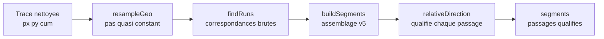

# Spécification technique — Partie ANALYSER

**Description complète des algorithmes de détection des segments multi-sens**

| | |
|---|---|
| **Document** | Spécification algorithmique du traitement « Analyser » |
| **Application** | Multi-Sens (fichier `index.html` monolithique) |
| **Version algorithmique** | v5 |
| **Entrée** | Trace GPX (points lat/lon ordonnés), paramètres IHM |
| **Sortie** | Segments répétés : liste ordonnée de passages qualifiés (référence / Aller / Retour) |

---

## Table des matières

1. [Vue d'ensemble du pipeline](#1-vue-densemble-du-pipeline)
2. [Prétraitement : rééchantillonnage (`resampleGeo`)](#2-prétraitement--rééchantillonnage-resamplegeo)
3. [Détection des correspondances (`findRuns`)](#3-détection-des-correspondances-findruns)
4. [Qualification du sens (`relativeDirection`)](#4-qualification-du-sens-relativedirection)
5. [Assemblage des segments (`buildSegments`, v5)](#5-assemblage-des-segments-buildsegments-v5)
6. [Analyse de complexité](#6-analyse-de-complexité)
7. [Invariants et arguments de correction](#7-invariants-et-arguments-de-correction)
8. [Paramètres : effet et interactions](#8-paramètres--effet-et-interactions)
9. [Limites connues et pistes d'amélioration](#9-limites-connues-et-pistes-damélioration)

---

## 1. Vue d'ensemble du pipeline

Le bouton **Analyser** déclenche la chaîne suivante :



Chaque étape transforme une représentation de la trace :

| Étape | Entrée | Sortie | Rôle |
|---|---|---|---|
| `resampleGeo` | points originaux (métrique projetée) | `R` : N+1 points équirépartis | Homogénéiser la densité |
| `findRuns` | `R`, tol, minLen | runs `{a0,a1,b0,b1,dir}` | Trouver les couples d'intervalles superposés |
| `buildSegments` | runs, `R`, tol, fuse, minLen | segments `{passages[]}` | Fusionner/recoller sans erreur sémantique |
| `relativeDirection` | `R`, deux passages | `+1` ou `-1` | Qualifier le sens du passage |

**Convention de représentation** : après le prétraitement, la trace est une suite
de points `P[0..N]` équirépartis (pas effectif `step` mètres). Un **intervalle**
de la trace est une paire d'indices `[s, e]` avec `s ≤ e`. Deux « passages » sur
un même tronçon de route correspondent à deux intervalles **dissociés dans le
temps** (indices éloignés) mais **superposés dans l'espace**.

**Nouveauté v5** : une **Passe D** de fusion intra-segment (voir §5.5) complète
l'assemblage. Elle recoud les passages **contigus de même sens** que le
rééchantillonnage et le chaînage n'ont pas su rapprocher (virages serrés,
tunnels, pertes de correspondance ponctuelle, croisements en X rejetés par le
test de perpendicularité). Le seuil est piloté par le paramètre `fuse`
(facteur ×2), sans nouvelle interaction UI.

---

## 2. Prétraitement : rééchantillonnage (`resampleGeo`)

### 2.1. Objectif

Les traces d'éditeur ont une densité de points arbitraire (points serrés dans les
virages, espacés en ligne droite). Toute comparaison d'indices serait biaisée.
Le rééchantillonnage ramène la trace à un pas **quasi constant**, de sorte que :

- une différence d'indices Δi représente ≈ Δi · step mètres ;
- les seuils exprimés en mètres se convertissent en points par division simple ;
- le coût des boucles est prévisible (O(N), N = longueur / pas).

### 2.2. Algorithme

1. Calculer `n = round(total / step)` ; définir le **pas effectif**
   `eff = total / n` (le pas est recalé pour que le dernier point rééchantillonné
   tombe exactement sur la fin de trace — évite un point final résiduel).
2. Pour chaque cible `d_i = i · eff` (i = 0 … n) :
   - avancer un **curseur** `k` sur les points originaux jusqu'à
     `cum[k] ≤ d_i < cum[k+1]` (le curseur ne recule jamais → O(N) total) ;
   - interpoler **linéairement** entre `P[k]` et `P[k+1]` au coefficient
     `t = (d_i − cum[k]) / (cum[k+1] − cum[k])` ;
   - mémoriser `orig[i] = k` (provenance).
3. Recalculer `cumR` (distances cumulées) sur les points rééchantillonnés —
   par construction, `cumR[i] ≈ i · eff`.

### 2.3. Propriétés

- **P-1 (provenance)** : `orig` est non-décroissant. Il permet de convertir un
  indice rééchantillonné en numéro de point GPX pour l'affichage (`orig[i] + 1`).
- **P-2 (metricité)** : toute paire (i, j) vérifie
  `| cumR[j] − cumR[i] − (j−i)·eff | ≤ eff`, ce qui justifie l'usage d'indices
  comme proxy de distance dans les étapes suivantes.
- **P-3 (garde-fou)** : `n` est plafonné à 120 000 (le pas est majoré si besoin).

---

## 3. Détection des correspondances (`findRuns`)

### 3.1. Problème

Trouver tous les couples (intervalle A, intervalle B) tels que A et B décrivent
le **même tronçon géométrique**, à `tol` mètres près, avec A **avant** B dans la
trace (A « première occurrence », B « seconde »), dans le même sens ou en sens
opposé.

### 3.2. Étape 3.2.a — Index spatial en grille

**Motivation** : le test naïf « toutes les paires de points » est en O(N²)
(14,4 milliards de paires pour N = 120 000). On veut ne tester que les paires
**spatialement proches**.

**Construction** : chaque point `P[i]` est rangé dans la cellule

```
cellule(i) = ( floor(RX[i] / cell), floor(RY[i] / cell) )
```

où `cell = max(tol, 1.5 · step)`.

**Justification de la taille de cellule** — la recherche de voisins se limite
aux **9 cellules** (3×3) autour de la cellule du point courant. Cette restriction
est correcte si et seulement si deux points distants de ≤ `tol` ne peuvent pas
tomber dans des cellules non adjacentes, ce qui est garanti dès que
`cell ≥ tol`. Le second terme (`1.5·step`) est un garde-fou pour les
échantillonnages grossiers : il empêche un maillage trop fin par rapport à
l'espacement des points.

**Coût** : construction O(N) ; la densité par cellule est bornée par la trace
elle-même (quelques points par cellule en pratique).

### 3.3. Étape 3.2.b — Filtres de correspondance ponctuelle

Pour chaque paire candidate (i, j), i < j, issue des 9 cellules, trois filtres
s'appliquent **dans l'ordre du moins cher au plus cher** :

**F1 — Séparation temporelle** (O(1)) :

```
cumR[j] − cumR[i] ≥ minSep     avec minSep = max(minLen / 2, 4 · step)
```

C'est le filtre anti-faux-positifs principal : sans lui, chaque point
s'apparierait à ses voisins immédiats (la trace est trivialement « proche
d'elle-même » à ±2 points). Le seuil à `minLen/2` découle de l'exigence de
longueur minimale : une correspondance entre points séparés de moins de la
moitié de la longueur minimale ne peut jamais appartenir à un run valide.

**F2 — Proximité spatiale** (O(1)) :

```
(RX[j] − RX[i])² + (RY[j] − RY[i])² ≤ tol²
```

**F3 — Alignement local des tangentes** (O(1), tangentes précalculées) :

Pour chaque point, une tangente `T[i] = P[i+2] − P[i−2]` (fenêtre symétrique,
bornée aux extrémités) est précalculée. La condition :

```
| T[i] · T[j] | > 0.12 · ‖T[i]‖ · ‖T[j]‖
```

Le produit scalaire **non normalisé en valeur absolue** accepte deux
configurations : tangentes de même sens (passage Aller futur) et de sens opposés
(Retour) — c'est le comportement voulu. Seules les tangentes **quasi
perpendiculaires** (|cos| ≤ 0,12, soit un angle entre ~83° et ~97°) sont rejetées :
ce sont les **croisements** de la trace avec elle-même, explicitement hors
périmètre de la spécification.

Chaque correspondance validée est enregistrée :

```
matches[ i·(N+1) + j ] = dir       dir = +1 si T[i]·T[j] > 0, sinon −1
```

`dir` encode le **sens relatif local** du couple : deux points progressant dans
le même sens absolu (dir = +1) ou en sens opposés (dir = −1).

### 3.4. Étape 3.2.c — Chaînage directionnel en runs

Une correspondance ponctuelle n'est pas une détection : il faut des
**suites contiguës** de correspondances pour délimiter des intervalles.

**Principe** : à partir d'une correspondance (i, j) non visitée, on étend le
couple **en parallèle** : i et j progressent ensemble (de d points chacun), à
direction relative constante. C'est ce qui traite uniformément les deux
configurations :

- Aller futur : (i, j) → (i+1, j+1) ;
- Retour : (i, j) → (i+1, j−1).

Formellement, le successeur de (i, j) est (i+d, j+d·dir).

**Algorithme** :

```text
pour chaque (k0, dir) dans matches :
    si k0 déjà visité : continuer
    (ci, cj) ← décodage de k0
    # recul : trouver le début du run
    répéter
        chercher d ∈ [1..MAXGAP] tel que (ci−d, cj−d·dir) ∈ matches
                  et non visité et indices valides
        si trouvé : (ci, cj) ← (ci−d, cj−d·dir) ; sinon stop
    # extension : consommer le run et le marquer visité
    répéter
        marquer (ei, ej) visité
        chercher d ∈ [1..MAXGAP] tel que (ei+d, ej+d·dir) ∈ matches
        si trouvé : (ei, ej) ← (ei+d, ej+d·dir) ; sinon stop
```

- **MAXGAP = 3** : nombre de correspondances manquantes consécutives tolérées
  dans la chaîne. Justification : un décalage spatial de quelques mètres entre
  les deux passages fait périodiquement « sortir » un couple de la tolérance
  (surtout en courbe serrée) ; 3 points ≈ 12 m au pas par défaut couvrent ces
  micro-ruptures sans risquer de ponts entre tronçons distincts.
- **Ordre de visite** : le recul d'abord garantit que chaque run est traité
  depuis son origine, quel que soit le point d'entrée dans la table de hachage.

**Acceptation d'un run** : le couple (ci…ei, cj'…ej') est retenu si

```
min( longueur_A, longueur_B ) ≥ minLen
```

où les longueurs sont mesurées via `cumR` (mètres réels, pas d'indices).

**Sortie** : `runs[] = { a0, a1, b0, b1, dir }` avec, par convention, le côté B
normalisé (`b0 < b1` quel que soit le sens du parcours) — les étapes en aval ne
raisonnent qu'en intervalles.

### 3.5. Propriétés

- **P-4 (maximalité)** : chaque run produit est maximal (ni prolongeable en
  avant, ni en arrière) par construction du chaînage.
- **P-5 (exclusivité)** : chaque correspondance appartient à au plus un run
  (marquage `visited`). Deux runs ne partagent donc jamais de correspondance —
  ils peuvent néanmoins décrire des intervalles qui se recouvrent, ce que
  `buildSegments` résoudra.
- **P-6 (direction constante)** : un run a un `dir` unique. Un tronçon parcouru
  trois fois (aller, retour, aller) produit trois « branches » et donc plusieurs
  runs croisés, jamais un run hybride.

---

## 4. Qualification du sens (`relativeDirection`)

### 4.1. Problème

Étant donné un passage de référence `first = [s₁, e₁]` et un passage ultérieur
`other = [s₂, e₂]` superposés géométriquement, déterminer si `other` est parcouru
dans le **même sens** (+1, Aller) ou en **sens inverse** (−1, Retour).

### 4.2. Algorithme

Le signe local de `dir` dans un run n'est pas suffisant : un passage peut être
assemblé depuis plusieurs runs de directions apparemment contradictoires (artefacts
de chaînage en courbe). On requalifie donc le sens **globalement**, sur les
passages finaux.

1. **Échantillonnage de la référence** : `nS` points de contrôle répartis
   uniformément sur `[s₁, e₁]`, avec `8 ≤ nS ≤ 60` (bornes : assez d'échantillons
   pour la robustesse, assez peu pour la performance).
2. **Appariement par pointeur glissant** : pour chaque échantillon `f`, chercher
   le point le plus proche dans `other`, **dans une fenêtre bornée** autour de la
   position du précédent appariement `p` :

   ```
   fenêtre = [ max(s₂, p − 90), min(e₂, p + 90) ]
   ```

   Justification : les deux passages étant superposés, leur correspondance
   géométrique est **monotone** (l'appariement avance dans le même ordre, même en
   Retour — dans ce cas la correspondance progresse en sens décroissant de `other`,
   que la fenêtre couvre naturellement). La fenêtre évite qu'un échantillon
   s'apparie à une portion erronée du passage (boucles croisées, croisements).
3. **Filtre de proximité** : un échantillon dont le meilleur voisin est à plus de
   `1.2 · tol` est ignoré (bords de passage non parfaitement alignés).
4. **Score de cap** : pour chaque couple apparié (f, q), comparer les caps locaux
   (azimuts calculés par `turf.bearing` sur 3 points d'avance) :

   ```
   score += cos( Δcap )
   ```

   Δcap étant l'écart signé normalisé dans (−180°, 180°] :
   - même sens → Δcap ≈ 0 → cos ≈ +1 ;
   - sens opposé → Δcap ≈ ±180° → cos ≈ −1.
5. **Décision** : `score ≥ 0 → +1 (Aller)`, sinon `−1 (Retour)`.

### 4.3. Justification du choix du cosinus

Le cosinus cumule trois qualités : **symétrique** (le signe ne dépend pas du sens
de parcours de la référence), **continu** (un virage commun aux deux passages
pénalise légèrement mais ne change pas le signe), et **auto-pondérant** (les
appariements les plus fiables — alignés — pèsent le plus). Un simple vote
majoritaire sur le signe de Δcap serait plus fragile aux appariements aberrants.

### 4.4. Signature et paramètre `tol`

En v5, `relativeDirection` reçoit **explicitement** `tol` en paramètre :

```js
function relativeDirection(R, first, other, tol)
```

C'était déjà le cas en v4 (correctif d'un bug où la fonction lisait `state.analysis.tol`
non encore affecté à cet instant du pipeline). La fonction est ainsi pure et
testable indépendamment.

---

## 5. Assemblage des segments (`buildSegments`, v5)

### 5.1. Problème

Les runs sortis de `findRuns` sont des **couples d'intervalles bruts**. L'état
« sémantiquement correct » recherché est :

1. chaque **passage** réel de la trace (une traversée complète d'un tronçon) doit
   correspondre à **un** intervalle contigu — or le chaînage fragmente
   (micro-ruptures, MAXGAP) ;
2. les passages d'un même tronçon doivent être **regroupés dans un même segment**,
   ordonnés chronologiquement ;
3. deux **références** de segments ne doivent **jamais se chevaucher** (exigence
   fonctionnelle) — un segment dont la référence est incluse dans celle d'un autre
   doit être absorbé ;
4. il ne faut **jamais** fusionner la fin d'un passage aller avec le début du
   passage retour d'un demi-tour, même si ces deux fragments sont adjacents le
   long de la trace (le demi-tour est souvent plus court que le rayon de fusion).

Le point 4 est le plus délicat : c'est la distinction entre une **fente de
chaînage** (à recoudre) et une **frontière entre passes** (à préserver), les deux
étant des intervalles quasi contigus le long de la trace.

**Nouveauté v5** : après avoir produit les passages définitifs, une **Passe D**
recoud les passages **contigus de même sens** séparés d'une courte distance
(≤ 2 × `fuse`). Voir §5.5.

### 5.2. Structures de données

- **items** : 2 intervalles par run (côté A, côté B), chacun `{s, e}` ;
- **links** : pour chaque run, le lien `[itemA, itemB]`. Sémantique forte :
  les deux extrémités d'un lien décrivent des **passes différentes** (elles sont
  spatialement superposées mais temporellement séparées d'au moins `minSep`) ;
- **union-find** : deux instances (items, passages) avec compression de chemin.

### 5.3. Prédicats

**`samePassage(X, Y)`** — deux items décrivent le même passage :

```
recouvrement = min(X.e, Y.e) − max(X.s, Y.s)
fente        = max(X.s, Y.s) − min(X.e, Y.e)
samePassage ⟺ recouvrement ≥ 4  OU  (0 ≤ fente ≤ fusePts)
```

- recouvrement ≥ 4 points : intervalles superposés (fragments imbriqués d'un
  même passage vu par plusieurs runs) ;
- fente ≤ fusePts : intervalles contigus — recoud une fente de chaînage.

**`boundaryBetweenPasses(X, Y)`** — X se termine, Y commence, quasi adjacents :
la jonction porte-t-elle la signature d'une **frontière entre deux passes** ?
Deux tests indépendants, `true` suffit à refuser la fusion :

**T1 — Inversion de cap.** Directions de fin de X (sur 4 points) et de début de Y :

```
cosθ = (dX·dY) / (‖dX‖·‖dY‖)
si cosθ < −0.5  →  frontière        (caps opposés à plus de 120°)
```

Un demi-tour (même en épingle élargie) inverse le cap ; deux fragments du même
passage le conservent. Seuil à −0,5 : tolère un virage commun violent, rejette
une véritable inversion.

**T2 — Ré-emprunt de route.** Si le début de Y repasse sur la route couverte par
X **loin de la jonction**, alors Y retrace X (ce n'est pas une continuation) :

```text
pour q ∈ [ max(Y.s+6, X.e+2) , min(Y.e, Y.s+18) ], pas de 4 :
    dE = ‖P[q] − P[X.e]‖²          # distance à la jonction
    si dE ≤ 1 : continuer           # q collé à la jonction : non discriminant
    pour t ∈ [X.e … X.s], pas de stride :
        dd = ‖P[q] − P[t]‖²
        si dd < 0.5·dE ET dd ≤ (4·tol)² : retourner true
retourner false
```

La double condition est le cœur du test : `dd ≤ (4·tol)²` dit « q est sur la
route de X » ; `dd < 0.5·dE` dit « q est nettement plus proche d'un point interne
de X que de la jonction » — donc il a **reculé** sur la route de X, signe de
re-traversée. Un fragment de continuation, lui, ne fait que s'éloigner de X.e.

**Propriété décisive** : `boundaryBetweenPasses` ne dépend **pas** de `fusePts`.
C'est ce qui garantit que le curseur de fusion ne peut pas détruire un
aller-retour, quel que soit son réglage (leçon des versions v2/v3, cf. §9 de la
doc d'architecture).

### 5.4. Boucle principale : Phases A → B → C, itérées

La boucle (max 5 itérations) est nécessaire car la fusion de Phase A change les
intervalles, ce qui peut créer de nouvelles adjacences à traiter. Elle s'arrête
quand la Phase C n'a plus rien fusionné (**stabilité**), ou au bout de 5 passes.

#### Phase A — fusion en passages

1. Construire `runLinked` = ensemble des paires d'items liées par un run
   (clé **symétrique** `min:max` — la paire doit être reconnue quel que soit
   l'ordre d'énumération).
2. Union-find sur les items **triés par `s`** : pour chaque paire (i, j)
   vérifiant `items[j].s − items[i].e ≤ fusePts` (sinon break — les items étant
   triés, aucune paire ultérieure n'est plus proche) :
   - si même classe ou `runLinked(i, j)` : ignorer ;
   - si `¬samePassage(i, j)` : ignorer ;
   - si `boundaryBetweenPasses(X, Y)` (X = celui qui termine, Y = celui qui
     commence) : ignorer ;
   - sinon : union.
3. Chaque classe d'items devient un **passage**, défini par son **hull**
   (enveloppe) `[min s, max e]`.
4. **Remappage des links** : chaque lien `[a, b]` devient `[passage(a), passage(b)]` ;
   - si les deux extrémités retombent dans le **même** passage : le lien est
     **consommé** (supprimé) — il n'exprime plus rien, et le garder reconnecterait
     des entités déjà fusionnées aux itérations suivantes ;
   - déduplication des liens restants (clé symétrique).

#### Phase B — regroupement en segments

Union-find sur les passages, unionnés selon les links remappés. Chaque composante
connexe est un **segment** ; ses passages sont triés par `s` croissant ; sa
référence est le passage de plus petit `s`.

#### Phase C — unification des références

Segments triés par début de référence `rS`. Parcours séquentiel avec hull
courant `[hS, hE]` : un segment est absorbé dans le groupe courant si

```
recouvrement = min(rE, hE) − max(rS, hS) > 0        (partie commune)
OU 0 < rS − hE ≤ fusePts                            (trop proches)
```

Au contact **exact** (`rS − hE = 0`), pas d'absorption : c'est le cas légitime
du demi-tour au sommet d'un col (référence de la descente commençant là où finit
celle de la montagne).

**Invariant garanti (à stabilisation)** : deux références de segments distincts
ne partagent aucune partie commune (elle serait absorbée à l'itération suivante)
et ne sont séparées de moins de `fusePts`.

#### Sortie de boucle

La boucle se termine quand la Phase C n'a rien fusionné (**stabilité**), ou au
bout de `MAX_ITERATIONS = 5` passes (garde-fou contre les oscillations
théoriques). Le résultat final est alors calculé — voir §5.5.

### 5.5. Finalisation (v5) — quatre étapes ordonnées

La finalisation a été enrichie en v5 avec la **Passe D**. Ordre d'exécution :

**Étape 1 — fusion ordonnée des passages d'un même groupe.**
Les passages triés par `s` sont fusionnés **deux à deux seulement en cas de
recouvrement interne strict** (`p.s < last.e`). Le **contact simple**
(`p.s == last.e`) produit deux passages distincts — c'est ce qui préserve la
structure aller/retour au demi-tour. Rejet des groupes à moins de 2 passages.

**Étape 2 — calcul des métadonnées (`rel`, `km`, `pt`).**
Pour chaque passage, dans l'ordre de tri par `s` :
- `p.rel = (k === 0) ? 0 : relativeDirection(R, ps[0], p, tol)` ;
- `p.km0 = cumR[p.s] / 1000`, `p.km1 = cumR[p.e] / 1000` ;
- `p.pt0 = orig[p.s] + 1`, `p.pt1 = orig[p.e] + 1`.

Cette étape est **désormais effectuée avant la Passe D**, car celle-ci a besoin
de `rel` pour comparer les sens et doit recalculer `km1`/`pt1` après extension.

**Étape 3 — Passe D : fusion intra-segment.**
Deux passages consécutifs d'un même segment sont fusionnés si :

```
last.e ≤ p.s                       (contiguïté le long de la trace)
ET (p.s − last.e) ≤ maxGapPts      (gap court)
ET last.rel === p.rel              (même sens)
```

avec

```
maxGapPts = max( fusePts , round(MERGE_WITHIN_SEGMENT_FACTOR × fusePts) )
MERGE_WITHIN_SEGMENT_FACTOR = 2
```

**Justification** — la Passe D comble les trous de détection que le chaînage
`findRuns` et la fusion `samePassage` n'ont pas su rattraper :

- **virages serrés** : la tangente locale change brutalement, les correspondances
  point-à-point sortent temporairement de la tolérance ;
- **tunnels, couverts forestiers** : pertes ponctuelles de superposabilité ;
- **croisements en X** : rejetés volontairement par F3 (`|cos| ≤ 0.12`), donc
  « troués » dans les runs, mais les deux passages contigus décrivent bien la
  même portion de trace de part et d'autre du croisement.

Cas concret mesuré : sur la trace de référence « Menton-Poggio », une portion
répétée de 4,24 km était détectée en 3 passages (référence 7,62→11,86 km,
retour 62,80→66,84 km, retour 66,87→67,05 km) avec un trou de 30 m entre les
deux retours. La Passe D les fusionne en un seul retour 62,80→67,05 km.

**Garde-fou du sens** : `last.rel === p.rel` empêche la fusion d'un Aller avec
un Retour adjacent. La frontière entre sens est intangible.

**Extension des bornes** : quand la fusion opère, `last.e`, `last.km1`, `last.pt1`
sont étendus au maximum. Les `layers` (références de polylignes Leaflet) ne sont
**plus conservés** : ils sont reconstruits par `renderWorkingOnMap()` après
l'analyse (voir doc technique).

**Clone superficiel** : à chaque passage accepté dans le résultat de la Passe D,
un `{...p}` est créé pour ne pas altérer les objets partagés avec les working
groups (qui les référencent après analyse).

**Étape 4 — assemblage final.**
`return final.map(p => ({ passages: p }))`.

---

## 6. Analyse de complexité

Soit N le nombre de points rééchantillonnés, M le nombre de correspondances.

| Étape | Coût | Justification |
|---|---|---|
| Rééchantillonnage | O(N) | curseur monotone sur les points originaux |
| Index en grille | O(N) | un calcul de cellule par point |
| Correspondances | O(N + M) | chaque point teste les 9 cellules voisines ; M est borné par la densité de superposition réelle de la trace |
| Chaînage des runs | O(M) | chaque correspondance est visitée une fois (marquage) ; le recul est amorti par le marquage |
| Phase A | O(I log I) par itération | tri des items + unions ; I = nombre d'items (2·runs) ; les paires candidates sont bornées par la fenêtre `fusePts` grâce au tri et au break |
| Phase B | O(P α(P)) | union-find sur P passages |
| Phase C | O(S log S) | tri des segments, parcours linéaire |
| `relativeDirection` | O(K · W) par passage | K ≤ 60 échantillons, fenêtre W ≤ 180 points |
| **Passe D** | **O(P + F)** | **parcours linéaire des passages triés, F = nombre de fusions effectives** |

**Total** : dominé par O(N + M), avec un facteur itératif borné (≤ 5) sur la
partie assemblage, négligeable car elle ne porte que sur les intervalles
détectés, pas sur les points. Mesuré sur la trace de référence (123 km, 30 700
points rééchantillonnés) : quelques dizaines de millisecondes.

**Mémoire** : O(N) pour les tableaux typés (`Float64Array`/`Uint32Array`),
O(M) pour la table des correspondances.

---

## 7. Invariants et arguments de correction

**INV-1 — Une correspondance, un run.** Le marquage `visited` avant extension
garantit l'exclusivité (P-5). Conséquence : les runs sont un **couvrant** des
correspondances, partition discrète de la preuve de superposition.

**INV-2 — Les links sont un anti-fusionnement.** Tant qu'un lien existe entre
deux entités, la Phase A refuse de les fusionner. Comme un lien ne disparaît que
si ses extrémités sont déjà dans le même passage (consommation), un lien ne peut
jamais « pousser » deux passes différentes à fusionner — il ne peut que les
**regrouper** au niveau segment (Phase B). C'est l'argument clé qui empêche
l'union d'un aller et de son retour.

**INV-3 — Frontières préservées indépendamment de la fusion.**
`boundaryBetweenPasses` étant indépendant de `fusePts`, toute paire encadrant un
demi-tour est rejetée à **toutes** les itérations et pour **tout** réglage du
curseur. La fusion ne peut donc jamais coalescer les deux branches d'un
aller-retour (bug v2, cf. historique).

**INV-4 — Stabilité de la Phase C.** La Phase C n'unifie que des références en
partie commune ou trop proches. Une fois unifié, le hull résultant ne peut plus
être en partie commune avec un autre groupe (il a absorbé tout ce qui le
touchait) — d'où convergence en ≤ 5 itérations sur les cas pratiques ; le seuil
de 5 est un garde-fou contre les oscillations théoriques.

**INV-5 — Non-régression du contact simple.** La fusion finale ne fusionne que
sur recouvrement **strict**. Le cas `p.s == last.e` (le début du retour est
exactement la fin de l'aller) survit comme deux passages — exigence du cas
d'usage « montée puis descente par le même chemin ».

**INV-6 (v5) — Passe D respecte le sens.** La condition `last.rel === p.rel`
interdit toute fusion entre passages de sens opposés, même contigus et proches.
Elle est nécessaire et suffisante : la seule frontière qui pourrait être
franchie par erreur est celle entre un Aller et un Retour adjacents.

**INV-7 (v5) — Passe D ne crée pas de superposition.** La Passe D ne fusionne
que des passages **contigus** (`p.s ≥ last.e`) : elle ne peut donc pas créer
d'intervalle chevauchant un passage tiers, elle ne fait qu'étendre `[last.s,
last.e]` sur des points non couverts par d'autres passages du même segment
(les passages d'un segment sont triés par `s` et disjoints après l'Étape 1).

**INV-8 (v5) — Passe D préserve le nombre de références.** La fusion n'opère
jamais sur `k === 0` (le premier passage du segment) : la référence reste
unique, son intervalle peut s'étendre si elle fusionne avec le passage suivant
(ce qui est correct — la référence continue), mais aucun passage ne « devient »
référence après coup.

---

## 8. Paramètres : effet et interactions

| Paramètre | Symbole | Défaut | Agit sur | Effet à la hausse | Effet à la baisse |
|---|---|---|---|---|---|
| Tolérance de superposition | `tol` | 10 m | F2 de `findRuns`, cellule de grille, T2 de `boundaryBetweenPasses` | Accepte des passages plus décalés ; augmente M (coût) ; cellules plus grosses | Perd les passages décalés ; risque de fragmenter les runs |
| Longueur minimale | `minLen` | 100 m | Acceptation des runs, `minSep` | Élimine les petits artefacts ; `minSep` monte, moins de faux positifs | Bruit de micro-correspondances |
| Pas d'échantillonnage | `step` | 4 m | N, granularité des frontières, cellule de grille (via `max`) | Plus rapide, frontières moins précises | Plus précis, plus lent |
| Fusion références proches | `fuse` | 100 m | `samePassage` (fentes), Phase C (proximité), **Passe D** (via `maxGapPts = 2 × fusePts`) | Recoud davantage de fentes ; unifie les références voisines ; **favorise la fusion intra-segment** | Ne recoud que les fentes fines ; références voisines distinctes ; Passe D restrictive |

**Interaction critique (éliminée en v4)** : avant la v4, `fuse` participait à la
décision de fusion des fragments adjacents **sans test de nature**, ce qui
permettait à une fusion élevée de recoller aller et retour au demi-tour et de
détruire le segment. Depuis la v4, `fuse` ne contrôle plus que la **distance** de
fusion ; la **nature** (fente de chaînage vs frontière de passes) est tranchée
par `boundaryBetweenPasses`, insensible au curseur. Conséquence attendue et
vérifiée : le résultat sur un aller-retour pur est **stable de 0 à 500 m** de
fusion.

**Nouvelle interaction (v5)** : la Passe D étend la portée de `fuse` à la fusion
intra-segment. Un utilisateur qui augmente `fuse` recoudra plus de trous courts
dans les passages individuels (virages, tunnels). C'est cohérent avec
l'intention déclarée du paramètre : « distance en deçà de laquelle deux passages
adjacents sont considérés comme un seul ». À 0, la Passe D est désactivée.

**Règle de réglage recommandée** : `tol` ≈ largeur de la route (10–15 m),
`minLen` ≥ 50 m, `fuse` = largeur de la plus petite séparation attendue entre
deux segments légitimes distincts (rues voisines, échangeurs) — typiquement
50–150 m.

---

## 9. Limites connues et pistes d'amélioration

1. **Fenêtre fixe du pointeur glissant** (±90 points dans `relativeDirection`) :
   sur un passage très court apparié à une référence très longue, la fenêtre peut
   saturer. Amélioration possible : fenêtre proportionnelle à
   `longueur_other / longueur_first`.

2. **MAXGAP constant** (3 points) : sa valeur effective en mètres dépend du pas.
   Un MAXGAP exprimé en mètres (MAXGAP_M / step) rendrait le comportement
   indépendant du rééchantillonnage.

3. **Phase C unidirectionnelle** : l'unification compare chaque segment au hull
   du groupe courant uniquement (pas de lookahead). Un segment très court coincé
   entre deux groupes peut être absorbé par le premier alors que le second est
   plus pertinent. Non problématique en pratique (l'absorption est idempotente
   sur le hull), mais un appariement « au plus proche » serait plus propre.

4. **`boundaryBetweenPasses`, fenêtre T2** (18 points) : un ré-emprunt commençant
   plus de 18 points (~72 m) après la jonction n'est pas détecté. Les cas
   pathologiques (demi-tour suivi d'un long chevauchement partiel) passeraient à
   travers T1 et T2 ; ils n'ont pas été observés sur traces d'éditeur.

5. **Altitude ignorée** : deux passages superposés en plan mais à altitudes
   différentes (échangeurs, ponts) seraient appariés à tort. Le prétraitement
   pourrait transporter `ele` et ajouter un filtre de cohérence altimétrique.

6. **Runs croisés (≥ 3 passages)** : un tronçon parcouru trois fois génère des
   runs croisés (P1↔P2, P1↔P3, P2↔P3). L'assemblage les regroupe correctement
   (composantes connexes), mais la qualification de sens se fait uniquement par
   rapport à P1 ; un passage P3 identique à P2 mais apparié avec des artefacts
   contradictoires serait quand même correctement qualifié (score global), sans
   vérification croisée P2↔P3.

7. **Passe D — seuil fixe** : le facteur 2 × `fuse` est arbitraire. Un seuil
   exprimé en mètres (par ex. `MERGE_WITHIN_SEGMENT_METERS`) serait plus
   lisible, mais introduirait un 5ᵉ paramètre à expliquer à l'utilisateur. La
   décision actuelle privilégie la simplicité d'IHM sur la précision du réglage.

8. **Passe D — fusion purement séquentielle** : la fusion n'opère que sur les
   passages **contigus** (`p.s ≥ last.e`). Si un passage de sens identique est
   séparé par un passage de sens opposé, aucune fusion ne s'applique — c'est le
   comportement voulu (la frontière de sens est intangible), mais cela signifie
   qu'un segment A-Aller-A-Retour-A-Aller ne fusionnera pas ses deux Allers.

9. **Détection à trois passages et plus** : la Passe D peut créer un passage
   « unifié » à partir de 3 fragments, mais l'ordre d'itération (une seule
   passe séquentielle) peut laisser deux fragments non adjacents dans la liste
   triée par `s` non-fusionnés s'ils ne sont pas contigus dans la liste après
   tri. Cas non observé sur les traces de test, à surveiller si l'utilisateur
   signale un comportement inattendu sur trace complexe.