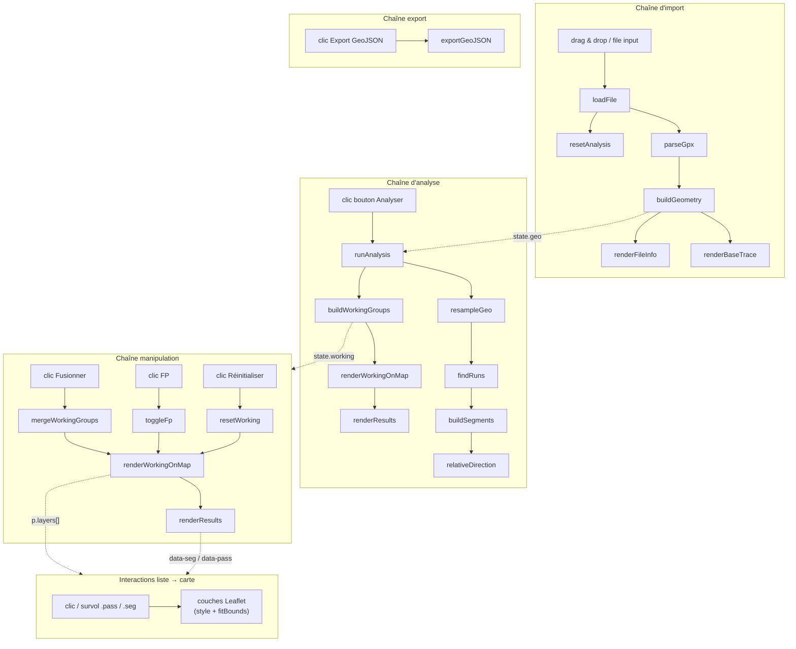
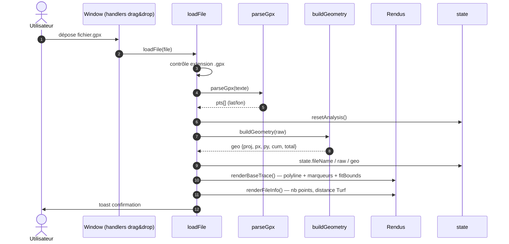
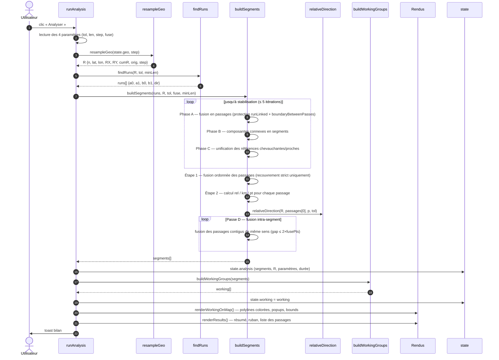
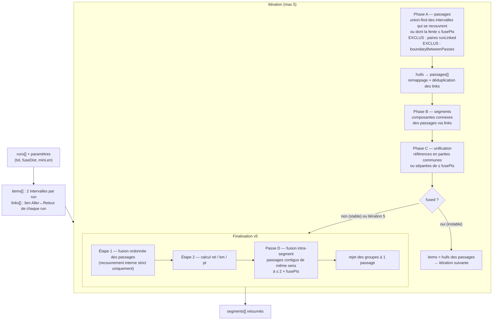
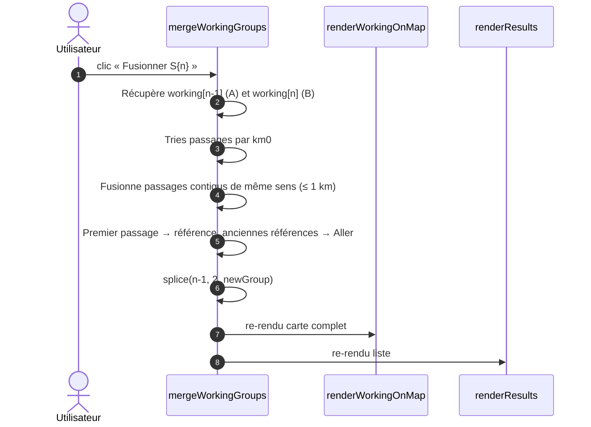
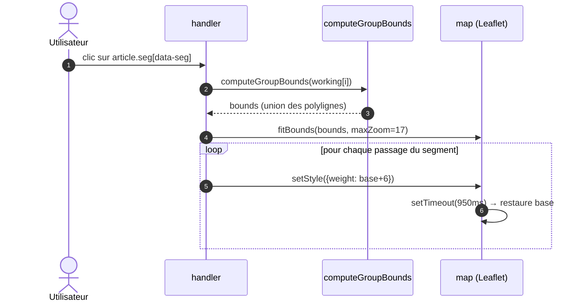

# Multi-Sens — Documentation technique

**Application de détection des segments multi-sens dans une trace GPX**

Version : v5 (fusion intra-segment, fusion manuelle respectueuse du sens, export compact)
Fichier : `index.html` (application monolithique HTML/CSS/JavaScript)
Dépendances : [Leaflet 1.9.4](https://leafletjs.com/) (cartographie), [Turf.js 7.1](https://turfjs.org/) (`length`, `bearing`, `lineString`), OpenStreetMap (tuiles).

---

## Table des matières

1. [Vue d'ensemble](#1-vue-densemble)
2. [Enchaînement des appels](#2-enchaînement-des-appels)
3. [Rôle détaillé de chaque fonction](#3-rôle-détaillé-de-chaque-fonction)
    - 3.1 [Couche utilitaires](#31-couche-utilitaires)
    - 3.2 [Couche données : lecture GPX et géométrie](#32-couche-données--lecture-gpx-et-géométrie)
    - 3.3 [Couche algorithmique : détection](#33-couche-algorithmique--détection)
    - 3.4 [Couche orchestration : analyse](#34-couche-orchestration--analyse)
    - 3.5 [Working groups : manipulations utilisateur](#35-working-groups--manipulations-utilisateur)
    - 3.6 [Couche présentation : rendus](#36-couche-présentation--rendus)
    - 3.7 [Couche export](#37-couche-export)
    - 3.8 [Couche IHM : événements et interactions](#38-couche-ihm--événements-et-interactions)
4. [Structures de données](#4-structures-de-données)
5. [Paramètres et leur influence](#5-paramètres-et-leur-influence)
6. [Notes d'implémentation et choix techniques](#6-notes-dimplémentation-et-choix-techniques)

---

## 1. Vue d'ensemble

L'application traite **une trace GPX** (suite ordonnée de points lat/lon) et détecte
les portions empruntées plusieurs fois (aller-retour, boucle repassant sur un
tronçon, double passage dans le même sens).

Le traitement s'organise en quatre chaînes indépendantes :

| Chaîne | Déclencheur | Fonction d'entrée |
|---|---|---|
| **Import** | Drag & drop ou sélection de fichier | `loadFile` |
| **Analyse** | Bouton « Analyser » | `runAnalysis` |
| **Manipulation utilisateur** | Clic sur « Fusionner » / « Faux positif » / « Réinitialiser » | `mergeWorkingGroups`, `toggleFp`, `resetWorking` |
| **Export** | Clic sur « Exporter GeoJSON » | `exportGeoJSON` |
| **Rendu / Interaction** | Fin d'analyse, manipulation, survol, clic | `renderWorkingOnMap`, `renderResults`, handlers |

L'état global est porté par un objet unique :

```js
const state = {
  fileName,      // nom du fichier GPX chargé
  raw,           // points GPX bruts {lat, lon}[]
  geo,           // géométrie nettoyée et projetée
  analysis,      // résultat de la dernière analyse (segments, R, paramètres, ms)
  working        // copie de travail des segments (fusion, FP) — modifiable par l'utilisateur
};
```

**Invariant clé** : `state.analysis` est **immuable** après l'analyse ;
`state.working` est la seule structure modifiée par les interactions utilisateur.
Toute modification de `working` déclenche un re-rendu complet de la carte depuis
`working`, garantissant la synchronisation liste ↔ carte.

---

## 2. Enchaînement des appels

### 2.1 Vue macroscopique



### 2.2 Séquence de l'import



### 2.3 Séquence de l'analyse



### 2.4 Structure interne de `buildSegments`



### 2.5 Séquence de la fusion manuelle



### 2.6 Séquence du clic sur un segment (zoom + highlight)



---

## 3. Rôle détaillé de chaque fonction

### 3.1 Couche utilitaires

#### `$(selector)`

Raccourci pour `document.querySelector(selector)`. Utilisée partout dans l'IHM
pour accéder aux éléments du DOM (sliders, boutons, conteneurs de résultats).

#### `toast(message, type)`

Affiche une notification temporaire (4,6 s) en bas à droite de l'écran.

- **Entrées** : `message` (string), `type` (`'info'` | `'ok'` | `'error'`).
- **Effet** : crée un `div.toast` dans `#toasts`, avec bordure gauche colorée selon
  le type, animation d'entrée, fondu de sortie puis suppression du DOM.
- **Appelée par** : `loadFile` (succès/échec de lecture), `runAnalysis` (bilan,
  erreur, plafonnement du pas), `exportGeoJSON` (bilan d'export).

#### `showProgress(label, pct, step)` / `hideProgress()`

Affiche / masque un overlay modal de progression (voir §3.6) pendant l'analyse.
`showProgress` met à jour le libellé, la largeur de la barre et le texte
d'étape. `hideProgress` retire la classe `on`.

- **Appelées par** : `runAnalysis` (avant chaque étape du pipeline).

#### `yieldUI()`

Retourne une promesse résolue après `CONFIG.YIELD_MS` (16 ms). Permet de rendre
la main au navigateur entre deux étapes longues du pipeline d'analyse, pour que
l'overlay de progression soit effectivement peint.

#### `makeProjector(p0)`

Fabrique un **couple de fonctions de projection/déprojection équirectangulaire
locale** centrées sur le premier point de la trace `p0`.

- **Entrée** : `p0` = `{lat, lon}` (premier point GPX).
- **Retour** : `{ fwd, inv }`
    - `fwd(p)` → `{x, y}` en **mètres** : `x = (lon - lon0) · cos(lat0) · 111320`,
      `y = (lat - lat0) · 110540`.
    - `inv(x, y)` → `{lat, lon}` (opération inverse).
- **Justification** : la précision d'une projection locale est largement
  suffisante (erreur métrique négligeable sur l'étendue d'une trace) pour des
  comparaisons à la tolérance de quelques mètres, et elle permet de travailler en
  mètres dans tout l'algorithme au lieu de degrés.
- **Appelée par** : `buildGeometry` (une seule fois, à chaque chargement de trace).

---

### 3.2 Couche données : lecture GPX et géométrie

#### `parseGpx(text)`

Analyse le texte XML d'un fichier GPX et extrait la suite ordonnée de points.

- **Entrée** : contenu texte du fichier.
- **Sortie** : `{lat, lon}[]`.
- **Comportement** :
    - Cherche les nœuds `trkpt` (points de trace) **puis**, à défaut, `rtept`
      (points d'itinéraire) — via `getElementsByTagNameNS('*', …)` pour être
      insensible à l'espace de noms.
    - Ignore les points aux coordonnées non numériques.
    - Lève une `Error` si le XML est malformé (`parsererror`) ou si moins de 2
      points sont trouvés. Le message est affiché par `loadFile` via `toast`.
- **Ne gère pas** : les traces multi-`<trkseg>` sont aplaties (tous les `trkpt`
  sont concaténés dans l'ordre du document) — hypothèse assumée pour des traces
  d'éditeur.

#### `loadFile(file)`

**Point d'entrée de la chaîne d'import.** Orchestre la lecture, la validation et
l'initialisation complète de l'application pour un nouveau fichier.

- **Entrée** : `File` (issu du drag & drop ou de l'input file).
- **Déroulé** :
    1. Rejette tout fichier sans extension `.gpx` (toast d'erreur).
    2. Lit le fichier avec `FileReader.readAsText`.
    3. En cas de succès : `parseGpx` → `resetAnalysis` → stockage de
       `state.fileName/raw/geo` (via `buildGeometry`) → `renderBaseTrace` →
       `renderFileInfo` → activation du bouton « Analyser » → toast de
       confirmation.
    4. En cas d'erreur de lecture : toast d'erreur.
- **Appelée par** : le handler de `drop` sur la fenêtre, le handler `change` de
  `#fileInput`.

#### `buildGeometry(raw)`

Transforme les points bruts en une **géométrie métrique exploitable** par
l'algorithme.

- **Entrée** : `raw` = `{lat, lon}[]`.
- **Sortie** : `geo = { proj, px, py, cum, total }`
    - `proj` : projecteur de `makeProjector` ;
    - `px`, `py` : coordonnées métriques de chaque point (tableaux JS) ;
    - `cum` : `Float64Array` des distances cumulées depuis le départ (mètres) ;
    - `total` : longueur totale de la trace nettoyée (mètres).
- **Traitement clé** : **suppression des doublons exacts** — un point dont la
  distance au précédent est < 5 cm (`CONFIG.DUP_THRESHOLD2`) est ignoré.
- **Appelée par** : `loadFile`.

#### `resampleGeo(geo, step)`

**Rééchantillonne la trace à pas quasi constant** — c'est la prémisse de tout
l'algorithme : des points équirépartis rendent les comparaisons d'intervalles
homogènes quelle que soit la densité d'origine du GPX.

- **Entrées** : `geo` (sortie de `buildGeometry`), `step` (pas visé en mètres).
- **Sortie** : `R = { n, lat, lon, RX, RY, cumR, orig, step }`
    - `n` : nombre de segments du rééchantillonnage (`≈ total / step`, borné) ;
    - `lat`, `lon` : `Float64Array(n+1)` — coordonnées géographiques des points
      rééchantillonnés (pour Leaflet et Turf) ;
    - `RX`, `RY` : `Float64Array(n+1)` — coordonnées métriques (pour l'index
      spatial) ;
    - `cumR` : `Float64Array(n+1)` — distances cumulées (km de la trace du point
      `i`) ;
    - `orig` : `Uint32Array(n+1)` — **indice dans la trace nettoyée** du point
      original précédant chaque point rééchantillonné ;
    - `step` : **pas effectif** (= `total / n`, recalé pour tomber juste sur la
      fin).
- **Détail d'implémentation** : interpolation linéaire entre les points
  originaux ; le pas est uniformisé sur la fin de la trace. Un garde-fou dans
  `runAnalysis` limite `n` à `CONFIG.MAX_SAMPLES` (120 000 points).
- **Appelée par** : `runAnalysis`, à chaque analyse (les paramètres pouvant
  changer).

---

### 3.3 Couche algorithmique : détection

#### Constantes `CONFIG` (v5)

Toutes les constantes magiques sont centralisées dans un objet `CONFIG` :

| Nom | Valeur | Rôle |
|---|---|---|
| `MAXGAP` | 3 | Trous tolérés dans le chaînage des runs |
| `TANGENT_SPAN` | 2 | Demi-fenêtre pour le calcul des tangentes locales |
| `PERPENDICULAR_COS` | 0.12 | Seuil de rejet des croisements perpendiculaires |
| `MIN_SEP_FACTOR` | 0.5 | Séparation temporelle minimale = 0.5 × minLen |
| `MIN_SEP_STEPS` | 4 | Plancher de séparation temporelle (en pas) |
| `SAME_PASSAGE_OVERLAP` | 4 | Recouvrement (pts) au-delà duquel = même passage |
| `MAX_ITERATIONS` | 5 | Nombre max d'itérations de l'assemblage |
| `REVERSE_DOT` | −0.5 | Seuil d'inversion de cap (T1) |
| `REEMPRUNT_FACTOR` | 0.5 | Facteur du test de ré-emprunt de route (T2) |
| `REEMPRUNT_GATE_TOL2` | 4 | Gate de proximité (en tol²) pour T2 |
| `REEMPRUNT_LOOKAHEAD` | 18 | Fenêtre (pts) inspectée après la fin de X |
| `REEMPRUNT_STRIDE_MAX` | 300 | Nb max d'échantillons pour scanner X |
| `MERGE_WITHIN_SEGMENT_FACTOR` | 2 | **v5** — Facteur de la Passe D |
| `DIR_MIN_SAMPLES` | 8 | Nb min d'échantillons pour le sens |
| `DIR_MAX_SAMPLES` | 60 | Nb max |
| `DIR_SAMPLE_PER` | 8 | Échantillon tous les N pts |
| `DIR_WINDOW` | 90 | Demi-fenêtre du pointeur glissant |
| `DIR_TOL_FACTOR2` | 1.44 | (1.2 × tol)² |
| `DUP_THRESHOLD2` | 0.0025 | (0.05 m)² — seuil de dédoublonnage |
| `MAX_SAMPLES` | 120 000 | Plafond de points rééchantillonnés |
| `YIELD_MS` | 16 | Durée d'un yield UI |
| `MERGE_MANUAL_TOL_KM` | 1.0 | **v5** — Tolérance de la fusion manuelle (km) |
| `FP_OPACITY` | 0.15 | **v5** — Opacité des polylignes FP |

#### `findRuns(R, tol, minLen)` — détection des correspondances brutes

**Cœur de la détection géométrique.** Trouve toutes les paires d'intervalles de la
trace qui se superposent spatialement, et les chaîne en « runs » maximaux.

- **Entrées** : `R` (rééchantillonnage), `tol` (tolérance, m), `minLen`
  (longueur minimale d'un run, m).
- **Sortie** : `runs[] = { a0, a1, b0, b1, dir }`.
- **Algorithme en trois temps** :
    1. **Index spatial en grille** — `cell = max(tol, step × 1.5)`.
    2. **Correspondances ponctuelles** — trois filtres : séparation temporelle
       `minSep`, proximité spatiale `tol`, alignement des tangentes
       (`|cos| > 0.12`).
    3. **Chaînage directionnel** — recul + extension à direction constante, avec
       tolérance `MAXGAP = 3`.
- **Appelée par** : `runAnalysis`.

#### `relativeDirection(R, first, other, tol)` — qualification du sens

Détermine si le passage `other` suit le **même sens** que la référence `first`
(retourne `+1` = Aller) ou le **sens inverse** (`-1` = Retour).

- **Entrées** : `R` (rééchantillonnage), `first` et `other` (passages `{s, e}`),
  `tol` (**paramètre explicite**, v4+).
- **Sortie** : `+1` ou `-1`.
- **Algorithme** : échantillonnage ≤ 60 points, pointeur glissant (±90 pts),
  azimuts via `turf.bearing`, score cumulé `cos(Δcap)`.
- **Appelée par** : `buildSegments` (Étape 2 de la finalisation uniquement).

#### `buildSegments(runs, R, tol, fuseDist, minLen)` — assemblage (v5)

**Transforme les runs bruts en segments sémantiquement corrects.**

- **Entrées** : `runs`, `R`, `tol`, `fuseDist`, `minLen`.
- **Sortie** : `segments[] = { passages[] }`, chaque passage étant
  `{ s, e, rel, km0, km1, pt0, pt1 }`.
- **Boucle principale** : Phases A → B → C, ≤ 5 itérations.
- **Finalisation v5 en 4 étapes** :
    1. Fusion ordonnée des passages (recouvrement strict uniquement) ;
    2. Calcul de `rel` / `km` / `pt` ;
    3. **Passe D** — fusion intra-segment des passages contigus de même sens
       (`gap ≤ 2 × fusePts`) ;
    4. Assemblage final.
- **Appelée par** : `runAnalysis`.

#### Passe D — fusion intra-segment (v5)

Nouveauté v5 : après la finalisation classique, une passe supplémentaire recoud
les passages **contigus de même sens** qui ont été séparés par un trou court de
détection (virage serré, tunnel, croisement en X rejeté par `findRuns`).

- **Condition de fusion** :

    ```js
    last.e ≤ p.s                       // contiguïté
    ET (p.s − last.e) ≤ maxGapPts      // gap court
    ET last.rel === p.rel              // même sens
    ```

- **Seuil** : `maxGapPts = max(fusePts, round(MERGE_WITHIN_SEGMENT_FACTOR × fusePts))`
  avec `MERGE_WITHIN_SEGMENT_FACTOR = 2`. Donc par défaut, avec `fuse = 100 m`
  et `step = 4 m` : `maxGapPts = 50` points ≈ **200 m**.
- **Garde-fou du sens** : `last.rel === p.rel` — interdit la fusion entre
  passages de sens opposés.
- **Effet** : produit un seul passage là où plusieurs fragments courts
  coexistaient. La référence peut s'étendre si elle fusionne avec le passage
  suivant.
- **Clone** : `{...p}` lors de l'ajout initial pour ne pas altérer les objets
  partagés avec les working groups.

---

### 3.4 Couche orchestration : analyse

#### `runAnalysis()` (async)

**Point d'entrée de la chaîne d'analyse**, déclenché par le bouton « Analyser ».

- **Déroulé** :
    1. Désactive le bouton, affiche le spinner (classes `busy`/`disabled`).
    2. `try` :
        - Lit les paramètres : `tol`, `minLen`, `fuse`, `step` ;
        - **Garde-fou performance** : si `total/step > CONFIG.MAX_SAMPLES`, le pas
          est augmenté pour plafonner le nombre de points ; flag `stepCapped` ;
        - `showProgress` + `await yieldUI()` à chaque étape ;
        - `resampleGeo` → `findRuns` → `buildSegments` ;
        - `state.analysis = { segments, R, tol, minLen, step, fuse, ms, stepCapped }` ;
        - `state.working = buildWorkingGroups(segments)` ;
        - `analyzedSignature = paramSignature()` ;
        - `renderWorkingOnMap()` puis `renderResults()` ;
        - `hideProgress()` ;
        - toast de bilan ;
        - si `stepCapped` : toast informatif ;
    3. `catch` : `hideProgress()`, toast d'erreur.
    4. `finally` : réactive le bouton, retire le spinner et l'indicateur `dirty`.
- **Appelée par** : le listener `click` de `#btnAnalyze`.

#### `paramSignature()`

Retourne la concaténation des 4 valeurs de sliders (`tol|len|step|fuse`).
Comparée à `analyzedSignature` pour allumer le **point orange** sur le bouton
« Analyser » (classe `dirty`) dès qu'un paramètre change après une analyse.

---

### 3.5 Working groups : manipulations utilisateur

La v5 introduit `state.working`, une copie de travail modifiable des segments
issus de l'analyse. Toutes les manipulations utilisateur y opèrent, laissant
`state.analysis` intact pour permettre la réinitialisation.

#### `buildWorkingGroups(segments)`

Construit une copie profonde des segments issus de l'analyse, prête à être
manipulée.

- **Entrée** : `state.analysis.segments`.
- **Sortie** : `working[]` où chaque groupe porte :
    - `passages[]` : copie des passages, avec `layers: []` (rempli plus tard) ;
    - `fp: false` : marqueur de faux positif ;
    - `merged: false`, `mergedCount: 1` : marqueur de fusion manuelle ;
    - `origIdx` : index d'origine dans `state.analysis.segments`.
- **Appelée par** : `runAnalysis`.

#### `getPassageLayers(p)`

Utilitaire : retourne `p.layers` si présent, sinon `[p.layer]`, sinon `[]`. Gère
la compatibilité avec les passages de l'analyse (qui n'ont qu'un `layer`) et les
passages working (qui ont un tableau `layers`).

#### `mergeWorkingGroups(idx)` — fusion manuelle (v5)

**Fusionne le segment `idx` avec son précédent `idx-1`.**

- **Entrées** : `idx` (index du segment à fusionner, `idx ≥ 1`).
- **Règles de fusion (v5)** :
    - Les passages des deux groupes sont triés par `km0` puis `km1` ;
    - Deux passages consécutifs **fusionnent seulement s'ils vont dans le même
      sens** (`sign(rel_last) === sign(rel_p)`) — une frontière aller/retour
      reste intangible ;
    - La tolérance est **généreuse** : `MERGE_MANUAL_TOL_KM = 1 km`,
      indépendante du paramètre `fuse` de l'analyse. Justification : la fusion
      manuelle est une décision explicite de l'utilisateur, qui peut couvrir de
      grands trous (interruptions de trace, sens uniques de village, portions
      manquantes) ;
    - Le premier passage résultant devient référence (`rel = 0`), les anciennes
      références basculent en Aller (`rel = 1`).
- **Actions** : `state.working.splice(idx-1, 2, newGroup)` puis
  `renderWorkingOnMap()` + `renderResults()` — la carte est reconstruite à
  partir de `working`, garantissant la cohérence liste ↔ carte.
- **Appelée par** : le handler `click` de `#results` sur les boutons `.btn-act[data-act="merge"]`.

**Exemple** : fusion de S1 (Réf 7.62→11.86, Ret 62.80→67.05) et S2 (Réf 11.99→23.06, Ret 51.37→62.54) :

- Tri : `[7.62-11.86 rf, 11.99-23.06 rf, 51.37-62.54 ret, 62.80-67.05 ret]` ;
- Fusion 1 : P1+P2 → `7.62-23.06 rf` (même sens, gap 0.13 km ≤ 1 km) ;
- Fusion 2 : P3+P4 → `51.37-67.05 ret` (même sens, gap 0.26 km ≤ 1 km) ;
- Résultat : **2 passages** cohérents.

#### `toggleFp(idx)` — bascule faux positif

- **Entrée** : `idx`.
- **Effet** : `g.fp = !g.fp`.
- **Actions** : `renderWorkingOnMap()` + `renderResults()` — les polylignes du
  segment passent en opacité `CONFIG.FP_OPACITY` (0.15) sur la carte, le segment
  est grisé dans la liste et **exclu de l'export GeoJSON**.
- **Appelée par** : le handler `click` sur `.btn-act[data-act="fp"]`.

#### `resetWorking()`

Restaure `state.working = buildWorkingGroups(state.analysis.segments)` et
re-rend carte + liste. Appelée par le handler `click` sur `#btnReset`.

---

### 3.6 Couche présentation : rendus

Les couches Leaflet sont organisées en **panes** à z-index croissant, pour
garantir la superposition demandée par la spécification (le premier passage doit
rester visible sous les suivants, même s'il les recouvre) :

| Pane | z-index | Contenu |
|---|---|---|
| `tracePane` | 395 | trace brute grise |
| `pass1Pane` | 410 | **premier passage** (référence) — trait large, en dessous |
| `pass2Pane` | 420 | **passages suivants** — traits fins, au-dessus |

Chaque pane a son renderer canvas dédié (`L.canvas`), pour la performance sur les
grandes traces.

#### `renderBaseTrace()`

Affiche la trace nettoyée (polyline grise, épaisseur 3), les marqueurs de départ
(blanc) et d'arrivée (noir), et cadre la carte (`fitBounds`).

- **Appelée par** : `loadFile`.
- **Couche** : `traceGroup` (vidée à chaque appel).

#### `renderFileInfo()`

Remplit le bloc d'information fichier : nom, points bruts, points après nettoyage,
distance totale — la distance est calculée par `turf.length` sur la trace **brute**.

- **Appelée par** : `loadFile`.

#### `clearAnalysisLayers()`

Vide la couche d'analyse (`analysisGroup.clearLayers()`). Appelée par
`renderWorkingOnMap` et `resetAnalysis`.

#### `renderWorkingOnMap()` (v5)

**Rendu des polylignes depuis `state.working`.** C'est cette fonction — et non
`renderAnalysis` — qui est appelée à chaque modification utilisateur (fusion,
FP, reset) pour garantir que la carte reste synchrone avec la liste.

- **Différence clé avec v4** : chaque passage working reçoit **une seule**
  polyligne, régénérée depuis ses indices `s`/`e`. Les `layers` sont
  **reconstruits** à chaque appel (contrairement à v4 qui réutilisait les
  polylignes de `state.analysis.segments`).
- **Prise en compte des FP** : multiplicateur d'opacité `CONFIG.FP_OPACITY` si
  `g.fp`.
- **Référence** : `pi === 0` → couleur bleue, épaisseur 9, pane `pass1Pane` ;
  sinon rouge (retour) ou orange (aller), épaisseur 4.5, pane `pass2Pane`.
- **Popups** : `popupHtml(p, pi)` (reconstruit à chaque appel).
- **Mémorisation** : `p.layers = [pl]` pour les interactions liste → carte.
- **Appelée par** : `runAnalysis`, `mergeWorkingGroups`, `toggleFp`,
  `resetWorking`.

#### `popupHtml(p, pi)`

Construit le contenu HTML du popup d'un passage : numéro, sens (référence /
Retour / Aller), plage de points GPX, positions kilométriques début → fin et
longueur.

- **Appelée par** : `renderWorkingOnMap`.

#### `computeGroupBounds(g)`

Retourne les `L.LatLngBounds` englobant toutes les polylignes d'un groupe
working. Utilisée pour le `fitBounds` au clic sur un segment.

#### `renderResults()`

Génère le panneau textuel des résultats **depuis `state.working`**.

- **Cas vide** : message explicite + astuce de réglage des paramètres.
- **Résumé** : nombre de segments visibles, faux positifs, fusions, km répétés,
  durée de calcul, paramètres actifs. Bouton « Exporter GeoJSON » et bouton
  conditionnel « Réinitialiser modifs ».
- **Par segment** (`article.seg`, `data-seg`) :
    - Badges **fusionné** et/ou **FP** dans le titre ;
    - Classe `seg-fp` si faux positif (opacité réduite, titre barré) ;
    - En-tête : numéro, nombre de passages, longueur de référence ;
    - **Ruban multi-rails** : un rail par passage, positionné en % le long de la
      trace totale (`left`/`width` dérivés de `km0/km1`), coloré selon le sens ;
    - Liste des passages (`div.pass`, `data-pass`) ;
    - **Actions** : bouton « Fusionner S{n} » (sauf sur le premier segment) et
      bouton « Faux positif » / « Retirer FP ».
- **Appelée par** : `runAnalysis`, `mergeWorkingGroups`, `toggleFp`,
  `resetWorking`.

---

### 3.7 Couche export

#### `exportGeoJSON()` — export compact (v5)

**Génère un export GeoJSON sans duplication des géométries de la trace.**

- **Principe** : chaque passage est représenté par ses **deux extrémités**
  (entrée et sortie) et un ensemble de métadonnées permettant de le relier à la
  trace GPX d'origine. La géométrie `LineString` contient **exactement 2
  coordonnées**.
- **Structure `FeatureCollection`** :
    - **`properties` globaux** :
        - `source` : nom du fichier GPX ;
        - `date` : ISO 8601 ;
        - `trace.point_count` : nombre de points dans la trace d'origine ;
        - `trace.length_km` : longueur totale de la trace ;
        - `parametres` : tolérance, longueur min, pas, fusion, pas plafonné ;
        - `ajustements` : fusions manuelles, faux positifs exclus ;
        - `note` : rappel explicatif du format compact.
    - **Une `Feature` par passage non-FP** :
        - `segment` : numéro du segment (1-based) ;
        - `passage` : numéro du passage dans le segment (1-based) ;
        - `sens` : `reference` | `aller` | `retour` ;
        - `point_entree` / `point_sortie` : index dans la trace GPX (1-based) ;
        - `km_entree` / `km_sortie` : distance cumulée le long de la trace (km) ;
        - `longueur_km` ;
        - `fusionne` : booléen ;
        - `geometry.coordinates` : **2 points** `[[lon_entry, lat_entry], [lon_exit, lat_exit]]`.
- **Filtrage** : les segments marqués FP sont exclus de la liste des features.
- **Nom du fichier** : `<nom_gpx>_segments.geojson`.
- **Toasts** : bilan après export (nombre de passages, nombre de FP exclus).
- **Appelée par** : le handler `click` sur `#btnExport`.

**Usage côté SIG** : pour reconstituer la portion complète d'un passage,
joindre `point_entree` / `point_sortie` avec la trace d'origine (voir annexe
13.6 du PRD).

---

### 3.8 Couche IHM : événements et interactions

#### `resetAnalysis()`

Réinitialise la partie « résultats » au chargement d'une nouvelle trace : vide
les couches d'analyse, annule `state.analysis` et `state.working`, retire
`analyzedSignature`, enlève l'indicateur `dirty`, affiche le message d'invite.

- **Appelée par** : `loadFile` (avant d'écraser l'état).

#### Handlers d'import

| Handler | Élément | Rôle |
|---|---|---|
| `click` | `#dropzone` | ouvre le sélecteur de fichier |
| `keydown` | `#dropzone` | accessibilité clavier (Entrée/Espace) |
| `change` | `#fileInput` | récupère le fichier sélectionné → `loadFile` |
| `dragenter` / `dragover` / `dragleave` / `drop` | `window` | gère l'overlay plein écran (compteur `dragDepth`) et route le fichier vers `loadFile` |

#### Handlers de la liste de résultats

Délégation d'événements sur `#results` :

| Sélecteur / cible | Effet |
|---|---|
| `#btnExport` | `exportGeoJSON()` |
| `#btnReset` | `resetWorking()` |
| `.btn-act[data-act="merge"]` | `mergeWorkingGroups(si)` |
| `.btn-act[data-act="fp"]` | `toggleFp(si)` |
| `article.seg` | `fitBounds(computeGroupBounds(g))` + pulsation des passages |
| `div.pass` (mouseover) | épaissit la polyligne correspondante |
| `div.pass` (mouseout) | restaure le style de repos |

Ces handlers exploitent les références `p.layers` posées par
`renderWorkingOnMap` et les attributs `data-seg` / `data-pass` posés par
`renderResults`.

#### Handlers de paramètres

Un listener générique, installé par boucle sur les 4 sliders (`#tol`, `#len`,
`#step`, `#fuse`) : met à jour le libellé de valeur (`#tolVal`, etc., avec cas
particulier `fuse = 0` → « off ») et allume l'indicateur `dirty` du bouton si
une analyse a déjà été faite avec d'autres valeurs.

#### Handlers des bulles d'aide

Boucle sur les `.help` : chaque clic bascule la visibilité du bloc
`.param-help` correspondant (via `data-help` → `id="help-XXX"`).

#### Initialisation (portée module)

Au chargement du script :

1. Création de la carte Leaflet (`#map`), zoom control, tuiles OSM ;
2. Création des panes et renderers ;
3. Création des `layerGroup` (`traceGroup`, `analysisGroup`) ;
4. Installation de tous les handlers listés ci-dessus.

---

## 4. Structures de données

### `state` (global)

```js
{
  fileName: string | null,              // nom du fichier chargé
  raw: { lat, lon }[] | null,           // points GPX bruts
  geo: { proj, px, py, cum, total } | null,

  analysis: {                           // résultat immuable de l'analyse
    segments: [ { passages: [Passage] } ],
    R: Resample,
    tol: number,                        // paramètre de tolérance
    minLen: number,                     // longueur minimale
    step: number,                       // pas de rééchantillonnage
    fuse: number,                       // distance de fusion
    ms: number,                         // durée de calcul en millisecondes
    stepCapped: boolean                 // true si le pas a été plafonné
  } | null,

  working: WorkingGroup[] | null        // v5 : copie modifiable
}
```

### `Resample` (retour de `resampleGeo`)

```js
{
  n: number,                  // nombre d'intervalles
  lat: Float64Array,          // (n+1) coordonnées géographiques
  lon: Float64Array,          // (n+1) coordonnées géographiques
  RX: Float64Array,           // (n+1) coordonnées métriques X
  RY: Float64Array,           // (n+1) coordonnées métriques Y
  cumR: Float64Array,         // (n+1) distances cumulées (m)
  orig: Uint32Array,          // (n+1) index point original
  step: number                // pas effectif (m)
}
```

### `Run` (sortie de `findRuns`)

```js
{ a0, a1, b0, b1, dir }   // intervalle A ↔ intervalle B, dir = ±1
```

### `Passage` (élément de `segments[].passages` dans `state.analysis`)

```js
{
  s: number,                  // indice de début dans le rééchantillonnage
  e: number,                  // indice de fin dans le rééchantillonnage
  rel: 0 | 1 | -1,           // 0 = référence, +1 = Aller, -1 = Retour
  km0: number,                // position kilométrique de début
  km1: number,                // position kilométrique de fin
  pt0: number,                // numéro de point GPX de début (1-based)
  pt1: number,                // numéro de point GPX de fin (1-based)
  layer: L.Polyline           // (ajouté au rendu v4 — conservé pour compat.)
}
```

### `WorkingGroup` (élément de `state.working`)

```js
{
  passages: [{
    s, e,                     // indices dans R
    km0, km1,                 // positions kilométriques
    pt0, pt1,                 // numéros de points GPX
    rel,                      // 0 / +1 / -1
    layers: [L.Polyline]      // v5 : tableau (rempli par renderWorkingOnMap)
  }],
  fp: boolean,                // faux positif
  merged: boolean,            // a subi une fusion manuelle
  mergedCount: number,        // nombre de segments d'origine fusionnés
  origIdx: number             // index dans state.analysis.segments
}
```

### `CONFIG` (constantes v5)

Voir §3.3 — tableau complet.

---

## 5. Paramètres et leur influence

| Paramètre | Slider | Défaut | Où il agit | Effet principal |
|---|---|---|---|---|
| **Tolérance de superposition** | `#tol` (3–30 m) | 10 m | `findRuns` (rayon, cellule), `boundaryBetweenPasses` (T2) | Distance max entre deux passages considérés superposés. Doit rester de l'ordre de la largeur de la route. |
| **Longueur minimale** | `#len` (20–500 m) | 100 m | `findRuns` (filtre des runs + `minSep`) | Filtre les micro-correspondances parasites. La séparation minimale entre deux points appariés en dérive (50 %). |
| **Pas d'échantillonnage** | `#step` (2–10 m) | 4 m | `resampleGeo`, indirectement la grille (`max(tol, 1.5·step)`) | Compromis précision/performance. Plafonné à 120 000 points par le garde-fou. |
| **Fusion références proches** | `#fuse` (0–500 m) | 100 m | `samePassage` (fentes), Phase C (proximité), **Passe D** (via `maxGapPts = 2×fusePts`) | À 0 : toutes les fusions automatiques sont désactivées. Pilote aussi la Passe D. |

### Paramètres internes clés

- `MERGE_MANUAL_TOL_KM = 1.0` : tolérance de la fusion manuelle (km). N'est pas
  exposée dans l'IHM. Indépendante de `fuse`.
- `MERGE_WITHIN_SEGMENT_FACTOR = 2` : facteur appliqué à `fusePts` pour le seuil
  de la Passe D.
- `FP_OPACITY = 0.15` : opacité des polylignes d'un segment FP.

---

## 6. Notes d'implémentation et choix techniques

1. **Projection équirectangulaire locale** (`makeProjector`) plutôt que projection
   cartographique complète : erreur négligeable à l'échelle d'une trace, et
   travail direct en mètres dans tout l'algorithme.

2. **Grille spatiale** (`findRuns`) : la taille de cellule est
   `max(tol, 1.5·step)` — la borne `tol` est une **contrainte de correction**
   (la recherche 3×3 doit voir toute paire à ≤ tol), le terme `1.5·step` un
   garde-fou pour les pas grossiers.

3. **Séparation temporelle** (`minSep = max(minLen/2, 4·step)`) : sans elle,
   chaque point s'apparierait à ses voisins immédiats.

4. **Chaînage directionnel** : les deux côtés d'un run progressent dans le même
   sens relatif (`dir`), ce qui traite uniformément aller et retour.
   `MAXGAP = 3` tolère les micro-ruptures.

5. **Historique du bug « fusion détruit le segment »** (v2 → v4) :
    - _v2_ : la fente de fusion était comparée en mètres le long de la trace ; à
      fusion > taille du demi-tour, la fin de l'aller et le début du retour
      étaient recollés → segment à 1 passage → rejet.
    - _v3_ : test réciproque sur les partenaires de run — **inopérant**, car
      autour d'un demi-tour les partenaires des deux branches sont eux-mêmes
      quasi adjacents.
    - _v4_ : test géométrique **local à la jonction**
      (`boundaryBetweenPasses`) — inversion de cap + ré-emprunt de route.
      Indépendant de `fuseDist`, donc le curseur de fusion est devenu sûr.

6. **Invariant de non-chevauchement des références** : garanti par la Phase C
   itérée (max 5 passes). Le **contact simple** (`p.s == last.e`) n'est pas un
   chevauchement : un aller-retour au sommet d'un col produit légitimement deux
   passages qui se touchent.

7. **Consommation des liens** : après chaque Phase A, un lien dont les deux
   extrémités retombent dans le même passage est supprimé.

8. **Performance** : index en grille O(N), `Float64Array`/`Uint32Array` partout,
   renderers canvas Leaflet, garde-fou à 120 000 points d'échantillonnage. Sur
   une trace de quelques milliers de points, l'analyse complète s'effectue en
   quelques dizaines de millisecondes.

9. **Turf.js** : utilisé pour `turf.length` (distance fichier), `turf.bearing`
   (qualification du sens), `turf.lineString`. Les calculs internes de
   l'algorithme sont faits directement en métrique projetée.

10. **`state.working` (v5)** : introduction d'une copie de travail modifiable
    pour découpler les manipulations utilisateur (fusion, FP) de l'analyse.
    `state.analysis` reste immuable, permettant la réinitialisation.

11. **Re-rendu carte complet à chaque modification (v5)** : `renderWorkingOnMap`
    reconstruit **toutes** les polylignes à partir de `state.working`. Plus
    coûteux qu'un patch incrémental, mais garantit l'absence d'état obsolète
    côté carte (le bug v4 laissait les polylignes d'origine après une fusion).

12. **Export compact (v5)** : le GeoJSON ne duplique plus les géométries de la
    trace. Une Feature par passage, géométrie LineString à 2 points, jointure
    côté SIG via `point_entree`/`point_sortie`. Taille d'export divisée par un
    facteur 100 à 1000 selon la longueur des passages.

13. **Fusion manuelle et sens (v5)** : `mergeWorkingGroups` respecte
    l'orientation des passages (`sign(rel)`). Une frontière aller/retour ne peut
    pas être franchie par une fusion manuelle, même si les deux passages sont
    à moins de 1 km l'un de l'autre. C'est le pendant manuel de la protection
    `boundaryBetweenPasses` de l'analyse.